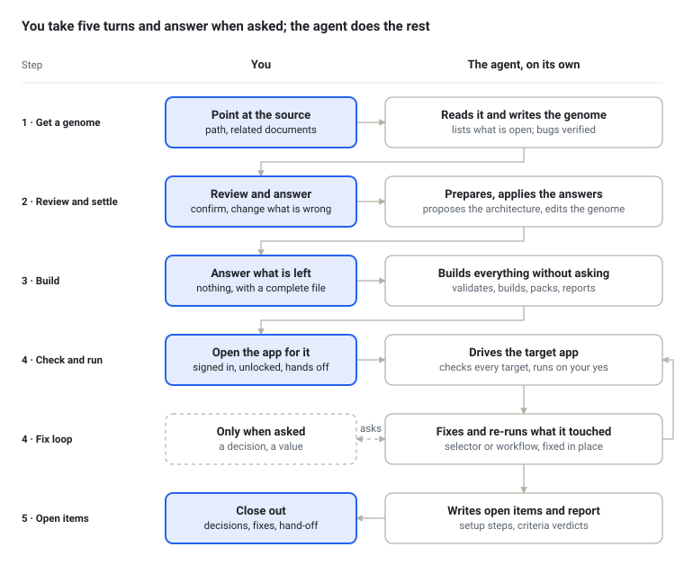
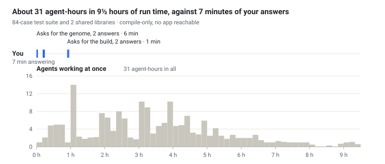

# Working with UiPath genomes

A genome is a plain-language blueprint of one automation, written in markdown. It says what the automation does step by step, its business rules, what happens when something fails, how to tell that it is done, and which UiPath skill builds each part. People review it, and agents build from it.

Two skills work with a genome:

- **`uipath-planner` writes it** from what you have: an idea, a process document, or an automation you already run. It also asks you the questions the genome leaves open, writes a solution design (SDD) when people need one, and makes every later change to the genome.
- **`uipath-genome` builds it.** It asks what is still open, hands each part to the UiPath skill that builds that product, and gives every acceptance criterion a verdict. It never changes the genome.

The genome says what to build. Each product's own skill knows how, and validates, builds and packs with the `uip` command line. Where the build can reach the real applications, it checks itself against them and fixes what fails.

That leaves you three things to focus on: the review of the design, the answers to its open questions, and the yes before anything runs on a real application.

Use a genome to:

- design a new automation from an idea, an SOP or a meeting transcript;
- document an automation you run, in words people review and agents act on;
- rebuild an existing automation onto the UiPath products that fit it.

## How this guide is laid out

| Part | Read it to |
| --- | --- |
| [1 · Understand](#part-1--understand) | Learn what a genome is, read one from top to bottom, and see who does what |
| [2 · The five steps](#part-2--the-five-steps) | Get a genome, settle its questions, build it, check it on the real application and hand it over |
| [3 · Existing automations](#part-3--existing-automations) | Document, rebuild or refactor something you already run |
| [4 · Reference](#part-4--reference) | Look up what to say, what a word means, and what to do when something is not as you expect |
| [5 · Background](#part-5--background) | See why the approach holds up, how it compares with other ways, and what real runs produced |

New to genomes? Read Part 1, then follow [A first run, start to finish](#a-first-run-start-to-finish). It needs no application and no existing automation.

The excerpts in this guide come from real runs, with their dates written as `<date>`. Agents word things differently every time, so compare the structure with what you get, not the sentences.

## Part 1 · Understand

### Why a genome

An agent asked to build an automation straight from a request has to guess what you meant, and its guesses end up in code, where nobody reviews them. A genome puts one reviewed document between understanding and building:

1. The agent writes down everything it understood, in plain words.
2. You read it, correct it and answer what it could not know.
3. The build follows it and is judged against it, criterion by criterion.

A wrong reading is then fixed in a text file before the build, not found after go-live. [Why it holds up](#why-it-holds-up) lists what else this buys.

### What a genome holds

A genome is a PDD (process definition document) and an SDD (solution design document) in one, written for the agent that builds it. When a solution design was agreed first, the genome is written from that design and names it. A person reviews it, so it is in plain words, with no activity or variable names, and file names only in its Source Map. An agent builds from it, so every section is there for something the build does:

| Question | Sections | What the build does with them |
| --- | --- | --- |
| What it is | Overview, Target Applications | Machine setup and network access go to the open items |
| How it is built | Build With, Platform Dependencies, Interface, Configuration Questions | Each part goes to its UiPath skill; the resources it declares and hands over (queues, assets, credentials, triggers, connections) are one table per kind, with how and where it runs; the open values are asked before anything is written |
| What is still to decide | Open Decisions | Asks the business outcomes and the missing material nobody has answered, and reports the other open entries as not confirmed |
| What it does | Workflow, Business Rules, Error Handling, Transactional Shape | Builds each step, rule and failure handler; asks how to split work done item by item |
| When it is done | Acceptance Criteria | Gives each numbered criterion a verdict in the completion report |
| Where it came from (extracted genomes only) | Source Map | Carries the UI targets and test data over from the source. In a genome of several projects whose rebuild changes the source's shape, its as-is process map draws the source as it runs, by the Process Map's rules, and marks what each part becomes: a project, part of another, or not rebuilt |

One project gives a **component genome**, a single file named `<name>-genome.md`. Two or more projects give a **process genome**: that file then holds the process map, the handoffs between the projects and the deployment, and each project has its own component genome in the folder `<name>-genome/` beside it.

Three excerpts from the genome of [the small run below](#what-a-run-looks-like), as written.

**A step** is behaviour: what goes in, what comes out, and each sub-step in order.

```text
8. **Look up the sleigh** (input: the request's Item Number; output: build year, model code, sleigh number, description, production date, delivery date):
   a. Accept the registry's notice when one is shown — Sleigh Registry library, Close Notice
   b. Search the Item Number — Sleigh Registry library, Search Sleigh No
   c. Close the result message — Sleigh Registry library, Close popup; when it fails with a detail that contains `There is no data`, apply the no-data rule (Business Rules, Step 8)
   d. Open the sleigh's details — Sleigh Registry library, Open Sleigh Details
   e. Read the six values — Sleigh Registry library, Get Data
```

**A source defect** is written down where it acts. When only the step's purpose shows what was meant, as here, it is kept as the source has it until you rule on it.

```text
**Source defect:** the subject names process number 069 in a process numbered 057. Evident intent: the subject names this process *[Inferred]*. The rebuild keeps the source's subject unless the user rules otherwise.
```

**An acceptance criterion** is specific enough to test.

```text
6. Given a request whose sleigh number the registry knows, the Sleigh Case List gains exactly one row with Created On as today's UTC date in month.day.year form, the sleigh number, description, model code, build year, production date and delivery date as the registry shows them, and Requested By as the sender's address.
```

### Read one, top to bottom

The fastest way to learn the format is to read a small genome in the order it is written. This one was written from a single paragraph:

> Every weekday at 07:00, download the euro foreign exchange reference rates the European Central Bank publishes, keep the rates for USD, GBP, CHF and RON, and e-mail them as a table to finance@contoso.com. If today's rates are not published yet, try again every 30 minutes until 10:00, then e-mail finance that they are missing.

Each section below says what it is for and what to check when you review it.

**Overview** says what the automation is for and how a run goes, in a few paragraphs. Check that it describes your process. Here the agent looked up when the rates are published, found that the request could not work as written, asked, and wrote down the answer:

```text
The ECB publishes each working day's rates at about 16:00 CET and publishes none on TARGET closing days. At 07:00 the rates finance expects are therefore those of the previous ECB working day.
```

**Target Applications** lists every system the automation reads from or acts on, with how it is reached. Check that none is missing and none is wrong.

**Build With** says which UiPath skill builds which steps, and why. Check the reason, since it is where the product choice is made:

```text
| 1–7 (whole process) | `uipath-rpa` | One unattended process: an HTTP download, XML reading, a date calculation, timed waits and a mail sent through an Integration Service connector activity. An RPA process on a serverless robot holds all of that in one project. A Maestro flow is only for coordination one run cannot hold, and nothing here outlives the run. An API workflow is meant for short runs, and this one can wait up to three hours. |
```

**Platform Dependencies** lists what the automation needs in Orchestrator and Integration Service: assets, credentials, queues, connections, triggers, one table per kind. Whoever deploys reads this.

**Interface** says what the automation takes in and gives back: arguments for a process, public workflows for a library.

**Configuration Questions** are the values the build needs and somebody must set. Each has a number that never changes, a kind and a default:

```text
1. Which mailbox or mailboxes receive the rates e-mail and the missing-rates notice? (setting; default: finance@contoso.com)
3. Which mailbox sends them, signed in through the connection? (setting; default: none)
5. Which currencies are kept, and in what order are they listed? (constant; default: USD, GBP, CHF, RON)
```

- A **setting** differs between environments (test, production), or must change without a new version. The build asks where settings are kept.
- A **constant** is the same in every environment, and changing it changes the automation.
- A default of `none` means the build cannot run without an answer. Question 3 above is needed before the build.

**Open Decisions** are the choices the description leaves to a person. This is the section to read most carefully:

```text
1. When one of the kept currencies is absent from the published file (the ECB has suspended a currency before), what is sent? (business outcome; answered by: the process owner; builds now: the rates e-mail with the currencies found, plus a line naming each absent currency; instead: the missing-rates notice, as if the day's rates were not published; instead: the rates e-mail with the absent currency's row reading "not published") — step 4, Keep the four currencies
```

Read an entry in four pieces:

1. **The question**, which nobody stated and the agent would otherwise have to guess.
2. **Its tier and its owner** (`business outcome; answered by: the process owner`): how much a wrong guess costs, and who decides.
3. **What is built until someone answers** (`builds now:`), then each alternative (`instead:`). The build never has to guess: until someone answers, it builds what the entry says. For missing material, that can be a placeholder or a stop.
4. **Where it acts** (`step 4`), so you can read the step it changes.

[Step 2](#2--review-it-and-settle-what-is-open) explains the tiers and how to answer.

**Workflow** is the automation step by step. Each step names what goes in and what comes out, then its sub-steps in order. A line the agent had to infer carries a mark that names the decision asking about it:

```text
4. **Keep the four currencies** (input: the list of currency and rate pairs; output: the rates table and the list of absent currencies):
   a. From the list keep only the currencies Configuration Question 5 names, in its order: USD, GBP, CHF, RON.
   b. Keep each rate as the text the file carries (for example 1.0989, 0.83305, 0.9233, 5.3482), with no rounding or recalculation.
   c. Each configured currency missing from the file goes into the list of absent currencies. *[Inferred: D1]*
```

`*[Inferred: D1]*` means: this line is the agent's reading, and Open Decisions entry 1 asks you about it. Once the entry is decided, the mark goes.

**Business Rules** holds the rules, each under the step where it acts, and the rules that hold throughout under General:

```text
### General
- Each run sends exactly one e-mail to finance: the rates e-mail or the missing-rates notice, never both and never more than one.
```

**Error Handling** says what happens when a step fails, again under its step:

```text
### Step 3: Download the daily reference rates
- The download fails (no connection, timeout after 60 seconds, an HTTP error) or the file cannot be read (no rate date, malformed content): the check counts as "not yet published". The run waits for the next check as in step 3d and keeps the last error for the missing-rates notice. A failure does not stop the run.
```

Check these against how the process behaves on a bad day, not a good one.

**Transactional Shape** matters when the automation works items one by one (invoices, rows, mails). It then describes the unit of work, how items are produced and consumed today, and the ways the work can be split, and the build asks you which split to use. This automation has no items, so the section says so:

```text
Not transactional: the run is one unit of work. One file is read and one e-mail is sent per run, and the four currencies are rows of that one e-mail, not items worked on their own.
```

**Acceptance Criteria** are the definition of done, numbered and specific enough to test. The build gives each one a verdict:

```text
8. Given a file with the expected rate date but no RON rate, the rates e-mail lists USD, GBP and CHF, plus the line "Not published by the ECB for {rate date}: RON".
```

Criterion 8 tests what Open Decisions entry 1 builds now. If you decide entry 1 differently, the agent changes step 4, the criterion and the e-mail text together.

**Source Map** is present only in a genome extracted from an existing automation. [Part 3](#part-3--existing-automations) covers it.

### The files you will meet

| File | What it is | Written by | What you do with it |
| --- | --- | --- | --- |
| `<name>-genome.md` | The genome | `uipath-planner` | Review it. Ask for changes in plain words |
| `<name>-genome/` | One genome per project, when there are several | `uipath-planner` | The same |
| `<name>-sdd.md`, or `<name>-solution-sdd.md` with one SDD per project | The same automation as a solution design for people, opening with every question still open. Written when you design from a process document, when you extract to document an automation, or when you ask for it | `uipath-planner` | Share it. Write answers after each `Answer` |
| `<name>-readiness.md` (optional) | The build's own questions and tasks, with the answers so far and the decisions still open | `uipath-genome`, with "Prepare the build" | Fill it in with the engineer and the system owners |
| A preferences file (optional) | Your team's standing answers and development standards | You, from the planner's `preferences-template.md` | Give it once |
| The projects | The automation itself | Each product's UiPath skill, through `uipath-genome` | Run, check, deploy |
| `<name>-handoff/` | The completion report, the setup steps for the target environment, and what is still to check on the real applications | `uipath-genome` | Read its `README.md` first |

### Who does what



*Who does what · the five steps of Part 2*

Blue boxes are your turns. Answer the questions ahead, in the SDD and in the readiness file when you prepare, and the build has little left to ask. Say "take the defaults" in the build request and it asks nothing.

Three things hold in every run:

1. **Only `uipath-planner` changes a genome.** The build never does. When the build finds the genome wrong, it reports it and offers the edit, which is made on your yes.
2. **Nothing reaches a tenant unless an answer allows it.** Publishing and deploying happen only when you ask. The one thing a build may create in the connected tenant is a Data Fabric entity it needs (one the genome names, or one that holds its records or test data), with its records. It asks first, and "take the defaults" counts as a yes.
3. **Nothing runs on a real application without your yes.**

## Part 2 · The five steps

### Before you start

- **What you have about the process.** A process document first (a PDD, an SOP, a runbook), then the automation itself, and any test evidence, recordings or tickets. The agent asks for them once and reads only what you give it.
- **Claude Code with the [UiPath skills](https://github.com/UiPath/skills).** Run `/uipath:install-permissions` once, so routine `uip` commands stop asking for approval.
- **A preferences file, when your team has standards.** It holds your standing answers: naming, project structure, logging, the template, where settings live. Give it once, and every genome and build follows it. Start one from the planner's `preferences-template.md`; a filled-in example: [migration-preferences.md](preferences-example/migration-preferences.md), with its [hand-off report example](preferences-example/handoff-report-example.html).
- **For live runs:** the target apps installed and signed in on this machine, the UiPath browser extension, and the Windows session unlocked.
- **A test environment.** Live runs create real records. Everything else stays on this machine, with one exception the build asks about: the Data Fabric entities it needs are created in the connected tenant. Nothing is published or deployed unless you ask.
- **Your rights.** Check that you have the rights to use with LLMs, including any third-party content they may contain:
  - the files or exports of an automation you extract, for the purpose of the extraction;
  - the genome, and the source of a genome extracted from an existing automation, for the purpose of building the automation in UiPath. The build reads that source again for its UI targets and test data.
- **Your setup.** Confirm that model hosting, data handling and coding agent configuration meet your organisation's requirements and respect rights reservations.

> **Tip.** Say in your request where the automation will run (Automation Cloud, Automation Suite and its version, or a standalone Orchestrator) when you know it. The product choice depends on it, and the agent asks when the request does not say.

### A first run, start to finish

This walk-through builds the genome you read in Part 1. It takes one paragraph of input and drives no application, so it works on any machine.

**1. Say what you want.** Start Claude Code in an empty folder and type the idea in your own words. Add that nothing should be built yet, so you can read the genome first:

```text
Write a genome for this automation, in this folder:

Every weekday at 07:00, download the euro foreign exchange reference rates the European Central Bank publishes, keep the rates for USD, GBP, CHF and RON, and e-mail them as a table to finance@contoso.com. If today's rates are not published yet, try again every 30 minutes until 10:00, then e-mail finance that they are missing.

Do not build anything in this run.
```

**2. Answer what changes the design.** Before it writes, the agent asks only the points that would change the product, the scope or the architecture. Everything else it writes into the genome as a question with a default. In this run it found one such point and offered to ask it:

```text
The request leaves 1 point open that changes the design: which rates count as "today's" when the ECB only publishes around 16:00 CET (this decides whether the 30-minute retry until 10:00 is needed at all). Should I ask it before I write? Everything else I write as questions in the genome, each with who answers it and what is built until then.

- Interview me (Recommended)
- No interview
```

The agent had checked the ECB's own page. As written, every run would have waited until 10:00 and sent the "missing" e-mail. Asked which rates the 07:00 run should expect, the answer was the previous working day's. The same batch asked where the automation will run and whether there is a preferences file.

What to learn from this: the agent checks facts it can check, and asks instead of choosing when your request and a fact disagree.

**3. Read what it wrote.** One file, `ecb-fx-reference-rates-genome.md`, and a closing message that tells you what is open:

```text
**Open decisions:** four, all for the process owner. Each has a fallback the build uses until it's answered, so none blocks the build.
[…]

**Configuration questions:** seven. Only question 3, which mailbox sends the e-mails, has no default, so it must be answered before the build. […]

To answer the open decisions, run `interview ecb-fx-reference-rates-genome.md`. If the answers come from someone outside this session, I can write an SDD for them instead. […]

Want to adjust anything?
```

Read the genome as [Part 1](#read-one-top-to-bottom) showed. If a step is wrong, say so in plain words ("step 6 should also name the last check's time") and the agent edits the file.

**4. Settle the open decisions.** Say "Interview me on the open questions". The agent first asks how you want to answer (every item, only what needs a decision, or the defaults), then asks each decision with its options, what the genome builds now among them. Your answers are written into the genome: each entry then reads `decided`, with the date and the answer, and the steps change where your answer differs from what was built.

**5. Build.** Say "Build `ecb-fx-reference-rates-genome.md`". The build asks the configuration values, each with the genome's default as its recommended answer (the sending mailbox has none), then its own questions, such as where the project goes and which mail activities to use. It then builds without stopping and ends with a hand-off folder. Open its `README.md` and read the Status section first: it says how many acceptance criteria are met and what is left to do before the first run.

**6. Decide what happens next.** The setup steps for your environment are in the hand-off folder. Nothing was published: say "Publish the solution" when you want that.

The five steps below cover each of these stages in full, with the choices you have at each one.

### 1 · Get a genome

**Goal:** a genome you can review, and a list of what is still open.

Say what you have. The agent writes the genome with `uipath-planner`, checks it, names the questions still open and asks what to change. Already have a genome? Go to step 2.

| You have | Say | The agent |
| --- | --- | --- |
| A PDD or another process document | "Design a solution from `<document>`" | Asks whether to decide on its own or pause at checkpoints for your review, and where the automation will run. Writes a solution design (SDD), then the genome of that design |
| An idea, SOP or transcript | "Write a genome for `<idea>`" | Offers to interview you first on what decides the design (the product, the scope), or asks up to three rounds of questions; either way also asks for your preferences file, unless your request names one or says there is none |
| A project or solution | "Extract a genome from `<folder>`" | Asks for related documents (PDD, SOP) and your preferences file, where the rebuild will run and whether to keep the parts nothing uses; for a UiPath project, also the Orchestrator folder it runs in. States its reading plan (in parts for a large project) and reads every file. Before it writes, it asks which UiPath product each part runs on, whether to fold a part that only re-reads another's output into that part, and, for a UiPath project, whether to retire an entry point that has not run |
| A UiPath project to refactor | "Refactor `<folder>`" | Extracts the genome with your refactor answers in it, waits for your edits, then builds |

A request can name its skill: "Use the `uipath-planner` skill to extract a genome from `<folder>`". Do that when the agent takes another route.

**What it asks before it writes.** As little as it can:

- **From a document or an idea**, it offers an interview on the points that change the design. It makes the offer only when such a point is open and someone is there to answer: not when a design run decides on its own, not from a solution design already agreed, and not in an unattended run. Accept it and it asks those points a few at a time; you can stop or take the defaults at any moment. Decline it and it asks a few questions of its own, in short rounds. A request can settle the offer ahead: "interview me before you write it" accepts it, and "do not interview me" declines it.
- **From an existing automation**, it never asks what the automation does: it reads it. It asks only for what sits beside the source (documents, a preferences file, where it runs), then the product for each part.

Whatever it does not ask, it writes down: a value becomes a Configuration Question with a default, and a choice becomes an Open Decisions entry with what is built until someone answers.

**What you get.**

- One genome per project: a spec of its steps, business rules, acceptance criteria and the UiPath skill that builds each part. With several projects, also an overview genome.
- An SDD beside it in three cases: you designed from a document, you extracted to document an automation, or you asked for one ("Write the SDD for `<name>-genome.md`"). It holds the same automation in the solution-design form people review, opening with every question still open. It is `<name>-sdd.md`, or `<name>-solution-sdd.md` with one SDD per project when there are several.
- Without an SDD, the genome holds the questions, and "Interview me on the open questions" asks them.

**How the run ends.** The closing message names the files, counts the open questions by kind and by who answers them, says how many must be answered before the build, and tells you how to answer: the interview, or an SDD for the people who are not in the session. It then asks "Want to adjust anything?".

**Changing it.** Ask in plain words ("step 4 is wrong: it should also …") and the agent edits the genome and writes any SDD again, keeping the answers you wrote in it. Only `uipath-planner` changes a genome: the build never does.

> **Common mistake.** Asking for the genome and the build in one request when you have not seen the genome yet. Add "Do not build anything in this run" to the first request, review, then build.

### 2 · Review it and settle what is open

**Goal:** a genome that says what you want built, with its questions answered by the people who own them.

This is your main decision point. The build follows the genome, and the agent never changes it while building.

#### Review in this order

1. **Acceptance criteria:** the definition of done, in the genome's Acceptance Criteria and in an SDD's Testing Strategy. Check that each one is testable on your data.
2. **Business decisions:** the Open Decisions, which open an SDD when there is one. These are the choices the source or the description leaves open, each with what the genome builds until someone decides.
   - Business outcomes come first. Among them are source defects you have not ruled on: bugs the agent found and verified in the source. By default the rebuild keeps the source's behaviour, bugs included, unless the source itself says what was meant (a comment, a log text, another copy of the step that does it), or you decide otherwise.
   - Then how a run behaves.
   - Then the agent's readings where the source is silent, each marked *[Inferred]* in the genome.
3. **Configuration values:** the values the build needs, such as URLs, accounts and settings, each with its default.
4. **Not covered:** parts of the source that no step rebuilds, in the Source Map's `Not covered` row and under Out of Scope in an SDD. Ask now if you want them.

To check a step against the original, the genome's Source Map names the part of the source each step came from. When a rebuild of several projects merges, splits or drops parts of the source, the Source Map's as-is process map shows the source as a whole, beside the Process Map.

#### The two kinds of question

A genome keeps its questions in two lists. They differ in what a blank costs.

| | Configuration Questions | Open Decisions |
| --- | --- | --- |
| Asks for | A value: an address, a folder, a name, a limit | A choice: what the automation should do |
| Cited as | `CQ3` | `D3` |
| Until answered | Built with its default. A default of `none`, or "not in the export", means the build needs the answer | Built as the entry says after `builds now:`, `recommended:`, `reading:` or `until answered:` |
| Answered by | The environment's owners for a setting, the process owner for a constant | The role the entry names |

Open Decisions come in four tiers, ordered by what a wrong guess costs:

| Tier | What it decides | Until someone answers | Does the build ask it? |
| --- | --- | --- | --- |
| Business outcome | What is written to a system, what is sent and to whom, which item is worked or skipped, an amount | Built as `builds now:` says. Nothing is recommended: the owner decides | Yes, in every build |
| Run behaviour | How a run counts, retries, recovers, stops, logs or reports | Built as the entry says is built now. The evident intent is the recommended option | No. The report lists it as not confirmed |
| Reading | A point the agent inferred that changes no outcome of its own: a purpose, a name, a format | Built as read | No. The report lists it as not confirmed |
| Material | A file or object the build needs and nobody supplied | A placeholder, or a stop, as the entry says | Yes |

Numbers never shift. An answered entry stays in the list and reads `decided`, so an answer written last week on a copy of the document still lands on the right item:

```text
2. Should a handled mail be marked read? (decided <date>: no — mails are left unread, as the source leaves them)
```

#### Who answers

Each item names a role, so one person's questions can be picked out:

| Role | Usually answers |
| --- | --- |
| The process owner | Business outcomes, rules, exceptions, scope, and values that are constants |
| Whoever knows the process | How a step is done today, and the agent's readings |
| Whoever holds the source | A missing file, export or document |
| The system's owner | How a system is reached, its accounts, a test instance |
| The environment's owners | Hosts, mailboxes, folders and schedules per environment |
| The delivery lead or the centre of excellence | Organisation standards, the preferences file |

#### Three ways to answer

**In the chat.** Say "Interview me on the open questions", or add a role ("the process owner's"). The interview goes like this:

1. It asks how you want to answer:
   - every item, a batch at a time;
   - only what needs a decision: the items with no default and the business outcomes;
   - the defaults, with any overrides you name: each value takes its default or yours, and each choice stays open, since a default nobody confirmed decides nothing;
   - not now: every item stays open.
2. It asks which roles you answer for, unless your request said ("I'm the process owner") or every item has the same owner. It then asks only those roles' items.
3. It asks up to four items at a time: items with no default first, then business outcomes, run behaviours, readings, material and values. While items remain, each batch offers "use the defaults for the rest".

A question looks like this. The first option is what is built now:

```text
D2 — Handled mails stay unread today, so every later run takes them again and re-queues or re-notifies. Should a handled mail be marked read?

- Leave unread (built now) — Keep the source's behaviour: mails stay unread and are taken again next run.
- Mark read when done — Mark each mail read once its outcome is recorded.
- Move to processed folder — Move each handled mail to a processed mailbox folder.
```

With no SDD and no readiness file, the interview asks the decisions only. The configuration values are asked when you build.

**In the SDD.** Share it with the people each item names. No SDD yet? Say "Write the SDD for `<name>-genome.md`". It opens with the questions, counted by who answers them, and each item has one answer line:

```text
**D7. How is the run started, and on how many robots?**
- **Context:** The project was never deployed and holds no trigger. It is unattended and takes the mail folder as a start argument.
- **See:** section 16, Deployment Environment
- **Options:**
  - a. A time trigger on one unattended robot, passing the mail folder. (built now)
  - b. Something else, in your words.
- **Answer (by whoever knows the process):**

**CQ3. Which credential asset signs in to the AP mailbox?**
- **Kind:** setting
- **Until answered:** built as an empty setting the run stops on. The source sets no password.
- **Answer (by the environment's owners):**
```

After `Answer`, write the letter of the option you choose, a value, `default` to keep a value's default, or your own words. An item left blank stays open.

**In a reply.** Paste what someone sent back ("D2: b. CQ3: the asset is called ApMailbox") and the agent matches each answer to its item by id. Two different answers to one item come back to you with both.

#### Apply the answers

Say "Apply the answers". The agent then:

- writes into the genome what each answer changes: the step, its rules, its criteria;
- marks each decided entry `decided`, with the date and the answer, and removes the *[Inferred]* marks it settled;
- writes any SDD again, keeping what is still open;
- keeps each configuration value where you wrote it, for the build to read.

An answer that keeps what the genome builds still decides its entry: it is confirmed, and no step changes. When the SDD came first (you designed from a document), an answer that changes the design updates the SDD first, and the genome follows.

If you skip this step, the build offers to do it before it asks anything.

#### Prepare the build (optional)

Prepare when someone else should answer the build's own questions, or you want to review the architecture before anything is built. On the machine that will build, say "Prepare the build of `<name>-genome.md`". The agent starts a build with `uipath-genome` (what is installed, which templates exist, where the source is) and asks each UiPath skill how it would build each capability the genome uses: mail, documents, spreadsheets, databases, applications, connectors. It reads the docs of the packages it would use, in a throwaway project, and looks on your tenant's feed for libraries earlier work published. It then asks you the build's questions, as many as you want to answer now, and writes `<name>-readiness.md` beside the genome with your answers and the rest, building nothing:

- **Architecture decisions**, each with its recommended option: how work done item by item is split, whether each library stays a package of its own, the technology for each capability (for mail: Microsoft 365 over Graph, or the desktop Outlook activities), how closely the rebuild follows the source. They are the build's answers and change nothing in the genome.
- **Genome edits:** the gaps it finds in the genome, each with its fix or its options. Applying the answers fixes them.
- **Build setup:** every other question the build would ask on that machine.
- **The systems to make reachable and the build environment**, each with a `Status:` line. Start these first: access takes the longest.
- **Decisions still open:** the questions nobody has answered yet, the SDD's, or the genome's when it has no SDD, so one file goes round.

An item in the readiness file reads like an SDD item, with the build's proposal marked and the answer's source written beside it:

```text
**R2. E-mail: which mail service sends the rates e-mail and the missing-rates e-mail?**
- **Context:** […] The genome's default is Microsoft Outlook 365 through an Integration Service connection. […]
- **See:** Target Applications; Platform Dependencies, Connections; Workflow steps 5 and 6; Configuration Question 6.
- **Options:**
  - a. Send Email (`UiPath.MicrosoftOffice365.Activities`) over the `EcbRatesMailbox` Integration Service connection. It sends an HTML body with the table, runs cross-platform and needs no app registration. (recommended)
  - b. Send SMTP Mail (`UiPath.Mail.Activities`), cross-platform. Needs an SMTP server, a port and a credential asset instead of the connection.
  - […]
- **Answer:** a (the user, in prepare, <date>)
```

Fill it in the same way, or say "Interview me on the open questions" with the file beside the genome: the interview then asks its blank items too, and offers the engineer and the architect among the roles. Then say "Apply the answers" again.

> **Check before you go on.** Every item that is needed before the build has an answer, or you know who will give it. Every business outcome is decided, or you accept what it builds now.

### 3 · Build

**Goal:** projects that validate and build, and a report that says how far each acceptance criterion is met.

Say "Build `<name>-genome.md`". The agent builds with `uipath-genome` and reads the answers in the SDD, when there is one, and in the readiness file when you prepared, as your answers.

#### What it asks

It asks only what those files leave blank, in batches of up to four. Most questions come with a recommended answer; a business decision comes with none, since its owner decides. With every item answered, the one question left is how the build runs its parts: in one session, or through subagents. A question whose options changed since the file was prepared (another machine, other packages) is asked again.

When the questions run past three batches, the first one is how you want to answer them, unless your request already said:

```text
The build has about 35 questions: the genome's 12 settings, 8 business decisions for you as process owner, the transaction design, and project setup. How do you want to answer them?

- Batch by batch
- Take the defaults
- Defaults + overrides
- Answer some, file rest
```

"Answer some, file rest" writes what you leave into the readiness file for other people, and the build stops there, as "Prepare the build" does.

The questions cover:

- the genome's open values (its Configuration Questions);
- the business decisions and the missing material nobody has answered;
- how to split work done item by item;
- the project: its location, Windows or cross-platform, the .NET version, XAML or C#, where settings live, package versions, where logs go;
- the technology for a capability the UiPath skill can build more than one way, such as mail or spreadsheets;
- whether it can reach the application and how far it may go there ([step 4](#4--check-run-and-fix)).

A rebuild as it is also asks how closely to follow the source; a refactor adds its own build questions ([Rebuilding an existing automation](#rebuilding-an-existing-automation)).

A business decision nobody has answered comes back as a question, with where it is in the source and what it affects, and once you agree, your answer goes into the genome before anything is built. How a run behaves, and the agent's readings, are built as the genome states them; the report lists those nobody confirmed.

The build asks where each project goes: a new folder beside the genome, or an existing project, which it recommends when your request names one. It copies a project before changing it, so the report can list every change. It also looks for libraries that already exist, in the build folder, at a path you name or on your tenant's feed, so a library built for an earlier process is reused instead of built twice, and it asks whether a library only one project uses stays a package of its own.

For a genome extracted from a project, you can take the source's value wherever the genome's default is a value the source holds, so only the values the source lacks, the choices it never had and the build setup are asked: pick that answer to the first question, or say "take the source's values" in the build request.

**With nobody to answer,** say "Build `<name>-genome.md`, take the defaults". The build asks nothing and takes each recommended option or default. The business decisions stay open: they are built as the genome builds them now, and the report lists each as not confirmed. Two things to know before you choose this. If the SDD or the readiness file holds answers that change the genome and were never applied, the build stops and names them: apply them first. And taking the defaults allows the one tenant write a build can make, creating the Data Fabric entities it needs.

#### What it does

Then it builds without stopping. A complex build runs in parts, by default at most two at once on a smaller model, unless you answered otherwise when it asked. The main session checks each part's result against the files.

#### What you get

- Projects that validate and build, with the libraries packed and the solution's pack tried on this machine.
- For a genome extracted from a project, the source's UI targets as Object Repository entries, each labelled *offline-unverified* until a check against the application makes it *verified* (a UiPath project's Object Repository is carried over as it is), test data from the source's rows, and one credential asset per login account, never a password.
- A hand-off folder, `<name>-handoff/`, beside the project or solution folder. Its `README.md` is the completion report.

The hand-off folder holds:

| File | What it holds |
| --- | --- |
| `README.md` | The completion report: status, next steps, your answers, a verdict on every acceptance criterion, the decisions the build made, where it differs from the genome, and what to expect on a first live run |
| `open-items.md`, `open-items/` | The setup steps for the target environment ([step 5](#5--open-items)) |
| `live-checks/` | For targets carried over from a source: what only the real application can settle, screen by screen |
| `correspondence/` | For a rebuild: where it departs from the source's names and shape, and why |
| `parity/`, `checkpoints/` | For a test suite: which assertion stands for each checkpoint of the source |
| `refactor-plan.md` | For a refactor: the decisions, the differences from the source and what is not proven until it runs |
| `reports/`, `integration-check.md` | What each project's build did, and the review of the projects against each other |

Every acceptance criterion gets one of five verdicts:

| Verdict | Means |
| --- | --- |
| Met | The code does it, and a run on this machine confirmed it |
| Met (static) | The code does it and validates, but the run needs a system that was out of reach |
| Partial | Built with a gap, which the report names |
| Not met | Nothing in the build addresses it |
| Not verifiable | Nothing the build contains can address it before a run: a manual act, or the target environment's own setup |

Read the report in this order: Status, Next steps, Acceptance criteria, then the decisions and the differences from the genome. A build with no application in reach ends mostly on Met (static). That is a finished build, not a tested one: [step 4](#4--check-run-and-fix) is where it gets tested.

### 4 · Check, run and fix

**Goal:** targets that match the real application, and runs that pass on it.

Before it builds, the agent asks whether it can reach the application, or a comparable test copy of it, and how far it may go there, unless the readiness file already says. The recommended answers are the cautious ones: not reachable, and a read-only check with no runs. [Live healing pass](live-healing-pass.md) lists what to tell it, what to ask before the first run, how to question a failure and what the final report must say.

**Prepare:** open the app in a test environment and sign in yourself, since the agent never types a password. Then keep off the mouse and keyboard: the agent takes over the screen, so a VM or a spare machine works best. When the application is only on another machine, ask for a remote session: the RPA skill then works on an Orchestrator unattended robot there. In your answer, name the window or URL it may use and what it must never close.

**The targets are checked.** Once the workflows are built, the agent goes through every Object Repository element on its screens without saving anything: it opens pages, menus and lists, types to show a popup, then cancels. It repairs each selector that doesn't match and lists the elements it could not reach. Some screens only appear with data the workflows pull from other systems, such as a record an upstream feed creates; the runs check those.

**The runs, only on your yes.** Allow them in your answer and name the test data they may change. The agent then runs the workflows and tests in debug mode, so a failure pauses on the failing step with the app left as it was, and fixes it:

| Failure | Fix |
| --- | --- |
| A control is not found | Repairs the selector on the paused app and saves it in the Object Repository, so every workflow that uses it gets the fix |
| An error in the logic | Fixes the workflow and checks it again |
| A step passes but missed | Treated as a failure: a control found only through a fallback, a read that came back empty while the screen showed something, a pick that landed on another entry |
| The genome is wrong | Notes it in the completion report, and asks you when the genome leaves a gap |

After each fix it re-runs what the fix touches and undoes a fix that breaks something that already worked; a failure it cannot fix goes into the completion report, and so does every change a run made in the application, with how to undo it. You answer only when asked: a decision or a missing value.

**No application within reach?** The build ends at projects that validate and build, and lists what only the application can settle, screen by screen, in `live-checks/` of the hand-off folder. A genome written from an idea has no targets to carry over: the report lists each placeholder target and the check it owes.

### 5 · Open items

**Goal:** an automation someone can deploy, with nothing left unsaid.

The hand-off folder holds two lists for you.

- **Setup for the target environment:** `open-items.md`, written when the environment needs any setup; a solution also gets one file per project under `open-items/`. It is a checklist for whoever deploys: folder and robots, packages, queues and assets, machine setup (apps, browser extension, network access), and triggers last. A refactor ends it with the cutover: shadow runs compared with the source, the write test, the switch, the rollback and what to retire. Credentials list the username only; the password is entered in Orchestrator.
- **Decisions for you:** in the completion report: criteria not yet met with the change each needs, rulings still owed, failures to expect on a live run, and corrections to the genome. Say "fix them": the agent fixes each one, re-runs what the fix touches, and undoes a fix that breaks a criterion already met. A genome correction is an edit to the genome, made by `uipath-planner`, then a rebuild.

Publishing is its own request. Say "Publish the solution" after the build: publishing and deploying happen only when you ask.

### Changing a genome later

A genome is kept current by asking, in plain words. The agent edits it in place, checks it, and writes its SDD again when it has one, keeping your answers.

| What changed | Say | What happens |
| --- | --- | --- |
| The behaviour you want | The change: "step 4 should also …" | The step, its rules and its criteria are edited together |
| The source automation (extracted genomes) | "The source changed" | Only the parts that changed are read again. Your edits stay unless the source now contradicts them, and the agent says which it kept |
| A part the genome left out (extracted genomes) | "Also translate what is not covered" | Those parts are read and added as steps |
| A document turned up (extracted genomes) | "Here is the PDD too" | It is read, and what it settles loses its *[Inferred]* mark. It never changes what the source does |
| The SDD's design sections, edited by a person | "The SDD was edited: update the genome" | For an SDD written from the genome: each change is applied to the genome, then the SDD is written again from it. When the SDD came first (you designed from a document), the SDD is the source: the design is revised, and the genome follows |
| You confirm every reading | "Remove the inferred flags" | Every mark goes, and each reading it named is decided |

After a change, build again and name the projects built before, in the request or in the readiness file. The build changes them in place, after taking a copy, and the report lists every change it made to them.

## Part 3 · Existing automations

A genome can be read out of an automation you already run. You then choose what to do with it:

| You want | Say | You get |
| --- | --- | --- |
| A document of what runs today | "Document `<folder>`: extract its genome" | A genome and its SDD. Nothing is built |
| The same automation, rebuilt as it is | "Extract a genome from `<folder>`", then build | A rebuild that keeps the source's names and shape, with every difference listed. A UiPath project is rebuilt as a refactor instead |
| The automation on the UiPath products that fit it | "Refactor `<folder>`" | A rebuild re-authored per product, proven beside the source before the switch |

### What extraction does

- **It reads every file,** in a plan it states first. A large source is read in parts.
- **It asks nothing about what the automation does.** It asks once for what sits beside it: a PDD or SOP, your preferences file, and for a UiPath project the Orchestrator folder it runs in, which it reads without changing anything.
- **It verifies every bug it suspects** in the source itself before writing it down as a defect.
- **It asks the product per part** before it writes. It also asks whether to fold a part that only re-reads another's output into that part and, for a UiPath project, whether to retire an entry point that has not run in the period it could read.
- **It writes where everything came from** in the Source Map, so nothing of the source is left behind unseen.

### What an extracted genome adds

**The Source Map** ties the genome to the source. It names the source and when it was read, the part of the source each step came from, and what no step rebuilds:

```text
| Not covered | none | The one entry point is covered |
| Unused | none | All three workflows are reached from `Main.xaml` |
| Finding S3 — total matched inside "Subtotal" | `ExtractInvoiceFields.xaml` line 25 | Source defect. […] Intent from the step's name "Total amount after 'Total'" only (D3) |
```

Check the `Not covered` and `Unused` rows when you review: they are the parts of the source the rebuild leaves out.

**Source defects** are bugs in the source. Each is written at the step where it acts, with what the source does and what it evidently meant to do. What the rebuild does with one depends on how the intent is known:

| The intent is | The rebuild | Your part |
| --- | --- | --- |
| Stated by the source: a comment, a log text or another copy of the step says what was meant | Does what was meant | When the fix changes no business outcome, an SDD lists it under "Defects the rebuild fixes": name any you want kept as the source has it. When it changes one, it is an open decision, built as meant until you rule |
| Shown only by what the step is for | Keeps the source's behaviour, bug included, until you rule | It is an open decision. Rule on it |

A ruling reads like any other answer. This defect was found in a project that reads invoice totals from PDF text:

```text
**Source defect:** `Total` is matched anywhere, so a `Subtotal` printed before the total is read as the total. Evident intent, from the step's purpose only: the invoice's total. User ruling (<date>): keep the source's matching — the first `Total` anywhere (D3).
```

Here the owner kept the source's behaviour. Either answer is theirs to give, and the genome records what was decided and when. To question a finding, say "Is this really a defect? Check it against the source".

### Not a one-to-one translation

A genome says what the automation does, not how the source did it. However closely a rebuild follows the source's steps, the mechanics underneath are written the UiPath way:

| In the source | In the UiPath build |
| --- | --- |
| One automation whose parts need different UiPath products, such as a flow that starts robot work | A project per product: a coordinator and the processes it starts, each built by its own UiPath skill |
| The same procedure copied into several automations | One library, packed and installed as a package by the projects that use it, when it takes more than one or a few activities |
| A loop over items with hand-made retries and status | Split as you choose: one process, a producer and a consumer, or one process with a queue; REFramework when picked |
| A target recorded per step or per window | One Object Repository element per control, shared by every step that uses it; a widget that repeats on many fields is one element that takes the field's label |
| A wait-and-check step after each action | Verification on the action itself; a separate check only where the outcome changes what happens next. A test's checkpoints stay assertions |
| Passwords and hosts in files or code | One credential asset per account; per-environment values as settings |

Kept as the source has it: every business rule, outcome and log line, the schedule and every output. The source's own log file is rebuilt only when a step reads it or you ask.

What changes is listed with its reason: a source defect fixed because the source states what was meant or you ruled so, a refactor answer, or a platform limit.

So the build is a rebuild, not a translation, yet easy to compare with the source. A [rebuild as it is](#rebuilding-an-existing-automation) also keeps the step names, and the shape wherever UiPath's way does not differ; by default a correspondence table records every step renamed, merged, split or dropped.

### Rebuilding an existing automation

A genome extracted from an existing automation is rebuilt in one of two ways, both keeping what [the source has](#not-a-one-to-one-translation).

**As it is.** The build keeps the source's step names, order and folders, so whoever knows the old automation can check the new one side by side. Every difference (a step renamed, merged, split, dropped or added) is a row of a correspondence table with its reason. The build asks how closely to follow:

1. Names, and the shape wherever UiPath's way does not differ (recommended): a workflow or loop whose work one or a few UiPath activities do becomes those activities, and the libraries left merge by application, each such change a row of the table.
2. Names and shape throughout.
3. The build's own names and grouping, with no table.

**As a refactor.** Every part is re-authored on the UiPath product its shape fits, and the build names its steps in the business's words. A UiPath project is rebuilt as a refactor; a smaller change is made in the project itself. The product is chosen for the shape, never as an upgrade, and every capability it relies on is checked first:

| Its steps | UiPath product |
| --- | --- |
| Screens, or work only the robot's machine reaches | RPA process, Portable unless an activity exists only for Windows |
| Connector and HTTP calls, a short run of few steps | API workflow |
| Connector and HTTP calls in a long run, with waits, or with every run inspectable step by step | Maestro flow |
| Items worked one by one, each retried and reported on its own | An RPA process that takes the queue and starts each item's connector and HTTP work as an API workflow |
| A step that waits for a person | A task in Action Center inside a long-running RPA process, or the coordinator's own human task |
| Waits of days, events or timers, parallel branches, or several automations that run on their own | Maestro flow, BPMN process or case |
| A rule table, a document-extraction model, judgment no rule decides, code several parts call | A decision table, extraction model, agent or function of its own, when the business maintains it apart, it is trained, or several parts call it |

A refactor is proven before the switch, with a way back:

1. **Questions**, in two places. Before the genome is written, per part: rebuild or retire it (retire only when its owner confirms nobody uses it), fold it into another when it only re-reads what that part already knew, and the product it runs on; the answers are in the genome you review. At the build, after the genome's own questions: a ruling on each source defect still open, whether to build a shadow mode and a write-test mode, how a run reports what it did, and which identity each connection signs in as.
2. **A plan**, written before any project exists: the decisions, every output the rebuild produces differently with its reason, the outputs it keeps, and what cannot be proven until it runs.
3. **Tests first.** Before a step's logic is written, its tests pin what the source does for every rule and branch, texts compared word for word; recorded runs are replayed when you have them.
4. **Shadow.** The rebuild runs beside the source on the same inputs and records what it would write instead of writing it; a comparison lists each item as the same, different as the plan expects, or to look at.
5. **Write test.** One item written for real and read back.
6. **Switch**, in one change window: the source's triggers off and its jobs finished first, so two implementations never write at once; a rollback ready; the source kept deployed until it is retired.

A change needs a reason: a source defect, your ruling, a refactor answer or a platform limit, each a row of the plan. A retried write first checks that it has not already gone through.

How far it is proven: target plans checked on small cases, and one component rebuilt with all 62 of its tests passing. A full refactor built end to end and a shadow run against a live source have not been done yet.

### Keeping a documented automation current

A genome extracted to document an automation goes stale when the automation changes. Say "The source changed": the agent finds what differs from the source the Source Map records, reads those parts again and rewrites only the steps they touch. Your edits elsewhere stay. When projects were added, removed or regrouped, the extraction runs again from the start and keeps the edits the source does not contradict.

## Part 4 · Reference

### What to say

Each use case is a few requests in a row. Steps 1 to 5 say what each request does and what you get from it.

| You want to | Say | Then |
| --- | --- | --- |
| Design a new automation from a process document | "Design a solution from `<document>`" | Review the solution design (SDD) it writes, then steps 2 to 5 for the genome of that design |
| Build from a solution design already agreed | "Write a genome from `<sdd>`" | Steps 2 to 5 |
| Build from an idea, an SOP or a transcript | "Write a genome for `<idea>`" | Steps 2 to 5 |
| Try a product on a scenario of its own, for a demo or a workshop | "Propose a demo scenario with `<product>`" | Pick a scenario; its genome is reviewed and built like any other |
| Document an automation you run | "Document `<folder>`: extract its genome" | A genome and its SDD. Review it (step 2); nothing is built. When the automation changes, say "The source changed": the agent reads again the parts that changed |
| Rebuild an existing automation as it is | "Extract a genome from `<folder>`" | Steps 2 to 5; the build asks how closely to follow the source ([Rebuilding an existing automation](#rebuilding-an-existing-automation)) |
| Rebuild an existing test suite | "Extract a genome from `<folder>`" | Steps 2 to 5: a test project whose cases assert each checkpoint the source checked, or list it as not asserted, with the reason |
| Refactor a UiPath project | "Refactor `<folder>`" | Steps 2 to 5, with the plan, the tests written first and the cutover ([As a refactor](#rebuilding-an-existing-automation)) |
| Change an automation built from a genome | The change, in plain words: "step 4 should also …" | The genome is updated, and its SDD when it has one, your answers kept. Build again (step 3), naming the projects built before in the request or in the readiness file: the build changes them in place, and the report lists every change made to them |
| Get the questions answered by other people | Share the SDD (no SDD yet: "Write the SDD for `<name>-genome.md`" first), or say "Interview me on the open questions" with the person beside you | "Apply the answers" writes them into the genome and the SDD |
| Get the build's own questions answered ahead | "Prepare the build of `<name>-genome.md`" on the machine that will build, then share the readiness file | "Apply the answers", then build: it asks nothing the files answer |
| Change answers after the build was prepared | Edit the SDD or the readiness file, then "Prepare the build" again | Your changes stay; a decision whose recommendation rests on an answer you changed is drawn again, and an answer that chose the option the change replaced is cleared |
| Build on another machine than the one prepared | "Build `<name>-genome.md`" on that machine | The file's answers hold; a question whose options are not the same there (other packages installed) is asked again |
| Build with nobody to answer | "Build `<name>-genome.md`, take the defaults" | The build asks nothing and takes each recommended option or default; the business decisions stay as the genome builds them, and the report lists each default it took and each decision nobody confirmed |
| Get a solution design (SDD) for a genome that has none | "Write the SDD for `<name>-genome.md`" | The SDD beside the genome, opening with the questions still open |
| Check a genome you were given | "Check `<name>-genome.md`" | One line per problem found; the genome is not changed. Ask for the fixes as changes |
| Publish what was built | "Publish the solution", after the build | Publishing and deploying happen only when you ask, never as part of the build |

### Words used in this guide

| Word | Meaning |
| --- | --- |
| Acceptance criterion | One numbered, testable statement of done. The build gives each a verdict |
| Component genome | The genome of one project |
| Configuration Question (`CQ3`) | A value the build needs, with its kind (setting or constant) and its default |
| Hand-off folder | `<name>-handoff/`, written by the build: the completion report and everything the person who deploys needs |
| *[Inferred]* | The mark on a line the agent had to infer. It names the decision that asks about it: `*[Inferred: D3]*` |
| Interview | The agent asking you the open questions in the chat, a few at a time |
| Open Decision (`D3`) | A choice left to a person, with who answers it and what is built until then |
| Owning skill | The UiPath skill that builds one kind of project: `uipath-rpa`, `uipath-maestro-flow` and the others. Build With names it per step |
| PDD | Process definition document: the process as people do it. It is input; the agent never writes one |
| Preferences file | Your team's standing answers and development standards, given once |
| Process genome | The genome of an automation with several projects: the map, the handoffs and the deployment, with one component genome per project |
| Readiness file | `<name>-readiness.md`, written by "Prepare the build": the build's questions and tasks, and the decisions still open |
| Ruling | Your decision on a source defect: fix it, or keep the source's behaviour |
| SDD | Solution design document: the automation as a design for people, opening with the open questions |
| Source defect | A bug found and verified in the source of an extracted genome |
| Source Map | The section of an extracted genome that says where each step came from and what was left out |
| Transactional Shape | The section that describes work done item by item, and the ways it can be split into projects and queues |
| Verdict | What the build says about one acceptance criterion: met, met (static), partial, not met or not verifiable |

### When something is not as you expect

**The agent started building before I saw a genome.** Add "Do not build anything in this run" to the request. A refactor request otherwise continues into the build once the genome is written and your edits are in.

**The agent took another route and wrote no genome.** Name the skill: "Use the `uipath-planner` skill to write a genome for …".

**It asks more than I can answer.** You have three ways out. Give a preferences file, which answers what it covers in every run. Take the defaults: "use the defaults for the rest" in an interview batch, or "take the defaults" at the build. Or answer what you know and have the build write the rest into the readiness file for someone else.

**I do not know an answer.** Do not guess. Leave it open and send the SDD, or the readiness file, to the person the item names. A business outcome nobody decided is built as the genome says and reported as not confirmed.

**The build asks values the genome already has.** A default is a proposal, not an answer. The build asks each configuration value, with the genome's default as the recommended option. To skip them, answer them ahead in the SDD or the readiness file, or pick "take the defaults" when the build asks how you want to answer. A question a file answers is asked again only when its options differ on the machine that builds.

**The build says the genome is wrong.** It does not fix the genome itself, and what it does depends on the problem. A genome that lacks a required section is not built: the build names the section and stops. A gap that needs a choice is asked as a question, and your answer is offered as an edit to the genome. Any other gap is built with the fix the build states, and listed under the report's differences from the genome. In each case `uipath-planner` makes the correction, on your yes. Then build again.

**Someone edited the genome by hand.** Say "Check `<name>-genome.md`" to find what the edit broke: a number that shifted, a mark that names no entry, an SDD that no longer matches. Asking for the change in words avoids this, since the agent keeps the numbering, the marks and the SDD in step.

**Someone edited the SDD's design sections.** Say "The SDD was edited: update the genome". For an SDD written from the genome, the genome is the source, so the change goes into it first. When the SDD came first, the SDD is the source: the design is revised, and the genome is brought in line with it.

**Two people answered the same item differently.** The agent brings both answers back to you and waits for your ruling.

**There is no application to test against.** Build anyway. The criteria end on met (static), and the hand-off says what the application must still confirm: `live-checks/` for targets carried over from a source, and the report's list of placeholder targets for a genome written from an idea. Run [step 4](#4--check-run-and-fix) when the application is in reach.

**Where did the passwords go?** Nowhere. The build never copies a secret. It declares one credential asset per account, with the username in the open items, and the password is entered in Orchestrator.

## Part 5 · Background

### Why it holds up

Reading and building are checked apart, with you in between:

1. **A checkpoint before any code.** Everything the agent understood is plain text you review before the build starts. A wrong reading is fixed in the genome, not found after go-live.
2. **Hidden rules written down.** Rules that live in error handlers, default values and settings files are read like any step and written at the step where they act, so the review sees them.
3. **Judged against the genome.** Expected outcomes come from the genome and, for an existing project, its source, never from what the build produced, so a test cannot pass by agreeing with the build. Whether the results match the source's is for whoever can compare runs; the build ships the table that makes the comparison possible.
4. **Every fix checked again.** After a fix, every run and test it touches runs again. A fix that breaks a criterion already met is undone, and the report gives the final build's verdicts.
5. **Nothing left behind unseen.** Every part of the source is rebuilt or named in the Source Map for your review, as not covered, unused or dead code, and each checkpoint of a test suite is asserted or listed as not asserted, with the reason.

### How it compares

| | Convert step by step | One-shot AI rewrite | Spec-first coding tools | A genome build |
| --- | --- | --- | --- | --- |
| Starts from the automation you have | Yes | Yes | No: specs the next change | Yes, or from an idea |
| A plain-language spec, reviewed before the build | No | No | Yes | Yes |
| Rules in error handlers, defaults and settings written down | Copied, not shown | Often lost | Not read | Yes, where they act |
| Built the target's way, not the old shape | No: same shape | Yes | Yes | Yes |
| Gaps marked, not guessed | Unmapped steps flagged | No: filled with guesses | Yes | Yes |
| Done is judged criterion by criterion | No: it compiles | No: its own tests pass | The spec's tests | Yes: a verdict on each, and tests that assert where the source checked |

**Where another way is enough:** a one-shot rewrite for a small automation someone knows well. Keeping the old shape is no reason to convert: a [rebuild as it is](#rebuilding-an-existing-automation) keeps the step names and the shape, hidden rules included. The genome costs a review turn and hours of agent time. It pays off when the rules are many, hidden, or must be proven.

### What a run looks like

**A small one.** One existing process: 458 steps, 23 screen elements and 5 systems (two web applications, a mailbox, two workbooks). Run on 9 Nov 2026; the figures are counted from its files and session logs.

| Stage | What came of it |
| --- | --- |
| One sentence, then 17 minutes of agent time | A genome: one file for the process and one for each of its three components (the process, and a library per web application), with 4 source defects written down |
| About 30 questions before the build | Among them: how to build the queue, a ruling on a source defect, whether the two libraries become packages of their own, whether the applications can be reached, and how closely to follow the source |
| 78 minutes of agent time | 3 projects that validate and build: the process on the REFramework template and 2 UI libraries, packed |
| The hand-off | 46 of 49 acceptance criteria met by the code as built, 3 partial, none confirmed by a run. 20 screen elements translated offline, with 27 checks still owed on the real applications. 34 setup steps for the target environment. Nothing created or published in a tenant |

The applications were out of reach, so nothing was run: every verdict is static, and the live checks are the next step.

**A large one.**



*Session logs of one run · 7–8 Oct 2026 · agents per 10 minutes of active time*

This run was checked in code, not on screen: no app was reachable. The live-run loop comes from a separate 7-step run with three live runs, where the agent fixed every failure itself and your part was under a minute of decisions.

The chart is measured from the session logs of one run: an 84-case test suite and 2 shared libraries, rebuilt from an existing test suite. Your 7 minutes count only the time from each question to your answer. Not counted: the notes and answers files prepared before the run, the time spent reviewing the genome, and the decisions handed back after.

What that run produced:

| Output | Count |
| --- | --- |
| Genome | 9 files, 6,300 lines: 2 library genomes with 169 steps, 6 test groups with 84 cases |
| Projects | 2 shared libraries and 1 test project, all building with 0 errors, packed |
| Workflows | 351: 222 in the libraries, which hold each app step once, and 129 in the test project, whose 84 cases call them |
| UI targets | 343 Object Repository elements on 71 screens of 14 applications, carried over from the source and not yet confirmed on screen |
| Test checks | all 487 source checkpoints carried over, plus 69 added |
| Acceptance criteria | 334 assessed: 286 built but not yet run on screen, 5 met by a run that needs no app, 43 partial, 0 not met |
