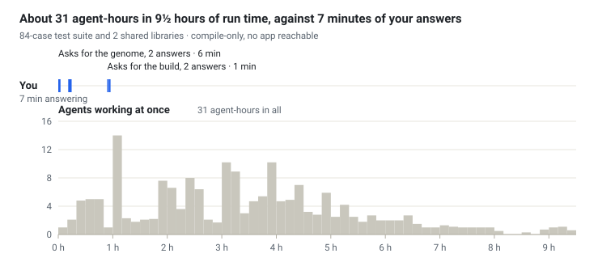
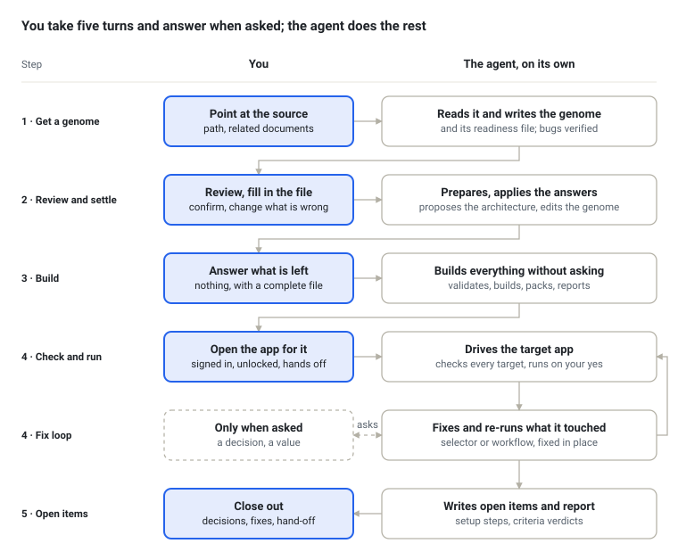

# Working with UiPath genomes

A genome is a plain-language blueprint of an automation, in markdown. Two skills work with it. `uipath-planner` writes it from what you have about your process. `uipath-genome` runs the build: it asks what is still open, hands each part to the UiPath skill that builds it, and gives every acceptance criterion a verdict. The genome says what to build; each product's own skill knows how, and validates, builds and packs with the `uip` command line. Where the build can reach the real applications, it checks itself against them and fixes what fails.

That leaves you three things to focus on: the review of the genome, the answers to its questions, and the yes before anything runs on a real application.

Use a genome to document an automation you run, in words people review and agents act on; to design a new one from an idea, an SOP or a meeting transcript; or to rebuild an existing automation onto the UiPath products that fit it.

## What a genome holds

A genome is a PDD and an SDD in one, written for the agent that builds it. When a solution design (SDD) was agreed first, the genome is written from that design and names it. A person reviews it, so it is in plain words, with no activity or variable names, and file names only in its Source Map. An agent builds from it, so every section is there for something the build does:

| Question | Sections | What the build does with them |
| --- | --- | --- |
| What it is | Overview, Target Applications | Machine setup and network access go to the open items |
| How it is built | Build With, Platform Dependencies, Interface, Configuration Questions | Each part goes to its UiPath skill; the open values are asked before anything is written |
| What it does | Workflow, Business Rules, Error Handling, Transactional Shape | Builds each step, rule and failure handler; asks how to split work done item by item |
| When it is done | Acceptance Criteria | Gives each numbered criterion a verdict in the completion report |
| Where it came from (extracted genomes only) | Source Map | Carries the UI targets and test data over from the source |

One project gives a component genome. Two or more give a process genome, with the process map, the handoffs between the projects and the deployment, plus one component genome per project.

Three excerpts from the genome of [the small run below](#what-a-run-looks-like), as written.

**A step** is behaviour: what goes in, what comes out, and each sub-step in order.

```text
8. **Look up the sleigh** (input: the request's Item Number; output: build year, model code, sleigh number, description, production date, delivery date):
   a. Accept the registry's notice when one is shown — Sleigh Registry library, Close Notice
   b. Search the Item Number — Sleigh Registry library, Search Sleigh No
   c. Close the result message — Sleigh Registry library, Close popup; when it fails with a detail that contains `There is no data`, apply the no-data rule (Business Rules, Step 8)
   d. Open the sleigh's details — Sleigh Registry library, Open Sleigh Details
   e. Read the six values — Sleigh Registry library, Get Data
```

**A source defect** is written down where it acts, and kept as the source has it until you rule on it.

```text
**Source defect:** the subject names process number 069 in a process numbered 057. Evident intent: the subject names this process *[Inferred]*. The rebuild keeps the source's subject unless the user rules otherwise.
```

**An acceptance criterion** is specific enough to test.

```text
6. Given a request whose sleigh number the registry knows, the Sleigh Case List gains exactly one row with Created On as today's UTC date in month.day.year form, the sleigh number, description, model code, build year, production date and delivery date as the registry shows them, and Requested By as the sender's address.
```

## Not a one-to-one translation

A genome says what the automation does, not how the source did it. However closely a rebuild follows the source's steps, the mechanics underneath are written the UiPath way:

| In the source | In the UiPath build |
| --- | --- |
| One automation whose parts need different UiPath products, such as a flow that starts robot work | A project per product: a coordinator and the processes it starts, each built by its own UiPath skill |
| The same procedure copied into several automations | One library, published to a feed and installed as a package, when it is more than one or a few activities do |
| A loop over items with hand-made retries and status | Split as you choose: one process, a producer and a consumer, or one process with a queue; REFramework when picked |
| A target recorded per step or per window | One Object Repository element per control, shared by every step that uses it; a widget that repeats on many fields is one element that takes the field's label |
| A wait-and-check step after each action | Verification on the action itself; a separate check only where the outcome changes what happens next. A test's checkpoints stay assertions |
| Passwords and hosts in files or code | One credential asset per account; per-environment values as settings |

Kept as the source has it: every business rule, outcome and log line, the schedule and every output; the source's own log file is rebuilt only when a step reads it or you ask. What changes is listed with its reason: a source defect fixed because the source states what was meant or you ruled so, a refactor answer, or a platform limit. So the build is a rebuild, not a translation, yet easy to compare with the source: a [rebuild as it is](#rebuilding-an-existing-automation) also keeps the step names, and the shape wherever UiPath's way does not differ, and by default a correspondence table records every step renamed, merged, split or dropped.

## Why it holds up

Reading and building are checked apart, with you in between:

1. **A checkpoint before any code.** Everything the agent understood is plain text you review before the build starts. A wrong reading is fixed in the genome, not found after go-live.
2. **Hidden rules written down.** Rules that live in error handlers, default values and settings files are read like any step and written at the step where they act, so the review sees them.
3. **Judged against the genome.** Expected outcomes come from the genome and, for an existing project, its source, never from what the build produced, so a test cannot pass by agreeing with the build. Whether the results match the source's is for whoever can compare runs; the build ships the table that makes the comparison possible.
4. **Every fix checked again.** After a fix, every run and test it touches runs again. A fix that breaks a criterion already met is undone, and the report gives the final build's verdicts.
5. **Nothing left behind unseen.** Every part of the source is rebuilt or named in the Source Map for your review, as not covered, unused or dead code, and each checkpoint of a test suite is asserted or listed as not asserted, with the reason.

## How it compares

| | Convert step by step | One-shot AI rewrite | Spec-first coding tools | A genome build |
| --- | --- | --- | --- | --- |
| Starts from the automation you have | Yes | Yes | No: specs the next change | Yes, or from an idea |
| A plain-language spec, reviewed before the build | No | No | Yes | Yes |
| Rules in error handlers, defaults and settings written down | Copied, not shown | Often lost | Not read | Yes, where they act |
| Built the target's way, not the old shape | No: same shape | Yes | Yes | Yes |
| Gaps marked, not guessed | Unmapped steps flagged | No: filled with guesses | Yes | Yes |
| Done is judged criterion by criterion | No: it compiles | No: its own tests pass | The spec's tests | Yes: a verdict on each, and tests that assert where the source checked |

**Where another way is enough:** a one-shot rewrite for a small automation someone knows well. Keeping the old shape is no reason to convert: a [rebuild as it is](#rebuilding-an-existing-automation) keeps the step names and the shape, hidden rules included. The genome costs a review turn and hours of agent time. It pays off when the rules are many, hidden, or must be proven.

## Rebuilding an existing automation

A genome extracted from an existing automation is rebuilt in one of two ways, both keeping what [the source has](#not-a-one-to-one-translation).

**As it is.** The build keeps the source's step names, order and folders, so whoever knows the old automation can check the new one side by side. Every difference (a step renamed, merged, split, dropped or added) is a row of a correspondence table with its reason. The build asks how closely to follow:

1. Names, and the shape wherever UiPath's way does not differ (recommended): a workflow or loop whose work one or a few UiPath activities do becomes those activities, and the libraries left merge by application, each such change a row of the table.
2. Names and shape throughout.
3. The build's own names and grouping, with no table.

**As a refactor.** Every part is re-authored on the UiPath product its shape fits, and the build names its steps in the business's words. A UiPath project is rebuilt as a refactor; a smaller change is made in the project itself. The product is chosen for the shape, never as an upgrade, and every capability it relies on is checked first:

| Its steps | UiPath product |
| --- | --- |
| Screens, or work only the robot's machine reaches | RPA process, Portable unless an activity exists only for Windows |
| Connector and HTTP calls, a short run of few steps | API workflow |
| Connector and HTTP calls in a long run, with waits, or with every run inspectable step by step | Maestro flow |
| Items worked one by one, each retried and reported on its own | An RPA process that takes the queue and starts each item's connector and HTTP work as an API workflow |
| A step that waits for a person | A task in Action Center inside a long-running RPA process, or the coordinator's own human task |
| Waits of days, events or timers, parallel branches, or several automations that run on their own | Maestro flow, BPMN process or case |
| A rule table, a document-extraction model, judgment no rule decides, code several parts call | A decision table, extraction model, agent or function of its own, when the business maintains it apart, it is trained, or several parts call it |

A refactor is proven before the switch, with a way back:

1. **Questions**, in two places. Before the genome is written, per part: rebuild or retire it (retire only when its owner confirms nobody uses it), fold it into another when it only re-reads what that part already knew, and the product it runs on; the answers are in the genome you review. At the build, after the genome's own questions: a ruling on each source defect still open, whether to build a shadow mode and a write-test mode, how a run reports what it did, and which identity each connection signs in as.
2. **A plan**, written before any project exists: the decisions, every output the rebuild produces differently with its reason, the outputs it keeps, and what cannot be proven until it runs.
3. **Tests first.** Before a step's logic is written, its tests pin what the source does for every rule and branch, texts compared word for word; recorded runs are replayed when you have them.
4. **Shadow.** The rebuild runs beside the source on the same inputs and records what it would write instead of writing it; a comparison lists each item as the same, different as the plan expects, or to look at.
5. **Write test.** One item written for real and read back.
6. **Switch**, in one change window: the source's triggers off and its jobs finished first, so two implementations never write at once; a rollback ready; the source kept deployed until it is retired.

A change needs a reason: a source defect, your ruling, a refactor answer or a platform limit, each a row of the plan. A retried write first checks that it has not already gone through.

How far it is proven: target plans checked on small cases, and one component rebuilt with all 62 of its tests passing. A full refactor built end to end and a shadow run against a live source have not been done yet.

## What a run looks like

**A small one.** One existing process: 458 steps, 23 screen elements and 5 systems (two web applications, a mailbox, two workbooks). Run on 9 Nov 2026; the figures are counted from its files and session logs.

| Stage | What came of it |
| --- | --- |
| One sentence, then 17 minutes of agent time | A genome: one file for the process and one for each of its three components (the process, and a library per web application), with 4 source defects written down |
| About 30 questions before the build | Among them: how to build the queue, a ruling on a source defect, whether the two libraries become packages of their own, whether the applications can be reached, and how closely to follow the source |
| 78 minutes of agent time | 3 projects that validate and build: the process on the REFramework template and 2 UI libraries, packed |
| The hand-off | 46 of 49 acceptance criteria met by the code as built, 3 partial, none confirmed by a run. 20 screen elements translated offline, with 27 checks still owed on the real applications. 34 setup steps for the target environment. Nothing created or published in a tenant |

The applications were out of reach, so nothing was run: every verdict is static, and the live checks are the next step.

**A large one.**



*Session logs of one run · 7–8 Oct 2026 · agents per 10 minutes of active time*

This run was checked in code, not on screen: no app was reachable. The live-run loop comes from a smaller run (7 steps, three live runs), where the agent fixed every failure itself and your part was under a minute of decisions.

The chart is measured from the session logs of one run: an 84-case test suite and 2 shared libraries, rebuilt from an existing test suite. Your 7 minutes count only the time from each question to your answer. Not counted: the notes and answers files prepared before the run, the time spent reviewing the genome, and the decisions handed back after.

What that run produced:

| Output | Count |
| --- | --- |
| Genome | 9 files, 6,300 lines: 2 library genomes with 169 steps, 6 test groups with 84 cases |
| Projects | 2 shared libraries and 1 test project, all building with 0 errors, packed |
| Workflows | 351: 222 in the libraries, which hold each app step once, and 129 in the test project, whose 84 cases call them |
| UI targets | 343 Object Repository elements on 71 screens of 14 applications, carried over from the source and not yet confirmed on screen |
| Test checks | all 487 source checkpoints carried over, plus 69 added |
| Acceptance criteria | 334 assessed: 286 built but not yet run on screen, 5 met by a run that needs no app, 43 partial, 0 not met |

## Who does what



*Who does what · the five steps below*

Blue boxes are your turns. Say "take the defaults" in the build request and the questions turn goes away.

## Before you start

- **What you have about the process.** A process document first (a PDD, an SOP, a runbook), then the automation itself, and any test evidence, recordings or tickets. The agent asks for them once and reads only what you give it.
- **Claude Code with the [UiPath skills](https://github.com/UiPath/skills).** Run `/uipath:install-permissions` once, so routine `uip` commands stop asking for approval.
- **For live runs:** the target apps installed and signed in on this machine, the UiPath browser extension, and the Windows session unlocked.
- **A test environment.** Live runs create real records. Everything else stays on this machine, with one exception the build asks about: Data Fabric entities the genome names are created in the connected tenant. Nothing is published or deployed unless you ask.

## 1 · Get a genome

Say what you have. The agent writes the genome with `uipath-planner`, checks it and asks what to change. Already have a genome? Go to step 2.

| You have | Say | The agent |
| --- | --- | --- |
| A PDD or another process document | "Design a solution from `<document>`" | Asks whether to decide on its own or pause at checkpoints for your review, and where the automation will run. Writes a solution design (SDD), then the genome of that design |
| An idea, SOP or transcript | "Write a genome for `<idea>`" | Asks up to three rounds of questions |
| A project or solution | "Extract a genome from `<folder>`" | Asks for related documents (PDD, SOP), where the rebuild will run and whether to keep the parts nothing uses; for a UiPath project, also the Orchestrator folder it runs in. States its reading plan (in parts for a large project) and reads every file. Before it writes, it asks per part whether to fold it into another and which UiPath product it runs on; for a UiPath project, also whether to retire it |
| A UiPath project to refactor | "Refactor `<folder>`" | Extracts the genome with your refactor answers in it, waits for your edits, then builds |

A request can name its skill: "Use the `uipath-planner` skill to extract a genome from `<folder>`".

You get one genome per project — a spec of its steps, business rules, acceptance criteria and the UiPath skill that builds each part — plus an overview genome when there are several. Ask for changes in plain words ("step 4 is wrong") and the agent edits the file. Only this skill changes a genome: the build never does.

## 2 · Review it

This is your main decision point. The build follows the genome, and the agent never changes it while building. Read these parts, in this order:

1. **Acceptance criteria** — the definition of done. Check that each one is testable on your data.
2. **Lines marked *[Inferred]*** — the agent's best reading where the source is silent. Confirm or correct them.
3. **Source defects** — bugs the agent found and verified in the source. By default the rebuild keeps the source's behaviour, bugs included, unless a comment or log text in the source says what was meant, or you decide otherwise. The agent lists the ones that need your decision.
4. **Configuration questions** — the values the build will ask you for, such as URLs, accounts and settings. Check the list now; you answer it in step 3.
5. **Not covered** — parts of the source that no step rebuilds. Ask now if you want them.

To check a step against the original, the Source Map names the part of the source each step came from.

## 3 · Build

Say "Build `<name>-genome.md`". The agent builds with `uipath-genome`, and asks its questions first, in batches of up to four, each with a recommended answer: the genome's open values, how to split work done item by item, the project location, XAML or C#, where settings live, package versions, and whether it can reach the application and how far it may go there ([step 4](#4--check-run-and-fix)). A rebuild as it is also asks how closely to follow the source; a refactor adds its own build questions ([Rebuilding an existing automation](#rebuilding-an-existing-automation)).

A source defect that needs your ruling comes back as a question, with where it is in the source and what it affects. The build also looks for projects that already exist, so a library built for an earlier process is reused instead of built twice, and asks whether each library becomes a package of its own.

For a genome extracted from a project, you can take the source's value wherever the genome has one, so only the values the source lacks, the choices it never had and the build setup are asked: pick that answer to the first question, or say "take the source's values" in the build request.

Then it builds without stopping. A large build runs in parts, at most two at once, on a smaller model, and the main session checks each part's result against the files.

You get:

- projects that validate and build, with the libraries packed and the solution's pack tried on this machine;
- for a genome extracted from a project, the source's UI targets as Object Repository entries, each labelled *offline-unverified* until a check against the application makes it *verified* (a UiPath project's Object Repository is carried over as it is), test data from the source's rows, and one credential asset per login account, never a password;
- a hand-off folder, `<name>-handoff/`, beside the project or solution folder. Its `README.md` is the completion report, with a verdict on every acceptance criterion: met, met (static) (built and validated, not yet run because the run needs a system out of reach), partial, not met, or not verifiable.

## 4 · Check, run and fix

Before it builds, the agent asks whether it can reach the application, or a comparable test copy of it, and how far it may go there. The recommended answers are the cautious ones: not reachable, and a read-only check with no runs. [Live healing pass](live-healing-pass.md) lists what to tell it, what to ask before the first run, how to question a failure and what the final report must say.

**Prepare:** open the app in a test environment and sign in yourself, since the agent never types a password. Then keep off the mouse and keyboard: the agent takes over the screen, so a VM or a spare machine works best. When the application is only on another machine, the RPA skill can work on an Orchestrator unattended robot there through a remote session. In your answer, name the window or URL it may use and what it must never close.

**The targets are checked.** Once the workflows are built, the agent goes through every Object Repository element on its screens without saving anything: it opens pages, menus and lists, types to show a popup, then cancels. It repairs each selector that doesn't match and lists the elements it could not reach. Some screens only appear with data the workflows pull from other systems, such as a record an upstream feed creates; the runs check those.

**The runs, only on your yes.** Allow them in your answer and name the test data they may change. The agent then runs the workflows and tests in debug mode, so a failure pauses on the failing step with the app left as it was, and fixes it:

| Failure | Fix |
| --- | --- |
| A control is not found | Repairs the selector on the paused app and saves it in the Object Repository, so every workflow that uses it gets the fix |
| An error in the logic | Fixes the workflow and checks it again |
| A step passes but missed | Treated as a failure: a control found only through a fallback, a read that came back empty while the screen showed something, a pick that landed on another entry |
| The genome is wrong | Notes it in the completion report, and asks you when the genome leaves a gap |

After each fix it re-runs what the fix touches and undoes a fix that breaks something that already worked; a failure it cannot fix goes into the completion report, and so does every change a run made in the application, with how to undo it. You answer only when asked: a decision or a missing value.

**No application within reach?** The build ends at projects that validate and build, and lists what only the application can settle, screen by screen, in `live-checks/` of the hand-off folder.

## 5 · Open items

The hand-off folder holds two lists for you.

- **Setup for the target environment:** `open-items.md`, written when the environment needs any setup; a solution also gets one file per project under `open-items/`. It is a checklist for whoever deploys: folder and robots, packages, queues and assets, machine setup (apps, browser extension, network access), and triggers last. A refactor ends it with the cutover: shadow runs compared with the source, the write test, the switch, the rollback and what to retire. Credentials list the username only; the password is entered in Orchestrator.
- **Decisions for you:** in the completion report: criteria not yet met with the change each needs, rulings still owed, failures to expect on a live run, and corrections to the genome. Say "fix them": the agent fixes each one, re-runs what the fix touches, and undoes a fix that breaks a criterion already met. A genome correction is an edit to the genome, made by `uipath-planner`, then a rebuild.
