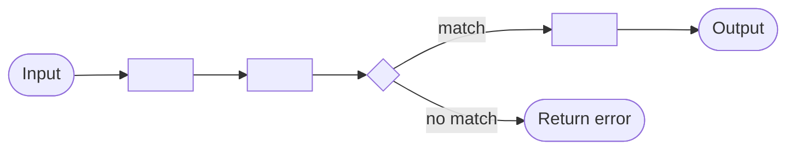

# Solution Design Document — <API_WORKFLOW_NAME>

<!-- Template: UiPath API Workflows — serverless, bot-less, synchronous request-response integrations.
     Phase 2 sections: §2, §3, §4, §5, §10. Phase 3 sections: all others. -->

---

## Document History

| Date | Version | Author | Role | Comments |
|---|---|---|---|---|
| <DATE> | 1.0 | <AUTHOR> | Generated by AI Agent | Initial SDD generated from PDD |

---

<!-- DO NOT RENAME: uipath-planner detects SDDs via this exact heading or the marker below. -->
<!-- planner-handoff:v1 -->
## Planner Handoff

| Field | Value |
|---|---|
| **Status** | <draft \| ready — the genome is written only from ready> |
| **Execution autonomy** | <autonomous \| interactive> |
| **Delivery model** | <cloud \| automation-suite <VERSION_IF_KNOWN> \| standalone \| unspecified> |
| **SDD scope** | <single-product \| solution> |
| **Solution root SDD** | <PATH_TO_SOLUTION_ROOT_SDD — solution scope only; omit all four solution rows for single-product> |
| **Solution ID** | <SOLUTION_NAME_KEBAB> |
| **Project SDD role** | child |
| **Independently executable** | no — built only through the Solution root |
| **Project list section** | §10 Project Structure + §5 Connectors |
| **Generated by** | uipath-planner |
| **Generation date** | <YYYY-MM-DD> |
| **Template validation** | <pending \| passed — set to passed when the template check passes, whatever the Status> |
| **Genome** | <path — written by the genome turn; omit this row in the SDD write> |

---

<!--
EMIT THIS BLOCK ONLY in an autonomous run or a caller's design request (sdd-writing-guide.md Step 4 item 3).
Non-RPA scope: Platform constraints, Scope and the product row.
-->
## Decisions Made

> The architectural decisions below were picked without a user checkpoint. Override by editing the relevant SDD section, or rerun in Interactive mode.

| # | Decision | Picked | One-sentence reason |
|---|---|---|---|
| 1 | **Platform constraints** (Constraint Gate) | <DELIVERY_MODEL; BLOCKED_PRODUCTS_OR_NONE> | <REASON> |
| 2 | **Scope** (Level 1) | <SINGLE_PRODUCT_OR_SOLUTION_COMPOSITION> | <REASON> |
| 3 | **Primary consumer** | <AGENT_TOOL_OR_FLOW_NODE_OR_CASE_TASK_OR_EXTERNAL_HTTP> | <REASON_FROM_PDD> |

---

<!--
EMIT THIS BLOCK ALWAYS (both execution modes).
Durable copy of the Phase 1 Recommended Scope summary — the SDD record of the
Constraint Gate outcome. See scope-recommendation-guide.md → Summary block for the full format.
-->
## Recommended Scope

**Recommendation:** <SINGLE_PRODUCT | SOLUTION(<PRODUCT_1>, ...)>
**Delivery model:** <cloud | automation-suite <version-if-known> | standalone | unspecified — assumed cloud [SME REVIEW]>
**Blocked by platform:** <PRODUCT → ALTERNATIVE_APPLIED (matrix | user exclusion), ... | none>
**Need profile:** <ONE_LINE_CORE_NEED_AND_TARGET_KPI>

---

<!--
EMIT THIS BLOCK ONLY when at least one [SME REVIEW] item remains after Step 3 resolution.
Skip entirely when no review items are open. Once the genome is written, uipath-planner writes this
section again from it, with every open question. See open-questions-guide.md for the item form.
Build prerequisites: sdd-writing-guide.md § Writing Rules.
-->
## Action Required — SME Review Items

<COUNT> questions are open: <COUNT_NEEDED> needed before the genome is written, the rest with a default applied in its section.

**D1. <QUESTION>**
- **Context:** <WHAT_IS_UNKNOWN>
- **See:** <SECTION>
- **Options:**
  - a. <DEFAULT_APPLIED> (built now)
  - b. <ANOTHER_OPTION>
- **Answer (by <ROLE>):**

**D2. <QUESTION_WITH_NO_DEFENSIBLE_DEFAULT>**
- **Context:** <WHAT_IS_UNKNOWN>
- **See:** <SECTION>
- **Until answered:** the SDD stays `draft` and no genome is written
- **Answer (by <ROLE>):**

> Each item is marked `[SME REVIEW] D<n>` in its section. A default-carried item blocks neither the genome nor the build: the automation is built on the option marked `(built now)`, or a value item's `Default:`, which must be verified before production sign-off. An item with an `Until answered:` line keeps the handoff at `Status: draft`.

---

## Table of Contents

1. API Workflow Overview
2. Input Schema
3. Output Schema
4. Execution Flow
5. Connectors & External Calls
6. Error Handling
7. Performance & Scaling
8. Security & Authentication
9. Consumers
10. Project Structure
11. Testing Strategy
12. Next Steps

---

<!-- planner-sdd-body:v1 -->
## 1. API Workflow Overview

| Field | Value |
|---|---|
| **API Workflow name** | <API_WORKFLOW_NAME> |
| **Objective** | <OBJECTIVE> |
| **Primary use case** | <COMPOSITE_SERVICE / DATA_RETRIEVAL / DATA_TRANSFORMATION / INTEGRATION> |
| **Invocation pattern** | Synchronous request-response |
| **Expected latency** | <MILLISECONDS_OR_SECONDS> |
| **Expected throughput** | <CALLS_PER_MINUTE> |
| **Source PDD** | <PATH_OR_LINK_TO_PDD> |

### In Scope

- <CAPABILITY_1>

### Out of Scope

- <CAPABILITY_1>

### Assumptions

<!-- Assumptions the design relies on. Verify before build; promote to [SME REVIEW] if unconfirmed. -->

- <ASSUMPTION_1>
- <ASSUMPTION_2>
- <ASSUMPTION_3>

---

## 2. Input Schema

<!-- The parameters the caller provides. A table only: the JSON schema is uipath-api-workflow's. -->

| Field | Type | Required | Description | Example |
|---|---|---|---|---|
| <FIELD_NAME> | <string / number / boolean / object / array> | <YES/NO> | <DESCRIPTION> | `<EXAMPLE_VALUE>` |

### Sample Input

```json
{
  "<FIELD_NAME>": "<EXAMPLE_VALUE>"
}
```

---

## 3. Output Schema

<!-- JSON schema for the data returned to the caller. -->

| Field | Type | Always Present | Description | Example |
|---|---|---|---|---|
| <FIELD_NAME> | <TYPE> | <YES/NO> | <DESCRIPTION> | `<EXAMPLE_VALUE>` |

### Sample Output

```json
{
  "<FIELD_NAME>": "<EXAMPLE_VALUE>"
}
```

---

## 4. Execution Flow

<!-- The logical steps and data flow, never code: the scripts are uipath-api-workflow's. -->



### Step Details

<!-- One row per step, one kind of work per row. Step Kind says what the step does; the activity that performs it is uipath-api-workflow's choice, never named here.
     - Decide (routes on a condition and produces nothing: a value a later step needs is produced by a Compute row before it)
     - Repeat (works a list item by item; Notes names the steps it repeats)
     - Compute (derives, converts, ranks or assembles values the workflow already holds)
     - Call (invokes one connector operation, HTTP endpoint or component of §5, and names it)
     - End (returns the output of §3 or an error of §6, and nothing else) -->

| # | Step | Step Kind | Input | Output | Notes |
|---|---|---|---|---|---|
| 1 | <STEP_NAME> | <STEP_KIND> | <INPUT_FIELDS> | <OUTPUT_FIELDS> | <NOTES> |

---

## 5. Connectors & External Calls

### Integration Service Connectors

| Connector | Operation | Called In Step | Input | Output |
|---|---|---|---|---|
| <CONNECTOR_NAME> (Workday/Zendesk/Salesforce/etc.) | <OPERATION> | <STEP_NUMBER> | <INPUT> | <OUTPUT> |

### Direct HTTP Calls

<!-- Used when no connector exists for the target system. -->

| Target | Method | Endpoint | Called In Step | Purpose |
|---|---|---|---|---|
| <SYSTEM_NAME> | <GET/POST/PUT/DELETE> | <ENDPOINT_URL> | <STEP_NUMBER> | <PURPOSE> |

### Integration Service Connections

<!-- Consolidated view of every Integration Service connection and how it is provisioned: reuse an existing Integration Service connector, custom-build a connector, or call the system over direct HTTP. Access Method values: `Integration Service — <CONNECTOR_SLUG>`, `Custom connector — <CONNECTOR_SLUG>`, or `Direct HTTP`. Ties the Integration Service Connectors and Direct HTTP Calls tables above to an explicit access method. Build prerequisites: sdd-writing-guide.md § Writing Rules. -->

| Connector | System | Access Method | Used By |
|---|---|---|---|
| <CONNECTOR_NAME> | <SYSTEM> | <ACCESS_METHOD> | <STEPS> |

### Build Assumptions

<!-- What this design needs a product to be able to do, beyond what this template states (sdd-writing-guide.md § Writing Rules). One row per capability; its owning skill confirms it at build, before the steps that rely on it are built. `None.` when the design relies on nothing unconfirmed. -->

| # | The Design Relies On | Relied On By | Confirmed By | If It Does Not Hold |
|---|---|---|---|---|
| A1 | <CAPABILITY_IN_PLAIN_WORDS> | <STEPS_OR_COMPONENTS> | `<OWNING_SKILL>` | <FALLBACK_STEP_OR_COMPONENT> |

---

## 6. Error Handling

### Known Error Scenarios

| Error Type | Source | HTTP Status to Return | Response Body |
|---|---|---|---|
| <VALIDATION_ERROR> | Input validation | 400 | `{ "error": "<MESSAGE>" }` |
| <EXTERNAL_FAILURE> | Connector/HTTP call fails | 502 | `{ "error": "<MESSAGE>" }` |
| <NOT_FOUND> | Upstream resource missing | 404 | `{ "error": "<MESSAGE>" }` |

### Retry Policy

<!-- Failure wording: sdd-writing-guide.md § Writing Rules. Every row names one §4 step. -->

| Operation | What Must Happen |
|---|---|
| <OPERATION> | <ATTEMPTS_AND_WAIT_THEN_OUTCOME> |

---

## 7. Performance & Scaling

| Metric | Target |
|---|---|
| p50 latency | <MILLISECONDS> |
| p99 latency | <MILLISECONDS> |
| Max throughput | <CALLS_PER_SECOND> |
| Max payload size (input) | <BYTES> |
| Max payload size (output) | <BYTES> |

**Note:** API Workflows run on a serverless runtime that auto-scales. Optimization focuses on external call latency, not compute.

---

## 8. Security & Authentication

### Authentication to the API Workflow

<!-- Who may call this workflow, with what identity, and what they may do. How callers authenticate is uipath-api-workflow's. -->

| Caller (§9) | Calls As | Allowed To |
|---|---|---|
| <CALLER> | <USER_OR_SERVICE_IDENTITY> | <WHAT_THEY_MAY_DO> |

### Authentication to External Systems

<!-- The identity each external call is made with and the credential it uses (a §5 connection or an asset). How it authenticates is the owning skill's. -->

| External System | Calls As | Credential |
|---|---|---|
| <SYSTEM_NAME> | <IDENTITY> | <CONNECTION_OR_ASSET_NAME> |

### Rate Limits

| Scope | Limit |
|---|---|
| Per caller | <CALLS_PER_MINUTE> |
| Global | <CALLS_PER_SECOND> |

### Non-Functional Requirements (supplement)

<!-- Performance / scaling → §7; security / auth → §8 above. These are the remaining cross-cutting NFRs. Fill each row; use [SME REVIEW] where unconfirmed. -->

| Dimension | Requirement / Design decision |
|---|---|
| **Availability / Resilience** | <serverless auto-scale (§7); idempotency so caller retries are safe; what happens on a failed call per §6 Retry Policy> |
| **Logging & Monitoring** | <request / response logging excluding sensitive fields; alerting on error-rate spikes; Insights / Orchestrator dashboards> |
| **Compliance** | <REGULATION_OR_—> |

---

## 9. Consumers

<!-- Who calls this API workflow? -->

| Consumer Type | Consumer Name | Usage Pattern |
|---|---|---|
| <AGENT / FLOW / CASE_MANAGEMENT / EXTERNAL_SYSTEM> | <NAME> | <WHEN_AND_WHY> |

---

## 10. Project Structure

<!-- The API workflow project is scaffolded by uipath-api-workflow, which owns its files and folders: never draw a file tree here. -->

**API workflow project:** `<API_WORKFLOW_PROJECT_NAME>` — built by `uipath-api-workflow`.

### Deployment Target

- Runs in **Orchestrator**, called by agents, flows or external callers

### Solution / Project Breakdown

<!-- Every buildable project in the solution: its product, source repo, Orchestrator folder, and run mode. One row per project (single row for a single-project solution). -->

| Project | Product (RPA / API / Agent / …) | GitHub Repository | Folder | Attended / Unattended |
|---|---|---|---|---|
| <PROJECT_NAME> | <PRODUCT> | <GIT_URL_OR_REPO> | <FOLDER_PATH> | <ATTENDED / UNATTENDED / N-A> |

### Reusable Components

<!-- Components reused from an existing library vs. new reusable components this build will publish. -->

| Type (reused / new-reusable) | Name | Details |
|---|---|---|
| reused | <COMPONENT_NAME> | <SOURCE_LIBRARY_AND_VERSION> |
| new-reusable | <COMPONENT_NAME> | <WHAT_IT_ENCAPSULATES_AND_CONSUMERS> |

### Environments (DEV / UAT / PROD)

<!-- Per-environment Orchestrator/tenant and folder targets. Fill with [SME REVIEW] if the deployment team has not confirmed. -->

| Item | DEV | UAT | PROD | Used By |
|---|---|---|---|---|
| Orchestrator + Tenant/Service | <URL_OR_TENANT> | <URL_OR_TENANT> | <URL_OR_TENANT> | <PROJECTS_OR_ALL> |
| Folder | <FOLDER_PATH> | <FOLDER_PATH> | <FOLDER_PATH> | <PROJECTS_OR_ALL> |

---

## 11. Testing Strategy

### Canonical Test Cases

| Test ID | Input | Expected Output | Expected Latency |
|---|---|---|---|
| T-01 | `<INPUT_JSON>` | `<OUTPUT_JSON>` | < <MILLISECONDS> |

### Error Path Tests

| Test ID | Input | Expected HTTP Status | Expected Error Body |
|---|---|---|---|
| T-E1 | `<INVALID_INPUT>` | 400 | `<EXPECTED_ERROR>` |

### Load Tests

<!-- For high-throughput API workflows. -->

| Scenario | Load Profile | Success Criteria |
|---|---|---|
| <SCENARIO> | <CALLS_PER_SECOND_AND_DURATION> | <p99_LATENCY_AND_ERROR_RATE> |

---

## 12. Next Steps

This SDD captures architecture and decisions. To build it, load `uipath-planner` with this SDD path:

> Load `uipath-planner`. SDD path: `<this-file>`.

**Build from the genome.** Once this SDD is approved, ask `uipath-planner` for its genome or for the build: it writes the genome beside this SDD (`author`), and `uipath-genome` builds every component from that genome through each component's owning skill. Without `uipath-genome` installed, the genome stays on disk for a later build.

Implementation steps **do not live in this SDD** — the genome carries them.

---

**End of Solution Design Document.**
