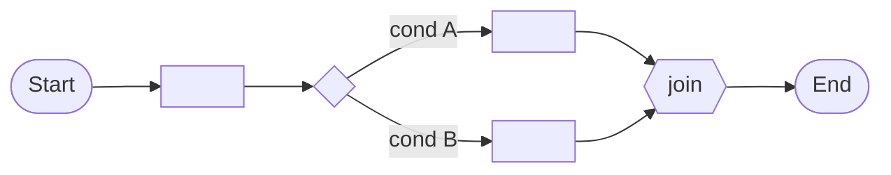

# Solution Design Document — <PROCESS_NAME>

<!-- Template: Maestro BPMN — BPMN 2.0 process orchestration over RPA, agents, API workflows, connectors and HITL.
     Layout: chapters 1–10 follow the PDD's order and say what the solution does, for the people who approve it; chapter 11 holds the BPMN wiring the build reads. Each fact has one home: a later chapter names an earlier one's rows, never restates them.
     Phase 2 sections: §2, §3, §4, §5, §6, §11. Phase 3 sections: all others. -->

---

## Document History

| Date | Version | Author | Role | Comments |
|---|---|---|---|---|
| <DATE> | 1.0 | <AUTHOR> | Generated by AI Agent | Initial SDD generated from PDD |

---

<!-- DO NOT RENAME: uipath-planner detects SDDs via this exact heading or the marker below. -->
<!-- planner-handoff:v1 -->
## Planner Handoff

| Field | Value |
|---|---|
| **Status** | <draft \| ready — the genome is written only from ready> |
| **Execution autonomy** | <autonomous \| interactive> |
| **Delivery model** | <cloud \| automation-suite <VERSION_IF_KNOWN> \| standalone \| unspecified> |
| **SDD scope** | <single-product \| solution> |
| **Solution root SDD** | <PATH_TO_SOLUTION_ROOT_SDD — solution scope only; omit all four solution rows for single-product> |
| **Solution ID** | <SOLUTION_NAME_KEBAB> |
| **Project SDD role** | child |
| **Independently executable** | no — built only through the Solution root |
| **Project list section** | §2 Steps + §6 Systems and Integrations |
| **Generated by** | uipath-planner |
| **Generation date** | <YYYY-MM-DD> |
| **Template validation** | <pending \| passed — set to passed when the template check passes, whatever the Status> |
| **Genome** | <path — written by the genome turn; omit this row in the SDD write> |

---

## Table of Contents

1. Solution Overview
2. Solution Flow
3. Business Rules and Decisions
4. Data
5. People and Human Tasks
6. Systems and Integrations
7. Exceptions and Error Handling
8. Running the Solution
9. Testing and Acceptance
10. Design Decisions
11. Build Specification
12. Next Steps

---

<!-- planner-sdd-body:v1 -->
## 1. Solution Overview

| Field | Value |
|---|---|
| **Process name** | <PROCESS_NAME> |
| **Objective** | <OBJECTIVE> |
| **Department / Function** | <DEPARTMENT> — <FUNCTION> |
| **Solution** | <ONE_SENTENCE: the product that carries the process and why — §10> |
| **Source PDD** | <PATH_OR_LINK_TO_PDD> |
| **Open questions** | <COUNT — listed in Action Required at the end of this document \| none> |

### In Scope

- <ACTIVITY_1>

### Out of Scope

- <ACTIVITY_1>

### Assumptions

<!-- Assumptions the design relies on. Verify before build; promote to [SME REVIEW] if unconfirmed. -->

- <ASSUMPTION_1>
- <ASSUMPTION_2>
- <ASSUMPTION_3>

---

## 2. Solution Flow

<!-- Build from the Phase 1 extracted steps. One diagram node per Steps row; label nodes with the step's description, not its key.
     Show decisions as diamonds, parallel branches with fork/join, timeouts and caught failures annotated. -->

### Steps

<!-- List every step in execution order: one row per step, one kind of work per row. The planner (`author`) builds the genome's components and steps from this table.
     Step Kind says what the step does; the BPMN element that performs it is uipath-maestro-bpmn's choice, never named here.
     - Start (one row per way the process starts: manual, scheduled, message)
     - Compute (derives, converts, groups, ranks or assembles values the process already holds)
     - Call (invokes one component of §6 — a process, agent, API workflow, connector operation, function or extraction model — and names it in Integrated Component)
     - Rule (evaluates one decision table of §3; its rules project is a row of §6 Business Rules Projects)
     - Human (a person decides, corrects or supplies data; the run waits for them, so a path that must not wait for people holds none; also a row of §5 Human Tasks)
     - Subprocess (groups the steps §11 Subprocesses lists, once or per item)
     - Call process (starts a separate process instance, §11 Call Activities)
     - End (one row per way the process ends; it does no work: a record written or a notice sent is a Call row before it) -->

| # | Node Key | Step Kind | Description | Inputs | Outputs | Integrated Component | Notes |
|---|---|---|---|---|---|---|---|
| 1 | `start` | Start | <DESCRIPTION> | — | — | — | Starts on: <MANUAL/SCHEDULED/MESSAGE> |
| 2 | `<NODE_KEY>` | <STEP_KIND> | <DESCRIPTION> | <INPUTS> | <OUTPUTS> | <§6_COMPONENT_NAME or —> | <NOTES> |

---

## 3. Business Rules and Decisions

### Decision Tables

<!-- references/design/business-rules-guide.md → Decision tables. Each decision runs in a Rule step (§2 Steps); gateways (§11) route on its output. Validation rules go in §4. Empty: `None. No rule decides an outcome.` -->

#### DT1 — <DECISION_NAME>
**Hit policy:** <UNIQUE / FIRST / COLLECT>
**Inputs:** `<INPUT_NAME>` (<string / number / boolean / date>), …
**Output:** `<OUTPUT_NAME>` (<TYPE_AND_ALLOWED_VALUES>)
**Runs in:** `<RULE_STEP_NODE_KEY>`

| # | <INPUT_NAME> | <INPUT_NAME> | → <OUTPUT_NAME> | Rule |
|---|---|---|---|---|
| 1 | <ENTRY> | <ENTRY> | <OUTPUT> | <BR_ID> |

### Rules That Need Reasoning

<!-- references/design/business-rules-guide.md → Rules that need reasoning. Agent: a Call step naming the agent. Person: a Human step, also in §5 Human Tasks. Empty: `None. Every rule is deterministic.` -->

| ID | Rule | Applied by | Inputs → Output | Where it runs |
|---|---|---|---|---|
| <BR_ID> | <RULE> | <Agent / Person> | <INPUTS> → <OUTPUT> | `<NODE_KEY>` |

---

## 4. Data

### Data the Process Carries

<!-- Every value the process carries between steps. Role: `given at start` (whatever starts the run supplies it; a scheduled start supplies nothing), `working` (a step sets it, later steps read it) or `result` (what the run leaves when it ends; it may be read on the way). Type is the kind of value — text, number, yes/no, date-time, list, record — never a product type. Set By is the one step that writes it; a value two steps write is two values. Where a value lives is the build's: state no scope. A validation business rule (regex / range / type / allowed values) goes in Description, prefixed with its BR ID. -->

| Name | Role | Type | Set By | Read By | Description |
|---|---|---|---|---|---|
| <VAR_NAME> | <given at start / working / result> | <KIND_OF_VALUE> | `<NODE_KEY_OR_—>` | `<NODE_KEYS>` | <DESCRIPTION> |

---

## 5. People and Human Tasks

### Roles

<!-- Who owns which steps: one row per role, each §2 step under exactly one role. Whether roles are drawn as pools or lanes is uipath-maestro-bpmn's choice, never stated here. -->

| Role / Participant | Owns Steps (node keys) | Notes |
|---|---|---|
| <ROLE> | <NODE_KEYS_FROM_§2> | <NOTES> |

### Human Tasks

<!-- One row per human step. uipath-maestro-bpmn builds it inline — never route it to uipath-human-in-the-loop. Record business intent only
     (who acts, what they decide); the BPMN specialist owns the task schema. -->

<!-- Every decision names the step the process continues at. A decision that leaves the work waiting names what ends the wait and the step it resumes at. Empty: `None. No person takes part in a run.` -->

| Node Key | Who Acts | Decisions → Next Node | Shown / Entered |
|---|---|---|---|
| `<NODE_KEY>` | <ROLE> | <DECISION_1> → `<NODE_KEY>`; <DECISION_2> → `<NODE_KEY>` | <DATA_SHOWN> / <DATA_ENTERED> |

---

## 6. Systems and Integrations

<!-- The components the process calls, keyed on Node Key from §2. Each flagged item becomes a genome component built by its owning skill. -->

### RPA Processes Invoked

| Process Name | Called From Node | Purpose |
|---|---|---|
| `<PROCESS_NAME>` | `<NODE_KEY>` | <PURPOSE> |

### Agents Invoked

| Agent Name | Called From Node | Purpose |
|---|---|---|
| `<AGENT_NAME>` | `<NODE_KEY>` | <PURPOSE> |

### API Workflows Invoked

| API Workflow Name | Called From Node | Purpose |
|---|---|---|
| `<API_WORKFLOW_NAME>` | `<NODE_KEY>` | <PURPOSE> |

### Integration Service Connectors

| Connector | Called From Node | Operation |
|---|---|---|
| <CONNECTOR_NAME> (Salesforce/Jira/etc.) | `<NODE_KEY>` | <OPERATION> |

### Integration Service Connections

<!-- Every Integration Service connection and how it is provisioned: reuse an existing Integration Service connector, custom-build a connector, or call the system over direct HTTP. Access Method values: `Integration Service — <CONNECTOR_SLUG>`, `Custom connector — <CONNECTOR_SLUG>`, or `Direct HTTP`. Complements the Integration Service Connectors table above (connector + node + operation). Build prerequisites: sdd-writing-guide.md § Writing Rules. -->

| Connector | System | Access Method | Used By |
|---|---|---|---|
| <CONNECTOR_NAME> | <SYSTEM> | <ACCESS_METHOD> | <NODES> |

### IXP / Document Understanding Models

<!-- Extraction from semi-structured documents (invoices, forms) consumed by this project, built by uipath-ixp before its consumers. IXP model rows (their Build Assumptions go in §11): sdd-writing-guide.md § Writing Rules. OPTIONAL subsection — omit entirely when no document extraction is in scope (exempt from the template-superset check). -->

| Model / Project | Called From Node | Document Types | Purpose |
|---|---|---|---|
| `<IXP_PROJECT_NAME>` | `<NODE_KEY>` | <DOCUMENT_TYPES> | <PURPOSE> |

### Coded Functions

<!-- Atomic deterministic logic in TypeScript, JavaScript, or Python (transform, parse, score, custom-auth API call, Integration Service connection query) invoked by this project. Implementation routes to uipath-functions; each function is built and published BEFORE its consumers. OPTIONAL subsection — omit entirely when no coded function is in scope (exempt from the template-superset check). -->

| Function | Called From Node | Input → Output (typed) | Purpose / Dependencies |
|---|---|---|---|
| `<FUNCTION_NAME>` | `<NODE_KEY>` | `<INPUT_MODEL>` → `<OUTPUT_MODEL>` | <PURPOSE_AND_DEPENDENCIES> |

### Business Rules Projects

<!-- One row per decision table of §3 that a Rule step evaluates. One Rule step evaluates one table. Each table is a Business Rules project of its own, built by uipath-rules and deployed BEFORE the process; it is also a row of §11 Solution / Project Breakdown. OPTIONAL subsection — omit entirely when §3 has no decision table (exempt from the template-superset check). -->

| Rules Project | Decision Table | Called From Node |
|---|---|---|
| `<RULES_PROJECT_NAME>` | <DT_ID_AND_NAME> | `<RULE_STEP_NODE_KEY>` |

---

## 7. Exceptions and Error Handling

<!-- Failure wording: sdd-writing-guide.md § Writing Rules.
     One row per failure the design answers; each row names one §2 step. Attempts belong to that step: the process as a whole is never retried. A failure the run carries on from is caught by a §11 boundary error event on that step, or on the subprocess that holds it, and Then names the step that event leads to (the alert, the record written, the end event reached). That event is interrupting. A failure of one item inside a per-item loop that the other items carry on from is caught inside the loop: the event sits on the failing step, and Then is a step inside the same loop. `—` in Caught By means nothing catches it: the run ends as failed, and Then says exactly `run ends as failed`. A failure of the step named in Then is a row of its own. -->

| Failing Node | Trigger | Attempts | Caught By | Then |
|---|---|---|---|---|
| `<NODE_KEY>` | <CONDITION> | <NUMBER_OR_—> | `<BOUNDARY_EVENT_KEY>` | `<NEXT_NODE_KEY>` |
| `<NODE_KEY>` | <CONDITION> | <NUMBER_OR_—> | — | run ends as failed |

---

## 8. Running the Solution

### Triggers

<!-- How the process instance starts, in the business's words: the time, the time zone, the days. How a schedule is expressed is the build's; a calendar it depends on (business days, holidays) is a Build Assumptions row with its fallback. -->

| Trigger Type | When | Notes |
|---|---|---|
| <MANUAL / SCHEDULED / MESSAGE> | <WHEN_IN_WORDS_OR_MESSAGE> | <NOTES> |

### Volume and Duration

| Field | Value |
|---|---|
| **Expected execution volume** | <EXECUTIONS_PER_DAY> |
| **Long-running characteristic** | <TYPICAL_DURATION> / <MAX_DURATION> |

### Non-Functional Requirements

<!-- Consolidated NFRs for the process and the components it orchestrates. Fill each row with the concrete design decision; use [SME REVIEW] where unconfirmed. -->

| Dimension | Requirement / Design decision |
|---|---|
| **Security** | <personal data: the fields that hold it, by name, and where each may be shown or stored. That run history and logs leave it out is a Build Assumptions row, never a promise. Credentials in Orchestrator credential / secret assets. Least-privilege Integration Service connection scope. Do not expose entity / API calls in the network trace> |
| **Performance** | <database vs file storage; webhooks vs polling; avoid license-consuming Windows processes where a headless / cross-platform path exists> |
| **Scalability** | <expected concurrent process instances; multi-instance subprocess fan-out; peak-window sizing> |
| **Availability / Resilience** | <boundary-timeout / retry behavior; idempotency of invoked components; graceful degradation> |
| **Logging & Monitoring** | <log level and sinks; alerting on instance failure; Maestro / Insights dashboards> |
| **Compliance** | <REGULATION_OR_—> |

---

## 9. Testing and Acceptance

<!-- Where the PDD states acceptance criteria, each test names the criterion it proves. -->

### Canonical Test Case

| Input Variable | Value |
|---|---|
| <VAR_NAME> | `<TEST_VALUE>` |

### Happy Path Assertions

1. <ASSERTION_1>

### Gateway / Branch Coverage

<!-- Exercise every outgoing path of every gateway in §11. -->

| Gateway Key | Path | Setup | Expected Route |
|---|---|---|---|
| `<GATEWAY_KEY>` | <BRANCH> | <SETUP> | <EXPECTED> |

### Boundary-Event & Timeout Scenarios

| Event Key | Setup | Expected Behavior |
|---|---|---|
| `<EVENT_KEY>` | <TRIGGER_THE_TIMEOUT_OR_ERROR> | <EXPECTED_INTERRUPT_OR_ESCALATION> |

### Error Path Scenarios

| Scenario | Setup | Expected Process Behavior |
|---|---|---|
| <SCENARIO_NAME> | <SETUP> | <EXPECTED> |

### End-to-End Orchestration Test

<!-- One run exercising the full path across every integrated component in §6. -->

1. <STEP_1>

---

## 10. Design Decisions

<!-- Written in every execution mode: the architectural picks a reviewer checks first (sdd-writing-guide.md Step 4 item 3). -->

### Decisions Made

| # | Decision | Picked | One-sentence reason |
|---|---|---|---|
| 1 | **Platform constraints** (Constraint Gate) | <DELIVERY_MODEL; BLOCKED_PRODUCTS_OR_NONE> | <REASON> |
| 2 | **Scope** (Level 1) | <SINGLE_PRODUCT_OR_SOLUTION_COMPOSITION> | <REASON> |
| 3 | **Process trigger (start event)** | <MANUAL_START \| TIMER_START \| MESSAGE_START> | <REASON_FROM_PDD> |

### Recommended Scope

<!-- Durable copy of the Phase 1 Recommended Scope summary — the SDD record of the Constraint Gate outcome. See scope-recommendation-guide.md → Summary block for the full format. -->

**Recommendation:** <SINGLE_PRODUCT | SOLUTION(<PRODUCT_1>, ...)>
**Delivery model:** <cloud | automation-suite <version-if-known> | standalone | unspecified — assumed cloud [SME REVIEW]>
**Blocked by platform:** <PRODUCT → ALTERNATIVE_APPLIED (matrix | user exclusion), ... | none>
**Need profile:** <ONE_LINE_CORE_NEED_AND_TARGET_KPI>

### Alternatives Considered

<!-- Each alternative the design weighed and why it was not picked. OPTIONAL subsection — omit entirely when none was weighed (exempt from the template-superset check); a caller's `traceability: required` fills it from its facts (caller-request-guide.md). -->

| Alternative | Why not picked |
|---|---|
| <ALTERNATIVE> | <REASON> |

### Requirements Traceability

<!-- Each requirement or business rule, from its source to the decision, data contract, NFR and test it leads to. OPTIONAL subsection — written only for a caller's `traceability: required` (caller-request-guide.md), omitted otherwise (exempt from the template-superset check). -->

| Requirement / rule | Source section | Decision or interface | Data contract / NFR | Acceptance criterion | Open gap |
|---|---|---|---|---|---|
| <ID_AND_REQUIREMENT> | <SOURCE_HEADING_LINK> | <DECISION> | <CONTRACT_OR_NFR> | <TEST_OR_CRITERION> | <GAP_OR_—> |

---

## 11. Build Specification

<!-- For the build: the BPMN wiring that carries §2's steps, read by uipath-maestro-bpmn. Every key here is a §2 step or a gateway, event, sequence flow, subprocess or call activity of this chapter. Each Subprocess and Call Activity key equals the key of its §2 Subprocess or Call process step. -->

### Gateways

<!-- exclusive (XOR), parallel (AND fork/join), inclusive (OR), event-based (race). The default branch carries no condition. -->

| Gateway Key | Type | Incoming | Outgoing | Default Flow | Purpose |
|---|---|---|---|---|---|
| `<GATEWAY_KEY>` | <exclusive / parallel / inclusive / event-based> | <SOURCE_NODES> | <TARGET_NODES> | <DEFAULT_BRANCH_OR_—> | <PURPOSE> |

### Sequence Flows

<!-- Condition: in words, on a §4 value or a decision table output named as that table names it; only on a flow leaving a gateway. A flow into or out of a per-item subprocess carries none: the subprocess is left when every item is done. -->

| Flow Key | Source | Target | Condition | Notes |
|---|---|---|---|---|
| `<FLOW_KEY>` | `<SOURCE_NODE>` | `<TARGET_NODE>` | <CONDITION_OR_—> | <NOTES> |

### Events

<!-- Event kinds: start / intermediate-catch / intermediate-throw / boundary / end.
     Definitions authored here: none, message, timer, error, terminate.
     Signal / escalation / conditional / compensate: author these only when the PDD names one. -->

| Event Key | Event Kind | Definition | Attached To (boundary) | Interrupting? | Timer / Message / Error detail |
|---|---|---|---|---|---|
| `<EVENT_KEY>` | <start / intermediate-catch / intermediate-throw / boundary / end> | <none / message / timer / error / terminate> | `<ACTIVITY_KEY_OR_—>` | <yes / no / —> | <DETAIL> |

### Subprocesses

<!-- subProcess = runs in the SAME instance (embedded grouping). Nodes Inside: every §2 step key and gateway key the subprocess holds. A multi-instance subprocess repeats exactly these per item; a step that must run per item and is not listed here runs once. Items are worked one after another unless the source needs them worked at the same time. Result Kept In: where each item's result stays until the step that reads them all — a record per item, named in §4; that items worked at the same time can each add to one shared list is a Build Assumptions row, never assumed. -->

| Subprocess Key | Nodes Inside | Multi-instance? | Result Kept In |
|---|---|---|---|
| `<SUBPROCESS_KEY>` | <NODE_AND_GATEWAY_KEYS> | <yes: sequential/parallel over <COLLECTION> — no> | <RECORD_OR_VARIABLE_OR_—> |

### Call Activities

<!-- callActivity = invokes a SEPARATE instance (Maestro / agentic / case). -->

| Call Activity Key | Invokes | Target Process | Input / Output Mapping |
|---|---|---|---|
| `<CALL_KEY>` | <separate Maestro / agentic / case instance> | `<TARGET_PROCESS>` | <MAPPING> |

### Build Assumptions

<!-- What this design needs a product to be able to do, beyond what this template states (sdd-writing-guide.md § Writing Rules). One row per capability; its owning skill confirms it at build, before the steps that rely on it are built. `None.` when the design relies on nothing unconfirmed. -->

| # | The Design Relies On | Relied On By | Confirmed By | If It Does Not Hold |
|---|---|---|---|---|
| A1 | <CAPABILITY_IN_PLAIN_WORDS> | `<NODE_KEYS>` | `<OWNING_SKILL>` | <FALLBACK_STEP_OR_COMPONENT> |

### Project Structure

<!-- The BPMN project is scaffolded by uipath-maestro-bpmn, which owns its files and folders: never draw a file tree here. -->

**BPMN project:** `<BPMN_PROJECT_NAME>` — built by `uipath-maestro-bpmn`.

### Orchestrator Deployment Target

<!-- Where the finished process runs. How it is packaged and published is its owning skills', never stated here. -->

- [ ] Development workspace (default)
- [ ] Orchestrator

### Solution / Project Breakdown

<!-- Every part the build creates: its product, source repo, Orchestrator folder, and run mode. One row per part (single row for a single-project solution); Coded Functions are one row each. How parts are grouped into projects, and which are packed into the solution or deployed on their own, is decided at build by their owning skills: never state it here. -->

| Project | Product (RPA / API / Agent / …) | GitHub Repository | Folder | Attended / Unattended |
|---|---|---|---|---|
| <PROJECT_NAME> | <PRODUCT> | <GIT_URL_OR_REPO> | <FOLDER_PATH> | <ATTENDED / UNATTENDED / N-A> |

### Reusable Components

<!-- Components reused from an existing library vs. new reusable components this build will publish. -->

| Type (reused / new-reusable) | Name | Details |
|---|---|---|
| reused | <COMPONENT_NAME> | <SOURCE_LIBRARY_AND_VERSION> |
| new-reusable | <COMPONENT_NAME> | <WHAT_IT_ENCAPSULATES_AND_CONSUMERS> |

### Environments (DEV / UAT / PROD)

<!-- Per-environment Orchestrator/tenant and folder targets. Fill with [SME REVIEW] if the deployment team has not confirmed. -->

| Item | DEV | UAT | PROD | Used By |
|---|---|---|---|---|
| Orchestrator + Tenant/Service | <URL_OR_TENANT> | <URL_OR_TENANT> | <URL_OR_TENANT> | <PROJECTS_OR_ALL> |
| Folder | <FOLDER_PATH> | <FOLDER_PATH> | <FOLDER_PATH> | <PROJECTS_OR_ALL> |

---

## 12. Next Steps

This SDD captures architecture and decisions. To build it, load `uipath-planner` with this SDD path:

> Load `uipath-planner`. SDD path: `<this-file>`.

**Build from the genome.** Once this SDD is approved, ask `uipath-planner` for its genome or for the build: it writes the genome beside this SDD (`author`), and `uipath-genome` builds every component from that genome through each component's owning skill. Without `uipath-genome` installed, the genome stays on disk for a later build.

Implementation steps **do not live in this SDD** — the genome carries them.

---

<!--
EMIT THIS BLOCK ONLY when at least one [SME REVIEW] item remains after Step 3 resolution.
Skip entirely when no review items are open; §1's Open questions row then reads `none`. Once the genome is written,
uipath-planner writes this section again from it, with every open question. See open-questions-guide.md for the item form.
Build prerequisites: sdd-writing-guide.md § Writing Rules.
-->
## Action Required — SME Review Items

<COUNT> questions are open: <COUNT_NEEDED> needed before the genome is written, the rest with a default applied in its section.

**D1. <QUESTION>**
- **Context:** <WHAT_IS_UNKNOWN>
- **See:** <SECTION>
- **Options:**
  - a. <DEFAULT_APPLIED> (built now)
  - b. <ANOTHER_OPTION>
- **Answer (by <ROLE>):**

**D2. <QUESTION_WITH_NO_DEFENSIBLE_DEFAULT>**
- **Context:** <WHAT_IS_UNKNOWN>
- **See:** <SECTION>
- **Until answered:** the SDD stays `draft` and no genome is written
- **Answer (by <ROLE>):**

> Each item is marked `[SME REVIEW] D<n>` in its section. A default-carried item blocks neither the genome nor the build: the automation is built on the option marked `(built now)`, or a value item's `Default:`, which must be verified before production sign-off. An item with an `Until answered:` line keeps the handoff at `Status: draft`.

---

**End of Solution Design Document.**
