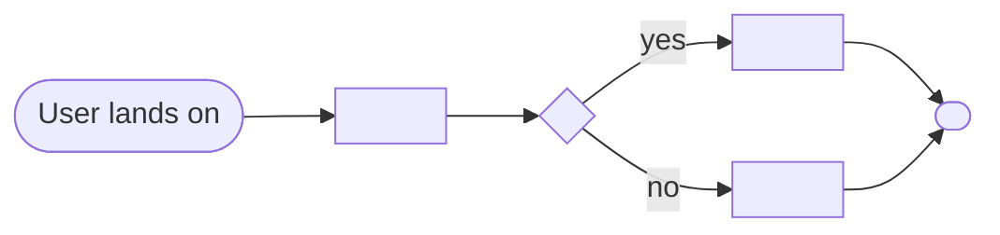

# Solution Design Document — <APP_NAME>

<!-- Template: Coded Apps (web applications). When the PDD lacked UI details, Phase 1 gap-filling Q&A fills framework, app type, pages/routes and the data the app keeps.
     Phase 2 sections: §2, §3, §4, §5, §6, §10. Phase 3 sections: all others. -->

---

## Document History

| Date | Version | Author | Role | Comments |
|---|---|---|---|---|
| <DATE> | 1.0 | <AUTHOR> | Generated by AI Agent | Initial SDD generated from PDD |

---

<!-- DO NOT RENAME: uipath-planner detects SDDs via this exact heading or the marker below. -->
<!-- planner-handoff:v1 -->
## Planner Handoff

| Field | Value |
|---|---|
| **Status** | <draft \| ready — the genome is written only from ready> |
| **Execution autonomy** | <autonomous \| interactive> |
| **Delivery model** | <cloud \| automation-suite <VERSION_IF_KNOWN> \| standalone \| unspecified> |
| **SDD scope** | <single-product \| solution> |
| **Solution root SDD** | <PATH_TO_SOLUTION_ROOT_SDD — solution scope only; omit all four solution rows for single-product> |
| **Solution ID** | <SOLUTION_NAME_KEBAB> |
| **Project SDD role** | child |
| **Independently executable** | no — built only through the Solution root |
| **Project list section** | §10 Project Structure + §9 Integrated Components |
| **Generated by** | uipath-planner |
| **Generation date** | <YYYY-MM-DD> |
| **Template validation** | <pending \| passed — set to passed when the template check passes, whatever the Status> |
| **Genome** | <path — written by the genome turn; omit this row in the SDD write> |

---

<!--
EMIT THIS BLOCK ONLY in an autonomous run or a caller's design request (sdd-writing-guide.md Step 4 item 3).
Non-RPA scope: Platform constraints, Scope and the product row.
-->
## Decisions Made

> The architectural decisions below were picked without a user checkpoint. Override by editing the relevant SDD section, or rerun in Interactive mode.

| # | Decision | Picked | One-sentence reason |
|---|---|---|---|
| 1 | **Platform constraints** (Constraint Gate) | <DELIVERY_MODEL; BLOCKED_PRODUCTS_OR_NONE> | <REASON> |
| 2 | **Scope** (Level 1) | <SINGLE_PRODUCT_OR_SOLUTION_COMPOSITION> | <REASON> |
| 3 | **App type & framework** | <WEB_OR_ACTION + REACT_OR_ANGULAR_OR_VUE> | <REASON_FROM_PDD> |

---

<!--
EMIT THIS BLOCK ALWAYS (both execution modes).
Durable copy of the Phase 1 Recommended Scope summary — the SDD record of the
Constraint Gate outcome. See scope-recommendation-guide.md → Summary block for the full format.
-->
## Recommended Scope

**Recommendation:** <SINGLE_PRODUCT | SOLUTION(<PRODUCT_1>, ...)>
**Delivery model:** <cloud | automation-suite <version-if-known> | standalone | unspecified — assumed cloud [SME REVIEW]>
**Blocked by platform:** <PRODUCT → ALTERNATIVE_APPLIED (matrix | user exclusion), ... | none>
**Need profile:** <ONE_LINE_CORE_NEED_AND_TARGET_KPI>

---

<!--
EMIT THIS BLOCK ONLY when at least one [SME REVIEW] item remains after Step 3 resolution.
Skip entirely when no review items are open. Once the genome is written, uipath-planner writes this
section again from it, with every open question. See open-questions-guide.md for the item form.
Build prerequisites: sdd-writing-guide.md § Writing Rules.
-->
## Action Required — SME Review Items

<COUNT> questions are open: <COUNT_NEEDED> needed before the genome is written, the rest with a default applied in its section.

**D1. <QUESTION>**
- **Context:** <WHAT_IS_UNKNOWN>
- **See:** <SECTION>
- **Options:**
  - a. <DEFAULT_APPLIED> (built now)
  - b. <ANOTHER_OPTION>
- **Answer (by <ROLE>):**

**D2. <QUESTION_WITH_NO_DEFENSIBLE_DEFAULT>**
- **Context:** <WHAT_IS_UNKNOWN>
- **See:** <SECTION>
- **Until answered:** the SDD stays `draft` and no genome is written
- **Answer (by <ROLE>):**

> Each item is marked `[SME REVIEW] D<n>` in its section. A default-carried item blocks neither the genome nor the build: the automation is built on the option marked `(built now)`, or a value item's `Default:`, which must be verified before production sign-off. An item with an `Until answered:` line keeps the handoff at `Status: draft`.

---

## Table of Contents

1. App Overview
2. App Type & Tech Stack
3. Pages & Routes
4. Components
5. State Management
6. API Integration
7. User Flows
8. Error Handling
9. Integrated Components
10. Project Structure
11. Testing Strategy
12. Next Steps

---

<!-- planner-sdd-body:v1 -->
## 1. App Overview

| Field | Value |
|---|---|
| **App name** | <APP_NAME> |
| **Objective** | <OBJECTIVE> |
| **Primary users** | <USER_ROLES> |
| **Trigger** | <HOW_IS_THE_APP_OPENED — user navigation / action from automation / HITL form> |
| **Expected concurrent users** | <NUMBER> |
| **Source PDD** | <PATH_OR_LINK_TO_PDD> |

### In Scope

- <FEATURE_1>

### Out of Scope

- <FEATURE_1>

### Assumptions

<!-- Assumptions the design relies on. Verify before build; promote to [SME REVIEW] if unconfirmed. -->

- <ASSUMPTION_1>
- <ASSUMPTION_2>
- <ASSUMPTION_3>

---

## 2. App Type & Tech Stack

### App Type

- [ ] **Web** — standalone web app users navigate to
- [ ] **Action** — triggered by an automation, receives and returns data

### Tech Stack

<!-- The framework only: build tooling, UI libraries and state libraries are uipath-coded-apps's. -->

**Framework:** <React / Angular / Vue>

**Justification:** <2_TO_3_SENTENCES_ON_WHY_IT_FITS>

---

## 3. Pages & Routes

| Route | Page Name | Purpose | Who Sees It |
|---|---|---|---|
| `/` | <PAGE_NAME> | <PURPOSE> | <ROLE> |
| `/<PATH>` | <PAGE_NAME> | <PURPOSE> | <ROLE> |

---

## 4. Components

<!-- List major components. Keep it architectural, not implementation-level. -->

| Component Name | Type | Used On Pages | Purpose |
|---|---|---|---|
| `<COMPONENT_NAME>` | <LAYOUT / FORM / TABLE / MODAL / etc.> | <PAGE_NAMES> | <PURPOSE> |

---

## 5. State Management

<!-- The data the app keeps while it is used, in business terms: what it is, how long it is kept, and which pages read it. How it is stored is uipath-coded-apps's. -->

| Data | Kept For (one page / the session / across sessions) | Read On Pages | Description |
|---|---|---|---|
| <DATA_NAME> | <HOW_LONG> | <PAGE_NAMES> | <WHAT_IT_HOLDS> |

---

## 6. API Integration

<!-- Which backends the app calls. -->

<!-- Calls As: the identity each call is made with (the signed-in user or a service identity). How the app authenticates is uipath-coded-apps's. -->

| Backend | Type | Purpose | Calls As |
|---|---|---|---|
| <BACKEND_NAME> | <UIPATH_API_WORKFLOW / REST / GRAPHQL> | <PURPOSE> | <USER_OR_SERVICE_IDENTITY> |

### UiPath API Workflow Calls

<!-- If the app calls API Workflows, list them. -->

| API Workflow | Called From | Input | Output |
|---|---|---|---|
| `<API_WORKFLOW_NAME>` | <COMPONENT_OR_PAGE> | <INPUT_SCHEMA> | <OUTPUT_SCHEMA> |

### Integration Service Connections

<!-- Every Integration Service connection the app relies on and how it is provisioned: reuse an existing Integration Service connector, custom-build a connector, or call the system over direct HTTP. Access Method values: `Integration Service — <CONNECTOR_SLUG>`, `Custom connector — <CONNECTOR_SLUG>`, or `Direct HTTP`. Build prerequisites: sdd-writing-guide.md § Writing Rules. -->

| Connector | System | Access Method | Used By |
|---|---|---|---|
| <CONNECTOR_NAME> | <SYSTEM> | <ACCESS_METHOD> | <PAGES_OR_COMPONENTS> |

---

## 7. User Flows

<!-- Describe key user journeys through the app. One diagram per flow. -->

### Flow: <FLOW_NAME>

**Description:** <NARRATIVE_OF_THE_FLOW>

---

## 8. Error Handling

<!-- Failure wording: sdd-writing-guide.md § Writing Rules. -->

| Error Scenario | User-Facing Behavior | Logging |
|---|---|---|
| API call fails | <ATTEMPTS_AND_WAIT_THEN_WHAT_THE_USER_SEES> | <LOG_TO_WHERE> |
| Validation error | <INLINE_ERROR_MESSAGE> | <YES/NO> |
| Session expired | <REDIRECT_TO_LOGIN> | <YES/NO> |

---

## 9. Integrated Components

### Called By (if Action app)

<!-- If this is an Action app triggered by automation, describe the caller. -->

| Caller | Type | Context |
|---|---|---|
| <CALLER_NAME> | <RPA_PROCESS / FLOW / AGENT> | <WHEN_AND_WHY> |

### Human Steps Served

<!-- Include only when a person acts in this app for another product's human step; omit otherwise. Business intent only: who acts, every decision they can take and where the work goes after each, what they are shown and what they enter. -->

| Step (caller's node key) | Who Acts | Decisions → Next | Shown / Entered |
|---|---|---|---|
| `<NODE_KEY>` | <ROLE> | <DECISION_1> → <NEXT>; <DECISION_2> → <NEXT> | <DATA_SHOWN> / <DATA_ENTERED> |

### Build Assumptions

<!-- What this design needs a product to be able to do, beyond what this template states (sdd-writing-guide.md § Writing Rules). One row per capability; its owning skill confirms it at build, before the steps that rely on it are built. `None.` when the design relies on nothing unconfirmed. -->

| # | The Design Relies On | Relied On By | Confirmed By | If It Does Not Hold |
|---|---|---|---|---|
| A1 | <CAPABILITY_IN_PLAIN_WORDS> | <STEPS_OR_COMPONENTS> | `<OWNING_SKILL>` | <FALLBACK_STEP_OR_COMPONENT> |

---

## 10. Project Structure

<!-- The app project is scaffolded by uipath-coded-apps, which owns its files and folders: never draw a file tree here. -->

**App project:** `<APP_PROJECT_NAME>` — built by `uipath-coded-apps`.

### Deployment Target

- [ ] Development workspace (default)
- [ ] Orchestrator

### Solution / Project Breakdown

<!-- Every buildable project in the solution: its product, source repo, Orchestrator folder, and run mode. One row per project (single row for a single-project solution). -->

| Project | Product (RPA / API / Agent / …) | GitHub Repository | Folder | Attended / Unattended |
|---|---|---|---|---|
| <PROJECT_NAME> | <PRODUCT> | <GIT_URL_OR_REPO> | <FOLDER_PATH> | <ATTENDED / UNATTENDED / N-A> |

### Reusable Components

<!-- Components reused from an existing library vs. new reusable components this build will publish. -->

| Type (reused / new-reusable) | Name | Details |
|---|---|---|
| reused | <COMPONENT_NAME> | <SOURCE_LIBRARY_AND_VERSION> |
| new-reusable | <COMPONENT_NAME> | <WHAT_IT_ENCAPSULATES_AND_CONSUMERS> |

### Environments (DEV / UAT / PROD)

<!-- Per-environment Orchestrator/tenant and folder targets. Fill with [SME REVIEW] if the deployment team has not confirmed. -->

| Item | DEV | UAT | PROD | Used By |
|---|---|---|---|---|
| Orchestrator + Tenant/Service | <URL_OR_TENANT> | <URL_OR_TENANT> | <URL_OR_TENANT> | <PROJECTS_OR_ALL> |
| Folder | <FOLDER_PATH> | <FOLDER_PATH> | <FOLDER_PATH> | <PROJECTS_OR_ALL> |

### Non-Functional Requirements

<!-- Consolidated NFRs for the app. Fill each row with the concrete design decision; use [SME REVIEW] where unconfirmed. -->

| Dimension | Requirement / Design decision |
|---|---|
| **Security** | <who may open the app and which data each role sees (§3). The identity each backend call is made with (§6). No secrets in the client bundle. Least-privilege scopes on UiPath API / Integration Service calls. Do not expose API calls with sensitive data in the network trace> |
| **Performance** | <bundle size and code-splitting; API latency and caching; avoid over-fetching; webhooks vs polling for live data> |
| **Scalability** | <expected concurrent users (§1); stateless client; CDN / static hosting> |
| **Availability / Resilience** | <what the user sees when a backend call fails (§8); degraded / offline behavior; session-expiry handling> |
| **Logging & Monitoring** | <client-side error logging and sink; usage / error dashboards; alerting> |
| **Compliance** | <REGULATION_OR_—> |

---

## 11. Testing Strategy

### Canonical Test Cases

| Test ID | User Flow | Input | Expected Outcome |
|---|---|---|---|
| T-01 | <FLOW_NAME> | <INPUT> | <EXPECTED_UI_STATE> |

### Unit Tests

- <UNIT_TEST_DESCRIPTION>

### E2E Tests

- <E2E_TEST_DESCRIPTION>

---

## 12. Next Steps

This SDD captures architecture and decisions. To build it, load `uipath-planner` with this SDD path:

> Load `uipath-planner`. SDD path: `<this-file>`.

**Build from the genome.** On the turn after this SDD is `Status: ready`, `uipath-planner` writes its genome beside it (`author`) and records the path in the `Genome` row of the Planner Handoff. `uipath-genome` builds every component from that genome through each component's owning skill. Without `uipath-genome` installed, the genome stays on disk for a later build.

Implementation steps **do not live in this SDD** — the genome carries them.

---

**End of Solution Design Document.**
