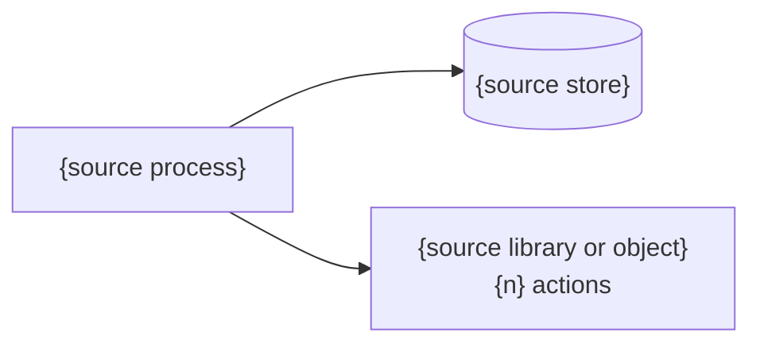

<!-- UIPATH-AUTOMATION-GENOME: component | This file is a build specification for one UiPath automation project.
     To build it, invoke the uipath-genome skill: it asks the configuration questions,
     then invokes the skills referenced in Build With. Do NOT execute these steps directly, and do NOT
     start from a Build With skill. To change it, invoke the uipath-planner skill. -->

# Genome: {Name}

> {One-line description of what this automation does}

> **This is a UiPath automation blueprint.** Do not execute these steps directly. Build it with the **uipath-genome** skill, which hands each part to the skill listed in **Build With** below.

> Part of: {Process name} — {one line on this component's role in the process}. *(Write the process name as a markdown link to `../{process-slug}-genome.md`. Omit this line for a standalone automation.)*

> Designed in: [{SDD title}]({relative path to the SDD}) · sdd-sha256 {SDD_FINGERPRINT} *(Only when the genome is authored from an agreed SDD; omit otherwise.)*

## Overview

{1-3 paragraphs: purpose, business problem, who it is for, what triggers it.}

## Target Applications

| Application | Role | Notes |
|-------------|------|-------|
| {e.g. SAP GUI} | {Input source / Output target / Both} | {version, module, access method; for an application driven through its UI, `UI targets: <environment>`} |

## Build With

| Step | Skill | Rationale |
|------|-------|-----------|
| {Workflow step reference} | `{uipath-skill-name}` | {Why this skill fits this step} |

## Platform Dependencies

{One table per kind of resource the automation uses, in this order; leave out a kind it does not use. Used by names the steps. A value the source or description does not show is *[Inferred]*, or the Configuration Question that asks it.}

### Queues

| Queue | One item is | Item fields | Unique reference | Retries | Added by | Worked by |
|-------|-------------|-------------|------------------|---------|----------|-----------|
| {e.g. InvoiceQueue} | {one invoice} | {InvoiceNumber: Text, Amount: Number} | {InvoiceNumber, on} | {2} | {step 3} | {steps 4–7} |

### Assets

| Asset | Type | Value | Used by | Purpose |
|-------|------|-------|---------|---------|
| {e.g. ErpBaseUrl} | {Text / Integer / Bool / Secret} | {fixed value, or Configuration Question N; never a secret} | {steps} | {what it is for} |

### Credentials

| Asset | Account or persona | Signs in to | Used by |
|-------|--------------------|-------------|---------|
| {e.g. ErpApprover} | {the approver account} | {SAP, production} | {steps} |

### Storage buckets

| Bucket | Holds | Written by | Read by |
|--------|-------|------------|---------|

### Connections

| Connection | Connector | Signs in as | Used by |
|------------|-----------|-------------|---------|

### Data Fabric entities

| Entity | Fields | Written by | Read by |
|--------|--------|------------|---------|

### Triggers

| Trigger | Starts | Kind | When | Runners |
|---------|--------|------|------|---------|
| {e.g. DailyIntake} | {this process} | {Time / Queue / Event} | {weekdays 07:00, Europe/Berlin; or the queue; or the event} | {1} |

### {Other service: Action Center, Document Understanding, Test Manager, Context Grounding}

| Resource | Used by | Purpose |
|----------|---------|---------|

*Stub when none: "No Orchestrator or Integration Service resources required." — the Runtime and deployment block follows it all the same.*

### Runtime and deployment

*(A standalone component genome only; a component inside a process leaves these to its process genome's Deployment.)*

- **Delivery model:** {Automation Cloud / Automation Suite <version> / standalone Orchestrator}
- **Packaging and route:** {one package, or the library feed it is published to}
- **Entry points:** {the entry point; how it starts: Triggers above}
- **Runtime and machines:** {Windows / cross-platform / serverless; unattended or attended; machine prerequisites}
- **Robots:** {the robot account, by persona}
- **Folders and environments:** {the folder and tenant of test and of production; the one whose UI targets this genome describes}
- **Logging and retention:** {where it logs; data kept out of the logs; log and queue-item retention}

## Interface

- **Inputs:** {arguments, files, queue items, or events the automation consumes — name, type, source}
- **Outputs:** {values, files, records, or events it produces — name, type, consumer}
- **Side effects:** {external state it changes — records created, emails sent, files moved}

{Library component: replace the bullets with one table per public workflow — `Argument | Direction | Type | Description` — and the conventions consumers rely on. Test component: list the per-scenario row schema (≤ ~20 fields) and, separately, the constants held in the project's configuration; credentials as asset names only.}

## Configuration Questions

{Questions to answer before building. Extracted genomes ask only the values the source leaves open, with the source value as the default — a value bound to the environment (host, mailbox, recipient, path or share, queue, asset or credential name) is always open; every value the source fixes stays in the section where it acts (format guide § Configuration Questions). Authored genome whose Transactional Shape is not the stub: one constant asks the item retry count and the consecutive-failure stop (transactional shape guide rule 4). Each question names its kind — setting or constant (format guide § Configuration Questions).}

1. {Question}? ({setting | constant}; default: {value})
2. {Question}? ({setting | constant}; default: {value})

*Stub when none: "No open values — no configuration needed."*

## Workflow

1. **Trigger**: {What starts the automation}
2. **{Step name}** (input: {data in}; output: {data out}):
   a. {Substep with specific field/data detail}
   b. {Conditional: if {condition}, then {action}; otherwise {action}}
3. **Output**: {What the automation produces}

## Business Rules

### Step {N}: {Step name}
- {Rule in plain language with specific fields, thresholds, and conditions}

### General
- {Rule that applies across steps}

*Stub when none: "No business rules beyond the Workflow substeps."*

## Error Handling

### Step {N}: {Step name}
- {Failure}: {recovery — retry count, fallback, notification, skip}

### Global
- Unhandled exception: {behaviour}

*Stub when none: "No error handling: a failure stops the run."*

## Transactional Shape

{Does the project iterate over units of work — items that succeed, fail, are retried and are tracked independently? Describe; never decide. Standalone project: the `Flows:` line and the whole block below per flow. Component of a process: one block per flow it takes part in, each with only the `Role:` line, the As-is rows that concern this project (a producer: source, reference rule, fate of the queued source item; a consumer: step groups, outcomes, counts, configuration split, traceability) and the line `Split options: per the process genome, Flow N.`}

**Flows:** Flow 1 — {unit}: steps {a–b} → steps {c–d}. *(standalone project only)*

### Flow 1 — {unit of work}: {producer} → {consumer}

**Role:** {producer | consumer | consumer of Flow {M} and producer of this flow} — {one sentence}. *(component of a process only)*

**Unit of work:** one {item}; reference {identifying field(s)}; fields as in {Interface / Handoffs row}; {volume and cadence}; chosen because {items fail, retry and are reported independently at this level; the reference exists; the retry cost is acceptable}.
**Alternative units of work:** one {other item} — fits when {condition}. *(every viable granularity, or "none")*

**As-is** — how the project handles the units today:

| Aspect | As-is |
|---|---|
| Produced by | {steps that create items; how often; one source or several; guarded by a lock or ledger?} |
| Consumed by | {steps that take items; one robot or several; how items are picked; order} |
| Item store | {queue / table / in-memory list / folder}; per-item state as {status, tags, fields, output} |
| Coordination | {parent items, ledgers, locks, tag joins — what each is for; "none"} |
| Item kinds | {one kind, or several routed inside the consumer — what differs} |
| Step groups | once per run: steps {n}; per item: steps {p–q}; at the end: steps {r} |

Outcomes — these rows, whatever the source calls its per-item results (approved, rejected, skipped are Success or a Business exception; transactional shape guide rule 4):

| Outcome | When | Effect |
|---|---|---|
| Success | every per-item step completed | item recorded as done with {result} |
| Business exception | Step {N} rules: {names} | no retry; item recorded with the reason; run continues |
| System exception | every other failure — Step {N} handlers: {names} | applications reopened, item retried {n}×, then recorded as failed with the reason; run stops after {m} consecutive |

**Split options** — rows A, B and C for the unit of work and for each unit the Alternative units line lists (a flow with a `Decided:` line: that one row alone), each option by its letter (transactional shape guide rule 3 defines them) with only what this flow requires and changes; runner counts are deployment settings, never options; none asserted beyond the `Decided:` line. A flow with one side outside the genome replaces the table with `Split options: none — the consumer is outside this genome: {what takes the items}.` (rule 9):

| Unit of work | Option | Requires | Changes against as-is |
|---|---|---|---|
| {unit} | A | {what this flow needs for one job to hold both roles — or "excluded: {the fact that rules it out}"} | {projects and schedules, where per-item state is visible, retry granularity, end-of-parent work} |
| {unit} | B | {…} | {…} |
| {unit} | C | {…; the once-guard for this flow's population} | {…} |
| {alternative unit} | A | … | {…} |
| {alternative unit} | B | … | {…} |
| {alternative unit} | C | … | {…} |

**Evidence:** {facts only — robots, schedules, sources, applications per item kind, whether items survive a run today}.
**Decided:** {only when the SDD, the request or the refactor answers already chose the split: option and unit — source; for B, `: <Project> → <Project>[ → …]` when the source names the projects (transactional shape guide rule 8)}
**Configuration:** settings — questions {a, b}; constants — questions {c, d}; assets — every asset row of Platform Dependencies.
**Traceability:** {per-item record and where it lands; screenshot on system exception; run summary}.

*Stub when none: "Not transactional: {reason — the run is one unit of work; one item's work started per item by {caller}; a library; a test-case group; a coordinator whose per-item lifecycle is the orchestration's; a {Flow, API workflow, agent} that works its items itself}."*

## Acceptance Criteria

1. Given {specific input}, the automation {specific observable outcome}
2. When {condition}, the automation {expected behaviour}
3. {Specific action} produces {specific result}

## Complexity

{simple | medium | complex}

## Tags

{comma-separated: domain, applications, platform features}

## Source Map

*Extraction only — omit for authored genomes. Delete on request when the genome is shared as a reusable blueprint.*

| Row | Source artifact | Notes |
|-----|-----------------|-------|
| {Dead code / Unresolved invocation / Inferred / a finding} | {Source framework}: `{Name}` ({id}) | {what it is, the lines that show it} |
| Requested change | {for a refactor or migration request: the user's words; otherwise —} | {each refactor-question decision — `Target: <component> → <product>`, `Retire: <entry point>`, `Fold: <reader> into <writer>`; a split decision is that flow's `Decided:` line alone} |
| Related resources | {path or link} — {kind} | {what it settled, or "not read" and why} |
| Resource discrepancies | {resource}: {what it says} | {what the source does} |

*A component of a process genome inherits the Source framework, Source export, Requested change, Inventory, Not covered, Unused and Related resources rows from the process genome, and its Today view; a standalone component genome carries them itself.*

### Today

*Standalone component genome only.* What the rebuild replaces, as the source runs (extracted genome guide § Source Map, the Today view).

- `{source unit}` ({n} actions) → {this component / folded into its steps / the activities of its callers / not rebuilt: the {row} row} — {why}

### Steps

| Step | Source objects | Data sets | Captures | Notes |
|------|----------------|-----------|----------|-------|
| {N} | `{Name}` ({id}[, {locator}]); … — the primary object first; a UiPath source: `{Folder/Workflow.xaml}` | `{Name}` ({id}); … or none | {n} | {callers, callees that are steps of their own, lines, quirks} |

*One row per Workflow step, keyed by its number (extracted genome guide § Source Map, the step table).*
