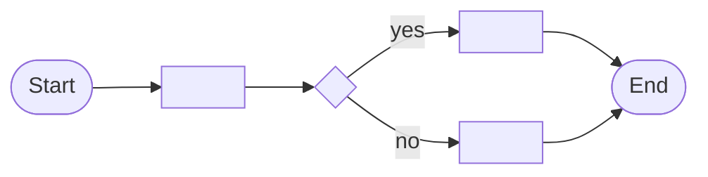

# Solution Design Document — <PROCESS_NAME>

<!-- Template: Maestro Flow — orchestrates multiple automation types (RPA, agents, apps, API workflows, HITL).
     Phase 2 sections: §3, §4, §5, §7, §10. Phase 3 sections: all others. -->
<!-- Template check before filling: list the BPMN structures the process needs — a fork that rejoins
     (both checks must finish), a per-activity timeout, a wait for a message or event, a per-item
     multi-instance loop, a subprocess. Two or more → this is the wrong template: use bpmn-sdd-template.md. -->

---

## Document History

| Date | Version | Author | Role | Comments |
|---|---|---|---|---|
| <DATE> | 1.0 | <AUTHOR> | Generated by AI Agent | Initial SDD generated from PDD |

---

<!-- DO NOT RENAME: uipath-planner detects SDDs via this exact heading or the marker below. -->
<!-- planner-handoff:v1 -->
## Planner Handoff

| Field | Value |
|---|---|
| **Status** | <draft \| ready — the genome is written only from ready> |
| **Execution autonomy** | <autonomous \| interactive> |
| **Delivery model** | <cloud \| automation-suite <VERSION_IF_KNOWN> \| standalone \| unspecified> |
| **SDD scope** | <single-product \| solution> |
| **Project list section** | §3 Nodes Inventory + §7 Integrated Components |
| **Solution root SDD** | <PATH_TO_SOLUTION_ROOT_SDD — solution scope only; for single-product omit this row and the three below it (Solution ID, Project SDD role, Independently executable) — every other row stays> |
| **Solution ID** | <SOLUTION_NAME_KEBAB> |
| **Project SDD role** | child |
| **Independently executable** | no — built only through the Solution root |
| **Generated by** | uipath-planner |
| **Generation date** | <YYYY-MM-DD> |
| **Template validation** | <pending \| passed — set to passed when the template check passes, whatever the Status> |
| **Genome** | <path — written by the genome turn; omit this row in the SDD write> |

---

<!--
EMIT THIS BLOCK ONLY in an autonomous run or a caller's design request (sdd-writing-guide.md Step 4 item 3).
Non-RPA scope: Platform constraints, Scope and the product row.
-->
## Decisions Made

> The architectural decisions below were picked without a user checkpoint. Override by editing the relevant SDD section, or rerun in Interactive mode.

| # | Decision | Picked | One-sentence reason |
|---|---|---|---|
| 1 | **Platform constraints** (Constraint Gate) | <DELIVERY_MODEL; BLOCKED_PRODUCTS_OR_NONE> | <REASON> |
| 2 | **Scope** (Level 1) | <SINGLE_PRODUCT_OR_SOLUTION_COMPOSITION> | <REASON> |
| 3 | **Maestro engine** (Flow vs BPMN) | <BPMN \| Flow> — structures: <EACH_ROW_5_STRUCTURE_THE_PROCESS_NEEDS \| none> | <two or more → BPMN; none → Flow; exactly one → Flow, BPMN offered (product-selection-guide.md § Maestro disambiguation)> |
| 4 | **Flow trigger type** | <MANUAL_OR_SCHEDULED_OR_EVENT_OR_HTTP> | <REASON_FROM_PDD> |

---

<!--
EMIT THIS BLOCK ALWAYS (both execution modes).
Durable copy of the Phase 1 Recommended Scope summary — the SDD record of the
Constraint Gate outcome. See scope-recommendation-guide.md → Summary block for the full format.
-->
## Recommended Scope

**Recommendation:** <SINGLE_PRODUCT | SOLUTION(<PRODUCT_1>, ...)>
**Delivery model:** <cloud | automation-suite <version-if-known> | standalone | unspecified — assumed cloud [SME REVIEW]>
**Blocked by platform:** <PRODUCT → ALTERNATIVE_APPLIED (matrix | user exclusion), ... — every product the source signals that the gate blocks, the picked design's or not (on Automation Suite older than 2.2510.2 the line always names Maestro — Flow, BPMN and Case — with the alternative the design applies, even when no Maestro project was ever a candidate) | none>
**Need profile:** <ONE_LINE_CORE_NEED_AND_TARGET_KPI>

---

<!--
EMIT THIS BLOCK ONLY when at least one [SME REVIEW] item remains after Step 3 resolution.
Skip entirely when no review items are open. Once the genome is written, uipath-planner writes this
section again from it, with every open question. See open-questions-guide.md for the item form.
Build prerequisites: sdd-writing-guide.md § Writing Rules.
-->
## Action Required — SME Review Items

<COUNT> questions are open: <COUNT_NEEDED> needed before the genome is written, the rest with a default applied in its section. By role: <ROLE> <COUNT>; <ROLE> <COUNT>.

How to answer:
1. After an item's `Answer`, write the letter of the option you choose, a value, `default` to keep a value's default, or your own words. An item left blank stays open.
2. Then ask `uipath-planner` to interview you on the rest: "Interview me on the open questions", adding a role to be asked only that person's. The interview writes your answers into this document.

**D1. <QUESTION>**
- **Context:** <WHAT_IS_UNKNOWN>
- **See:** <SECTION>
- **Options:**
  - a. <DEFAULT_APPLIED> (built now)
  - b. <ANOTHER_OPTION>
- **Answer (by <ROLE>):**

**D2. <QUESTION_WITH_NO_DEFENSIBLE_DEFAULT>**
- **Context:** <WHAT_IS_UNKNOWN>
- **See:** <SECTION>
- **Until answered:** the SDD stays `draft` and no genome is written
- **Answer (by <ROLE>):**

> Each item is marked `[SME REVIEW] D<n>` in its section. A default-carried item blocks neither the genome nor the build: the automation is built on the option marked `(built now)`, or a value item's `Default:`, which must be verified before production sign-off. An item with an `Until answered:` line keeps the handoff at `Status: draft`.

---

## Table of Contents

1. Flow Overview
2. Flow Diagram
3. Nodes Inventory
4. Variables
5. Subflows
6. Triggers
7. Integrated Components
8. Error Handling
9. Business Rules
10. Project Structure
11. Testing Strategy
12. Next Steps

---

<!-- planner-sdd-body:v1 -->
## 1. Flow Overview

| Field | Value |
|---|---|
| **Flow name** | <FLOW_NAME> |
| **Objective** | <OBJECTIVE> |
| **Department / Function** | <DEPARTMENT> — <FUNCTION> |
| **Trigger type** | <MANUAL / SCHEDULED / EVENT / HTTP> |
| **Expected execution volume** | <EXECUTIONS_PER_DAY> |
| **Source PDD** | <PATH_OR_LINK_TO_PDD> |

### In Scope

- <ACTIVITY_1>

### Out of Scope

- <ACTIVITY_1>

### Assumptions

<!-- Assumptions the design relies on. Verify before build; promote to [SME REVIEW] if unconfirmed. -->

- <ASSUMPTION_1>
- <ASSUMPTION_2>
- <ASSUMPTION_3>

---

## 2. Flow Diagram

<!-- Build from the Phase 1 extracted steps. One node per logical step.
     Show decision points as diamond shapes, parallel branches with fork/join. -->

---

## 3. Nodes Inventory

<!-- List every step in execution order: one row per step, one kind of work per row. Step Kind says what the step does; the Flow node that performs it is uipath-maestro-flow's choice, never named here. A step that does two kinds of work is two rows with two keys.
     - Start (one row per way the flow starts: manual, scheduled, event, HTTP)
     - Decide (routes on a condition and produces nothing: a value a later step needs is produced by a Compute row before it)
     - Repeat (works a list item by item; Notes names the steps it repeats)
     - Compute (derives, converts, ranks or assembles values the flow already holds)
     - Call (invokes one component of §7 — a process, agent, API workflow, connector operation, rules project, function or extraction model — and names it)
     - Human (a person decides, corrects or supplies data; the flow waits for them)
     - Subflow call (runs one subflow of §5)
     - End (returns the flow's outputs and nothing else: closing a record or sending a result is a Call row before it) -->

| # | Node Key | Step Kind | Description | Inputs | Outputs | Notes |
|---|---|---|---|---|---|---|
| 1 | `start` | Start | <DESCRIPTION> | — | — | Starts on: <MANUAL/SCHEDULED/EVENT/HTTP> |
| 2 | `<NODE_KEY>` | <STEP_KIND> | <DESCRIPTION> | <INPUTS> | <OUTPUTS> | <NOTES> |

---

## 4. Variables

<!-- Every value the flow holds. Role is one of: input (given when the flow starts), output (returned when it ends), working (used in between); a value is never two roles — one that comes in and goes out changed is an input and an output under two names. Type is the business type: text, number, yes/no, date, list of <what>, record of <what>. Set By and Read By name §3 node keys. -->

| Name | Role | Type | Set By | Read By | Description |
|---|---|---|---|---|---|
| <VAR_NAME> | <input / output / working> | <TYPE> | `<NODE_KEY>` | `<NODE_KEYS>` | <DESCRIPTION> |

---

## 5. Subflows

<!-- Only include if the flow uses subflows. A subflow takes inputs and returns outputs: it never routes the flow that calls it, so where the work goes next is a Decide row after the Subflow call row in §3. Called From Nodes names those Subflow call rows, one per place it runs. -->

| Subflow Name | Purpose | Inputs | Outputs | Called From Nodes |
|---|---|---|---|---|
| `<SUBFLOW_NAME>` | <PURPOSE> | <INPUT_VARS> | <OUTPUT_VARS> | <NODE_KEYS> |

---

## 6. Triggers

<!-- How the flow starts, in the business's words: the time, the time zone, the days, or the event or call that starts it. How a schedule is expressed is the build's; a calendar it depends on (business days, holidays) is a Build Assumptions row with its fallback. -->

| Trigger Type | When | Notes |
|---|---|---|
| <MANUAL/SCHEDULED/EVENT/HTTP> | <WHEN_IN_BUSINESS_TERMS> | <NOTES> |

---

## 7. Integrated Components

<!-- Flag the automation types the flow orchestrates. Each flagged item becomes a genome component built by its owning skill. -->

### RPA Processes Invoked

| Process Name | Called From Node | Purpose |
|---|---|---|
| `<PROCESS_NAME>` | `<NODE_KEY>` | <PURPOSE> |

### Agents Invoked

| Agent Name | Called From Node | Purpose |
|---|---|---|
| `<AGENT_NAME>` | `<NODE_KEY>` | <PURPOSE> |

### API Workflows Invoked

| API Workflow Name | Called From Node | Purpose |
|---|---|---|
| `<API_WORKFLOW_NAME>` | `<NODE_KEY>` | <PURPOSE> |

### Integration Service Connectors

| Connector | Called From Node | Operation |
|---|---|---|
| <CONNECTOR_NAME> (Salesforce/Jira/etc.) | `<NODE_KEY>` | <OPERATION> |

### Integration Service Connections

<!-- Every Integration Service connection and how it is provisioned: reuse an existing Integration Service connector, custom-build a connector, or call the system over direct HTTP. Access Method values: `Integration Service — <CONNECTOR_SLUG>`, `Custom connector — <CONNECTOR_SLUG>`, or `Direct HTTP`. Complements the Integration Service Connectors table above (connector + node + operation). Build prerequisites: sdd-writing-guide.md § Writing Rules. -->

| Connector | System | Access Method | Used By |
|---|---|---|---|
| <CONNECTOR_NAME> | <SYSTEM> | <ACCESS_METHOD> | <NODES> |

### IXP / Document Understanding Models

<!-- Extraction of fields from semi-structured documents (invoices, forms) consumed by this project, built by uipath-ixp before its consumers. Document Types: the business documents the source names, each with the format it arrives in (PDF, scan, spreadsheet, email body). Purpose: the fields to extract. IXP model rows: sdd-writing-guide.md § Writing Rules. OPTIONAL subsection — omit entirely when no document extraction is in scope (exempt from the template-superset check). -->

| Model / Project | Called From Node | Document Types (format) | Purpose |
|---|---|---|---|
| `<IXP_PROJECT_NAME>` | `<NODE_KEY>` | <DOCUMENT_TYPES_AND_FORMATS> | <FIELDS_TO_EXTRACT> |

### Coded Functions

<!-- Atomic deterministic logic in TypeScript, JavaScript, or Python (transform, parse, score, custom-auth API call, Integration Service connection query) invoked by this project. Implementation routes to uipath-functions; each function is built and published BEFORE its consumers. One row per function; how functions are grouped into projects is decided at build. OPTIONAL subsection — omit entirely when no coded function is in scope (exempt from the template-superset check). -->

| Function | Called From Node | Input → Output (typed) | Purpose / Dependencies |
|---|---|---|---|
| `<FUNCTION_NAME>` | `<NODE_KEY>` | `<INPUT_MODEL>` → `<OUTPUT_MODEL>` | <PURPOSE_AND_DEPENDENCIES> |

### Business Rules Projects

<!-- One row per decision table the flow evaluates (§9 Decision Tables): each table is a Business Rules project of its own, built by uipath-rules and deployed BEFORE the flow, and a row of Solution / Project Breakdown. That a flow node can call one is a Build Assumptions row, with the Coded Function it falls back on. OPTIONAL subsection — omit entirely when no decision table is in scope (exempt from the template-superset check). -->

| Rules Project | Decision Table | Called From Node |
|---|---|---|
| `<RULES_PROJECT_NAME>` | <DECISION_TABLE_NAME> | `<NODE_KEY>` |

### HITL Touchpoints

<!-- One row per HITL node. Business intent only: who acts, every decision they can take and the node the flow continues at after each, what they are shown and what they enter. A decision that stops the work names where it stops. A decision that leaves the work waiting names what ends the wait and the node it resumes at. The form, its fields and how each decision is wired are uipath-human-in-the-loop's. A step that needs a purpose-built app instead of a form names that app, which is then a row of Coded Apps Referenced. -->

| Node Key | Who Acts | Decisions → Next Node | Shown / Entered | Custom App |
|---|---|---|---|---|
| `<NODE_KEY>` | <ROLE> | <DECISION_1> → `<NODE_KEY>`; <DECISION_2> → `<NODE_KEY>` | <DATA_SHOWN> / <DATA_ENTERED> | <`APP_NAME` \| none> |

### Coded Apps Referenced

<!-- A person's decision in an app is a row of HITL Touchpoints, which names the app here. -->

| App Name | Called From Node | Purpose |
|---|---|---|
| `<APP_NAME>` | `<NODE_KEY>` | <WHAT_THE_PERSON_DOES_IN_IT> |

### Build Assumptions

<!-- What this design needs a product to be able to do, beyond what this template states (sdd-writing-guide.md § Writing Rules). One row per capability; its owning skill confirms it at build, before the nodes that rely on it are built. `None.` when the design relies on nothing unconfirmed. -->

| # | The Design Relies On | Relied On By | Confirmed By | If It Does Not Hold |
|---|---|---|---|---|
| A1 | <CAPABILITY_IN_PLAIN_WORDS> | `<NODE_KEYS>` | `<OWNING_SKILL>` | <FALLBACK_STEP_OR_COMPONENT> |

---

## 8. Error Handling

<!-- Failure wording: sdd-writing-guide.md § Writing Rules.
     - Every row names one §3 step; a step with no row here fails the instance.
     - A failure a person resolves is a Human row of §3, not a row here.
     - An alert or a record of the failure is a Call row of §3 that the failing step leads to, named in What Must Happen. -->

| Scope | Failure | Trigger | What Must Happen |
|---|---|---|---|
| `<NODE_KEY>` | <SPECIFIC_FAILURE> | <CONDITION> | <ATTEMPTS_AND_WAIT_THEN_OUTCOME> |

---

## 9. Business Rules

<!-- Every rule the source states has one home here: [Business Rules Guide](../../references/design/business-rules-guide.md) § Homes per template.
     - Keep the source's rule IDs verbatim (`BR-001`, `BR-F01`); only a source that numbers none gets `BR-01`, `BR-02`, …. A rule the design adds takes the next free ID and its `[DEFAULT]` or `[SME REVIEW]` marker.
     - Each row carries the rule in the source's words, never the ID alone. The element that applies a rule (§3 node) names its ID there; this row stays its one definition.
     - Every subsection but Rules Not Carried stays: an empty one holds its `None.` line.
     - Before the ready flip, `br-coverage.mjs` prints `OK` against the source (business-rules-guide.md § 4). -->

### Validation Rules

<!-- A rule that checks a value's form. Empty: `None. No rule checks a value's form.` -->

| ID | Rule | Field | Check (regex / range / type / allowed values) | Checked at |
|---|---|---|---|---|
| <BR_ID> | <RULE> | <FIELD> | <CHECK> | <NODE_KEY> |

### Decision Tables

<!-- business-rules-guide.md → Decision tables. Runs in: the Rule node, its table a row of § Business Rules Projects. Empty: `None. No rule decides an outcome.` -->

#### DT1 — <DECISION_NAME>
**Hit policy:** <UNIQUE / FIRST / COLLECT>
**Inputs:** `<INPUT_NAME>` (<string / number / boolean / date>), …
**Output:** `<OUTPUT_NAME>` (<TYPE_AND_ALLOWED_VALUES>)
**Runs in:** <RUNS_IN>

| # | <INPUT_NAME> | <INPUT_NAME> | → <OUTPUT_NAME> | Rule |
|---|---|---|---|---|
| 1 | <ENTRY> | <ENTRY> | <OUTPUT> | <BR_ID>: <RULE> |

### Rules Applied in the Flow

<!-- A rule that sets what the flow does when a condition holds: a fallback when a system is down or a check cannot run, a deadline or reminder, a route, what is shown, sent or kept. Applied by: the §3 node — a node, a gateway or a §8 error row — that applies it. Empty: `None. Every rule is a validation, a decision or a reasoning rule.` -->

| ID | Rule | When | What happens | Applied by |
|---|---|---|---|---|
| <BR_ID> | <RULE> | <CONDITION> | <OUTCOME> | <APPLIED_BY> |

### Rules That Need Reasoning

<!-- business-rules-guide.md → Rules that need reasoning. Agent: a node calling the agent. Person: a Human node, also in § HITL Touchpoints. Empty: `None. Every rule is deterministic.` -->

| ID | Rule | Applied by | Inputs → Output | Where it runs |
|---|---|---|---|---|
| <BR_ID> | <RULE> | <Agent / Person> | <INPUTS> → <OUTPUT> | <WHERE_IT_RUNS> |

### Rules Not Carried

<!-- OPTIONAL subsection — omit entirely when the design applies every rule the source states (exempt from the template-superset check). A source rule this design does not apply: another SDD of the solution applies it (name it), or the source's future state retires it. Any other reason is an [SME REVIEW] item. -->

| ID | Rule | Why not here |
|---|---|---|
| <BR_ID> | <RULE> | <REASON> |

---

## 10. Project Structure

<!-- The flow project is scaffolded by uipath-maestro-flow, which owns its files and folders: never draw a file tree here. This section records what the solution is made of and where it is deployed. -->

**Flow project:** `<FLOW_PROJECT_NAME>` — built by `uipath-maestro-flow`.

### Orchestrator Deployment Target

<!-- Where the finished automation runs. How it is packaged and published is its owning skills', never stated here. -->

- [ ] Development workspace (default)
- [ ] Orchestrator

### Solution / Project Breakdown

<!-- Every part the build creates: its product, source repo, Orchestrator folder, and run mode. One row per part (single row for a single-project solution); Coded Functions are one row each. How parts are grouped into projects, and which are packed into the solution or deployed on their own, is decided at build by their owning skills: never state it here. -->

| Project | Product (RPA / API / Agent / …) | GitHub Repository | Folder | Attended / Unattended |
|---|---|---|---|---|
| <PROJECT_NAME> | <PRODUCT> | <GIT_URL_OR_REPO> | <FOLDER_PATH> | <ATTENDED / UNATTENDED / N-A> |

### Reusable Components

<!-- Components reused from an existing library vs. new reusable components this build will publish. -->

| Type (reused / new-reusable) | Name | Details |
|---|---|---|
| reused | <COMPONENT_NAME> | <SOURCE_LIBRARY_AND_VERSION> |
| new-reusable | <COMPONENT_NAME> | <WHAT_IT_ENCAPSULATES_AND_CONSUMERS> |

### Environments (DEV / UAT / PROD)

<!-- Per-environment Orchestrator/tenant and folder targets. Fill with [SME REVIEW] if the deployment team has not confirmed. -->

| Item | DEV | UAT | PROD | Used By |
|---|---|---|---|---|
| Orchestrator + Tenant/Service | <URL_OR_TENANT> | <URL_OR_TENANT> | <URL_OR_TENANT> | <PROJECTS_OR_ALL> |
| Folder | <FOLDER_PATH> | <FOLDER_PATH> | <FOLDER_PATH> | <PROJECTS_OR_ALL> |

### Non-Functional Requirements

<!-- Consolidated NFRs for the flow and the components it orchestrates. Fill each row with the concrete design decision; use [SME REVIEW] where unconfirmed. -->

| Dimension | Requirement / Design decision |
|---|---|
| **Security** | <credentials in Orchestrator credential / secret assets. Least-privilege Integration Service connection scope. Do not expose entity / API calls in the network trace. Personal data: the fields that hold it, by name, and where each may be shown or stored. That run history and logs leave it out is a Build Assumptions row, never a promise> |
| **Performance** | <database vs file storage; webhooks vs polling; avoid license-consuming Windows processes where a headless / cross-platform path exists> |
| **Scalability** | <expected concurrent instances; per-node fan-out limits; peak-window sizing> |
| **Availability / Resilience** | <what a failed instance leaves behind and how it is run again; which steps are safe to run twice; graceful degradation> |
| **Logging & Monitoring** | <log level and sinks; alerting on instance failure; Maestro / Insights dashboards> |
| **Compliance** | <REGULATION_OR_—> |

---

## 11. Testing Strategy

### Canonical Test Case

| Input Variable | Value |
|---|---|
| <VAR_NAME> | `<TEST_VALUE>` |

### Happy Path Assertions

1. <ASSERTION_1>

### Error Path Scenarios

| Scenario | Setup | Expected Flow Behavior |
|---|---|---|
| <SCENARIO_NAME> | <SETUP> | <EXPECTED> |

---

## 12. Next Steps

This SDD captures architecture and decisions. To build it, load `uipath-planner` with this SDD path:

> Load `uipath-planner`. SDD path: `<this-file>`.

**Build from the genome.** Once this SDD is approved, ask `uipath-planner` for its genome or for the build: it writes the genome beside this SDD (`author`), and `uipath-genome` builds every component from that genome through each component's owning skill. Without `uipath-genome` installed, the genome stays on disk for a later build.

Implementation steps **do not live in this SDD** — the genome carries them.

---

**End of Solution Design Document.**
