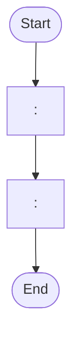
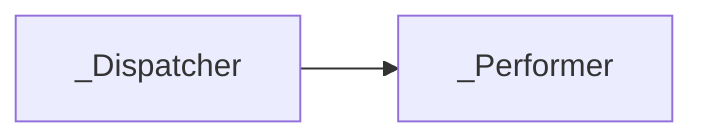

# Solution Design Document — <PROCESS_NAME>

<!-- Template: RPA Process / Library / Test Automation.
     Phase 2 sections: §5, §9, §10, §11, §12, §13, §14. Phase 3 sections: all others.
     Before filling §10-§11: run Level 2.5 Part A (RPA Decomposition Signals) from rpa-product-guide.md. Its decision sets whether §10-§11 describe one project or a Master Project with sub-projects. -->

---

## Document History

| Date | Version | Author | Role | Comments |
|---|---|---|---|---|
| <DATE> | 1.0 | <AUTHOR> | Generated by AI Agent | Initial SDD generated from PDD |

---

<!-- DO NOT RENAME: uipath-planner detects SDDs via this exact heading or the marker below. -->
<!-- planner-handoff:v1 -->
## Planner Handoff

| Field | Value |
|---|---|
| **Status** | <draft \| ready — the genome is written only from ready> |
| **Execution autonomy** | <autonomous \| interactive> |
| **Delivery model** | <cloud \| automation-suite <VERSION_IF_KNOWN> \| standalone \| unspecified> |
| **SDD scope** | <single-product \| solution> |
| **Solution root SDD** | <PATH_TO_SOLUTION_ROOT_SDD — solution scope only; omit all four solution rows for single-product> |
| **Solution ID** | <SOLUTION_NAME_KEBAB> |
| **Project SDD role** | child |
| **Independently executable** | no — built only through the Solution root |
| **Project list section** | <§11 \| §10 + §11 \| Project Inventory (Project Inventory = solution overview only)> |
| **Generated by** | uipath-planner |
| **Generation date** | <YYYY-MM-DD> |
| **Template validation** | <pending \| passed — set to passed when the template check passes, whatever the Status> |
| **Genome** | <path — written by the genome turn; omit this row in the SDD write> |

---

<!-- EMIT THIS BLOCK ONLY in an autonomous run or a caller's design request (sdd-writing-guide.md Step 4 item 3). -->
## Decisions Made

> The architectural decisions below were picked without a user checkpoint. Override by editing the relevant SDD section, or rerun in Interactive mode.

| # | Decision | Picked | One-sentence reason |
|---|---|---|---|
| 1 | **Platform constraints** (Constraint Gate) | <DELIVERY_MODEL; BLOCKED_PRODUCTS_OR_NONE> | <REASON> |
| 2 | **Scope** (Level 1) | <SINGLE_PRODUCT_OR_SOLUTION_COMPOSITION> | <REASON> |
| 3 | **RPA sub-type** (Level 1.5) | <PROCESS_OR_LIBRARY_OR_TEST_AUTOMATION> | <REASON> |
| 4 | **Authoring mode** (Level 2) | <XAML_OR_CODED_OR_HYBRID> | <REASON> |
| 5 | **Framework** | <REFRAMEWORK_OR_SEQUENCE> | <REASON> |

---

<!--
EMIT THIS BLOCK ALWAYS (both execution modes).
Durable copy of the Phase 1 Recommended Scope summary — the SDD record of the
Constraint Gate outcome. See scope-recommendation-guide.md → Summary block for the full format.
Blocked by platform: when platform-availability-guide.md blocks Solutions for this Delivery model
(standalone, Automation Suite older than 2.2510, or a user exclusion), list `Solutions → standalone packages`.
-->
## Recommended Scope

**Recommendation:** <SINGLE_PRODUCT | SOLUTION(<PRODUCT_1>, ...)>
**Delivery model:** <cloud | automation-suite <version-if-known> | standalone | unspecified — assumed cloud [SME REVIEW]>
**Blocked by platform:** <PRODUCT → ALTERNATIVE_APPLIED (matrix | user exclusion), ... | none>
**Need profile:** <ONE_LINE_CORE_NEED_AND_TARGET_KPI>

---

<!--
EMIT THIS BLOCK ONLY when at least one [SME REVIEW] item remains after Step 3 resolution.
Skip entirely when no review items are open. Once the genome is written, uipath-planner writes this
section again from it, with every open question. See open-questions-guide.md for the item form.
Build prerequisites: sdd-writing-guide.md § Writing Rules.
-->
## Action Required — SME Review Items

<COUNT> questions are open: <COUNT_NEEDED> needed before the genome is written, the rest with a default applied in its section.

**D1. <QUESTION>**
- **Context:** <WHAT_IS_UNKNOWN>
- **See:** <SECTION>
- **Options:**
  - a. <DEFAULT_APPLIED> (built now)
  - b. <ANOTHER_OPTION>
- **Answer (by <ROLE>):**

**D2. <QUESTION_WITH_NO_DEFENSIBLE_DEFAULT>**
- **Context:** <WHAT_IS_UNKNOWN>
- **See:** <SECTION>
- **Until answered:** the SDD stays `draft` and no genome is written
- **Answer (by <ROLE>):**

> Each item is marked `[SME REVIEW] D<n>` in its section. A default-carried item blocks neither the genome nor the build: the automation is built on the option marked `(built now)`, or a value item's `Default:`, which must be verified before production sign-off. An item with an `Until answered:` line keeps the handoff at `Status: draft`.

---

## Table of Contents

1. Process Overview
2. Process Map
3. Detailed Process Steps
4. Business Rules
5. Data Definitions
6. Value Mappings
7. Exception Handling
8. Error Handling
9. Application Inventory
10. Master Project Architecture
11. Project Structure
12. Queue Architecture
13. Implementation Mode
14. Packages
15. Credentials & Assets
16. Deployment Environment
17. Testing Strategy
18. Next Steps

---

<!-- planner-sdd-body:v1 -->
## 1. Process Overview

| Field | Value |
|---|---|
| **Process name** | <PROCESS_NAME> |
| **Objective** | <OBJECTIVE> |
| **Department / Function** | <DEPARTMENT> — <FUNCTION> |
| **Schedule** | <FREQUENCY_AND_HOURS> |
| **Volume** | <ITEMS_PER_DAY> (peak: <PEAK_PERIOD>) |
| **Avg. handling time (manual)** | <MANUAL_TIME> |
| **Avg. handling time (automated target)** | <AUTOMATED_TIME> |
| **Exception rate** | <ESTIMATED_RATE> |
| **Source PDD** | <PATH_OR_LINK_TO_PDD> |

### Delivery Team

<!-- From the PDD's Key Contacts. Only roles the PDD names — never invent names; omit a row the PDD is silent on. Run mode: §11 Project Mode Decision; runtime: §16. -->

| Role | Name | Contact |
|---|---|---|
| Solution Architect | <NAME> | <EMAIL> |
| Business Analyst | <NAME> | <EMAIL> |
| Developer(s) | <NAME> | <EMAIL> |
| Project Manager | <NAME> | <EMAIL> |
| SME / Process Owner | <NAME> | <EMAIL> |

### In Scope

- <ACTIVITY_1>
- ...

### Out of Scope

- <ACTIVITY_1>
- ...

### Assumptions

<!-- Assumptions the design relies on. Verify before build; promote to [SME REVIEW] if unconfirmed. -->

- <ASSUMPTION_1>
- <ASSUMPTION_2>
- <ASSUMPTION_3>

---

## 2. Process Map

<!-- Build strictly from the steps extracted in Phase 1: one node per step, no invented steps. Mermaid flowchart syntax. -->



| Step | Description | Application |
|---|---|---|
| <STEP_NUMBER> | <SHORT_DESCRIPTION> | <APP_NAME> |

---

## 3. Detailed Process Steps

<!-- One summary table for all steps. Step Details subsections only for complex steps. -->

### Step Summary

| # | Action | Application | Input | Output | Rules | Errors |
|---|---|---|---|---|---|---|
| <STEP_NUMBER> | <ACTION> | <APP_NAME> | <INPUT> | <OUTPUT> | <BR_IDS> | <EXCEPTION_OR_ERROR_IDS> |

### Step Details

#### Step <STEP_NUMBER> — <STEP_TITLE>

<DETAILED_DESCRIPTION_FOR_COMPLEX_STEPS_ONLY>

---

## 4. Business Rules

<!-- Extraction, classification, homes and the coverage check: [Business Rules Guide](../../references/design/business-rules-guide.md). This table holds validation rules only; decision and reasoning rules fill the two subsections below.
     - Every §5 output field has at least one validation row: the PDD's rule, or the format its example values imply marked `[DEFAULT]` — never an unmarked pattern the source does not support.
     - Validation is the tightest shape the PDD supports: regex, length range, type, or allowed values.
     - Every validation rule with a value in §17 Canonical Test Case becomes a test assertion, with the extracted values, never invented ones. -->

| ID | Rule Name | Description | Trigger Condition | Validation (regex / range / type / allowed values) | Affected Steps |
|---|---|---|---|---|---|
| BR-01 | <RULE_NAME> | <DESCRIPTION> | <WHEN_DOES_IT_APPLY> | <REGEX_OR_RANGE_OR_TYPE_OR_ENUM> | <STEP_NUMBERS> |

### Decision Tables

<!-- references/design/business-rules-guide.md → Decision tables. Runs in: the step and its coded logic or lookup. Empty: `None. No rule decides an outcome.` -->

#### DT1 — <DECISION_NAME>
**Hit policy:** <UNIQUE / FIRST / COLLECT>
**Inputs:** `<INPUT_NAME>` (<string / number / boolean / date>), …
**Output:** `<OUTPUT_NAME>` (<TYPE_AND_ALLOWED_VALUES>)
**Runs in:** <STEP_NUMBER_AND_LOGIC>

| # | <INPUT_NAME> | <INPUT_NAME> | → <OUTPUT_NAME> | Rule |
|---|---|---|---|---|
| 1 | <ENTRY> | <ENTRY> | <OUTPUT> | <BR_ID> |

### Rules That Need Reasoning

<!-- references/design/business-rules-guide.md → Rules that need reasoning. A person applies it through Action Center. Empty: `None. Every rule is deterministic.` -->

| ID | Rule | Applied by | Inputs → Output | Where it runs |
|---|---|---|---|---|
| <BR_ID> | <RULE> | <Agent / Person> | <INPUTS> → <OUTPUT> | <WHERE_IT_RUNS> |

---

## 5. Data Definitions

<!-- The same tables whatever the §13 Implementation Mode: how each record is declared in code or XAML is uipath-rpa's.
     - Business Type: text, number, yes/no, date, list of <what>, record of <what>. Text unless the PDD does arithmetic, date or yes/no work on the value.
     - Keep records flat (one level of nesting at most) and small (~15 fields as a guideline): split along a domain boundary, keep a cohesive record whole `[DEFAULT]`.
     - Name fields in the PDD's vocabulary (`InvoiceNumber`, not `doc_id`). -->

### Transaction Data

| Field | Business Type | Source | Description |
|---|---|---|---|
| <FIELD_NAME> | <BUSINESS_TYPE> | <SOURCE_APP_AND_FIELD> | <DESCRIPTION> |

### Output Data

| Field | Business Type | Source | Description |
|---|---|---|---|
| <FIELD_NAME> | <BUSINESS_TYPE> | <STEP_THAT_SETS_IT> | <DESCRIPTION> |

### Status / Category Values

| Field | Allowed Values |
|---|---|
| <FIELD_NAME> | <COMMA_SEPARATED_VALUES> |

---

## 6. Value Mappings

### <MAPPING_NAME> — <SOURCE_APP> to <TARGET_APP>

| Source Value | Target Value |
|---|---|
| `<SOURCE_1>` | `<TARGET_1>` |

---

## 7. Exception Handling

| ID | Exception Name | Trigger Step | Trigger Condition | Action |
|---|---|---|---|---|
| B1 | <EXCEPTION_NAME> | <STEP_NUMBER> | <HOW_TO_DETECT> | <WHAT_TO_DO> |

**Default handler:** For any unanticipated business exception, <DEFAULT_ACTION>.

---

## 8. Error Handling

<!-- Failure wording: sdd-writing-guide.md § Writing Rules. Every row names one §3 step. -->

| ID | Error Name | Trigger Step | Trigger Condition | What Must Happen |
|---|---|---|---|---|
| E1 | <ERROR_NAME> | <STEP_NUMBER> | <HOW_TO_DETECT> | <ATTEMPTS_AND_WAIT_THEN_OUTCOME> |

**Default handler:** For any unanticipated system error, <DEFAULT_ACTION>.

---

## 9. Application Inventory

<!-- List all applications.
     - SaaS integrations (Salesforce, Jira, …): Access Method `Integration Service — <CONNECTOR_SLUG>`. Each flagged item becomes a genome component built by its owning skill; §14 needs only `UiPath.IntegrationService.Activities` for all connectors combined.
     - Email: name the protocol (IMAP, O365 Graph API, Exchange/EWS, POP3) — never default to O365.
     - Access Method → package mapping: [Package Selection Guide](../../references/design/package-selection-guide.md). -->

| # | Application | Interface | Access Method | Role | Interaction Pattern | Session Management |
|---|---|---|---|---|---|---|
| 1 | <APP_NAME> | <WEB/DESKTOP/API> | <URL_OR_PROTOCOL_OR_INTEGRATION_SERVICE> | <SOURCE/TARGET/UTILITY> | <READ/WRITE/READ-WRITE/TRANSIENT> | <PER_RUN/PER_ITEM> |

### Interactive Authentication / Re-auth Handoff

<!-- Include only when a step needs a login the robot cannot perform (hardware token, smart card, biometric) — references/design/attended-reauth-pattern-guide.md. Otherwise omit this subsection, heading included. -->

| Field | Value |
|---|---|
| **Application** | <APP requiring the human login> |
| **Factor the robot cannot supply** | <HARDWARE_TOKEN / SMART_CARD / BIOMETRIC / OTP_DEVICE> |
| **Handoff point** | <process step where the robot pauses for the human> |
| **Human action** | <what the person does — e.g., insert token, complete portal login> |
| **Resume condition (state anchor)** | <observable post-login state the robot verifies before continuing — e.g., authenticated URL reached, dashboard element present> |
| **No-completion behavior** | [DEFAULT] <e.g., wait 5 min, then abort with notification> |
| **Design shape** | <A: login-before-handoff \| B: mid-run pause + state-aware resume> |

### Integration Service Connections

<!-- Every Integration Service connection and how it is provisioned: reuse an existing Integration Service connector, custom-build a connector, or call the system over direct HTTP. Access Method values: `Integration Service — <CONNECTOR_SLUG>`, `Custom connector — <CONNECTOR_SLUG>`, or `Direct HTTP`. Complements the Access Method column of the Application Inventory table above. Build prerequisites: sdd-writing-guide.md § Writing Rules. -->

| Connector | System | Access Method | Used By |
|---|---|---|---|
| <CONNECTOR_NAME> | <SYSTEM> | <ACCESS_METHOD> | <STEPS_OR_APPS> |

### IXP / Document Understanding Models

<!-- Extraction from semi-structured documents (invoices, forms) consumed by this project, built by uipath-ixp before its consumers. IXP model rows: sdd-writing-guide.md § Writing Rules. OPTIONAL subsection — omit entirely when no document extraction is in scope (exempt from the template-superset check). -->

| Model / Project | Called From Workflow / Step | Document Types | Purpose |
|---|---|---|---|
| `<IXP_PROJECT_NAME>` | `<WORKFLOW_OR_STEP>` | <DOCUMENT_TYPES> | <PURPOSE> |

### Build Assumptions

<!-- What this design needs a product to be able to do, beyond what this template states (sdd-writing-guide.md § Writing Rules). One row per capability; its owning skill confirms it at build, before the steps that rely on it are built. A workflow that waits for a person or an outside event is a row here. `None.` when the design relies on nothing unconfirmed. -->

| # | The Design Relies On | Relied On By | Confirmed By | If It Does Not Hold |
|---|---|---|---|---|
| A1 | <CAPABILITY_IN_PLAIN_WORDS> | <STEPS_OR_COMPONENTS> | `<OWNING_SKILL>` | <FALLBACK_STEP_OR_COMPONENT> |

---

## 10. Master Project Architecture

<!-- Produced by Level 2.5 Part A (RPA Decomposition Signals) from rpa-product-guide.md.
     Generate EITHER Option A (Master Project) OR Option B (Single Project); delete the other entirely.
     Option A only when Part A names, for every split, the boundary that requires it (scaling, failure isolation, a long wait, ownership or cadence). Otherwise → Option B. -->

### Option A — Master Project (multiple queue-connected sub-projects)

**Pattern:** <PATTERN_NAME — e.g., Dispatcher / Performer>

**Boundaries named:** one per split, each the fact that requires it — scaling, failure isolation, a long wait, ownership or cadence
- <SPLIT_1>: <BOUNDARY>

#### Sub-projects overview

<!-- Sub-type: Process / Library / Test Automation. Libraries and Test Automation projects use no Orchestrator queue: `—` in Input Queue / Output Queue. -->

| # | Project Name | Sub-type | Role | Framework | Input Queue | Output Queue | PDD Steps |
|---|---|---|---|---|---|---|---|
| 1 | `<NAME>_Dispatcher` | Process | <ROLE_DESCRIPTION> | Sequence | — | `<QUEUE_1>` | <STEP_NUMBERS> |
| 2 | `<NAME>_Performer` | Process | <ROLE_DESCRIPTION> | REFramework | `<QUEUE_1>` | — | <STEP_NUMBERS> |
| 3 | `<NAME>_SharedLib` | Library | <ROLE_DESCRIPTION> | — | — | — | — |
| 4 | `<NAME>_Regression` | Test Automation | <ROLE_DESCRIPTION> | — | — | — | <TEST_STEPS> |

#### Data flow diagram



<!-- Each sub-project has its own §11 Project Structure, §13 Implementation Mode and §14 Packages subsection. -->

### Option B — Single Project

**Boundaries named:** none — one project

<!-- Keep §10 with this one line; §11 describes the single project. §12 applies only when the project defines or consumes a queue — see §12's include rule. -->

---

## 11. Project Structure

<!-- §11 Project Mode Decision is the one home of each project's sub-type, attendance, start, framework and persistence; other sections name it. -->

### Solution / Project Breakdown

<!-- Every buildable project in the solution: its product, source repo and Orchestrator folder; RPA run mode: Project Mode Decision below. Solution-wide — fill once. One row per project (single row for a single-project solution). -->

| Project | Product (RPA / API / Agent / …) | GitHub Repository | Folder |
|---|---|---|---|
| <PROJECT_NAME> | <PRODUCT> | <GIT_URL_OR_REPO> | <FOLDER_PATH> |

### Reusable Components

<!-- Components reused from an existing library (the tenant libraries Step 5 selected included) vs. new reusable components this build will publish. Solution-wide — fill once. -->

| Type (reused / new-reusable) | Name | Details |
|---|---|---|
| reused | <COMPONENT_NAME> | <SOURCE_LIBRARY_AND_VERSION> |
| new-reusable | <COMPONENT_NAME> | <WHAT_IT_ENCAPSULATES_AND_CONSUMERS> |

### Project Mode Decision

<!-- One row per project; the columns are independent — one choice never silently decides another.
     - Type ← Level 1.5 / Level 1.75 Pass C. A Master Project may mix types (a Process Performer, a shared Library, a Test Automation project validating it).
     - Compatibility ← the PDD: Cross-platform when no desktop-UI or Windows-only dependency exists (headless, web, API work); Windows otherwise; legacy only when unavoidable.
     - Authoring ← §13 / Level 2. Framework ← rpa-product-guide R-04.
     - Attendance, Initiation ← the PDD. "Unattended + queue-triggered" is Attendance=Unattended, Initiation=Queue trigger.
     - Persistence ← an in-flight human approval or async wait (rpa-product-guide → Long-running workflows): YES makes each wait a Build Assumptions row (§9); the framework stays as picked. -->

| # | Project | Type | Compatibility | Authoring | Attendance | Initiation | Framework | Persistence (long-running) |
|---|---|---|---|---|---|---|---|---|
| 1 | `<PROJECT_NAME>` | <Process / Library / Test Automation> | <Windows / Cross-platform> | <XAML / Coded C# / Hybrid> | <Attended / Unattended / Attended-start + unattended-resume> | <Manual / Scheduled / Queue trigger / Event / API> | <Sequence / REFramework> | <YES — Build Assumptions row per wait / NO> |

<!-- Master Project (Option A in §10): repeat this section per sub-project — Recommended Structure, Workflow Inventory, Screens Visited and Workflow Dependencies — honoring its Type above.
     Libraries and Test Automation projects inside a Master Project consume and produce no Orchestrator queue: `—` for Input Queue / Output Queue in §10 and §12. -->

### Recommended Structure

<!-- The scaffold is uipath-rpa's: the framework's own files, the configuration file, the folders and how the entry point reaches the business workflows come from the Framework column of §11 Project Mode Decision. Never draw them. List only the files this design adds. -->

```text
<PROJECT_NAME>/
├── <WORKFLOW_FILE>        (one line per §Workflow Inventory row)
└── ...
```

### Workflow Inventory

<!-- One table per project. Runs says when the workflow runs, one of: `once, before the items` (reads or prepares the whole set), `per item` (the work on one transaction item, and nothing that needs the other items), `once, after the items` (grouping, totals, reconciliation, publishing), `own entry point` (started by its own trigger). A workflow that waits for a person or an outside event is a Build Assumptions row: where a wait may sit is uipath-rpa's. -->

| # | Workflow File | Runs | Responsibility | PDD Steps | Inputs | Outputs |
|---|---|---|---|---|---|---|
| 1 | `<FILENAME>` | <once, before the items / per item / once, after the items / own entry point> | <RESPONSIBILITY> | <STEP_NUMBERS> | <INPUT_ARGS_WITH_TYPES> | <OUTPUT_ARGS_WITH_TYPES> |

### Screens Visited

<!-- Include only when the project drives an application's UI; omit for headless / API-only projects. One row per screen, in the order the workflow reaches them. Which elements are captured, and how, is uipath-rpa's. -->

| # | Application | Screen (business name) |
|---|---|---|
| 1 | <APP_FROM_§9> | <SCREEN_NAME> |

### Workflow Dependencies

<!-- Which business workflow of the inventory calls which. How the framework's entry point reaches them is uipath-rpa's: no entry-point or framework file appears here. `None.` when no business workflow calls another. -->

| Workflow | Calls |
|---|---|
| `<WORKFLOW_FILE>` | `<WORKFLOW_FILE>`, … |

---

## 12. Queue Architecture

<!-- Include whenever the design defines or consumes any Orchestrator queue: always for a Master Project (Option A in §10), and for a Single Project that is queue-triggered, consumes an existing queue (owned by another team) or self-dispatches. Delete only when no queue is involved. For an existing external queue, fill Queue Configuration with the observed settings and mark rows the owning team controls `[SME REVIEW]`. How the consumer starts: §11 Initiation. -->

### Queue Definitions

| Queue Name | Producer Project | Consumer Project | Attempts per item |
|---|---|---|---|
| `<QUEUE_NAME>` | `<PRODUCER_PROJECT>` | `<CONSUMER_PROJECT>` | <ATTEMPTS_BEFORE_THE_ITEM_FAILS> |

### Queue Configuration

<!-- Design decisions per queue, one table per queue. Fill each row; [SME REVIEW] where the ops team must confirm. Encryption and retention: §16 Security & Data Handling. -->

#### `<QUEUE_NAME>` — configuration

| Setting | Decision |
|---|---|
| **Unique reference** | <YES / NO> — duplicate policy: <REJECT_DUPLICATES_VIA_REFERENCE_FORMAT / ALLOW> ; reference format: `<e.g., <InvoiceNo>-<VendorId>>` |
| **Priority / Deadline / Postpone** | <DEFAULT_PRIORITY; deadline rule; postpone rule OR —> |
| **Queue SLA / risk SLA** | <SLA_TARGET; RISK_SLA_ALERT_THRESHOLD OR —> |
| **Poison items** | <handling after the last attempt: alert + reconciliation procedure> |

### Queue Item Schema

#### `<QUEUE_NAME>` — SpecificContent fields

| Field Name | Type | Source | Description |
|---|---|---|---|
| `<FIELD_NAME>` | <BUSINESS_TYPE> | <SOURCE_STEP_OR_VARIABLE> | <DESCRIPTION> |

#### `<QUEUE_NAME>` — Output / Analytics fields

<!-- OutputData written on success; Analytics fields promoted for Insights. Include only when the queue writes either; otherwise omit this table. -->

| Field Name | Kind (Output / Analytics) | Type | Description |
|---|---|---|---|
| `<FIELD_NAME>` | <OUTPUT / ANALYTICS> | <BUSINESS_TYPE> | <DESCRIPTION> |

<!-- Repeat Queue Configuration and Queue Item Schema for each queue. -->

### Queue Processing Rules

- Each Performer project works one queue item at a time.
- On business exception: the queue item is **Failed** and not retried, with the exception reason in the item's output.
- On system error: the queue item is retried up to its queue's **Attempts per item**, then **Failed** with the error recorded on the item.
- Dispatcher must populate ALL SpecificContent fields listed above — missing fields cause Performer failures.
- When Queue Configuration sets **Unique reference = YES**: Dispatcher sets the Reference and a duplicate item is never added. When **NO**: name the duplicate/idempotency owner in §16 Operational Support.

---

## 13. Implementation Mode

<!-- Master Project: the mode per sub-project when they differ (an XAML Dispatcher beside a Hybrid Performer with heavy data logic).
     - Coded C# needs at least two Coded C# rows of the Level 2 table to hold ([RPA Product Guide § Selection checklist before recommending Coded C#](../../references/design/rpa-product-guide.md#selection-checklist-before-recommending-coded-c)).
     - A transactional project that needs coded logic is Hybrid — never hand-roll a coded transaction framework.
     - Justification cites at least one §3 characteristic ("§3 shows 9 of 11 steps drive a browser; only step 7 shapes data" → XAML; "§3 step 5 deserializes JSON and aggregates 200 records, the other 8 steps are UI" → Hybrid). -->

**Recommendation:** <XAML / Coded C# / Hybrid>

**Justification:** <2_TO_3_SENTENCES_CITING_§3>

**Coded C# checklist items met:** <ITEMS — Coded C# only; omit this line otherwise>

---

## 14. Packages

<!-- Required NuGet packages only; Master Project: one table per sub-project. Infer them from §9 and the process steps with the [Package Selection Guide](../../references/design/package-selection-guide.md).
     - Integration Service connectors are never rows: they are declared in §9 and run on `UiPath.IntegrationService.Activities`, the only §14 entry they need.
     - Version: `Latest`, unless the PDD, AS-IS or TO-BE names one — then that exact version (Package Selection Guide Pitfall 1). -->

| Package | Version | Purpose |
|---|---|---|
| `UiPath.System.Activities` | <Latest, or the version the PDD names> | Core activities (data tables, files, Orchestrator, workflow operators) |
| `<PACKAGE_NAME>` | <Latest, or the version the PDD names> | <WHY_NEEDED_—_REFERENCE_APP_OR_STEP> |

---

## 15. Credentials & Assets

| Asset Name | Type | Description | Notes |
|---|---|---|---|
| `<ASSET_NAME>` | <CREDENTIAL/TEXT/INT/BOOL> | <WHAT_IT_STORES> | <NOTES> |

---

## 16. Deployment Environment

<!-- These facts come from the deployment team, not the PDD — never invent values. A subsection whose facts the source does not give holds one line instead of a table of gaps: `[SME REVIEW] D<n>: pending deployment-team input`, one Action Required item per subsection whose Question names what to confirm. Run mode, start and compatibility: §11 Project Mode Decision. -->

### Robot & Runtime

| Field | Value |
|---|---|
| **Orchestrator tenant / folder** | <TENANT_NAME> / <FOLDER_PATH> |
| **UiPath Studio version** | <STUDIO_VERSION> |
| **UiPath Robot version** | <ROBOT_VERSION> |
| **Orchestrator** | <Cloud / On-prem version> |
| **Recommended screen resolution** | <RESOLUTION> (UI automation projects only) |

### Environments (DEV / UAT / PROD)

<!-- Per-environment Orchestrator/tenant and folder targets. Fill with [SME REVIEW] if the deployment team has not confirmed. -->

| Item | DEV | UAT | PROD | Used By |
|---|---|---|---|---|
| Orchestrator + Tenant/Service | <URL_OR_TENANT> | <URL_OR_TENANT> | <URL_OR_TENANT> | <PROJECTS_OR_ALL> |
| Folder | <FOLDER_PATH> | <FOLDER_PATH> | <FOLDER_PATH> | <PROJECTS_OR_ALL> |

### Runtime Prerequisites

<!-- Everything the robot machine needs before the first run: installed applications, browser extensions, network access, certificates, a person at the machine for an interactive login. -->

- <PREREQUISITE_1>
- <PREREQUISITE_2>

### Scalability & Concurrency

<!-- Size from §1 volume and handling time and the SLA; [SME REVIEW] for what the deployment team owns. -->

| Field | Value |
|---|---|
| **Peak window** | <TIME_WINDOW> |
| **Completion SLA** | <SLA> |
| **Robots needed in the peak window** | <N — from §1 volume × automated handling time, or [SME REVIEW]> |
| **Calendars / time zone** | <BUSINESS_CALENDAR; TZ; non-working-day policy> |
| **Overlapping runs** | <what happens when a run is still going when the next one is due> |
| **License assumption** | <UNATTENDED_RUNTIME_COUNT / attended licenses — [SME REVIEW]> |

### Operational Support

<!-- How the automation behaves in production when things go wrong, and who owns it. Fill each row; [SME REVIEW] where the ops team must confirm. -->

| Concern | Design decision |
|---|---|
| **Idempotency** | <duplicate-write prevention PER TARGET SYSTEM — idempotency key / pre-write existence check / queue unique reference (§12)> |
| **Checkpoint & restart** | <resume point after mid-run failure; reconciliation query that proves no item was lost or double-processed> |
| **Session recovery** | <what happens when the application or browser stops responding mid-item: restart it and retry the item, or fail the item> |
| **Correlation & logging** | <correlation ID carried across systems (e.g., queue Reference); structured log fields: <FIELD_LIST>> |
| **Alerting** | <thresholds: consecutive failures ≥N, queue SLA at risk (§12), zero items processed in window; alert channel> |
| **Reprocessing** | <procedure to re-run failed/poison items after a fix — who triggers it, from which queue/status> |
| **Support ownership** | <L1/L2 owner; runbook location [SME REVIEW]> |
| **Business continuity** | <manual fallback while automation is down; rollback of partial writes> |

### Security & Data Handling

<!-- Security decisions come from the security team, not the PDD — [SME REVIEW] anything unconfirmed. -->

| Concern | Design decision |
|---|---|
| **Data classification & PII** | <classification; PII fields from §5; masking rule in logs and queue items> |
| **Credentials** | <Orchestrator credential / secret assets (§15); rotation owner + cadence; no secret in configuration files or logs> |
| **Service accounts & privilege** | <robot account privileges = least required per app; asset/queue folder scope> |
| **Encryption** | <in transit (TLS to all endpoints); at rest (PII-bearing queue items §12, storage buckets)> |
| **Retention & audit** | <data retention/purge per store, queues included; audit events required; log retention> |
| **Network** | <allowlists for robot VMs; proxy requirements; internal CA certificates — owner (§16 Runtime Prerequisites)> |

### Delivery Quality Gates

| Gate | Decision |
|---|---|
| **Promotion path** | <DEV → UAT → PROD (§16 Environments); approval gate per hop> |
| **Production smoke test** | <first-run verification after each PROD deploy — scenario + owner> |

### Non-Functional Requirements

<!-- Only the NFRs no subsection above states: security, scalability, resilience and monitoring live in their own subsections. Fill each row with the concrete design decision; use [SME REVIEW] where unconfirmed. -->

| Dimension | Requirement / Design decision |
|---|---|
| **Performance** | <database vs file storage; webhooks vs polling; avoid license-consuming Windows processes where a headless / cross-platform path exists> |
| **Compliance** | <REGULATION_OR_—> |

---

## 17. Testing Strategy

### Requirements Traceability

<!-- Every PDD step and business rule maps to at least one test below. Untested rules are an SDD defect. -->

| PDD Step / Rule | Covered By (test IDs) |
|---|---|
| <STEP_OR_RULE_REF> | <TEST_IDS> |

### Canonical Test Case

| Field | Value |
|---|---|
| <FIELD_NAME> | `<TEST_VALUE>` |

### Happy Path Assertions

1. <ASSERTION_1>

### Exception Test Cases

| Exception ID | Test Setup | Trigger | Expected Outcome |
|---|---|---|---|
| B1 | <HOW_TO_SET_UP> | <WHAT_TRIGGERS_IT> | <EXPECTED_BEHAVIOR> |

### System Error Scenarios

| Error ID | Testable in Dev? | How to Simulate | Expected Outcome |
|---|---|---|---|
| E1 | <YES/NO> | <SIMULATION_METHOD> | <EXPECTED_BEHAVIOR> |

### Non-Functional Tests

<!-- Prove the §16 design, not just the happy path. One row each for peak volume within the window, concurrent robots on one queue (no item worked twice), restart after a mid-item failure (no item lost or doubled). One row each also for an expired or rotated credential (clean failure and alert, nothing leaked to logs), the target app's UI still matching the captured elements, and the robot account's least privilege. `—` a row only with a stated reason. -->

| Test | Scenario | Expected |
|---|---|---|
| <TEST> | <SCENARIO> | <EXPECTED> |

### UAT Acceptance Criteria

<!-- Business sign-off conditions — measurable, agreed before UAT starts. -->

1. <CRITERION>

### Test Data & Cleanup

| Item | Decision |
|---|---|
| **Test data source** | <synthetic / anonymized production / SME-provided [SME REVIEW]> |
| **Cleanup** | <how test artifacts (queue items, records, files, emails) are removed per environment> |

### Production Verification

<!-- Post-go-live checks — pairs with the §16 Delivery Quality Gates smoke test. -->

1. <CHECK>

### End-to-End Pipeline Test (Master Project only)

<!-- Include this subsection only for a Master Project (Option A in §10). Delete for a Single Project. -->

| Test Scenario | Setup | Trigger | Expected Flow | Assertions |
|---|---|---|---|---|
| Happy path | <SETUP> | <TRIGGER_DISPATCHER> | Dispatcher → Queue → Performer | <FINAL_STATE_ASSERTIONS> |
| Performer failure + retry | <SETUP_BAD_ITEM> | <TRIGGER> | Item fails in Performer, retried, succeeds on retry | Queue item retry count incremented, final status Success |
| Business exception | <SETUP_BRE_ITEM> | <TRIGGER> | Item fails in Performer with BRE | Queue item Failed, BRE reason in its output |

---

## 18. Next Steps

This SDD captures architecture and decisions. To build it, load `uipath-planner` with this SDD path:

> Load `uipath-planner`. SDD path: `<this-file>`.

**Build from the genome.** Once this SDD is approved, ask `uipath-planner` for its genome or for the build: it writes the genome beside this SDD (`author`), and `uipath-genome` builds every component from that genome through each component's owning skill. Without `uipath-genome` installed, the genome stays on disk for a later build.

Implementation steps **do not live in this SDD** — the genome carries them, with the skill that builds each component and the build order.

---

**End of Solution Design Document.**
