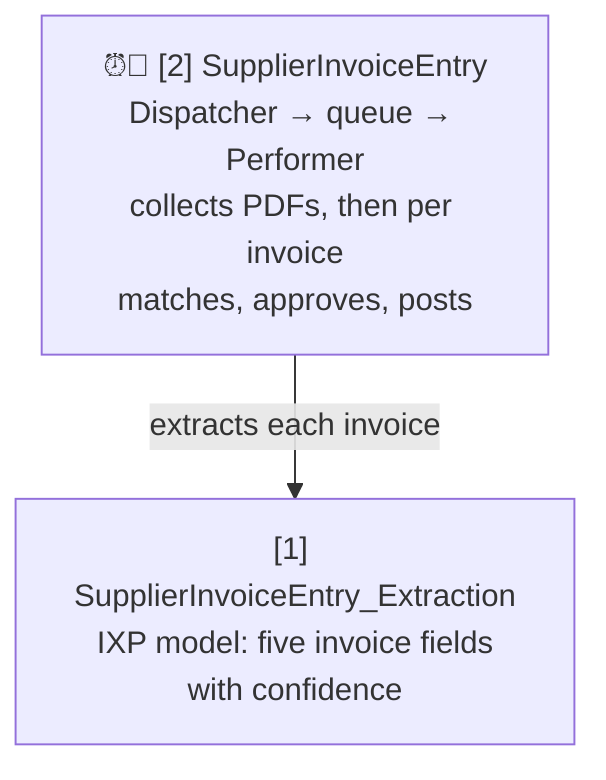

<!-- UIPATH-AUTOMATION-GENOME: process | This file is the high-level build specification for a multi-component
     UiPath automation. Each component has its own genome in the sibling folder named in Components.
     To build it, invoke the uipath-genome skill: it asks the configuration questions,
     then invokes the skills referenced in Components. Do NOT execute these steps directly, and do NOT
     start from a Components skill. To change it, invoke the uipath-planner skill. -->

# Genome: Supplier Invoice Entry

> Supplier invoices that arrive as PDFs in the Accounts Payable shared mailbox are read, checked against their purchase order in Contoso ERP, approved in Action Center when over the limit, and posted, or set aside with the reason.

> **This is a UiPath automation blueprint.** Do not execute these steps directly. Build it with the **uipath-genome** skill, which builds each component with the skill named in **Components**, then wires them per **Handoffs** and **Deployment**.

> Designed in: [Solution Design Document — Supplier Invoice Entry](supplier-invoice-entry-sdd.md) · sdd-sha256 a58b1a9eb5c72abe468cb25b19548915b1ef3032df3c570559916c3f565d01d1

## Overview

Accounts Payable at Contoso enters supplier invoices into Contoso ERP by hand. Each supplier sends its invoices as PDF attachments to the AP shared mailbox, each in its own layout. This automation takes over the entry. It collects every PDF from the mailbox and reads five fields from it: supplier, invoice number, invoice date, purchase order number and total. It checks the invoice against its purchase order in Contoso ERP. An invoice over the approval limit waits for an approver in Action Center. Every invoice that passes is posted in the ERP. The goals are less manual effort and fewer entry errors.

The process is owned by the Accounts Payable process owner. Volume is up to 50 invoices a day. Collection runs every 30 minutes during business hours, and each invoice is then worked on its own. The approval wait can last hours or days without holding up any other invoice.

An invoice is done when one of two things is true. Either it is posted in Contoso ERP, with the ERP document number recorded against its queue item. Or it is set aside: its PDF and the reason (unmatched, rejected, unreadable or duplicate) are mailed to the AP shared mailbox for a clerk to handle by hand, and the item is recorded as a business exception. No invoice is ever posted twice, and no invoice over the limit is posted without an approval.

## Actors and Systems

| Actor / System | Role | Notes |
|----------------|------|-------|
| Supplier | Human — sends invoices | PDF attachments to the AP shared mailbox; one PDF is one invoice |
| AP approvers group | Human — approves or rejects invoices over the limit | Action Center; the process waits on them |
| AP lead | Human — receives the escalation of an approval left open 5 business days | Action Center |
| AP clerks | Human — handle set-aside invoices by hand | Read set-aside notices in the AP shared mailbox; recipients only |
| AP shared mailbox | System — source of invoices; recipient of set-aside notices | Mail server; IMAP to read and SMTP to send, see component 2's D2 |
| Contoso ERP | System — purchase order lookup and invoice posting target | UI automation on a Windows unattended robot, see component 2's D1 |
| Action Center | System — approval tasks | Form task; the job suspends while it waits |

## Components

| # | Component | Type | Skill | Genome | Summary |
|---|-----------|------|-------|--------|---------|
| 1 | SupplierInvoiceEntry_Extraction | IXP model | `uipath-ixp` | [supplier-invoice-entry-extraction-genome.md](supplier-invoice-entry-genome/supplier-invoice-entry-extraction-genome.md) | Reads supplier, invoice number, invoice date, PO number and total from a supplier invoice PDF, with a confidence per field |
| 2 | SupplierInvoiceEntry | RPA process | `uipath-rpa` | [supplier-invoice-entry-genome.md](supplier-invoice-entry-genome/supplier-invoice-entry-genome.md) | Collects invoice PDFs from the mailbox into a queue, then per invoice extracts, matches the PO, gets approval over the limit, and posts or sets aside |

Build order follows the table unless **Handoffs** requires otherwise: the extraction model is built and deployed before the RPA process that calls it.

## Process Map

1. **Collect** — component 2 (collection stage): reads unread e-mails in the AP shared mailbox. It stores each PDF attachment and adds one queue item per PDF. It moves each e-mail to its processed or unprocessed folder. Exits when every unread e-mail has been handled.
2. **Extract and validate** — component 2 (invoice stage), calling component 1: reads the five invoice fields from the PDF and checks them. Exits with valid fields, or sets the invoice aside as Unreadable.
3. **Check against the ERP** — component 2: checks the invoice is not already in Contoso ERP, then matches it against its purchase order. Exits matched, or sets the invoice aside as Duplicate or Unmatched. An earlier attempt of the same item that already posted ends the item as Posted here.
4. **Approve** — component 2, with the AP approvers group in Action Center: an invoice over the limit waits for an Approve or a Reject. Exits approved, or sets the invoice aside as Rejected.
5. **Post or set aside** — component 2: posts the invoice in Contoso ERP and records the document number, or mails the set-aside notice. Exits when the queue item is final.

The components, their triggers and the queues.

Legend: ⏰ time trigger · 🔔 queue trigger · ⚡ event or API trigger · 👤 started by a person · no mark: invoked by another component. Solid arrow: adds to or takes from a queue, or calls a component; dotted arrow: a handoff through a file, a mail or a shared store.

## Handoffs

| From | To | Mechanism | Data passed | Failure behaviour |
|------|----|-----------|-------------|-------------------|
| 2 SupplierInvoiceEntry — collection stage (SupplierInvoiceEntry_Dispatcher) | 2 SupplierInvoiceEntry — invoice stage (SupplierInvoiceEntry_Performer) | Queue item, intra-component, on queue `SupplierInvoiceEntry_Invoices`; the PDF itself travels in storage bucket `SupplierInvoiceEntry_Invoices` | MessageId: Text, AttachmentIndex: Integer, AttachmentName: Text, BucketPath: Text, Sender: Text, ReceivedAt: Text (ISO 8601); reference `<MessageId>_<AttachmentIndex>` | An add the queue refuses as a duplicate reference counts as already added. A failed upload or add leaves the e-mail in the inbox for the next run (component 2, step 3). Invoice-stage failures are the queue's retries and the outcomes in Transactional Shape |
| 2 SupplierInvoiceEntry (invoice stage) | 1 SupplierInvoiceEntry_Extraction | Extraction model call (IXP, inside the invoice stage's job) | In: the invoice PDF. Out: Supplier: Text, InvoiceNumber: Text, InvoiceDate: Date, PONumber: Text, Total: Decimal, each with a confidence from 0 to 1 | A service error or no result is a system exception of the item: retried by the queue, then failed (component 2, step 6) |
| 2 SupplierInvoiceEntry (invoice stage) | AP approvers group (Action Center) | Action Center task, created by the invoice stage, which suspends until the task completes | To the approver: supplier, invoice number, invoice date, PO number, total, and the PDF. Back: Approved or Rejected; a reason, required on Reject | A task that cannot be created is a system exception: retried, nothing posted. An open task gets a reminder after 2 business days and goes to the AP lead after 5. The invoice keeps waiting until someone acts |

## Platform Dependencies

### Queues

| Queue | One item is | Item fields | Unique reference | Retries | Added by | Worked by |
|-------|-------------|-------------|------------------|---------|----------|-----------|
| `SupplierInvoiceEntry_Invoices` | one invoice PDF | MessageId: Text, AttachmentIndex: Integer, AttachmentName: Text, BucketPath: Text, Sender: Text, ReceivedAt: Text; output Supplier, InvoiceNumber, InvoiceDate, PONumber, Total, ERPDocumentNumber; analytics Outcome, ApprovalOutcome, SetAsideReason | `<MessageId>_<AttachmentIndex>`, on | component 2's Configuration Question 9 | component 2 | component 2 |

### Storage buckets

| Bucket | Holds | Written by | Read by |
|--------|-------|------------|---------|
| `SupplierInvoiceEntry_Invoices` | Each invoice PDF, from collection until the item is worked | component 2 | component 2 |

### Triggers

| Trigger | Starts | Kind | When | Runners |
|---------|--------|------|------|---------|
| SupplierInvoiceEntry collection schedule | component 2, collection entry point | Time | component 2's Configuration Question 1 | 1; a run is skipped while the previous one still runs |
| SupplierInvoiceEntry invoice queue trigger | component 2, invoice entry point | Queue | one job per new item on `SupplierInvoiceEntry_Invoices` | component 2's Configuration Question 10 |

### Action Center

| Resource | Used by | Purpose |
|----------|---------|---------|
| Approval form task, assigned to the approver group, with reminder and escalation | component 2 | Approve or reject an invoice over the limit |

### Document Understanding

| Resource | Used by | Purpose |
|----------|---------|---------|
| IXP extraction model `SupplierInvoiceEntry_Extraction`, deployed to the process folder | component 2 (built as component 1) | Field extraction from supplier invoice PDFs |

## Configuration Questions

No open values — no configuration needed.

## Open Decisions

1. Which sample supplier invoices, with their purchase orders, can the model training and the tests use? (material; answered by: whoever holds the source; until answered: synthetic supplier PDFs in several layouts, with test POs created in the ERP test instance; the model and the test data are trained and checked on those) — component 1, training documents; component 2, acceptance criteria

## Business Rules

- Invoices, purchase orders and the approval limit share one currency. No conversion is done.
- One PDF attachment is one invoice. An e-mail can carry several invoices, and each is worked and recorded on its own.
- Every invoice ends with exactly one outcome: Posted, or SetAside with a reason of Unmatched, Rejected, Unreadable or Duplicate. Every invoice records its approval result: NotRequired, Approved or Rejected.
- Nothing is posted without an Approve when the total is over the limit.

## Error Handling and Recovery

- Extraction model unavailable or failing: the invoice item fails as a system exception and the queue retries it. After the last retry the invoice is set aside with the error and the support owner is alerted (component 2, step 13).
- Approval task left open: the invoice keeps waiting with no robot held. The reminder and the escalation to the AP lead come from the task. Nothing times out.
- Partial completion between collection and work: an e-mail moves to its processed folder only after all its items are added, and the unique reference refuses a second item. A collection run that fails partway is completed by the next run without duplicates.
- A posting whose result is unknown (robot or ERP failed after submit): the retry finds the invoice by its queue reference in the ERP and completes the item as Posted. There is no second posting.

## Transactional Shape

**Flows:** Flow 1 — one invoice PDF: component 2 collection stage → component 2 invoice stage (Handoffs row 1).

### Flow 1 — one invoice PDF: component 2 collection stage → component 2 invoice stage

**Unit of work:** one invoice PDF attachment; reference `<MessageId>_<AttachmentIndex>` (the source e-mail's Message-ID and the 1-based position of the PDF in it); fields as in Handoffs row 1; up to 50 a day, collected every 30 minutes in business hours. Chosen because each invoice is matched, approved, posted or set aside on its own. The reference exists before the work starts. A retry redoes only one invoice.
**Alternative units of work:** one e-mail with all its PDF attachments — fits when the PDFs of one e-mail must be posted or set aside together, which nothing in the design asks today.

**As-is** — how the process handles the units, as designed:

| Aspect | As-is |
|---|---|
| Produced by | component 2, steps 1–3. Scheduled every 30 minutes in business hours, one source (the AP shared mailbox). The population is guarded by the queue's unique reference, and an e-mail is moved out of the inbox only when all its items are added |
| Consumed by | component 2, steps 4–14. One job per queue item, started by the queue trigger, at most 2 running at once. A job that waits for approval is suspended and holds no robot. Items are taken in arrival order, normal priority |
| Item store | Orchestrator queue `SupplierInvoiceEntry_Invoices` (encrypted). Per-item state is kept as specific content set at add, output fields and analytics set when the item completes, and status Successful or Failed (business or system). The PDF is in storage bucket `SupplierInvoiceEntry_Invoices` |
| Coordination | Unique reference: a rerun on the same e-mail adds no second item. The e-mail is moved to its processed folder after its last item is added, so a failed run is redone by the next one. The queue reference is written into the ERP invoice's reference text, so a retry recognises its own posting (component 2, steps 8 and 11) |
| Item kinds | one kind |
| Step groups | consumer once per run: steps 4 (one item per job, so once per job); per item: steps 5–13; at the end: step 14 |

Outcomes — these rows, whatever the source calls its per-item results (approved, rejected, skipped are Success or a Business exception; transactional shape guide rule 4):

| Outcome | When | Effect |
|---|---|---|
| Success | every per-item step completed | item Successful with Outcome Posted, the ERP document number and the approval result |
| Business exception | component 2 Step 7 rules: field unreadable; Step 8 rules: invoice already in the ERP; Step 9 rules: purchase order not matched; Step 10 rules: approval rejected | no retry; item Failed as a business exception with SetAsideReason; set-aside notice with the PDF mailed to AP (step 13) |
| System exception | every other failure — component 2 Step 6, 8, 9, 10 and 11 handlers: extraction failure, ERP unavailable, screen element missing, approval task not created, posting result unknown | ERP closed and reopened, item retried by the queue per component 2's Configuration Question 9, then recorded as failed with the error, set aside and alerted. One item per job, so no run-level consecutive stop |

**Split options** — rows A, B and C for the unit of work and for each unit the Alternative units line lists:

| Unit of work | Option | Requires | Changes against as-is |
|---|---|---|---|
| one invoice PDF | A | excluded: an approval wait of days inside one job holds every later invoice, and a system-error retry has to outlive the job that failed | One project and one schedule. Items live in the job; retries only within the run; per-invoice state visible only in the job log |
| one invoice PDF | B | Two projects (collection on a schedule, cross-platform and headless; invoice work on a queue trigger, Windows with a UI session), one queue, one storage bucket for the PDFs | As designed: collection keeps its own 30-minute cadence; each invoice retries and suspends on its own; per-invoice state in the queue |
| one invoice PDF | C | One project on one trigger and one machine type (Windows with a UI session for both roles), with the unique reference as the once-guard on every job's collection pass | One project. Collection runs inside each worker job, so the mailbox is read at the queue's pace, not on its own schedule. A suspended approval job still has to resume into the same entry point |
| one e-mail with all its PDFs | A | excluded: the same approval wait and cross-job retries as above | One job per e-mail. All its invoices retry together; one rejection holds its siblings |
| one e-mail with all its PDFs | B | One queue item per e-mail with its PDFs listed; the invoice stage works each PDF inside the e-mail's transaction and records per-PDF outcomes in a record store keyed by the reference | A retry redoes only the unfinished PDFs of the e-mail when their state survives. An approval on one PDF suspends the whole e-mail |
| one e-mail with all its PDFs | C | As B, in one project with the unique reference on the Message-ID as the once-guard | As B, with collection inside each worker job |

**Evidence:** Collection and invoice work have different cadences (a 30-minute schedule against one job per item) and different runtimes (cross-platform headless against a Windows UI session). An approval can wait hours or days, and the waiting job is suspended. A failed item must survive its job for the queue's retries. There is one source (the AP shared mailbox) and one item kind. Nothing outside the process reads the items, apart from the queue view for AP.
**Decided:** B, one invoice PDF — the SDD §10: SupplierInvoiceEntry_Dispatcher → SupplierInvoiceEntry_Performer
**Configuration:** settings — component 2's questions 1, 2, 3, 4, 5, 8, 10, 11; constants — component 2's questions 6, 7, 9; assets — every asset row of component 2's Platform Dependencies.
**Traceability:** Per invoice, the queue item carries its reference, status and, on completion, the extracted fields, Outcome, ApprovalOutcome, SetAsideReason and ERP document number. The queue reference is written into the ERP invoice and carried in every log line. A screenshot is logged on every system exception. Each collection run logs the e-mails read, items added and e-mails set aside. AP reads the queue view of `SupplierInvoiceEntry_Invoices` as its dashboard.

## Acceptance Criteria

1. Given two e-mails in the AP shared mailbox, one with an invoice under the limit and one with an invoice over the limit, both matching open purchase orders, a collection run adds two queue items. The first invoice is posted with ApprovalOutcome NotRequired. The second waits in Action Center and, on Approve, is posted with ApprovalOutcome Approved. Both e-mails end in the processed folder.
2. When Contoso ERP is down for an invoice's first attempt and restored before the retry, the item fails as a system exception, is retried, and ends Successful with exactly one invoice in the ERP.
3. Given an invoice naming a purchase order that does not exist, the item ends Failed as a business exception with SetAsideReason Unmatched, a set-aside notice with the PDF reaches the AP shared mailbox, and nothing is posted.
4. When the collection stage runs again on an e-mail whose invoices are already queued (the e-mail moved back to the inbox), no second queue item is added.
5. Given 50 production-like invoices from at least 5 suppliers, each is either posted correctly or set aside with the right reason. No invoice is posted twice, and no invoice over the limit is posted without an Approve.
6. When the robot is stopped right after an invoice's posting is submitted, the retry completes the item as Posted with the document number already in the ERP, and the ERP holds one invoice for it.

## Deployment

- **Packaging and route:** a single solution (`uipath-solution`), `SupplierInvoiceEntry`, holding the RPA projects SupplierInvoiceEntry_Dispatcher and SupplierInvoiceEntry_Performer (component 2, per the `Decided:` line) and the IXP model SupplierInvoiceEntry_Extraction (component 1). No libraries.
- **Entry points:** component 2's collection entry point, started by the collection schedule; component 2's invoice entry point, started by the queue trigger, one item per job, resumed by Orchestrator when its approval task completes. Component 1 is called by component 2. How each starts: Platform Dependencies, Triggers.
- **Runtime:** component 2's collection stage cross-platform, unattended, headless. Component 2's invoice stage Windows, unattended, with an interactive session at 1920×1080 for the ERP. Long-running with persistence for the approval wait; the job resumes on an unattended robot. Component 1 runs in the IXP service.
- **Kept out of the logs:** invoice contents beyond the reference, supplier, invoice number, PO number, outcome and set-aside reason. No totals or PDF content in logs, and no credential value anywhere.

UI targets: the Contoso ERP test instance

## Complexity

complex

## Tags

accounts-payable, supplier-invoices, contoso-erp, email, ixp, document-understanding, queues, action-center, human-in-the-loop, long-running, reframework, dispatcher-performer
