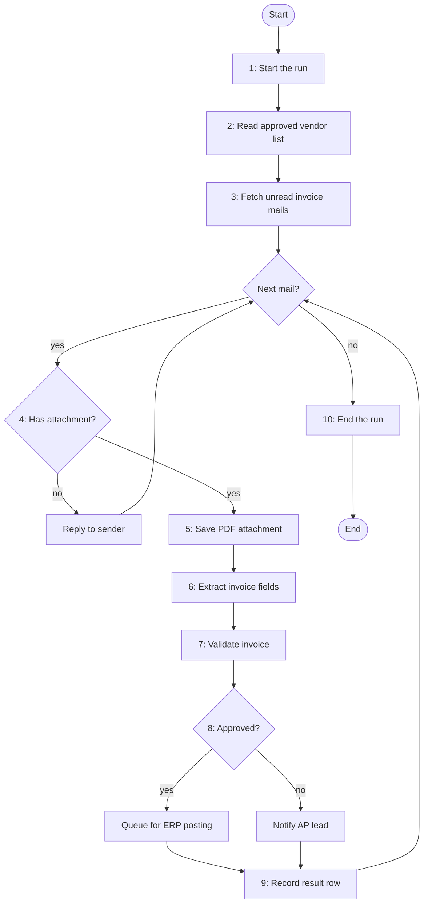

# Solution Design Document — Invoice Intake

---

## Document History

| Date | Version | Author | Role | Comments |
|---|---|---|---|---|
| 2026-11-22 | 1.0 | uipath-planner | Generated by AI Agent | `extract`: written from the extracted genome `invoice-intake-genome.md` (documentation request, unattended) |

---

<!-- DO NOT RENAME: uipath-planner detects SDDs via this exact heading or the marker below. -->
<!-- planner-handoff:v1 -->
## Planner Handoff

| Field | Value |
|---|---|
| **Status** | ready |
| **Execution autonomy** | autonomous |
| **Delivery model** | unspecified |
| **SDD scope** | single-product |
| **Generated by** | uipath-planner |
| **Generation date** | 2026-11-22 |
| **Template validation** | passed |
| **Genome** | invoice-intake-genome.md · genome-sha256 bd75f9677edc8d36b4147bfa336d2e23bf4d17069343e44641d45e9e753615d5 |

---

## Decisions Made

> What the genome decides. The genome is the source: change it there, and this document is written again from it.

| # | Decision | Picked | One-sentence reason |
|---|---|---|---|
| 1 | **Platform constraints** | unspecified; no products blocked | The genome names no platform; an RPA process runs on every delivery model. |
| 2 | **Build skill** | `uipath-rpa`, one RPA process | Mail, workbook, PDF text, file and queue work are all RPA activities; no screen is driven. |
| 3 | **Target** | RPA process on Portable | Every activity the steps need exists cross-platform (refactor answer, unattended default). |

---

## Recommended Scope

**Recommendation:** SINGLE_PRODUCT (RPA process)
**Delivery model:** unspecified
**Blocked by platform:** none
**Need profile:** Triage supplier invoice mails unattended: extract, validate against the approved vendor list, queue approved invoices for ERP posting.

---

## Action Required — SME Review Items

20 questions are open. Needed before the build: 4 — Material to supply: 1; Configuration values: 3. Every other item has a default the build uses until someone changes it. By role: the process owner 6; the ERP posting process owner 1; whoever knows the process 1; whoever holds the source 1; the environment's owners 10; the delivery lead or the centre of excellence 1. The build's own questions (the split, the libraries, the technology, the setup) are not here: they are asked when the build is prepared or starts.

How to answer:
1. After an item's `Answer`, write the letter of the option you choose, a value, `default` to keep a value's default, or your own words. An item left blank stays open.
2. Or ask `uipath-planner` to interview you on them: "Interview me on the open questions", adding a role to be asked only that person's. It first asks how you want to answer: every item, only what needs a decision, or the defaults.
3. Then ask it to "Apply the answers". It writes them into the genome and this document.

### Business decisions

5 business outcomes, 1 run behaviour, 1 reading. None stops the build: each is built as marked `(built now)` until you answer. Start with the business outcomes, because each one changes what the automation does for the business.

#### Business outcomes

##### Invoice Intake

**D1. When a mail carries several PDF attachments, which invoice does the run work?**
- **Context:** The robot saves every PDF of a mail. The original project never captured the saved file's path, so it never said which PDF it meant to work.
- **See:** step 5, Save the PDF attachment
- **Options:**
  - a. Work the first saved PDF as the mail's one invoice. Other PDFs are saved but not worked. (built now)
  - b. Work every saved PDF as its own invoice. Each is extracted, validated and queued or rejected on its own.
- **Answer (by the process owner):**

**D3. Should a handled mail be marked read or moved, so a later run does not take it again?**
- **Context:** The robot reads only unread mails and never marks them read. Every run takes the same mails again. That means a second queue item, rejection notice or reply for the same mail on each run.
- **See:** step 3, Fetch unread invoice mails
- **Options:**
  - a. Leave mails unread, as today. (built now)
  - b. Mark each handled mail read.
  - c. Move each handled mail to a processed folder.
- **Answer (by the process owner):**

**D4. A mail whose attachments hold no PDF: reply to the sender, or fail as the original does?**
- **Context:** The original checks only that a mail has some attachment. A mail with only a Word file fails later. The reply text itself says "did not contain a PDF invoice".
- **See:** step 4, Check the mail carries an attachment
- **Options:**
  - a. Send the attachment-missing reply to the sender. (built now)
  - b. Keep the original behaviour: the mail fails as a system error.
- **Answer (by the process owner):**

**D5. Does the ERP posting queue refuse a second item with the same invoice number?**
- **Context:** Each approved invoice is queued with its invoice number as reference. The queue's settings were not available. Together with D3, this decides whether duplicates reach ERP posting.
- **See:** Section 12, Queue Architecture
- **Options:**
  - a. Leave the queue as the target environment has it. This build does not set uniqueness. (built now)
  - b. Enforce a unique reference, so a duplicate invoice is refused.
- **Answer (by the ERP posting process owner):**

**D7. Once an invoice is queued, should a later failure for that mail still move its PDF to the failed folder?**
- **Context:** Any failure moves the saved PDF to the failed folder. If the invoice was already queued, the queue item then points to a PDF that is no longer there.
- **See:** Section 8, Error Handling
- **Options:**
  - a. Move the PDF anyway, as today. (built now)
  - b. Leave a queued invoice's PDF in the inbox folder.
- **Answer (by the process owner):**

#### How a run behaves

##### Invoice Intake

**D2. Which columns does a row of the intake log carry, when it is kept?**
- **Context:** The original meant to add one row per mail to the intake log workbook. It never filled the row, so no columns are known. Whether the log is kept at all is CQ10.
- **See:** step 9, Record the result row
- **Options:**
  - a. One row per handled mail: sender, vendor, invoice number, amount, approved or rejected, rejection reason, time handled. (recommended) (built now)
  - b. Other columns, in your words.
- **Answer (by the process owner):**

#### The genome's readings

##### Invoice Intake

**D6. What starts a run, and how often?**
- **Context:** The project holds no trigger and does not run in Orchestrator today.
- **See:** step 1, Start the run
- **Options:**
  - a. Started on demand, with the mailbox folder to read. (built now)
  - b. something else, in your words
- **Answer (by whoever knows the process):**

#### Defects the rebuild fixes

The source states what each was meant to do, and the rebuild does that. Name any the rebuild should keep as the source does.

- Invoice Intake, step 6, Extract invoice fields: the log line for an unreadable invoice names the previous mail's invoice number. The rebuild names this mail's invoice number, empty when it could not be read.
- **Answer (by the process owner):**

### Material to supply

**D8. What do the approved vendor workbook's rows look like? Supply a sample of `ApprovedVendors.xlsx`.**
- **See:** step 2, Read the approved vendor list
- **Until answered:** the build reads sheet `Vendors` with columns `VendorName` and `CreditLimit`, as the original names them, and tests with a sample workbook it makes.
- **Answer (by whoever holds the source):**

### Configuration values

#### Invoice Intake

**CQ1. Which IMAP server and port serve the AP mailbox?**
- **Kind:** setting
- **Default:** `imap.contoso.com`, port 993, SSL
- **Answer (by the environment's owners):**

**CQ2. Which mailbox account does the run read?**
- **Kind:** setting
- **Default:** `ap-invoices@contoso.com`
- **Answer (by the environment's owners):**

**CQ3. Which mailbox folder does the run read — the start argument?**
- **Kind:** setting
- **Until answered:** built as an empty start argument the run stops on. The original has no default.
- **Answer (by the environment's owners):**

**CQ4. Which credential asset holds the AP mailbox's sign-in?**
- **Kind:** setting
- **Until answered:** built as an empty setting the run stops on. The original sets no password.
- **Answer (by the environment's owners):**

**CQ5. Which SMTP server, port, sending address and credential asset send the run's mails?**
- **Kind:** setting
- **Until answered:** built as empty settings; every reply and rejection notice fails until set.
- **Answer (by the environment's owners):**

**CQ6. Who receives the rejection notice?**
- **Kind:** setting
- **Default:** `ap-lead@contoso.com`
- **Answer (by the environment's owners):**

**CQ7. Where is the approved vendor workbook?**
- **Kind:** setting
- **Default:** `C:\Finance\Config\ApprovedVendors.xlsx`
- **Answer (by the environment's owners):**

**CQ8. Which folders hold the saved invoices — the inbox folder and the failed folder?**
- **Kind:** setting
- **Default:** `C:\Finance\Invoices\Inbox` and `C:\Finance\Invoices\Failed`
- **Answer (by the environment's owners):**

**CQ9. Which queue receives approved invoices?**
- **Kind:** setting
- **Default:** `ERP_InvoicePosting`
- **Answer (by the environment's owners):**

**CQ10. Does the run keep writing its intake log workbook besides the job's log?**
- **Kind:** constant
- **Default:** the job's log in Orchestrator only. The option keeps one row per handled mail in the workbook of CQ11.
- **Answer (by the process owner):**

**CQ11. Where is the intake log workbook, when kept?**
- **Kind:** setting
- **Default:** `C:\Finance\Invoices\IntakeLog.xlsx`, sheet `Log`
- **Answer (by the environment's owners):**

### Preferences

**Which preferences file should the build follow?**
- **Context:** The development standards and standing answers the build follows beyond the genome: naming, project structure, logging, error handling, code, testing, packaging.
- **Default:** none: the building skills' own practice
- **Answer (by the delivery lead or the centre of excellence):**

---

## Table of Contents

1. Process Overview
2. Process Map
3. Detailed Process Steps
4. Business Rules
5. Data Definitions
6. Value Mappings
7. Exception Handling
8. Error Handling
9. Application Inventory
10. Master Project Architecture
11. Project Structure
12. Queue Architecture
13. Implementation Mode
14. Packages
15. Credentials & Assets
16. Deployment Environment
17. Testing Strategy
18. Next Steps

---

<!-- planner-sdd-body:v1 -->
## 1. Process Overview

| Field | Value |
|---|---|
| **Process name** | Invoice Intake |
| **Objective** | Triage supplier invoice mails of the AP mailbox: extract vendor, invoice number and total from each PDF, validate against the approved vendor list, queue approved invoices for ERP posting, notify on rejections and missing attachments. |
| **Department / Function** | Finance — Accounts payable |
| **Schedule** | [SME REVIEW] D6: started on demand today |
| **Volume** | Not recorded; at most 50 mails per run |
| **Avg. handling time (manual)** | Not recorded |
| **Avg. handling time (automated target)** | Not recorded |
| **Exception rate** | Not recorded |
| **Source PDD** | None. Documented from the existing UiPath project `InvoiceIntake` (version 1.4.0). |

### Delivery Team

No contacts are recorded in the source.

### In Scope

- Steps 1–10 of the genome: fetch unread invoice mails, save the PDF, extract fields, validate, queue or reject, record the result, log the run.

### Out of Scope

- The ERP posting process that works the `ERP_InvoicePosting` queue.
- Maintaining the approved vendor workbook.

### Assumptions

- [SME REVIEW] D6: a run is started on demand with the mailbox folder to read.
- [SME REVIEW] D1: a mail carries one invoice; the first saved PDF is worked.

---

## 2. Process Map



| Step | Description | Application |
|---|---|---|
| 1 | Start the run | — |
| 2 | Read the approved vendor list | Approved vendor workbook |
| 3 | Fetch unread invoice mails | AP mailbox (IMAP) |
| 4 | Check the mail carries an attachment | AP mailbox; SMTP |
| 5 | Save the PDF attachment | Shared folders |
| 6 | Extract invoice fields | PDF |
| 7 | Validate the invoice | — |
| 8 | Route the invoice | Orchestrator queue; SMTP |
| 9 | Record the result row | Intake log workbook |
| 10 | End the run | — |

---

## 3. Detailed Process Steps

### Step Summary

| # | Action | Application | Input | Output | Rules | Errors |
|---|---|---|---|---|---|---|
| 1 | Log "Invoice intake started for folder {folder}" | — | mailbox folder | log line | — | — |
| 2 | Read sheet `Vendors`, first row headers | Approved vendor workbook | workbook | vendor table | — | E2 |
| 3 | Take unread mails of the folder, at most 50 | AP mailbox | folder | mails | — | E1 |
| 4 | No attachment → reply to sender, skip | SMTP | mail | continue or reply | BR-01 | B1 |
| 5 | Save `.pdf` attachments to the inbox folder | Shared folders | mail | PDF path | BR-02 | E3 |
| 6 | Read PDF text; vendor, invoice number, total | PDF | PDF | fields | BR-03 – BR-06 | B2, E3 |
| 7 | Vendor known; amount within limits | — | fields, vendor table | approved, reason | DT1 | B3, E3 |
| 8 | Approved → queue item; rejected → mail AP lead | Queue; SMTP | fields | item or notice | BR-07 | E3 |
| 9 | Append result row (when kept) | Intake log | result | row | — | E3 |
| 10 | Log "Invoice intake finished. Emails processed: {count}" | — | mails | log line | — | — |

### Step Details

#### Step 5 — Save the PDF attachment

Every attachment whose name ends in `.pdf` is saved to the inbox folder. The original never captured the saved path; the rebuild captures it and works the first saved PDF [SME REVIEW] D1: several PDFs in one mail.

#### Step 6 — Extract invoice fields

The text is read without layout. Vendor = first non-empty line, trimmed. Invoice number and total are the first matches of the patterns in BR-04 and BR-05. Missing total or empty invoice number → B2. The amount is the total with commas removed, `.` as decimal point.

#### Step 9 — Record the result row

Kept only when CQ10 says so [SME REVIEW] D2: columns of the row. The original appended a table it never filled.

---

## 4. Business Rules

| ID | Rule Name | Description | Trigger Condition | Validation (regex / range / type / allowed values) | Affected Steps |
|---|---|---|---|---|---|
| BR-01 | Invoice attachment present | A mail must carry a PDF attachment [SME REVIEW] D4: the original tested any attachment | each mail | at least one attachment named `*.pdf` | 4 |
| BR-02 | PDF only | Only `.pdf` attachments are saved | step 5 | file name ends `.pdf` | 5 |
| BR-03 | Vendor name | First non-empty line of the PDF text, trimmed | step 6 | non-empty string | 6 |
| BR-04 | Invoice number | First match, ignoring case, anywhere in the text | step 6 | `Invoice\s*(?:No\|Number\|#)[:.]?\s*([A-Z0-9-]+)`, captured group; must be non-empty | 6 |
| BR-05 | Total | First match, ignoring case; also matches inside `Subtotal` | step 6 | `Total\s*(?:Due)?[:.]?\s*[$€]?\s*([0-9][0-9,]*\.?[0-9]{0,2})`, captured group | 6 |
| BR-06 | Amount | Total with commas removed, decimal point `.` | step 6 | decimal number | 6, 7 |
| BR-07 | Route | Approved → ERP posting queue; rejected → AP lead notice; a rejected invoice is not queued | step 8 | approved flag | 8 |

### Decision Tables

#### DT1 — Invoice validation
**Hit policy:** FIRST
**Inputs:** `VendorKnown` (boolean — trimmed, case-insensitive equality with a `VendorName` row), `Amount` (number), `CreditLimit` (number — first matching row)
**Output:** `Approved` (boolean), `Reason` (string)
**Runs in:** step 7

| # | VendorKnown | Amount | → Approved, Reason | Rule |
|---|---|---|---|---|
| 1 | false | any | false, `Vendor not in approved vendor list` | DT1 |
| 2 | true | ≤ 0 | false, `Amount must be positive` | DT1 |
| 3 | true | > 25000 | false, `Amount exceeds auto-approval ceiling of 25000` | DT1 |
| 4 | true | > CreditLimit | false, `Amount exceeds vendor credit limit of {CreditLimit}` | DT1 |
| 5 | true | otherwise | true, empty | DT1 |

### Rules That Need Reasoning

None. Every rule is deterministic.

---

## 5. Data Definitions

The implementation mode is decided when the build is prepared (Section 13); the data below holds for either.

### Start Argument

| Key | Type | Source | Description |
|---|---|---|---|
| MailboxFolder | String | start of run | IMAP folder to read (CQ3) |

### Queue Item Data

See Section 12, Queue Item Schema.

### Status/Category Values

| Variable | Allowed Values |
|---|---|
| Validation result | approved, rejected |
| Rejection reason | the four reasons of DT1 |

---

## 6. Value Mappings

None. No rule maps one value to another.

---

## 7. Exception Handling

| ID | Exception Name | Trigger Step | Trigger Condition | Action |
|---|---|---|---|---|
| B1 | Attachment missing | 4 | mail has no attachment (no PDF: D4) | Warn log "No attachment on mail from {sender} - skipping"; reply to sender, subject `Invoice not processed - attachment missing`, body `Your email did not contain a PDF invoice. Please resend with the invoice attached.`; next mail |
| B2 | Unreadable invoice | 6 | total not found or invoice number empty | Warn log "Business rule failure for {invoice number}: {reason}"; PDF stays in the inbox folder; no notice; next mail |
| B3 | Invoice rejected | 7 | DT1 rows 1–4 | Mail to the AP lead (CQ6), subject `Invoice {number} rejected`, body `Vendor: …`, `Amount: …`, `Reason: …` on three lines; not queued |

**Default handler:** none beyond B1–B3: no item is retried.

---

## 8. Error Handling

| ID | Error Name | Trigger Step | Trigger Condition | Retry Policy | Action |
|---|---|---|---|---|---|
| E1 | Mailbox unavailable | 3 | fetch fails | up to 3 attempts, 30 s apart | then the run ends with no mail worked |
| E2 | Vendor workbook unreadable | 2 | read fails | none | the run ends |
| E3 | Per-mail failure | 5–9 | any other failure (PDF unreadable, credit limit not a number, queue or mail server refuses) | none (0×) | Error log "Failed to process mail from {sender}: {message}"; PDF moved to the failed folder, overwriting; next mail. [SME REVIEW] D7: the PDF is moved even after the invoice was queued |

**Default handler:** any failure outside steps 4–9 ends the run; no screenshot beyond the robot's own on failure, no notification. The run never stops on consecutive failures. Values of names starting `Private:` or containing `password` are kept out of the logs.

---

## 9. Application Inventory

| # | Application | Interface | Access Method | Role | Interaction Pattern | Session Management |
|---|---|---|---|---|---|---|
| 1 | AP mailbox | API | IMAP, SSL, port 993 (CQ1–CQ4) | Source | READ | PER_RUN |
| 2 | Mail server | API | SMTP (CQ5) | Target | WRITE | PER_ITEM |
| 3 | Approved vendor workbook | File | Workbook read, Excel not required (CQ7) | Source | READ | PER_RUN |
| 4 | PDF invoices | File | PDF text read, no OCR | Source | READ | PER_ITEM |
| 5 | Shared folders | File | File system (CQ8) | Utility | READ-WRITE | PER_ITEM |
| 6 | Intake log workbook | File | Workbook append (CQ10, CQ11) | Target | WRITE | PER_ITEM |
| 7 | Orchestrator queue | API | Add queue item (CQ9) | Target | WRITE | PER_ITEM |

### Integration Service Connections

None. Mail is read over IMAP and sent over SMTP.

---

## 10. Master Project Architecture

### Option B — Single Project

**Boundaries named:** none — one project.

---

## 11. Project Structure

### Solution / Project Breakdown

| Project | Product (RPA / API / Agent / …) | GitHub Repository | Folder | Attended / Unattended |
|---|---|---|---|---|
| InvoiceIntake | RPA | Not recorded | Decided when the build is prepared | Unattended |

### Reusable Components

None. No library is used or published.

### Project Type

| # | Project Name | Sub-type |
|---|---|---|
| 1 | `InvoiceIntake` | Process |

### Project Mode Decision

| # | Project | Type | Compatibility | Authoring | Attendance | Initiation | Framework | Persistence (long-running) | Packaging |
|---|---|---|---|---|---|---|---|---|---|
| 1 | `InvoiceIntake` | Process | Cross-platform (Portable) | Decided when the build is prepared | Unattended | Manual [SME REVIEW] D6: what starts a run | Decided when the build is prepared — the split options of the genome's Transactional Shape | NO | Decided when the build is prepared |

### Recommended Structure

Decided when the build is prepared. The source is a flat project: one main workflow calling an extraction workflow and a validation workflow.

### Workflow Inventory

| # | Workflow File | Responsibility | PDD Steps | Inputs | Outputs |
|---|---|---|---|---|---|
| 1 | Main | Run, per-mail loop and routing | 1–5, 8–10 | MailboxFolder: String | — |
| 2 | ExtractInvoiceFields | Read the PDF and its fields | 6 | PdfPath: String | VendorName: String, InvoiceNumber: String, Amount: Double |
| 3 | ValidateInvoice | Apply DT1 | 7 | VendorName: String, Amount: Double, ApprovedVendors: DataTable | IsApproved: Boolean, Reason: String |

The source's file names; the rebuild's layout is decided when the build is prepared.

### Workflow Dependencies

```text
Main
├── calls ExtractInvoiceFields
└── calls ValidateInvoice
```

---

## 12. Queue Architecture

### Queue Definitions

| Queue Name | Producer Project | Consumer Project | Trigger Type | Max Retries |
|---|---|---|---|---|
| `ERP_InvoicePosting` | `InvoiceIntake` | the ERP posting process (outside this design) | not known | not known |

### Queue Configuration

#### `ERP_InvoicePosting` — configuration

| Setting | Decision |
|---|---|
| **Unique reference** | [SME REVIEW] D5: reference is the invoice number; uniqueness not set by this build |
| **Retry ownership** | The consumer's; not in this design |
| **Priority / Deadline / Postpone** | Normal; no deadline; no postpone |
| **Queue SLA / risk SLA** | — |
| **Encryption** | Not recorded |
| **Analytics fields** | — |
| **Retention / archival** | Not recorded |
| **Poison items** | The consumer's |
| **Trigger threshold** | The consumer's |

### Queue Item Schema

#### `ERP_InvoicePosting` — SpecificContent fields

| Field Name | Type | Source | Description |
|---|---|---|---|
| `VendorName` | STRING | step 6 | Vendor name read from the PDF |
| `InvoiceNumber` | STRING | step 6 | Invoice number; also the item reference |
| `Amount` | DOUBLE | step 6 | Invoice total |
| `PdfPath` | STRING | step 5 | Path of the saved PDF in the inbox folder |

### Queue Processing Rules

- One item per approved invoice; rejected invoices are not queued.
- The item is added before the result row; a later failure still moves the PDF ([SME REVIEW] D7: PDF of a queued invoice).
- A mail taken again by a later run queues its invoice again unless the queue refuses the reference (D3, D5).
- Split of the mail loop itself (one job, or a mail queue between a producer and a consumer): the genome's Transactional Shape lists options A, B and C. Decided when the build is prepared.

---

## 13. Implementation Mode

**Recommendation:** Decided when the build is prepared.

**Justification (2-3 sentences):** The source is XAML. The steps are mail, file and workbook activities plus two pattern matches and a five-row decision (Section 4); XAML holds them, and a coded workflow for steps 6–7 is the other option. The genome leaves the choice to the build.

---

## 14. Packages

| Package | Version | Purpose |
|---|---|---|
| `UiPath.System.Activities` | Latest | Core, files, queue add, logging |
| `UiPath.Mail.Activities` | Latest | IMAP read, SMTP send, save attachments |
| `UiPath.Excel.Activities` | Latest | Workbook read and append |
| `UiPath.PDF.Activities` | Latest | PDF text read |

Package versions are decided when the build is prepared. The source pinned the versions above at 25.10.0, 2.4.1, 3.1.0 and 3.20.1, and also referenced UI Automation, which no step uses.

---

## 15. Credentials & Assets

| Asset Name | Type | Description | Notes |
|---|---|---|---|
| Named by CQ4 | CREDENTIAL | AP mailbox sign-in, `ap-invoices@contoso.com` | Not in the source |
| Named by CQ5 | CREDENTIAL | SMTP sending account | Not in the source |

Every other value is a Configuration value: CQ1–CQ3, CQ6–CQ11.

---

## 16. Deployment Environment

### Robot & Runtime

| Field | Value |
|---|---|
| **Robot type** | UNATTENDED |
| **Trigger** | MANUAL [SME REVIEW] D6: what starts a run |
| **Orchestrator tenant / folder** | Decided when the build is prepared |
| **UiPath Studio version** | Source built with 25.10.0 |
| **UiPath Robot version** | Decided when the build is prepared |
| **Orchestrator** | Decided when the build is prepared |
| **Cross-platform / Windows-only** | Cross-platform (source: Windows) |
| **Source repository** | Not recorded |
| **Shared libraries referenced** | none |

### Environments (DEV / UAT / PROD)

Not in the genome: decided when the build is prepared.

### Development & Production Hosts

Not in the genome: decided when the build is prepared.

### Runtime Prerequisites

- Network access to the IMAP and SMTP servers.
- Read access to the approved vendor workbook; write access to the inbox, failed and intake log locations.
- An Orchestrator connection, for the queue add.

### Scalability & Concurrency

One job, one robot; at most 50 mails per run. Volumes are not recorded.

### Operational Support

| Concern | Design decision |
|---|---|
| **Idempotency** | [SME REVIEW] D3: mails stay unread and are retaken; D5 decides whether the queue refuses duplicates |
| **Checkpoint & restart** | None: a run takes the folder's unread mails again |
| **Session recovery** | None |
| **Correlation & logging** | Queue reference = invoice number; log lines name the sender |
| **Alerting** | None in the source |
| **Dashboards** | Not recorded |
| **Reprocessing** | Failed PDFs are in the failed folder; their mails stay unread |
| **Support ownership** | Not recorded |
| **Business continuity** | Not recorded |

### Security & Data Handling

| Concern | Design decision |
|---|---|
| **Data classification & PII** | Sender addresses and invoice data in logs; names starting `Private:` or containing `password` kept out |
| **Credentials** | Credential assets of CQ4 and CQ5; none in the source |
| **Service accounts & privilege** | Not recorded |
| **Encryption** | IMAP over SSL |
| **Retention & audit** | Not recorded |
| **Network** | Not recorded |

### Delivery Quality Gates

Not in the genome: decided when the build is prepared.

### Non-Functional Requirements

| Dimension | Requirement / Design decision |
|---|---|
| **Performance** | Headless; no UI; Portable robot |
| **Compliance** | — |

---

## 17. Testing Strategy

### Requirements Traceability

| PDD Step / Rule | Covered By (test IDs) |
|---|---|
| Steps 1, 10 | AC 1, 20, 21 |
| Step 2 | AC 2 |
| Step 3 | AC 3, 4, 22 |
| Step 4, BR-01 | AC 5, 6 |
| Step 5, BR-02 | AC 7 |
| Step 6, BR-03 – BR-06 | AC 8, 9, 10, 11 |
| Step 7, DT1 | AC 12, 13, 14 |
| Step 8, BR-07 | AC 15, 16 |
| Step 9 | AC 19 |
| E3 | AC 17, 18 |

AC numbers are the genome's Acceptance Criteria.

### Canonical Test Case

| Field | Value |
|---|---|
| PDF first line | `Acme Ltd` |
| Invoice text | `Invoice No: INV-1001`, `Total Due: $1,234.50` |
| Vendor list row | `Acme Ltd`, credit limit 10000 |
| Expected | queue item, reference `INV-1001`, Amount 1234.5 |

### Happy Path Assertions

1. One `ERP_InvoicePosting` item, reference `INV-1001`, priority Normal, fields VendorName, InvoiceNumber, Amount, PdfPath (AC 15).
2. No mail to the AP lead or the sender.

### Exception Test Cases

| Exception ID | Test Setup | Trigger | Expected Outcome |
|---|---|---|---|
| B1 | mail with no attachment | run | reply to sender; nothing queued (AC 5, 6) |
| B2 | PDF with no total | run | Warn log; PDF stays in inbox (AC 11) |
| B3 | unknown vendor; amounts 0, 30000, 12000 | run | AP lead notices with the DT1 reasons (AC 13, 14, 16) |

### System Error Scenarios

| Error ID | Testable in Dev? | How to Simulate | Expected Outcome |
|---|---|---|---|
| E1 | YES | mailbox unreachable | 3 attempts, 30 s apart, then run ends (AC 4) |
| E2 | YES | workbook missing | run ends before fetching (AC 2) |
| E3 | YES | credit limit not a number; queue refuses | Error log; PDF moved to failed folder; next mail (AC 17, 18) |

### Non-Functional Tests

| Test | Scenario | Expected |
|---|---|---|
| Performance / load | 60 unread mails | at most 50 worked (AC 3) |
| Concurrent robots | — | one robot in the source |
| Recovery / restart | second run over the same unread mails | mails retaken (AC 22, D3) |
| Credential expiration | expired mailbox credential | E1, then run ends |
| UI compatibility | — | no UI |
| Security | log review | no password values in logs |

### UAT Acceptance Criteria

1. Every Acceptance Criterion 1–22 of the genome passes.

### Test Data & Cleanup

| Item | Decision |
|---|---|
| **Test data source** | Synthetic PDFs and vendor workbook (D8) |
| **Cleanup** | Remove test queue items, saved PDFs and sent test mails per environment |

### Production Verification

1. First production run's queue items checked against their PDFs.

---

## 18. Next Steps

The genome `invoice-intake-genome.md` is the source of this document. To build, invoke `uipath-genome` with that genome: it asks the configuration values above, the build's own questions, and builds through `uipath-rpa`. Answers to the items above go back into the genome through `uipath-planner` ("Apply the answers").

### Terminal artefact — packaging per the §11 Project Mode Decision

Decided when the build is prepared: a standalone package published to an Orchestrator feed, or a Solution (`.uipx`).

---

**End of Solution Design Document.**
