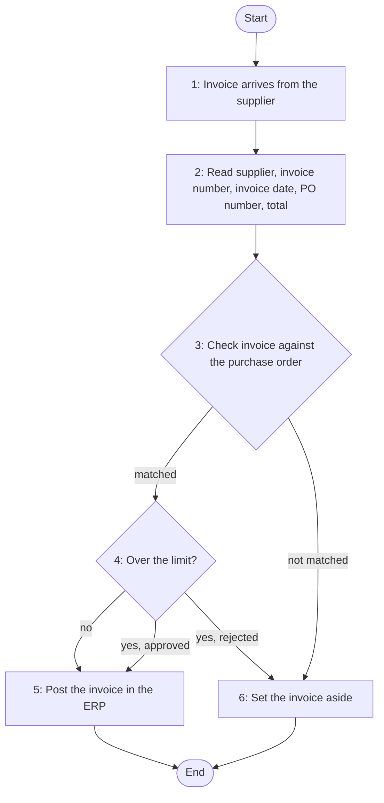
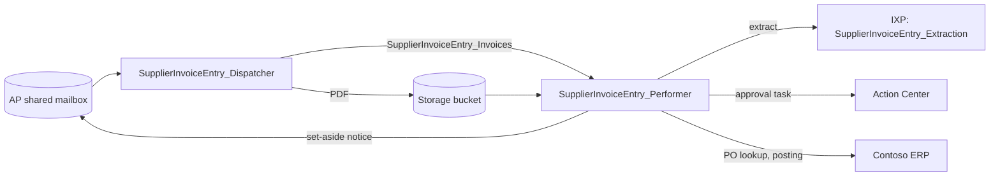

# Solution Design Document — Supplier Invoice Entry

---

## Document History

| Date | Version | Author | Role | Comments |
|---|---|---|---|---|
| 2026-11-22 | 1.0 | uipath-planner | Generated by AI Agent | Initial SDD generated from PDD (`pdd.md`) |
| 2026-11-22 | 1.0 | uipath-planner | Generated by AI Agent | Interview: 4 points answered by the process owner; 0 left open |

---

<!-- DO NOT RENAME: uipath-planner detects SDDs via this exact heading or the marker below. -->
<!-- planner-handoff:v1 -->
## Planner Handoff

| Field | Value |
|---|---|
| **Status** | ready |
| **Execution autonomy** | interactive |
| **Delivery model** | cloud |
| **SDD scope** | single-product |
| **Project list section** | §10 + §11 |
| **Generated by** | uipath-planner |
| **Generation date** | 2026-11-22 |
| **Template validation** | passed |

---

## Recommended Scope

**Recommendation:** RPA Process — Master Project (`SupplierInvoiceEntry_Dispatcher` + `SupplierInvoiceEntry_Performer`), with an IXP extraction model and an Action Center approval as integrated components
**Delivery model:** cloud
**Blocked by platform:** none
**Need profile:** Deterministic entry of supplier invoices (PDFs, a different layout per supplier) into Contoso ERP, with a PO check and an approval over the limit. The target is less manual effort and fewer entry errors.

**Reasoning:**
- Input is semi-structured, because every supplier uses a different PDF layout. Extraction goes to an IXP model, called in-process by the Performer.
- The PO match and the approval threshold are written rules, so no Agent is needed.
- One human approval inside one process → a long-running RPA workflow with an Action Center task, not Maestro.
- Contoso ERP has no confirmed API, so it is driven through its UI by an unattended robot (see D5).
- Each invoice succeeds or fails on its own → one queue item per invoice, handled by a REFramework Performer.

**Alternatives considered:**
- Maestro Flow — rejected: one approval inside one process is light orchestration that RPA absorbs.
- Agent — rejected: no step needs judgment the rules cannot express.
- API Workflow — rejected: no confirmed ERP API, and the mailbox is read by a robot.

---

## Action Required — SME Review Items

11 questions are open: 0 needed before the genome is written, the rest with a default applied in its section. By role: the process owner 2; the environment's owners 5; the system's owner 2; the delivery lead 1; whoever holds the source 1.

**D1. What are today's manual handling time per invoice, the share of invoices set aside, and the busiest period?**
- **Context:** The PDD records no baseline. Sizing and the business case use it.
- **See:** §1 Process Overview
- **Default:** not recorded; sizing uses up to 50 invoices a day and 5 minutes per invoice until UAT measures it.
- **Answer (by the process owner):**

**D2. What are the business hours, calendar and time zone for the Dispatcher's schedule?**
- **Context:** The Dispatcher polls every 30 minutes during business hours.
- **See:** §1 Process Overview; §16 Scalability & Concurrency
- **Default:** Monday to Friday, 08:00–18:00, Contoso's local time zone, no holiday calendar.
- **Answer (by the environment's owners):**

**D3. What is the approval limit?**
- **Context:** An invoice strictly above the limit needs approval. The value is held in the `SupplierInvoiceEntry_ApprovalLimit` asset.
- **See:** step 4, approval over the limit; §4 DT2
- **Default:** the asset is left empty, and every invoice goes to approval until it is set.
- **Answer (by the process owner):**

**D4. Which mail platform hosts the AP shared mailbox, and how should the robot reach it?**
- **Context:** The PDD says only "E-mail". The choice changes the package and the assets.
- **See:** step 1, collect invoices; §9 Application Inventory
- **Options:**
  - a. IMAP to read and SMTP to send, with `UiPath.Mail.Activities` (built now)
  - b. Microsoft 365 through the Outlook 365 Integration Service connector
  - c. Gmail through the Gmail Integration Service connector
- **Answer (by the system's owner):**

**D5. How is Contoso ERP reached: web UI, desktop client, or an API?**
- **Context:** The PDD names Contoso ERP but no interface. The PO lookup and the posting run on it. The posting must also take the queue reference in a reference text field.
- **See:** step 3, PO check; step 5, post the invoice; §9 Application Inventory
- **Options:**
  - a. UI automation of the ERP screens on a Windows robot (built now)
  - b. A REST API, through a catalog or custom Integration Service connector
  - c. something else, in your words
- **Answer (by the system's owner):**

**D6. Are there shared libraries or existing automations in Contoso's tenant that this design should reuse?**
- **Context:** The tenant search ran only against a UiPath staging tenant, not Contoso's tenant.
- **See:** §11 Reusable Components; §16 Robot & Runtime
- **Default:** none; public packages only.
- **Answer (by the delivery lead or the centre of excellence):**

**D7. Which Orchestrator tenant and folder, Studio and Robot versions, and source repository does the solution use?**
- **Context:** Deployment facts the PDD does not give.
- **See:** §11 Solution / Project Breakdown; §16 Robot & Runtime
- **Default:** a folder named `SupplierInvoiceEntry` in Contoso's Automation Cloud tenant; current Studio and Robot; repository named at build.
- **Answer (by the environment's owners):**

**D8. What are the DEV, UAT and PROD tenants and folders?**
- **Context:** Needed for the promotion path.
- **See:** §16 Environments
- **Default:** one tenant per environment, each with a `SupplierInvoiceEntry` folder; names given at deployment.
- **Answer (by the environment's owners):**

**D9. Which machines or machine template do the robots run on?**
- **Context:** The Performer needs a Windows session at 1920×1080. The Dispatcher can run headless.
- **See:** §16 Development & Production Hosts; §16 Scalability & Concurrency
- **Default:** one Windows unattended machine template per environment.
- **Answer (by the environment's owners):**

**D10. Which Action Center groups approve invoices, and who is the AP lead for escalation?**
- **Context:** The process owner chose one AP approvers group, with escalation to the AP lead after 5 business days.
- **See:** step 4, approval over the limit; §15 Credentials & Assets
- **Default:** groups `AP Approvers` and `AP Lead`, created in the process folder.
- **Answer (by the environment's owners):**

**D11. Which sample supplier invoices, with their POs, can the tests use?**
- **Context:** The PDD has no example values. The canonical test case and the extraction model need real layouts.
- **See:** §17 Canonical Test Case
- **Default:** synthetic supplier PDFs and test POs in the ERP test instance until samples arrive.
- **Answer (by whoever holds the source):**

> Each item is marked `[SME REVIEW] D<n>` in its section. A default-carried item blocks neither the genome nor the build: the automation is built on the option marked `(built now)`, or a value item's `Default:`, which must be verified before production sign-off.

---

## Table of Contents

1. Process Overview
2. Process Map
3. Detailed Process Steps
4. Business Rules
5. Data Definitions
6. Value Mappings
7. Exception Handling
8. Error Handling
9. Application Inventory
10. Master Project Architecture
11. Project Structure
12. Queue Architecture
13. Implementation Mode
14. Packages
15. Credentials & Assets
16. Deployment Environment
17. Testing Strategy
18. Next Steps

---

<!-- planner-sdd-body:v1 -->
## 1. Process Overview

| Field | Value |
|---|---|
| **Process name** | Supplier Invoice Entry |
| **Objective** | Enter supplier invoices into Contoso ERP automatically. Each invoice is checked against its purchase order, approved first when over the limit, and posted. |
| **Department / Function** | Accounts Payable — supplier invoice entry |
| **Schedule** | Dispatcher polls the AP shared mailbox every 30 minutes during business hours [DEFAULT]. [SME REVIEW] D2: business hours and calendar. The Performer starts per queue item. |
| **Volume** | Up to 50 invoices a day (peak: [SME REVIEW] D1: not recorded) |
| **Avg. handling time (manual)** | [SME REVIEW] D1: not recorded in the PDD |
| **Avg. handling time (automated target)** | 5 minutes per invoice, excluding the approval wait [DEFAULT] |
| **Exception rate** | [SME REVIEW] D1: not recorded in the PDD |
| **Source PDD** | `pdd.md` |

### Delivery Team

| Role | Name | Contact |
|---|---|---|
| SME / Process Owner | Accounts Payable process owner (name not given in the PDD) | — |

### In Scope

- Reading supplier invoices (PDF) that arrive in the AP shared mailbox.
- Extracting the supplier, invoice number, invoice date, purchase order number and total.
- Checking each invoice against its purchase order in Contoso ERP.
- Approval in Action Center for an invoice over the limit, before it is posted.
- Posting the invoice in Contoso ERP.
- Setting aside an invoice that cannot be matched (or is rejected or unreadable), with the PDF and the reason sent to AP.

### Out of Scope

- Payment of the invoice and any step after posting.
- Changing purchase orders or supplier master data in Contoso ERP.
- Manual processing of set-aside invoices (it stays with the AP clerks).
- Invoices that arrive other than by e-mail (paper, portal).

### Assumptions

- Invoices arrive as PDF attachments in one AP shared mailbox; one PDF is one invoice.
- Invoices, purchase orders and the approval limit share one currency; no conversion is done.
- The ERP posting screen accepts the five extracted fields plus the PO reference; line-level coding is done by the ERP from the PO. [SME REVIEW] D5: ERP access route and posting fields
- The approval is given in Action Center by the AP approvers group; the approver does not need ERP access.

---

## 2. Process Map



| Step | Description | Application |
|---|---|---|
| 1 | An invoice arrives from the supplier | E-mail |
| 2 | Read supplier, invoice number, invoice date, purchase order number and total | IXP (PDF) |
| 3 | Check the invoice against the purchase order | Contoso ERP |
| 4 | An invoice over the limit needs approval before it is posted | Action Center |
| 5 | Post the invoice in the ERP | Contoso ERP |
| 6 | An invoice that cannot be matched is set aside | E-mail |

---

## 3. Detailed Process Steps

### Step Summary

| # | Action | Application | Input | Output | Rules | Errors |
|---|---|---|---|---|---|---|
| 1 | Dispatcher reads unread e-mails in the AP shared mailbox, stores each PDF attachment in the storage bucket, adds one queue item per PDF, moves the e-mail to `Processed` | E-mail, Orchestrator | AP mailbox | Queue items in `SupplierInvoiceEntry_Invoices` | — | B5, E1, E2 |
| 2 | Performer downloads the PDF and extracts the five invoice fields with the IXP model, then validates them | IXP, Orchestrator | Queue item, PDF | Supplier, InvoiceNumber, InvoiceDate, PONumber, Total | BR-04 – BR-08, BR-13 | B3, E3 |
| 3 | Performer looks up the PO in Contoso ERP and applies the match rule; checks the invoice is not already in the ERP | Contoso ERP | PONumber, Supplier, Total | Match result | BR-01 (DT1) | B1, B4, E4, E5 |
| 4 | When the total is over the limit, the Performer creates an approval task and suspends until the approver acts | Action Center | Invoice fields, PDF | Approved / Rejected, comment | BR-02 (DT2), BR-03 | B2, E6 |
| 5 | Performer posts the invoice in Contoso ERP and records the ERP document number | Contoso ERP | Invoice fields | ERPDocumentNumber | BR-09, BR-10, BR-11 | E4, E5, E7 |
| 6 | Performer e-mails the PDF and the reason to AP and closes the item as a business exception | E-mail | PDF, reason | Set-aside notice | BR-12 | — |

### Step Details

#### Step 1 — Collect invoices from the AP mailbox

- One queue item per PDF attachment; the reference is `<MessageId>_<AttachmentIndex>`, so a rerun on the same e-mail never adds the item twice.
- The PDF is stored in the storage bucket at `<MessageId>/<AttachmentIndex>_<AttachmentName>` before the item is added.
- The e-mail moves to the `Processed` folder only after all its items are added; an e-mail with no PDF moves to `Unprocessed` (B5).

#### Step 4 — Approval over the limit

- The task goes to the AP approvers group with the invoice fields and the PDF. Business intent: the approver approves or rejects; a rejection carries a reason.
- Reminder after 2 business days; escalation to the AP lead after 5 business days; the invoice keeps waiting until someone acts.
- The Performer job suspends while it waits (no robot held) and resumes on an unattended robot when the task completes.

#### Step 5 — Post the invoice

- Before writing, `CheckAlreadyPosted` searches the ERP for the supplier and invoice number. Posting writes the queue reference into the invoice's reference text [DEFAULT], so a match carrying this item's reference is its own earlier attempt: the item completes as Posted with the found document number. Any other match is B4.

---

## 4. Business Rules

| ID | Rule Name | Description | Trigger Condition | Validation (regex / range / type / allowed values) | Affected Steps |
|---|---|---|---|---|---|
| BR-04 | Supplier present | The supplier must be read from the invoice | After extraction | String, not empty after trim | 2 |
| BR-05 | Invoice number present | The invoice number must be read from the invoice | After extraction | String, not empty after trim | 2 |
| BR-06 | Invoice date valid | The invoice date must be a real date, not in the future [DEFAULT] | After extraction | Date; `InvoiceDate <= today` | 2 |
| BR-07 | PO number present | The PO number must be read; the ERP lookup decides whether it exists | After extraction | String, not empty after trim | 2 |
| BR-08 | Total valid | The total must be a positive amount [DEFAULT] | After extraction | `decimal > 0` | 2 |
| BR-09 | Document number on posting | A posted invoice carries the ERP document number | Outcome = Posted | String, not empty | 5 |
| BR-10 | Outcome values | Every processed invoice ends with one outcome | End of transaction | `{ "Posted", "SetAside" }` | 5, 6 |
| BR-11 | Approval outcome values | Every processed invoice records the approval result | End of transaction | `{ "NotRequired", "Approved", "Rejected" }` | 4, 5 |
| BR-12 | Set-aside reason values | A set-aside invoice records why | Outcome = SetAside | `{ "Unmatched", "Rejected", "Unreadable", "Duplicate" }` | 6 |
| BR-13 | Extraction confidence | Each of the five fields must be read with confidence at or above the threshold held in `SupplierInvoiceEntry_ExtractionConfidence` (0.80 [DEFAULT]) | After extraction | `decimal >= 0.80` per field | 2 |

### Decision Tables

#### DT1 — PO match
**Hit policy:** UNIQUE
**Inputs:** `poFound` (boolean), `poSupplierMatches` (boolean), `totalWithinOpenAmount` (boolean)
**Output:** `matchResult` (string: "Matched", "Unmatched")
**Runs in:** Step 3, `MatchPurchaseOrder.xaml` — inputs from the ERP PO lookup (PO exists and is open; PO supplier equals the invoice supplier; invoice total ≤ PO open amount)

| # | poFound | poSupplierMatches | totalWithinOpenAmount | → matchResult | Rule |
|---|---|---|---|---|---|
| 1 | true | true | true | "Matched" | BR-01: the invoice is checked against the purchase order — matched when the open PO exists, has the invoice's supplier, and covers the total |
| 2 | false | - | - | "Unmatched" | BR-01: an invoice that cannot be matched is set aside |
| 3 | true | false | - | "Unmatched" | BR-01: an invoice that cannot be matched is set aside |
| 4 | true | true | false | "Unmatched" | BR-01: an invoice that cannot be matched is set aside |

#### DT2 — Approval route
**Hit policy:** UNIQUE
**Inputs:** `invoiceTotal` (number), `approvalLimitSet` (boolean), `approvalLimit` (number)
**Output:** `approvalRoute` (string: "Post", "Approval")
**Runs in:** Step 4, `RequestApproval.xaml` — `approvalLimit` read from the `SupplierInvoiceEntry_ApprovalLimit` asset

| # | invoiceTotal | approvalLimitSet | approvalLimit | → approvalRoute | Rule |
|---|---|---|---|---|---|
| 1 | - | false | - | "Approval" | [SME REVIEW] D3: until the limit is set, every invoice is approved first |
| 2 | > approvalLimit | true | - | "Approval" | BR-02: an invoice over the limit needs approval before it is posted |
| 3 | <= approvalLimit | true | - | "Post" | BR-02: an invoice at or under the limit is posted without approval |

### Rules That Need Reasoning

| ID | Rule | Applied by | Inputs → Output | Where it runs |
|---|---|---|---|---|
| BR-03 | An invoice over the limit is approved or rejected before it is posted; a rejection carries a reason. | Person | Invoice fields, PDF → Approved / Rejected, comment | Action Center task, AP approvers group, step 4; reminder after 2 business days, escalation to the AP lead after 5 |

---

## 5. Data Definitions

### Option B — XAML Mode

#### Transaction Data (Dictionary)

| Key | Type | Source | Description |
|---|---|---|---|
| MessageId | String | Queue item (E-mail Message-ID) | Identity of the source e-mail |
| AttachmentIndex | Int32 | Queue item | Position of the PDF in the e-mail (1-based) |
| AttachmentName | String | Queue item | File name of the PDF |
| BucketPath | String | Queue item | Path of the PDF in the storage bucket |
| Sender | String | Queue item | Sender address of the e-mail |
| ReceivedAt | DateTime | Queue item | When the e-mail arrived |
| Supplier | String | IXP — supplier | Supplier name as printed on the invoice |
| InvoiceNumber | String | IXP — invoice number | Supplier's invoice number |
| InvoiceDate | DateTime | IXP — invoice date | Invoice date |
| PONumber | String | IXP — purchase order number | Contoso purchase order number |
| Total | Decimal | IXP — total | Invoice total |

#### Output Data (Dictionary)

| Key | Type | Description |
|---|---|---|
| Outcome | String | Final result of the invoice |
| ERPDocumentNumber | String | Document number Contoso ERP returns on posting |
| ApprovalOutcome | String | Result of the approval step |
| ApproverComment | String | Reason given by the approver (rejections) |
| SetAsideReason | String | Why the invoice was set aside |

#### Status/Category Values

| Variable | Allowed Values |
|---|---|
| Outcome | Posted, SetAside |
| ApprovalOutcome | NotRequired, Approved, Rejected |
| SetAsideReason | Unmatched, Rejected, Unreadable, Duplicate |
| MatchResult | Matched, Unmatched |
| ApprovalRoute | Post, Approval |

---

## 6. Value Mappings

None. The PDD defines no value mapping; the supplier is compared by name against the PO's supplier in DT1 (case and surrounding spaces ignored [DEFAULT]).

---

## 7. Exception Handling

| ID | Exception Name | Trigger Step | Trigger Condition | Action |
|---|---|---|---|---|
| B1 | Invoice not matched | 3 | DT1 returns "Unmatched" | Set aside: `SetAsideReason` = Unmatched; e-mail the PDF and the failed check to the AP shared mailbox; item Failed (business exception) |
| B2 | Approval rejected | 4 | Approver rejects the Action Center task | Set aside: `SetAsideReason` = Rejected, `ApproverComment` kept; e-mail the PDF and the approver's reason to the AP shared mailbox; item Failed (business exception) |
| B3 | Field unreadable | 2 | Any of BR-04 – BR-08 or BR-13 fails | Set aside: `SetAsideReason` = Unreadable; e-mail the PDF and the failing fields to the AP shared mailbox for manual entry; item Failed (business exception) |
| B4 | Invoice already in the ERP | 3 | `CheckAlreadyPosted` finds the supplier and invoice number in the ERP, not posted by this item | Set aside: `SetAsideReason` = Duplicate; e-mail the PDF and the existing ERP document number to the AP shared mailbox; item Failed (business exception) |
| B5 | E-mail without a PDF | 1 | An e-mail in the mailbox has no PDF attachment | Dispatcher moves the e-mail to `Unprocessed` and sends a notice to the AP shared mailbox; no queue item [DEFAULT] |

**Default handler:** For any unanticipated business exception, set the invoice aside with its reason as in B1, and fail the item as a business exception.

---

## 8. Error Handling

| ID | Error Name | Trigger Step | Trigger Condition | Retry Policy | Action |
|---|---|---|---|---|---|
| E1 | Mailbox unreachable or sign-in fails | 1 | IMAP connection or authentication error | 3 retries, exponential backoff [DEFAULT] | Dispatcher job faults; alert the support owner; the next scheduled run picks up the same unread e-mails |
| E2 | Bucket upload or queue add fails | 1 | Orchestrator API error | 3 retries, exponential backoff [DEFAULT] | E-mail stays in the inbox (not moved), so the next run retries it; the unique reference stops a second item |
| E3 | IXP extraction fails or times out | 2 | Extraction service error or no result | Queue retry ×3 [DEFAULT] | Item Failed (system error); after the last retry, poison handling (§12) |
| E4 | Contoso ERP unavailable or sign-in fails | 3, 5 | Application does not start, login rejected, or session lost | Queue retry ×3 [DEFAULT] | REFramework closes and restarts the ERP; item retried; credential errors alert without retrying the login more than once, to avoid lockout |
| E5 | ERP screen element not found or timeout | 3, 5 | UI element missing after 10 s; page load over 30 s [DEFAULT] | Queue retry ×3 [DEFAULT] | Screenshot logged; ERP restarted; item retried |
| E6 | Approval task cannot be created | 4 | Action Center API error | Queue retry ×3 [DEFAULT] | Item retried; no posting without an approval |
| E7 | Posting result unknown | 5 | Robot or ERP fails after the post is submitted | Queue retry ×3 [DEFAULT] | On retry `CheckAlreadyPosted` finds this item's invoice and completes it as Posted with the found document number; no second posting |

**Default handler:** For any unanticipated system error, fail the item as a system error so Orchestrator retries it (×3), log the exception with the queue reference, and alert the support owner after the last retry.

---

## 9. Application Inventory

| # | Application | Interface | Access Method | Role | Interaction Pattern | Session Management |
|---|---|---|---|---|---|---|
| 1 | AP shared mailbox (E-mail) | Mail server | IMAP to read, SMTP to send [DEFAULT] — [SME REVIEW] D4: mail platform and protocol | Source; utility for set-aside notices | READ-WRITE | PER_RUN |
| 2 | Contoso ERP | UI (web or desktop) — [SME REVIEW] D5: access route and interface | UI automation | Source (PO lookup) and target (posting) | READ-WRITE | PER_RUN |
| 3 | Orchestrator storage bucket `SupplierInvoiceEntry_Invoices` | Orchestrator | Orchestrator activities | Utility — holds each PDF between Dispatcher and Performer | READ-WRITE | PER_ITEM |
| 4 | Action Center | Orchestrator | Form task (long-running workflow) | Approval of invoices over the limit | WRITE | PER_ITEM |

### Integration Service Connections

| Connector | System | Access Method | Used By |
|---|---|---|---|
| — | — | None in this design: mail runs on `UiPath.Mail.Activities` (IMAP/SMTP) and Contoso ERP has no confirmed API. If D4 confirms Microsoft 365 or D5 confirms an ERP API, the access method moves to an Integration Service connector or a custom connector. | — |

### IXP / Document Understanding Models

| Model / Project | Called From Workflow / Step | Document Types | Purpose |
|---|---|---|---|
| `SupplierInvoiceEntry_Extraction` | `ExtractInvoiceFields.xaml` / step 2 | Supplier invoice (PDF, one layout per supplier) | Extract Supplier, InvoiceNumber, InvoiceDate, PONumber, Total with a confidence per field. Built and published by `uipath-ixp` before the Performer. |

---

## 10. Master Project Architecture

### Option A — Master Project (multiple queue-connected sub-projects)

**Pattern:** Dispatcher / Performer

**Boundaries named:**
- Dispatcher | Performer: a long wait. An over-limit invoice waits hours or days for approval while every other invoice must keep moving. So the Performer works one invoice per job and suspends, and collection from the mailbox runs on its own schedule.

#### Sub-projects overview

| # | Project Name | Sub-type | Role | Framework | Input Queue | Output Queue | PDD Steps |
|---|---|---|---|---|---|---|---|
| 1 | `SupplierInvoiceEntry_Dispatcher` | Process | Read the AP mailbox, store PDFs, add one queue item per invoice | Sequence | — | `SupplierInvoiceEntry_Invoices` | 1 |
| 2 | `SupplierInvoiceEntry_Performer` | Process | Extract, match the PO, get approval over the limit, post or set aside | REFramework | `SupplierInvoiceEntry_Invoices` | — | 2, 3, 4, 5, 6 |

#### Data flow diagram



---

## 11. Project Structure

### Solution / Project Breakdown

| Project | Product (RPA / API / Agent / …) | GitHub Repository | Folder | Attended / Unattended |
|---|---|---|---|---|
| `SupplierInvoiceEntry_Dispatcher` | RPA | [SME REVIEW] D7: repository | [SME REVIEW] D7: Orchestrator folder | UNATTENDED |
| `SupplierInvoiceEntry_Performer` | RPA | [SME REVIEW] D7: repository | [SME REVIEW] D7: Orchestrator folder | UNATTENDED |
| `SupplierInvoiceEntry_Extraction` | IXP model | — | [SME REVIEW] D7: Orchestrator folder | N-A |

### Reusable Components

| Type (reused / new-reusable) | Name | Details |
|---|---|---|
| reused | — | None found. [SME REVIEW] D6: the tenant library search and estate sweep did not run against Contoso's tenant. |
| new-reusable | `SupplierInvoiceEntry_Extraction` (IXP model) | Supplier invoice extraction; consumed by the Performer; reusable by other AP processes. Built before the Performer. |

### Project Type

| # | Project Name | Sub-type |
|---|---|---|
| 1 | `SupplierInvoiceEntry_Dispatcher` | Process |
| 2 | `SupplierInvoiceEntry_Performer` | Process |

### Project Mode Decision

| # | Project | Type | Compatibility | Authoring | Attendance | Initiation | Framework | Persistence (long-running) | Packaging |
|---|---|---|---|---|---|---|---|---|---|
| 1 | `SupplierInvoiceEntry_Dispatcher` | Process | Cross-platform | XAML | Unattended | Scheduled | Sequence | NO | Solution (.uipx) |
| 2 | `SupplierInvoiceEntry_Performer` | Process | Windows | XAML | Unattended | Queue trigger | REFramework | YES — suspend/resume points in Workflow Inventory | Solution (.uipx) |

### 11.1 SupplierInvoiceEntry_Dispatcher

#### Recommended Structure

```text
SupplierInvoiceEntry_Dispatcher/
├── project.json
├── Main.xaml
├── Process/
│   ├── ReadInvoiceMails.xaml
│   └── EnqueueInvoices.xaml
├── Data/
│   └── Config.xlsx
└── Tests/
```

#### Workflow Inventory

| # | Workflow File | Responsibility | PDD Steps | Inputs | Outputs |
|---|---|---|---|---|---|
| 1 | `Main.xaml` | Read config and assets, call the two workflows, log the run totals | 1 | — | — |
| 2 | `Process/ReadInvoiceMails.xaml` | Read unread e-mails from the configured mailbox folder; move e-mails with no PDF to `Unprocessed` and notify AP (B5) | 1 | in_MailFolder (String) | out_Mails (List<MailMessage>) |
| 3 | `Process/EnqueueInvoices.xaml` | Per PDF: upload to the bucket, add the queue item with reference `<MessageId>_<AttachmentIndex>`; move the e-mail to `Processed` once all its items are added | 1 | in_Mails (List<MailMessage>) | out_ItemsAdded (Int32) |

#### Workflow Dependencies

```text
Main.xaml
├── calls Process/ReadInvoiceMails.xaml
└── calls Process/EnqueueInvoices.xaml
```

### 11.2 SupplierInvoiceEntry_Performer

#### Recommended Structure

```text
SupplierInvoiceEntry_Performer/
├── project.json            (supportsPersistence: true)
├── Main.xaml
├── Framework/
│   ├── InitAllSettings.xaml
│   ├── InitAllApplications.xaml
│   ├── GetTransactionData.xaml
│   ├── Process.xaml
│   ├── SetTransactionStatus.xaml
│   ├── CloseAllApplications.xaml
│   └── KillAllProcesses.xaml
├── Process/
│   ├── ExtractInvoiceFields.xaml
│   ├── ValidateExtraction.xaml
│   ├── MatchPurchaseOrder.xaml
│   ├── CheckAlreadyPosted.xaml
│   ├── RequestApproval.xaml
│   ├── PostInvoice.xaml
│   └── SetAsideInvoice.xaml
├── Data/
│   └── Config.xlsx
└── Tests/
```

#### Workflow Inventory

| # | Workflow File | Responsibility | PDD Steps | Inputs | Outputs |
|---|---|---|---|---|---|
| 1 | `Process/ExtractInvoiceFields.xaml` | Download the PDF from the bucket and run the IXP model | 2 | in_BucketPath (String) | out_Fields (Dictionary<String,Object>), out_Confidence (Dictionary<String,Double>) |
| 2 | `Process/ValidateExtraction.xaml` | Apply BR-04 – BR-08 and BR-13; throw B3 on a missing or invalid field | 2 | in_Fields, in_Confidence | out_Valid (Boolean) |
| 3 | `Process/MatchPurchaseOrder.xaml` | Look up the PO in Contoso ERP and evaluate DT1; throw B1 when unmatched | 3 | in_PONumber (String), in_Supplier (String), in_Total (Decimal) | out_MatchResult (String) |
| 4 | `Process/CheckAlreadyPosted.xaml` | Search the ERP for supplier + invoice number before writing; return a found document number or throw B4 | 3, 5 | in_Supplier, in_InvoiceNumber (String), in_Reference (String) | out_ExistingDocNumber (String) |
| 5 | `Process/RequestApproval.xaml` | Evaluate DT2; when Approval, create the Action Center task and **suspend** until it completes (**resume point**); throw B2 on Reject | 4 | in_Fields, in_BucketPath | out_ApprovalOutcome (String), out_ApproverComment (String) |
| 6 | `Process/PostInvoice.xaml` | Enter and post the invoice in Contoso ERP | 5 | in_Fields | out_ERPDocumentNumber (String) |
| 7 | `Process/SetAsideInvoice.xaml` | E-mail the PDF and the reason to the set-aside recipient; called from SetTransactionStatus on a business exception | 6 | in_BucketPath, in_Reason (String), in_Fields | — |

#### UI Element Groups (selector inventory)

| # | Application | Screen | Elements (names) |
|---|---|---|---|
| 1 | Contoso ERP | Login | User name, Password, Sign in |
| 2 | Contoso ERP | Purchase order lookup | PO number search, PO supplier, PO open amount, PO status |
| 3 | Contoso ERP | Supplier invoice search | Supplier, Invoice number, Results list |
| 4 | Contoso ERP | Supplier invoice entry | Supplier, Invoice number, Invoice date, PO number, Total, Post, Document number |

Screen and element names are design intent; `uipath-rpa` captures the targets against the live application. [SME REVIEW] D5: ERP interface

#### Workflow Dependencies

```text
Main.xaml (REFramework)
└── Framework/Process.xaml
    ├── calls Process/ExtractInvoiceFields.xaml
    ├── calls Process/ValidateExtraction.xaml
    ├── calls Process/MatchPurchaseOrder.xaml
    ├── calls Process/CheckAlreadyPosted.xaml
    ├── calls Process/RequestApproval.xaml   (suspend / resume)
    └── calls Process/PostInvoice.xaml
Framework/SetTransactionStatus.xaml
└── calls Process/SetAsideInvoice.xaml (business exceptions)
```

---

## 12. Queue Architecture

### Queue Definitions

| Queue Name | Producer Project | Consumer Project | Trigger Type | Max Retries |
|---|---|---|---|---|
| `SupplierInvoiceEntry_Invoices` | `SupplierInvoiceEntry_Dispatcher` | `SupplierInvoiceEntry_Performer` | QUEUE_TRIGGER | 3 [DEFAULT] |

### Queue Configuration

#### `SupplierInvoiceEntry_Invoices` — configuration

| Setting | Decision |
|---|---|
| **Unique reference** | YES — duplicates rejected via reference; reference format: `<MessageId>_<AttachmentIndex>` |
| **Retry ownership** | Orchestrator auto-retry ×3 for system errors [DEFAULT]; REFramework `MaxRetryNumber` = 0 |
| **Priority / Deadline / Postpone** | Normal priority; no deadline; no postpone |
| **Queue SLA / risk SLA** | — (no SLA in the PDD) |
| **Encryption** | YES — items carry supplier invoice data |
| **Analytics fields** | Outcome, SetAsideReason, ApprovalOutcome |
| **Retention / archival** | No automatic deletion; items stay until a retention rule is set (§16 Security & Data Handling) |
| **Poison items** | After the last retry: item Failed, the PDF and error e-mailed to AP as a set-aside, alert to the support owner |
| **Trigger threshold** | 1 job per new item, one item per job (the job may suspend); max 2 concurrent running jobs [DEFAULT] |

### Queue Item Schema

#### `SupplierInvoiceEntry_Invoices` — SpecificContent fields

| Field Name | Type | Source | Description |
|---|---|---|---|
| `MessageId` | STRING | Step 1 — e-mail header | Message-ID of the source e-mail |
| `AttachmentIndex` | INT | Step 1 | 1-based position of the PDF in the e-mail |
| `AttachmentName` | STRING | Step 1 | PDF file name |
| `BucketPath` | STRING | Step 1 — bucket upload | Path of the stored PDF |
| `Sender` | STRING | Step 1 — e-mail header | Sender address |
| `ReceivedAt` | STRING | Step 1 — e-mail header | Arrival time, ISO 8601 |

#### `SupplierInvoiceEntry_Invoices` — Output / Analytics fields

| Field Name | Kind (Output / Analytics) | Type | Description |
|---|---|---|---|
| `Supplier` | OUTPUT | STRING | Extracted supplier |
| `InvoiceNumber` | OUTPUT | STRING | Extracted invoice number |
| `InvoiceDate` | OUTPUT | STRING | Extracted invoice date (ISO 8601) |
| `PONumber` | OUTPUT | STRING | Extracted PO number |
| `Total` | OUTPUT | STRING | Extracted total |
| `ERPDocumentNumber` | OUTPUT | STRING | ERP document number when posted |
| `Outcome` | ANALYTICS | STRING | Posted / SetAside |
| `ApprovalOutcome` | ANALYTICS | STRING | NotRequired / Approved / Rejected |
| `SetAsideReason` | ANALYTICS | STRING | Unmatched / Rejected / Unreadable / Duplicate |

### Queue Processing Rules

- The Performer processes one queue item per job via REFramework's `GetTransactionData`. A job that suspends for approval keeps its item In Progress until it resumes and finishes it; the item is never marked Successful before the approval.
- On business exception (B1–B4): item **Failed** as a business exception (no retry), reason in `SetAsideReason`, set-aside notice sent.
- On system error: item **Failed**, retried by Orchestrator up to 3 times; the error is recorded on the item when retries are exhausted.
- The Dispatcher populates every SpecificContent field above.
- Unique reference = YES: the Dispatcher sets the reference; duplicates are rejected by Orchestrator, never deduplicated in Performer code.

---

## 13. Implementation Mode

**Recommendation:** XAML (both projects)

**Justification (2-3 sentences):** §3 shows the Dispatcher is mail and queue activities, and the Performer is UI driving of Contoso ERP (steps 3 and 5) around one IXP call (step 2) and one Action Center task (step 4). The only data logic is two small decision tables and five field checks. None of the Coded C# checklist items holds, so XAML on the REFramework shell fits.

---

## 14. Packages

### 14.1 SupplierInvoiceEntry_Dispatcher

| Package | Version | Purpose |
|---|---|---|
| `UiPath.System.Activities` | Latest | Core activities, queue items, storage bucket upload |
| `UiPath.Mail.Activities` | Latest | IMAP read and move, SMTP notice for B5 (§9 row 1) |

### 14.2 SupplierInvoiceEntry_Performer

| Package | Version | Purpose |
|---|---|---|
| `UiPath.System.Activities` | Latest | Core activities, queue, storage bucket download |
| `UiPath.UIAutomation.Activities` | Latest | Contoso ERP UI (§9 row 2) |
| `UiPath.IntelligentOCR.Activities` | Latest | Calls the IXP extraction model (§9 IXP table) |
| `UiPath.Persistence.Activities` | Latest | Action Center form task and wait-and-resume; requires `supportsPersistence: true` in `project.json` |
| `UiPath.FormActivityLibrary` | Latest | Form for the approval task |
| `UiPath.Mail.Activities` | Latest | SMTP set-aside notice (step 6) |

---

## 15. Credentials & Assets

| Asset Name | Type | Description | Notes |
|---|---|---|---|
| `SupplierInvoiceEntry_MailCredential` | CREDENTIAL | AP shared mailbox account (IMAP/SMTP) | Dispatcher and Performer; [SME REVIEW] D4: mail platform |
| `SupplierInvoiceEntry_MailServer` | TEXT | IMAP host and port | Dispatcher |
| `SupplierInvoiceEntry_SmtpServer` | TEXT | SMTP host and port | Dispatcher (B5 notice), Performer (set-aside notice) |
| `SupplierInvoiceEntry_MailFolder` | TEXT | Inbox folder the Dispatcher reads | Dispatcher; `Processed` and `Unprocessed` are sub-folders |
| `SupplierInvoiceEntry_SetAsideRecipient` | TEXT | Address set-aside notices go to | The AP shared mailbox address |
| `SupplierInvoiceEntry_ERPCredential` | CREDENTIAL | Robot account for Contoso ERP | Performer; least privilege: PO read, invoice create and post |
| `SupplierInvoiceEntry_ERPUrl` | TEXT | ERP address or application path | Performer; [SME REVIEW] D5: ERP access route |
| `SupplierInvoiceEntry_ApprovalLimit` | TEXT | Approval limit (decimal, Contoso's currency) | Performer; empty until set — every invoice goes to approval meanwhile; [SME REVIEW] D3: limit value |
| `SupplierInvoiceEntry_ExtractionConfidence` | TEXT | Minimum IXP confidence per field | Performer; 0.80 [DEFAULT] |
| `SupplierInvoiceEntry_ApproverGroup` | TEXT | Action Center group that approves | Performer; [SME REVIEW] D10: Action Center groups |
| `SupplierInvoiceEntry_EscalationGroup` | TEXT | AP lead group for escalation after 5 business days | Performer; [SME REVIEW] D10: Action Center groups |

Credentials live only in Orchestrator credential assets, never in `Config.xlsx` or logs. Rotation follows Orchestrator asset management [DEFAULT].

---

## 16. Deployment Environment

### Robot & Runtime

| Field | Value |
|---|---|
| **Robot type** | UNATTENDED (both projects; Performer start and resume both unattended) |
| **Trigger** | Dispatcher: SCHEDULED, every 30 minutes in business hours; Performer: QUEUE_BASED |
| **Orchestrator tenant / folder** | [SME REVIEW] D7: Contoso tenant and folder |
| **UiPath Studio version** | [SME REVIEW] D7: Studio version |
| **UiPath Robot version** | [SME REVIEW] D7: Robot version |
| **Orchestrator** | Automation Cloud |
| **Cross-platform / Windows-only** | Dispatcher: Cross-platform; Performer: Windows |
| **Recommended screen resolution** | 1920×1080 [DEFAULT] (Performer) |
| **Source repository** | [SME REVIEW] D7: repository |
| **Shared libraries referenced** | None — [SME REVIEW] D6: tenant library search not run against Contoso's tenant |

### Environments (DEV / UAT / PROD)

[SME REVIEW] D8: pending deployment-team input

### Development & Production Hosts

[SME REVIEW] D9: pending deployment-team input

### Runtime Prerequisites

- Network access from the robot to the IMAP and SMTP servers of the AP mailbox.
- Network access and a robot account for Contoso ERP; the ERP client or browser (with the UiPath extension) installed on the Performer machine ([SME REVIEW] D5: ERP interface).
- An interactive Windows session for the Performer (UI automation); the Dispatcher runs headless.
- The IXP model `SupplierInvoiceEntry_Extraction` deployed and reachable from the Performer's folder.
- Action Center enabled on the tenant, with the approver and escalation groups created ([SME REVIEW] D10: Action Center groups).

### Scalability & Concurrency

| Field | Value |
|---|---|
| **Volume** | Up to 50 invoices a day |
| **Avg handling time (automated)** | 5 minutes per invoice, excluding the approval wait [DEFAULT] |
| **Peak window** | Business hours, 600 minutes [DEFAULT] — [SME REVIEW] D2: business hours |
| **Completion SLA** | — (none in the PDD); approval wait excluded |
| **Exception + retry factor** | 1.15 [DEFAULT] |
| **Utilization target** | 0.8 [DEFAULT] |
| **Required runtimes** | ceil(50 × 5 × 1.15 ÷ (600 × 0.8)) = **1** |
| **Concurrent job limit** | 2 running jobs (suspended Performer jobs hold no robot) — matches §12 Trigger threshold |
| **Machine template / VM pool** | [SME REVIEW] D9: hosts |
| **Robot accounts** | 1 unattended account; Performer foreground (UI), Dispatcher background |
| **Session requirements** | Console or RDP session at 1920×1080 for the Performer |
| **Calendars / time zone** | [SME REVIEW] D2: business calendar and time zone |
| **Overlapping-job policy** | Dispatcher: skip a scheduled run while the previous one still runs |
| **License assumption** | 1 unattended runtime; IXP consumption for up to 50 documents a day [DEFAULT] |

### Operational Support

| Concern | Design decision |
|---|---|
| **Idempotency** | Orchestrator queue: unique reference `<MessageId>_<AttachmentIndex>`. Contoso ERP: pre-write existence check (`CheckAlreadyPosted`) on supplier + invoice number, with the queue reference written to the invoice's reference text on posting [DEFAULT] so a retry recognises its own posting. Mailbox: an e-mail moves to `Processed` only after all its items are added. |
| **Checkpoint & restart** | The queue item is the checkpoint. A restarted item re-extracts and re-checks; `CheckAlreadyPosted` stops a second posting. Reconciliation: queue items for the day vs ERP invoices carrying a queue reference. |
| **Session recovery** | REFramework: on a system error, close and kill the ERP, log in again, retry the item via the queue. |
| **Correlation & logging** | Queue reference carried in every log line and written to the ERP invoice; structured fields: Reference, Supplier, InvoiceNumber, PONumber, Outcome, SetAsideReason. No totals or invoice contents in logs beyond these fields. |
| **Alerting** | Dispatcher job faulted; 3 consecutive Performer system errors; an item exhausting retries; alerts to the support owner. |
| **Dashboards** | Orchestrator queue view of `SupplierInvoiceEntry_Invoices` (Outcome, SetAsideReason analytics); owner: AP process owner. |
| **Reprocessing** | After a fix, failed system-error items are retried from the queue by the support owner; set-aside invoices are entered by AP clerks by hand. |
| **Support ownership** | L1: AP team (set-asides); L2: RPA support. Runbook location: [SME REVIEW] D7: repository |
| **Business continuity** | While the automation is down, AP clerks enter invoices by hand from the mailbox; the Dispatcher only takes unread e-mails, so a clerk marks handled e-mails as read or moves them. |

### Security & Data Handling

| Concern | Design decision |
|---|---|
| **Data classification & PII** | Supplier invoice data (commercial, may include supplier contact details); queue encrypted (§12); logs carry only the fields named in Operational Support. |
| **Credentials** | Orchestrator credential assets (§15); rotation per Orchestrator asset management. |
| **Service accounts & privilege** | ERP robot account: PO read, invoice create and post only; mailbox account: the AP shared mailbox only; assets and queue scoped to the process folder. |
| **Encryption** | TLS to the mail servers and the ERP; queue encryption on; storage bucket in Automation Cloud. |
| **Retention & audit** | No automatic deletion: PDFs stay in the bucket and items in the queue until a retention rule is set (decided by the process owner). Approval decisions are kept in Action Center and on the queue item. |
| **Network** | Robot machines reach the mail servers, the ERP and Automation Cloud. |

### Delivery Quality Gates

| Gate | Decision |
|---|---|
| **Package versioning** | §14 versions resolved at build and pinned in `project.json`; semantic versioning per project |
| **Workflow Analyzer** | Enforced on publish [DEFAULT] |
| **Source control** | One repository for the solution ([SME REVIEW] D7: repository); pull request review before merge |
| **CI validation** | Analyze and run tests before publish |
| **Promotion path** | DEV → UAT → PROD, process-owner sign-off before PROD |
| **Rollback** | Previous solution version kept in Orchestrator; redeploy it |
| **Production smoke test** | First PROD run: one known invoice under the limit and one over it, checked in the ERP by AP |

### Non-Functional Requirements

| Dimension | Requirement / Design decision |
|---|---|
| **Performance** | Polling every 30 minutes is enough for up to 50 invoices a day; the Dispatcher runs headless on a cross-platform robot so only the ERP step uses a Windows session; the approval wait holds no robot. |
| **Compliance** | — (no regulation named; the approval over the limit is the control) |

---

## 17. Testing Strategy

### Requirements Traceability

| PDD Step / Rule | Covered By (test IDs) |
|---|---|
| Step 1 | T01, T08, X5, S1, S2, E2E-1 |
| Step 2 | T01, X3, S3 |
| Step 3 | T01, T02, X1, X4, S4, S5 |
| Step 4 | T03, T04, X2, S6 |
| Step 5 | T01, T03, S7 |
| Step 6 | X1 – X4 |
| BR-01 (DT1) | DT1-1 – DT1-4 |
| BR-02 (DT2) | DT2-1 – DT2-3 |
| BR-03 | T03, X2 |
| BR-04 – BR-08, BR-13 | X3, V1 – V6 |
| BR-09 – BR-12 | T01, X1 – X4 (output assertions) |

### Canonical Test Case

| Field | Value |
|---|---|
| Supplier | [SME REVIEW] D11: sample invoices |
| InvoiceNumber | [SME REVIEW] D11: sample invoices |
| InvoiceDate | [SME REVIEW] D11: sample invoices |
| PONumber | [SME REVIEW] D11: sample invoices |
| Total | [SME REVIEW] D11: sample invoices |

The PDD carries no example values. Until real samples arrive, the build uses synthetic supplier PDFs and test POs created in the ERP test instance.

### Happy Path Assertions

1. **T01** — An e-mail with one PDF under the limit, matching an open PO: one queue item with reference `<MessageId>_1`; the invoice posted in the ERP; `Outcome` = Posted, `ApprovalOutcome` = NotRequired, `ERPDocumentNumber` not empty; the e-mail in `Processed`.
2. **T02** — An e-mail with two PDFs: two queue items (`_1`, `_2`), both processed independently.
3. **T03** — An invoice over the limit: the job suspends with an Action Center task to the approver group; on Approve it resumes and posts; `ApprovalOutcome` = Approved.
4. **T04** — Reminder and escalation: an approval task left open shows the reminder after 2 business days and the escalation to the AP lead after 5 (checked with a shortened test calendar).
5. **T08** — Dispatcher rerun on an e-mail already enqueued (moved back to the inbox): no second queue item (unique reference rejects it).

**Decision table cases** (inputs and expected outputs from SME-confirmed values; amounts from the samples in D11):

| ID | Inputs | Expected |
|---|---|---|
| DT1-1 | PO found, supplier matches, total ≤ open amount | Matched |
| DT1-2 | PO number not in the ERP | Unmatched |
| DT1-3 | PO found, other supplier | Unmatched |
| DT1-4 | PO found, supplier matches, total > open amount | Unmatched |
| DT2-1 | Limit asset empty, any total | Approval |
| DT2-2 | Limit set, total above it | Approval — [SME REVIEW] D3: limit value |
| DT2-3 | Limit set, total equal to it | Post — [SME REVIEW] D3: limit value |

**Validation cases:** V1 supplier empty, V2 invoice number empty, V3 invoice date tomorrow, V4 PO number empty, V5 total 0, V6 one field below 0.80 confidence — each ends in B3.

### Exception Test Cases

| Exception ID | Test Setup | Trigger | Expected Outcome |
|---|---|---|---|
| B1 (X1) | Invoice naming a PO that does not exist | Performer processes it | Item Failed (business), `SetAsideReason` = Unmatched; notice with PDF in the AP mailbox; nothing posted |
| B2 (X2) | Invoice over the limit | Approver rejects with a reason | Item Failed (business), `SetAsideReason` = Rejected, `ApproverComment` kept; notice with the reason; nothing posted |
| B3 (X3) | Blurred PDF or a PDF missing the PO number | Performer processes it | Item Failed (business), `SetAsideReason` = Unreadable; notice lists the failing fields |
| B4 (X4) | Invoice whose supplier and number already exist in the ERP (entered by hand) | Performer processes it | Item Failed (business), `SetAsideReason` = Duplicate; notice carries the existing document number; nothing posted |
| B5 (X5) | E-mail with only a Word attachment | Dispatcher run | No queue item; e-mail in `Unprocessed`; notice to the AP mailbox |

### System Error Scenarios

| Error ID | Testable in Dev? | How to Simulate | Expected Outcome |
|---|---|---|---|
| E1 (S1) | YES | Wrong mailbox password in the DEV asset | Dispatcher faults after retries; alert; e-mails untouched |
| E2 (S2) | YES | Remove bucket write permission | E-mail stays in the inbox; next run succeeds after the fix; no duplicate item |
| E3 (S3) | YES | Point the extraction at an unavailable model version | Item retried ×3, then Failed; poison handling |
| E4 (S4) | YES | Stop the ERP test instance or lock the robot account | Item retried; credential error alerts without repeated logins |
| E5 (S5) | YES | Change an ERP screen in test or slow the network | Screenshot logged; item retried |
| E6 (S6) | PARTIAL | Revoke Action Center permission for the robot | Item retried; nothing posted |
| E7 (S7) | YES | Kill the Performer right after the post is submitted | Retry finds the invoice by its queue reference; item Successful; one invoice in the ERP |

### Non-Functional Tests

| Test | Scenario | Expected |
|---|---|---|
| Performance / load | 50 invoices delivered in one hour | All processed within business hours; 1 runtime suffices |
| Concurrent robots | 2 Performer jobs on the same queue | No duplicate processing; unique reference holds |
| Recovery / restart | Kill a job mid-transaction, restart | No lost or doubled invoices (reconciliation per §16) |
| Credential expiration | Expired ERP credential asset | Clean failure and alert, no lockout, no secret in logs |
| UI compatibility | ERP version and browser used in PROD ([SME REVIEW] D5: ERP interface) | Targets hold |
| Security | Robot accounts with the designed least privilege | Process completes; logs carry only the named fields |

### UAT Acceptance Criteria

1. 50 production-like invoices from at least 5 different suppliers: every invoice either posted correctly or set aside with the right reason; no invoice posted twice.
2. Every over-limit invoice waits for approval; none is posted without an Approve.
3. Extraction: the five fields correct on at least 95% of readable invoices [DEFAULT]; the rest set aside as Unreadable, never posted wrong.

### Test Data & Cleanup

| Item | Decision |
|---|---|
| **Test data source** | Sample supplier invoices from AP ([SME REVIEW] D11: sample invoices); synthetic PDFs until then; test POs in the ERP test instance |
| **Cleanup** | DEV/UAT: delete test queue items and bucket files, reverse or delete test invoices in the ERP test instance, clear the test mailbox |

### Production Verification

1. AP checks the first 20 production invoices item by item in the ERP against their PDFs before the schedule runs unattended all day.

### End-to-End Pipeline Test (Master Project only)

| Test Scenario | Setup | Trigger | Expected Flow | Assertions |
|---|---|---|---|---|
| Happy path (E2E-1) | Two e-mails: one invoice under the limit, one over | Run the Dispatcher | Dispatcher → Queue → Performer; approval for the second | Both posted; second shows Approved; both e-mails in `Processed` |
| Performer failure + retry | ERP down for the first attempt | Run the Dispatcher, restore the ERP | Item fails in Performer, retried, succeeds on retry | Queue item retry count incremented, final status Successful, one ERP invoice |
| Business exception | Invoice with an unknown PO | Run the Dispatcher | Item fails in Performer with B1 | Queue item Failed, Unmatched in its output, notice sent |

---

## 18. Next Steps

This SDD captures architecture and decisions. To build it, load `uipath-planner` with this SDD path:

> Load `uipath-planner`. SDD path: `supplier-invoice-entry-sdd.md`.

**Build from the genome.** This run stops at the SDD, as the process owner asked. When a build is wanted, `uipath-planner` writes the genome beside this SDD (`author`) and records its path in the `Genome` row of the Planner Handoff; `uipath-genome` then builds every component through its owning skill, the IXP model `SupplierInvoiceEntry_Extraction` before the Performer.

Implementation steps **do not live in this SDD** — the genome carries them, with the skill that builds each component and the build order.

### Terminal artefact — packaging per the §11 Project Mode Decision

**Packaging = Solution (`.uipx`)** — this is a Master Project (Dispatcher + Performer, with the IXP model). After the implementation specialists report their work complete, `uipath-solution` packs every project into one `.uipx`. Publishing and deploying the `.uipx` is `uipath-solution`'s too.

---

**End of Solution Design Document.**
