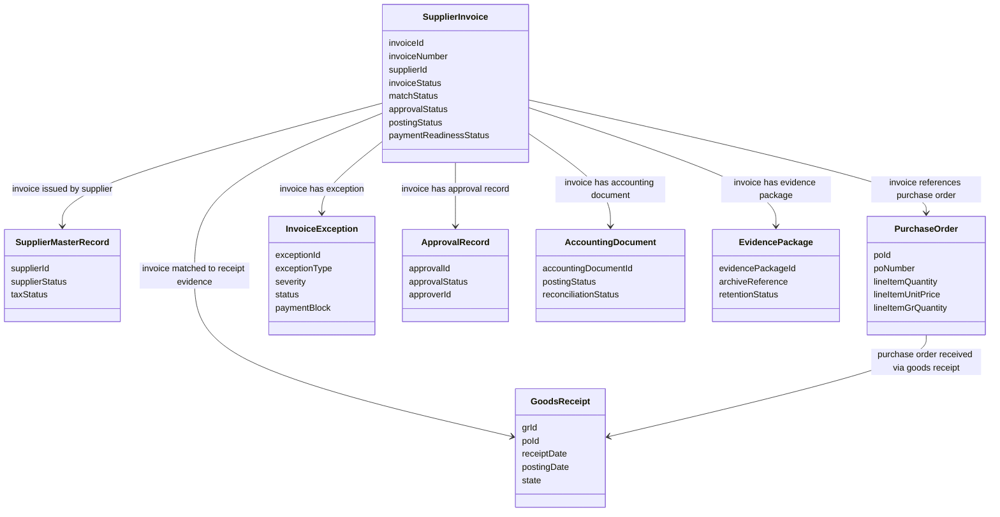
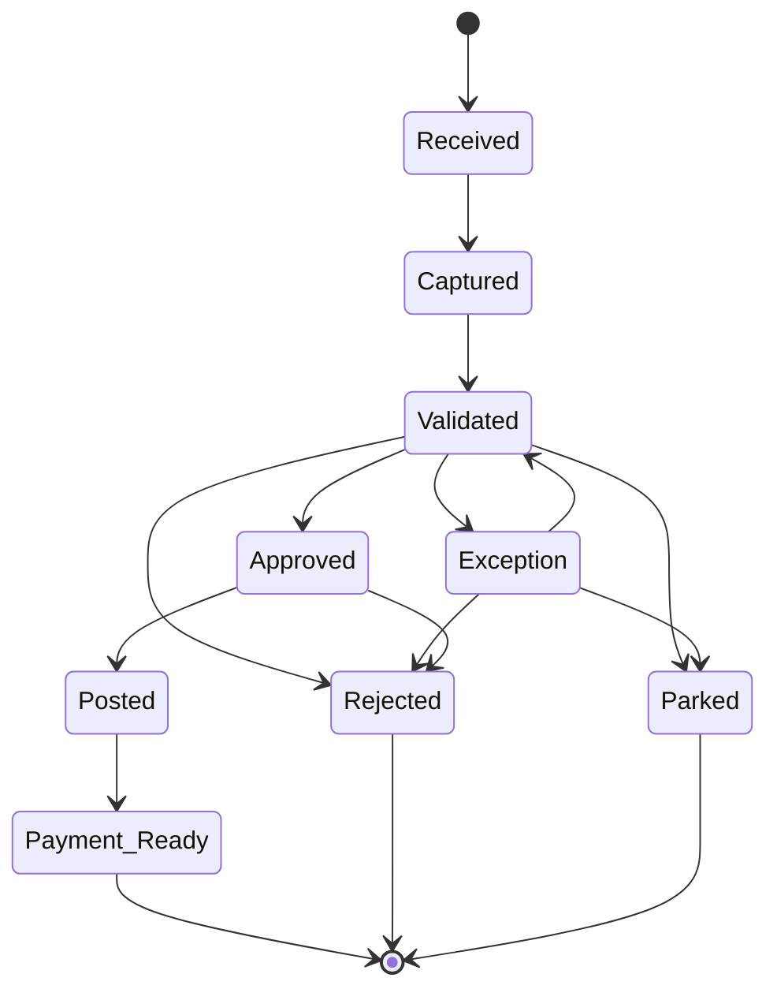

<!-- doc:meta type=pdd label="Process Definition Document" icon=FaClipboardList metadatafields=client,author,date,version client="Dumbwit Process" author="Process Analyst" date="13 October 2026" version="1.0" header="Invoice Processing | Process Definition Document" footer="Confidential | Dumbwit Process" process="Invoice Processing" -->


<!-- pdd:section id=business-context sources=as-is/overview.md,as-is/pain-points.md,to-be/overview.md,to-be/benefits.md reproj=g1 -->
# 1. Business Context

## 1.1 Problem Statement

Invoice Processing supports Finance Operations and Accounts Payable from supplier invoice receipt through ERP posting and payment-readiness handoff. The approved baseline does not provide local volume, headline failure metrics, handling time, or quantified compliance exposure; the current process does require repeated validation, matching, exception coordination, approval waiting, and system handoffs across intake, capture, AP workflow, ERP, PO/receipt, tax validation, and archive services. These unknown baselines are carried as open items rather than invented values.

==TBD: Confirm local invoice volume, cycle time, exception rate, touchless rate, handling effort, and quantified compliance exposure.==

## 1.2 Objectives

- Improve visibility from invoice receipt through payment readiness by assigning a tracking ID, timestamps, owners, and explicit handoff status.
- Increase routine straight-through processing through confidence-based capture, deterministic validation, duplicate detection, and configured matching rules; the target percentage is not yet set.
- Reduce uncontrolled waiting by routing exceptions by cause, applying payment blocks, and adding reminders and escalation timers.
- Strengthen non-PO, tax, approval, segregation-of-duties, and evidence controls without automating judgment that requires an authorized person.
- Improve recovery from supplier correction, missing receipt, approval timeout, and ERP or integration failure through explicit message, retry, replay, and parked outcomes.
- Establish measurable acceptance criteria for cycle time, touchless processing, exception aging, duplicate prevention, approval response, evidence completeness, and payment readiness.

==TBD: Confirm numeric target values and acceptance thresholds for the objectives above.==

## 1.3 Expected Value

The future design is intended to make invoice work more transparent, consistent, and auditable while directing human attention toward uncertain data, business exceptions, tax judgments, approvals, and controlled recovery. It separates the invoice-processing boundary from payment execution, preserves the evidence chain from original invoice through accounting and handoff, and gives Finance a clearer basis for monitoring aging, exceptions, and readiness. Numeric targets belong in Section 10.


<!-- pdd:section id=scope sources=as-is/overview.md,as-is/business-rules.md,as-is/exception-handling.md,queries/open-questions.md,entities/applications/ reproj=g1 -->
# 2. Scope

## 2.1 Process Identity

| Process name | Process group | Process identifier | Industry |
|---|---|---|---|
| Invoice Processing | Finance Operations / Accounts Payable | Invoice Processing | Finance Operations |

## 2.2 Scope Boundaries

| In Scope | Out of Scope |
|---|---|
| Supplier invoice receipt and intake validation | Payment execution and bank settlement |
| Invoice registration, extraction, validation, and supplier checks | Sourcing, requisition creation, and purchase-order creation as upstream processes |
| Duplicate detection and PO, receipt, or approved receipt-exempt matching | Downstream payment disbursement, bank-file execution, and payment reconciliation |
| Controlled non-PO receipt, coding, policy disposition, tax, and approval handling | Local product selection, connector configuration, and implementation design |
| Exception ownership, payment blocks, rework, escalation, and supplier correction | Organization-specific policy thresholds not yet confirmed |
| ERP posting, evidence archival, and payment-readiness handoff | Final payment approval or treasury execution |

The process boundary ends when the invoice is payment-ready, rejected/returned, or parked/blocked. Exact local boundary details for payment-batch review and remittance preparation remain open.

==TBD: Confirm whether payment-batch review and remittance preparation are included in the local payment-readiness boundary.==

## 2.3 Systems and Applications

| System | Role in Process | Access Type |
|---|---|---|
| **Invoice intake channels** | Receive supplier invoices through email, portal, scan, EDI, or e-invoicing channels. | Read / write |
| **Invoice capture and OCR** | Digitize documents, extract fields, score confidence, and support verification. | Read / write |
| **AP workflow** | Register invoices, route work, track status, manage exceptions, approvals, blocks, and audit history. | Read / write |
| **ERP finance system** | Provide accounting, PO references where applicable, posting, GR/IR, blocks, and payment readiness. | Read / write |
| **PO and receipt system** | Provide PO, goods receipt, service evidence, and matching information. | Read / write |
| **Tax validation system** | Calculate or validate tax, exemptions, reverse charge, withholding, and e-invoice fields. | Read / write |
| **Document archive** | Retain invoice and supporting validation, match, approval, accounting, and readiness evidence. | Write / read |

Product names, access mechanisms, endpoints, authentication, and exact screens are not confirmed.


<!-- pdd:section id=current-state sources=as-is/overview.md,as-is/diagram.md,as-is/steps/,as-is/metrics.md,as-is/pain-points.md,as-is/stages.md,as-is/stages/,as-is/attachments.md reproj=g1 -->
# 3. Current State

## 3.1 Overview

The current process begins when a supplier invoice arrives through an intake channel and continues through registration, extraction, validation, duplicate detection, PO/receipt matching, exception handling, tax validation, approval, ERP posting, and payment-readiness preparation. The approved current design identifies likely touchpoints across intake, capture/OCR, AP workflow, ERP, PO/receipt, tax validation, and document archive, but exact products, screens, integration methods, and re-keying points remain unconfirmed. The current process contains manual reviews, cross-team handoffs, payment blocks, rework, and approval waiting; the start of compliance clocks and local monitoring rules are not yet defined.

## 3.2 Current Flow

### Invoice Receipt & Capture

| # | Current step |
|---|---|
| 1.1 | Receive invoice through an available supplier channel. |
| 1.2 | Digitize or capture the invoice image or structured invoice data. |
| 1.3 | Register the invoice and assign a tracking ID and receipt timestamp. |
| 1.4 | Route the invoice according to channel and capture path. |

### Data Extraction & Validation

| # | Current step |
|---|---|
| 2.1 | Extract invoice header and line data. |
| 2.2 | Score extraction confidence. |
| 2.3 | Verify low-confidence fields manually. |
| 2.4 | Validate header fields and line arithmetic. |
| 2.5 | Match the supplier to supplier-master data. |

### Duplicate & PO Matching

| # | Current step |
|---|---|
| 3.1 | Run exact duplicate checks. |
| 3.2 | Run fuzzy duplicate checks and review suspected duplicates. |
| 3.3 | Retrieve the purchase order and receipt or service evidence. |
| 3.4 | Execute PO and receipt matching using configured tolerances. |
| 3.5 | Classify full match, non-PO, pending receipt, variance, or no-match outcomes. |

### Exception Resolution

| # | Current step |
|---|---|
| 4.1 | Categorize the exception and assess severity. |
| 4.2 | Assign the exception to a queue or resolver. |
| 4.3 | Apply a payment block and notify the resolver. |
| 4.4 | Investigate, request supplier information, correct receipt or PO data, process credit notes, accept permitted overrides, or return/reject the invoice. |
| 4.5 | Close and re-match the invoice, or escalate and park it when unresolved. |

### Tax, Approval & Posting

| # | Current step |
|---|---|
| 5.1 | Validate tax, exemption, reverse charge, withholding, and e-invoice fields when applicable. |
| 5.2 | Determine approval requirement and route approval. |
| 5.3 | Handle approval, information request, delegation, reminder, escalation, or rejection. |
| 5.4 | Determine coding, create the ERP accounting entry, clear GR/IR where applicable, verify block release, and archive evidence. |
| 5.5 | Select or defer the invoice for payment readiness, evaluate discount terms, assemble or review a payment batch, and prepare remittance. |

## 3.3 Metrics

| Metric | Current signal | Measurement method |
|---|---|---|
| Invoice volume and frequency | Not provided | Intake, ERP, or AP workflow report to be confirmed |
| Receipt-to-posting or readiness cycle time | Not provided | Workflow timestamps to be confirmed |
| Backlog and aging | Not provided | Exception and approval queues to be confirmed |
| Touchless or straight-through rate | Not provided | Cases completed without human intervention to be confirmed |
| Exception and duplicate rate | Not provided | Exception and duplicate records to be confirmed |
| FTE and time per invoice | Not provided | Team roster and timed sample to be confirmed |

==TBD: Confirm current baseline values, clock start and stop, exclusions, reporting grain, and authoritative source for each metric.==

## 3.4 Pain Points

| Where | What breaks | Impact |
|---|---|---|
| Data verification | Low-confidence extraction, mandatory-field errors, and arithmetic issues require manual review. | Handling effort and cycle-time impact are not quantified. |
| Matching and exceptions | Missing receipt evidence, price or quantity variance, non-PO handling, and supplier corrections create rework. | Payment blocks and aging may increase; local impact is not quantified. |
| Approval routing | Approval availability, delegation, information requests, and timeouts can delay progression. | Approval aging and SLA impact are not quantified. |
| Cross-system handoffs | Exact ownership, system source of truth, and manual re-keying are not confirmed. | Visibility, auditability, and control exposure are not quantified. |

==TBD: Confirm organization-specific pain points, workarounds, and quantified impact.==

The approved current-process map is embedded below.

```mermaid diagramFamily=case-design
flowchart LR
  caseStart(("Invoice received"))

  subgraph invoice_receipt_capture["Invoice Receipt & Capture"]
    registerInvoice["Register invoice"]
    intakeResult{"Intake accepted?"}
  end

  subgraph data_extraction_validation["Data Extraction & Validation"]
    validateInvoice["Validate invoice data"]
    validationResult{"Validation passed?"}
  end

  subgraph duplicate_po_matching["Duplicate & PO Matching"]
    checkDuplicate["Check duplicate invoice"]
    duplicateResult{"Duplicate suspected?"}
    matchInvoice["Match PO and receipt"]
    matchResult{"Match result?"}
  end

  subgraph exception_resolution["Exception Resolution"]
    categorizeException["Categorize invoice exception"]
    resolveException["Resolve invoice exception"]
    rejectInvoice["Reject or return invoice"]
    parkInvoice["Park blocked invoice"]
  end

  subgraph tax_validation["Tax Validation"]
    validateTax["Validate invoice tax"]
    taxResult{"Tax valid?"}
  end

  subgraph approval_routing["Approval Routing"]
    routeApproval["Route invoice approval"]
    approvalResult{"Approval outcome?"}
  end

  subgraph erp_posting_payment_readiness["ERP Posting & Payment Readiness"]
    postInvoice["Post invoice to ERP"]
    postingResult{"Posting successful?"}
    paymentResult{"Payment ready?"}
    preparePayment["Prepare payment batch"]
  end

  caseStart --> registerInvoice
  registerInvoice --> intakeResult
  intakeResult -->|accepted| validateInvoice
  intakeResult -->|unreadable or unsupported| rejectInvoice
  validateInvoice --> validationResult
  validationResult -->|passed| checkDuplicate
  validationResult -. correction .-> categorizeException
  checkDuplicate --> duplicateResult
  duplicateResult -->|not suspected| matchInvoice
  duplicateResult -. suspected .-> categorizeException
  matchInvoice --> matchResult
  matchResult -->|full match| validateTax
  matchResult -->|non-PO| routeApproval
  matchResult -. pending receipt or variance .-> categorizeException
  categorizeException --> resolveException
  resolveException -. resolved .-> validateInvoice
  resolveException -->|rejected| rejectInvoice
  resolveException -->|unresolved| parkInvoice
  validateTax --> taxResult
  taxResult -->|valid| routeApproval
  taxResult -. correction .-> categorizeException
  routeApproval --> approvalResult
  approvalResult -->|approved| postInvoice
  approvalResult -. information or timeout .-> categorizeException
  approvalResult -->|rejected| rejectInvoice
  postInvoice --> postingResult
  postingResult -->|posted| paymentResult
  postingResult -. correction .-> categorizeException
  paymentResult -->|ready| preparePayment
  paymentResult -. batch hold or exclusion .-> parkInvoice

  class caseStart kind-event
  class registerInvoice kind-task,case-task-action,owner-ap,system-ap-workflow
  class intakeResult kind-decision,owner-ap
  class validateInvoice kind-task,case-task-process,owner-ap,system-invoice-capture
  class validationResult kind-decision,owner-ap
  class checkDuplicate kind-task,case-task-process,owner-ap,system-ap-workflow
  class duplicateResult kind-decision,owner-ap
  class matchInvoice kind-task,case-task-process,owner-ap,system-po-receipt-system
  class matchResult kind-decision,owner-ap
  class categorizeException kind-task,case-task-action,owner-ap,system-ap-workflow
  class resolveException kind-task,case-task-action,owner-ap,system-ap-workflow
  class rejectInvoice kind-task,case-task-action,owner-ap,case-ends-case
  class parkInvoice kind-task,case-task-action,owner-ap,case-ends-case
  class validateTax kind-task,case-task-process,owner-tax,system-tax-validation
  class taxResult kind-decision,owner-tax
  class routeApproval kind-task,case-task-process,owner-ap,system-ap-workflow
  class approvalResult kind-decision,owner-ap
  class postInvoice kind-task,case-task-process,owner-ap,system-erp
  class postingResult kind-decision,owner-ap
  class paymentResult kind-decision,owner-ap
  class preparePayment kind-task,case-task-action,owner-ap,system-erp,case-ends-case
```



*Figure: Current invoice case map rendered from the approved current-process artifact.*


<!-- pdd:section id=target-state sources=to-be/overview.md,to-be/process.bpmn,to-be/bpmn-details.md,to-be/transformation-decisions.md,to-be/participants-and-lanes.md,to-be/events-and-triggers.md,to-be/activities.md,to-be/gateways-and-routes.md,to-be/message-and-timer-flows.md,to-be/data-objects.md,to-be/exception-handling.md,to-be/benefits.md reproj=g1 -->
# 4. Future State

## 4.1 Vision

The future design is a cross-functional BPMN process from supplier invoice receipt through payment-readiness handoff. It makes validation, duplicate detection, PO and non-PO routes, exception ownership, tax checks, approvals, posting recovery, evidence archival, and payment readiness explicit; humans remain responsible for judgment, approval, policy-sensitive decisions, and controlled fallback. Product selections, connectors, endpoint details, and local thresholds remain implementation decisions.

The approved future process model is embedded below.

```bpmn
<?xml version="1.0" encoding="UTF-8"?>
<bpmn:definitions xmlns:bpmn="http://www.omg.org/spec/BPMN/20100524/MODEL" xmlns:xsi="http://www.w3.org/2001/XMLSchema-instance" id="Definitions_InvoiceProcessing" targetNamespace="https://uipath.com/business-analysis/invoice-processing">
  <bpmn:message id="Message_InvoiceReceived" name="Supplier invoice received" />
  <bpmn:message id="Message_CorrectionRequest" name="Invoice correction requested" />
  <bpmn:message id="Message_CorrectedInvoice" name="Corrected invoice received" />
  <bpmn:message id="Message_ReceiptEvidenceRequest" name="Receipt evidence requested" />
  <bpmn:message id="Message_ReceiptEvidence" name="Receipt evidence received" />

  <bpmn:collaboration id="Collaboration_InvoiceProcessing">
    <bpmn:participant id="Participant_InvoiceProcessing" name="Invoice Processing" processRef="Process_InvoiceProcessing" />
    <bpmn:participant id="Participant_Supplier" name="Supplier" processRef="Process_Supplier" />
    <bpmn:participant id="Participant_Receiving" name="Receiving or Service Owner" processRef="Process_Receiving" />
    <bpmn:messageFlow id="MessageFlow_InvoiceToAP" name="Invoice submission" sourceRef="Task_SupplierSendInvoice" targetRef="Start_InvoiceReceived" messageRef="Message_InvoiceReceived" />
    <bpmn:messageFlow id="MessageFlow_CorrectionRequest" name="Correction request" sourceRef="Task_RequestSupplierCorrection" targetRef="Start_SupplierCorrectionRequest" messageRef="Message_CorrectionRequest" />
    <bpmn:messageFlow id="MessageFlow_CorrectedInvoice" name="Corrected invoice" sourceRef="Task_SupplierSendCorrectedInvoice" targetRef="Catch_CorrectedInvoice" messageRef="Message_CorrectedInvoice" />
    <bpmn:messageFlow id="MessageFlow_ReceiptEvidenceRequest" name="Receipt evidence request" sourceRef="Task_RequestReceiptEvidence" targetRef="Start_ReceiptEvidenceRequest" messageRef="Message_ReceiptEvidenceRequest" />
    <bpmn:messageFlow id="MessageFlow_ReceiptEvidence" name="Receipt evidence" sourceRef="Task_ReceivingSubmitEvidence" targetRef="Catch_ReceiptEvidenceReceived" messageRef="Message_ReceiptEvidence" />
  </bpmn:collaboration>

  <bpmn:process id="Process_InvoiceProcessing" name="Invoice Processing" isExecutable="false">
    <bpmn:laneSet id="LaneSet_InvoiceProcessing">
      <bpmn:lane id="Lane_AP" name="Accounts Payable">
        <bpmn:flowNodeRef>Start_InvoiceReceived</bpmn:flowNodeRef>
        <bpmn:flowNodeRef>Task_AcknowledgeRegister</bpmn:flowNodeRef>
        <bpmn:flowNodeRef>Task_ValidateIntake</bpmn:flowNodeRef>
        <bpmn:flowNodeRef>Gateway_IntakeAccepted</bpmn:flowNodeRef>
        <bpmn:flowNodeRef>Task_ExtractInvoiceData</bpmn:flowNodeRef>
        <bpmn:flowNodeRef>Gateway_DataValid</bpmn:flowNodeRef>
        <bpmn:flowNodeRef>Task_VerifyInvoiceData</bpmn:flowNodeRef>
        <bpmn:flowNodeRef>Task_CheckSupplierMaster</bpmn:flowNodeRef>
        <bpmn:flowNodeRef>Gateway_SupplierValid</bpmn:flowNodeRef>
        <bpmn:flowNodeRef>Task_ResolveSupplierMaster</bpmn:flowNodeRef>
        <bpmn:flowNodeRef>Gateway_SupplierMasterResolved</bpmn:flowNodeRef>
        <bpmn:flowNodeRef>Task_CheckDuplicate</bpmn:flowNodeRef>
        <bpmn:flowNodeRef>Gateway_DuplicateSuspected</bpmn:flowNodeRef>
        <bpmn:flowNodeRef>Task_ReviewDuplicate</bpmn:flowNodeRef>
        <bpmn:flowNodeRef>Gateway_DuplicateCleared</bpmn:flowNodeRef>
        <bpmn:flowNodeRef>Task_RetrievePOReceipt</bpmn:flowNodeRef>
        <bpmn:flowNodeRef>Gateway_POPath</bpmn:flowNodeRef>
        <bpmn:flowNodeRef>Task_MatchPOReceipt</bpmn:flowNodeRef>
        <bpmn:flowNodeRef>Gateway_MatchOutcome</bpmn:flowNodeRef>
        <bpmn:flowNodeRef>Task_RequestReceiptEvidence</bpmn:flowNodeRef>
        <bpmn:flowNodeRef>Catch_ReceiptEvidenceReceived</bpmn:flowNodeRef>
        <bpmn:flowNodeRef>Task_CreateExceptionBlock</bpmn:flowNodeRef>
        <bpmn:flowNodeRef>Gateway_ExceptionCause</bpmn:flowNodeRef>
        <bpmn:flowNodeRef>Task_RequestSupplierCorrection</bpmn:flowNodeRef>
        <bpmn:flowNodeRef>Catch_CorrectedInvoice</bpmn:flowNodeRef>
        <bpmn:flowNodeRef>Task_ReMatchInvoice</bpmn:flowNodeRef>
        <bpmn:flowNodeRef>Gateway_ReMatchOutcome</bpmn:flowNodeRef>
        <bpmn:flowNodeRef>Task_DetermineApproval</bpmn:flowNodeRef>
        <bpmn:flowNodeRef>Gateway_ApprovalRequired</bpmn:flowNodeRef>
        <bpmn:flowNodeRef>Task_RouteApproval</bpmn:flowNodeRef>
        <bpmn:flowNodeRef>Task_RequestApprovalInformation</bpmn:flowNodeRef>
        <bpmn:flowNodeRef>Task_EscalateMissingReceipt</bpmn:flowNodeRef>
        <bpmn:flowNodeRef>Task_EscalateException</bpmn:flowNodeRef>
        <bpmn:flowNodeRef>Task_RemindEscalateApproval</bpmn:flowNodeRef>
        <bpmn:flowNodeRef>Task_ArchiveEvidence</bpmn:flowNodeRef>
        <bpmn:flowNodeRef>End_IncompleteIntake</bpmn:flowNodeRef>
        <bpmn:flowNodeRef>End_Rejected</bpmn:flowNodeRef>
        <bpmn:flowNodeRef>End_Parked</bpmn:flowNodeRef>
      </bpmn:lane>
      <bpmn:lane id="Lane_Procurement" name="Procurement">
        <bpmn:flowNodeRef>Task_ResolvePriceVariance</bpmn:flowNodeRef>
        <bpmn:flowNodeRef>Boundary_ExceptionTimer</bpmn:flowNodeRef>
      </bpmn:lane>
      <bpmn:lane id="Lane_Tax" name="Tax">
        <bpmn:flowNodeRef>Task_ValidateTax</bpmn:flowNodeRef>
        <bpmn:flowNodeRef>Gateway_TaxOutcome</bpmn:flowNodeRef>
        <bpmn:flowNodeRef>Task_ResolveTaxException</bpmn:flowNodeRef>
        <bpmn:flowNodeRef>Gateway_TaxResolved</bpmn:flowNodeRef>
      </bpmn:lane>
      <bpmn:lane id="Lane_Approver" name="Budget Owner or Delegated Approver">
        <bpmn:flowNodeRef>Task_NonPOReceiptConfirm</bpmn:flowNodeRef>
        <bpmn:flowNodeRef>Task_NonPOReview</bpmn:flowNodeRef>
        <bpmn:flowNodeRef>Task_NonPOPolicyDisposition</bpmn:flowNodeRef>
        <bpmn:flowNodeRef>Gateway_NonPOOutcome</bpmn:flowNodeRef>
        <bpmn:flowNodeRef>Task_ApproveInvoice</bpmn:flowNodeRef>
        <bpmn:flowNodeRef>Boundary_ApprovalTimer</bpmn:flowNodeRef>
        <bpmn:flowNodeRef>Gateway_ApprovalOutcome</bpmn:flowNodeRef>
      </bpmn:lane>
      <bpmn:lane id="Lane_Finance" name="Finance or Treasury">
        <bpmn:flowNodeRef>Task_ValidatePostingData</bpmn:flowNodeRef>
        <bpmn:flowNodeRef>Task_PostInvoiceERP</bpmn:flowNodeRef>
        <bpmn:flowNodeRef>Gateway_PostingOutcome</bpmn:flowNodeRef>
        <bpmn:flowNodeRef>Task_ManualControlledPosting</bpmn:flowNodeRef>
        <bpmn:flowNodeRef>Task_CheckPaymentReadiness</bpmn:flowNodeRef>
        <bpmn:flowNodeRef>Gateway_PaymentReady</bpmn:flowNodeRef>
        <bpmn:flowNodeRef>Task_PreparePaymentHandoff</bpmn:flowNodeRef>
        <bpmn:flowNodeRef>Task_EscalatePaymentBlock</bpmn:flowNodeRef>
        <bpmn:flowNodeRef>End_PaymentReady</bpmn:flowNodeRef>
      </bpmn:lane>
      <bpmn:lane id="Lane_IT" name="IT or Systems Support">
        <bpmn:flowNodeRef>Task_ReplayPosting</bpmn:flowNodeRef>
        <bpmn:flowNodeRef>Gateway_RetryOutcome</bpmn:flowNodeRef>
      </bpmn:lane>
    </bpmn:laneSet>

    <bpmn:startEvent id="Start_InvoiceReceived" name="Invoice received">
      <bpmn:messageEventDefinition id="MessageEventDefinition_InvoiceReceived" messageRef="Message_InvoiceReceived" />
    </bpmn:startEvent>
    <bpmn:serviceTask id="Task_AcknowledgeRegister" name="Acknowledge and register invoice" />
    <bpmn:businessRuleTask id="Task_ValidateIntake" name="Validate image and channel" />
    <bpmn:exclusiveGateway id="Gateway_IntakeAccepted" name="Intake accepted?" />
    <bpmn:serviceTask id="Task_ExtractInvoiceData" name="Extract invoice data" />
    <bpmn:exclusiveGateway id="Gateway_DataValid" name="Data valid?" />
    <bpmn:userTask id="Task_VerifyInvoiceData" name="Verify uncertain invoice data" />
    <bpmn:serviceTask id="Task_CheckSupplierMaster" name="Check supplier master" />
    <bpmn:exclusiveGateway id="Gateway_SupplierValid" name="Supplier valid?" />
    <bpmn:userTask id="Task_ResolveSupplierMaster" name="Resolve supplier master issue" />
    <bpmn:exclusiveGateway id="Gateway_SupplierMasterResolved" name="Supplier issue resolved?" />
    <bpmn:businessRuleTask id="Task_CheckDuplicate" name="Check duplicate invoice" />
    <bpmn:exclusiveGateway id="Gateway_DuplicateSuspected" name="Duplicate suspected?" />
    <bpmn:userTask id="Task_ReviewDuplicate" name="Review duplicate suspect" />
    <bpmn:exclusiveGateway id="Gateway_DuplicateCleared" name="Duplicate cleared?" />
    <bpmn:serviceTask id="Task_RetrievePOReceipt" name="Retrieve PO and receipt evidence" />
    <bpmn:exclusiveGateway id="Gateway_POPath" name="PO route?" />
    <bpmn:userTask id="Task_NonPOReceiptConfirm" name="Confirm non-PO receipt and coding" />
    <bpmn:userTask id="Task_NonPOReview" name="Review non-PO invoice" />
    <bpmn:userTask id="Task_NonPOPolicyDisposition" name="Record non-PO policy disposition" />
    <bpmn:exclusiveGateway id="Gateway_NonPOOutcome" name="Non-PO accepted?" />
    <bpmn:businessRuleTask id="Task_MatchPOReceipt" name="Match PO and receipt" />
    <bpmn:exclusiveGateway id="Gateway_MatchOutcome" name="Match outcome?" />
    <bpmn:sendTask id="Task_RequestReceiptEvidence" name="Request receipt evidence" />
    <bpmn:intermediateCatchEvent id="Catch_ReceiptEvidenceReceived" name="Receipt evidence received">
      <bpmn:messageEventDefinition id="MessageEventDefinition_ReceiptEvidence" messageRef="Message_ReceiptEvidence" />
    </bpmn:intermediateCatchEvent>
    <bpmn:boundaryEvent id="Boundary_MissingReceiptTimer" name="Missing receipt deadline" attachedToRef="Task_RequestReceiptEvidence">
      <bpmn:timerEventDefinition id="TimerDefinition_MissingReceipt">
        <bpmn:timeDuration>P5D</bpmn:timeDuration>
      </bpmn:timerEventDefinition>
    </bpmn:boundaryEvent>
    <bpmn:userTask id="Task_CreateExceptionBlock" name="Create exception and payment block" />
    <bpmn:exclusiveGateway id="Gateway_ExceptionCause" name="Exception cause?" />
    <bpmn:userTask id="Task_ResolvePriceVariance" name="Resolve price variance" />
    <bpmn:boundaryEvent id="Boundary_ExceptionTimer" name="Exception deadline" attachedToRef="Task_ResolvePriceVariance">
      <bpmn:timerEventDefinition id="TimerDefinition_Exception">
        <bpmn:timeDuration>P3D</bpmn:timeDuration>
      </bpmn:timerEventDefinition>
    </bpmn:boundaryEvent>
    <bpmn:userTask id="Task_ResolveQuantityVariance" name="Resolve quantity or receipt variance" />
    <bpmn:sendTask id="Task_RequestSupplierCorrection" name="Request supplier correction" />
    <bpmn:intermediateCatchEvent id="Catch_CorrectedInvoice" name="Corrected invoice received">
      <bpmn:messageEventDefinition id="MessageEventDefinition_CorrectedInvoice" messageRef="Message_CorrectedInvoice" />
    </bpmn:intermediateCatchEvent>
    <bpmn:businessRuleTask id="Task_ReMatchInvoice" name="Re-match corrected invoice" />
    <bpmn:exclusiveGateway id="Gateway_ReMatchOutcome" name="Re-match successful?" />
    <bpmn:userTask id="Task_EscalateMissingReceipt" name="Escalate missing receipt" />
    <bpmn:userTask id="Task_EscalateException" name="Escalate unresolved exception" />
    <bpmn:serviceTask id="Task_ValidateTax" name="Validate invoice tax" />
    <bpmn:exclusiveGateway id="Gateway_TaxOutcome" name="Tax valid?" />
    <bpmn:userTask id="Task_ResolveTaxException" name="Resolve tax exception" />
    <bpmn:exclusiveGateway id="Gateway_TaxResolved" name="Tax issue resolved?" />
    <bpmn:businessRuleTask id="Task_DetermineApproval" name="Determine approval requirement" />
    <bpmn:exclusiveGateway id="Gateway_ApprovalRequired" name="Approval required?" />
    <bpmn:serviceTask id="Task_RouteApproval" name="Route approval request" />
    <bpmn:userTask id="Task_ApproveInvoice" name="Approve invoice" />
    <bpmn:boundaryEvent id="Boundary_ApprovalTimer" name="Approval deadline" attachedToRef="Task_ApproveInvoice">
      <bpmn:timerEventDefinition id="TimerDefinition_Approval">
        <bpmn:timeDuration>P2D</bpmn:timeDuration>
      </bpmn:timerEventDefinition>
    </bpmn:boundaryEvent>
    <bpmn:serviceTask id="Task_RemindEscalateApproval" name="Remind and escalate approval" />
    <bpmn:exclusiveGateway id="Gateway_ApprovalOutcome" name="Approval outcome?" />
    <bpmn:userTask id="Task_RequestApprovalInformation" name="Request approval information" />
    <bpmn:businessRuleTask id="Task_ValidatePostingData" name="Validate posting data" />
    <bpmn:serviceTask id="Task_PostInvoiceERP" name="Post invoice to ERP" />
    <bpmn:exclusiveGateway id="Gateway_PostingOutcome" name="Posting successful?" />
    <bpmn:serviceTask id="Task_ReplayPosting" name="Retry or replay posting" />
    <bpmn:exclusiveGateway id="Gateway_RetryOutcome" name="Retry outcome?" />
    <bpmn:userTask id="Task_ManualControlledPosting" name="Perform controlled manual posting" />
    <bpmn:serviceTask id="Task_ArchiveEvidence" name="Archive invoice evidence" />
    <bpmn:businessRuleTask id="Task_CheckPaymentReadiness" name="Check payment readiness" />
    <bpmn:exclusiveGateway id="Gateway_PaymentReady" name="Payment ready?" />
    <bpmn:sendTask id="Task_PreparePaymentHandoff" name="Prepare payment handoff" />
    <bpmn:userTask id="Task_EscalatePaymentBlock" name="Escalate payment block" />
    <bpmn:endEvent id="End_IncompleteIntake" name="Invoice returned from intake" />
    <bpmn:endEvent id="End_Rejected" name="Invoice rejected or returned" />
    <bpmn:endEvent id="End_Parked" name="Invoice parked or blocked" />
    <bpmn:endEvent id="End_PaymentReady" name="Payment ready" />

    <bpmn:sequenceFlow id="Flow_01" sourceRef="Start_InvoiceReceived" targetRef="Task_AcknowledgeRegister" />
    <bpmn:sequenceFlow id="Flow_02" sourceRef="Task_AcknowledgeRegister" targetRef="Task_ValidateIntake" />
    <bpmn:sequenceFlow id="Flow_03" sourceRef="Task_ValidateIntake" targetRef="Gateway_IntakeAccepted" />
    <bpmn:sequenceFlow id="Flow_04" sourceRef="Gateway_IntakeAccepted" targetRef="Task_ExtractInvoiceData"><bpmn:conditionExpression xsi:type="bpmn:tFormalExpression">accepted</bpmn:conditionExpression></bpmn:sequenceFlow>
    <bpmn:sequenceFlow id="Flow_05" sourceRef="Gateway_IntakeAccepted" targetRef="End_IncompleteIntake"><bpmn:conditionExpression xsi:type="bpmn:tFormalExpression">unreadable or unsupported</bpmn:conditionExpression></bpmn:sequenceFlow>
    <bpmn:sequenceFlow id="Flow_06" sourceRef="Task_ExtractInvoiceData" targetRef="Gateway_DataValid" />
    <bpmn:sequenceFlow id="Flow_07" sourceRef="Gateway_DataValid" targetRef="Task_VerifyInvoiceData"><bpmn:conditionExpression xsi:type="bpmn:tFormalExpression">low confidence or validation failure</bpmn:conditionExpression></bpmn:sequenceFlow>
    <bpmn:sequenceFlow id="Flow_08" sourceRef="Gateway_DataValid" targetRef="Task_CheckSupplierMaster"><bpmn:conditionExpression xsi:type="bpmn:tFormalExpression">validated</bpmn:conditionExpression></bpmn:sequenceFlow>
    <bpmn:sequenceFlow id="Flow_09" sourceRef="Task_VerifyInvoiceData" targetRef="Task_CheckSupplierMaster" />
    <bpmn:sequenceFlow id="Flow_10" sourceRef="Task_CheckSupplierMaster" targetRef="Gateway_SupplierValid" />
    <bpmn:sequenceFlow id="Flow_11" sourceRef="Gateway_SupplierValid" targetRef="Task_ResolveSupplierMaster"><bpmn:conditionExpression xsi:type="bpmn:tFormalExpression">unknown or inactive supplier</bpmn:conditionExpression></bpmn:sequenceFlow>
    <bpmn:sequenceFlow id="Flow_12" sourceRef="Gateway_SupplierValid" targetRef="Task_CheckDuplicate"><bpmn:conditionExpression xsi:type="bpmn:tFormalExpression">active supplier</bpmn:conditionExpression></bpmn:sequenceFlow>
    <bpmn:sequenceFlow id="Flow_13" sourceRef="Task_ResolveSupplierMaster" targetRef="Gateway_SupplierMasterResolved" />
    <bpmn:sequenceFlow id="Flow_14" sourceRef="Gateway_SupplierMasterResolved" targetRef="Task_CheckDuplicate"><bpmn:conditionExpression xsi:type="bpmn:tFormalExpression">resolved</bpmn:conditionExpression></bpmn:sequenceFlow>
    <bpmn:sequenceFlow id="Flow_15" sourceRef="Gateway_SupplierMasterResolved" targetRef="End_Rejected"><bpmn:conditionExpression xsi:type="bpmn:tFormalExpression">not resolved</bpmn:conditionExpression></bpmn:sequenceFlow>
    <bpmn:sequenceFlow id="Flow_16" sourceRef="Task_CheckDuplicate" targetRef="Gateway_DuplicateSuspected" />
    <bpmn:sequenceFlow id="Flow_17" sourceRef="Gateway_DuplicateSuspected" targetRef="Task_ReviewDuplicate"><bpmn:conditionExpression xsi:type="bpmn:tFormalExpression">suspected</bpmn:conditionExpression></bpmn:sequenceFlow>
    <bpmn:sequenceFlow id="Flow_18" sourceRef="Gateway_DuplicateSuspected" targetRef="Task_RetrievePOReceipt"><bpmn:conditionExpression xsi:type="bpmn:tFormalExpression">not suspected</bpmn:conditionExpression></bpmn:sequenceFlow>
    <bpmn:sequenceFlow id="Flow_19" sourceRef="Task_ReviewDuplicate" targetRef="Gateway_DuplicateCleared" />
    <bpmn:sequenceFlow id="Flow_20" sourceRef="Gateway_DuplicateCleared" targetRef="Task_RetrievePOReceipt"><bpmn:conditionExpression xsi:type="bpmn:tFormalExpression">cleared</bpmn:conditionExpression></bpmn:sequenceFlow>
    <bpmn:sequenceFlow id="Flow_21" sourceRef="Gateway_DuplicateCleared" targetRef="End_Rejected"><bpmn:conditionExpression xsi:type="bpmn:tFormalExpression">confirmed duplicate</bpmn:conditionExpression></bpmn:sequenceFlow>
    <bpmn:sequenceFlow id="Flow_22" sourceRef="Task_RetrievePOReceipt" targetRef="Gateway_POPath" />
    <bpmn:sequenceFlow id="Flow_23" sourceRef="Gateway_POPath" targetRef="Task_NonPOReceiptConfirm"><bpmn:conditionExpression xsi:type="bpmn:tFormalExpression">no valid PO</bpmn:conditionExpression></bpmn:sequenceFlow>
    <bpmn:sequenceFlow id="Flow_24" sourceRef="Gateway_POPath" targetRef="Task_MatchPOReceipt"><bpmn:conditionExpression xsi:type="bpmn:tFormalExpression">PO or approved GR-exempt route</bpmn:conditionExpression></bpmn:sequenceFlow>
    <bpmn:sequenceFlow id="Flow_25" sourceRef="Task_NonPOReceiptConfirm" targetRef="Task_NonPOReview" />
    <bpmn:sequenceFlow id="Flow_26" sourceRef="Task_NonPOReview" targetRef="Task_NonPOPolicyDisposition" />
    <bpmn:sequenceFlow id="Flow_27" sourceRef="Task_NonPOPolicyDisposition" targetRef="Gateway_NonPOOutcome" />
    <bpmn:sequenceFlow id="Flow_28" sourceRef="Gateway_NonPOOutcome" targetRef="Task_ValidateTax"><bpmn:conditionExpression xsi:type="bpmn:tFormalExpression">accepted with evidence</bpmn:conditionExpression></bpmn:sequenceFlow>
    <bpmn:sequenceFlow id="Flow_29" sourceRef="Gateway_NonPOOutcome" targetRef="End_Rejected"><bpmn:conditionExpression xsi:type="bpmn:tFormalExpression">rejected or unsupported</bpmn:conditionExpression></bpmn:sequenceFlow>
    <bpmn:sequenceFlow id="Flow_30" sourceRef="Task_MatchPOReceipt" targetRef="Gateway_MatchOutcome" />
    <bpmn:sequenceFlow id="Flow_31" sourceRef="Gateway_MatchOutcome" targetRef="Task_ValidateTax"><bpmn:conditionExpression xsi:type="bpmn:tFormalExpression">full match</bpmn:conditionExpression></bpmn:sequenceFlow>
    <bpmn:sequenceFlow id="Flow_32" sourceRef="Gateway_MatchOutcome" targetRef="Task_RequestReceiptEvidence"><bpmn:conditionExpression xsi:type="bpmn:tFormalExpression">pending receipt or service evidence</bpmn:conditionExpression></bpmn:sequenceFlow>
    <bpmn:sequenceFlow id="Flow_33" sourceRef="Gateway_MatchOutcome" targetRef="Task_CreateExceptionBlock"><bpmn:conditionExpression xsi:type="bpmn:tFormalExpression">price, quantity, PO, or contract variance</bpmn:conditionExpression></bpmn:sequenceFlow>
    <bpmn:sequenceFlow id="Flow_34" sourceRef="Task_RequestReceiptEvidence" targetRef="Catch_ReceiptEvidenceReceived" />
    <bpmn:sequenceFlow id="Flow_35" sourceRef="Catch_ReceiptEvidenceReceived" targetRef="Task_ReMatchInvoice" />
    <bpmn:sequenceFlow id="Flow_36" sourceRef="Boundary_MissingReceiptTimer" targetRef="Task_EscalateMissingReceipt" />
    <bpmn:sequenceFlow id="Flow_37" sourceRef="Task_EscalateMissingReceipt" targetRef="End_Parked" />
    <bpmn:sequenceFlow id="Flow_38" sourceRef="Task_CreateExceptionBlock" targetRef="Gateway_ExceptionCause" />
    <bpmn:sequenceFlow id="Flow_39" sourceRef="Gateway_ExceptionCause" targetRef="Task_ResolvePriceVariance"><bpmn:conditionExpression xsi:type="bpmn:tFormalExpression">price, PO, or contract issue</bpmn:conditionExpression></bpmn:sequenceFlow>
    <bpmn:sequenceFlow id="Flow_40" sourceRef="Gateway_ExceptionCause" targetRef="Task_ResolveQuantityVariance"><bpmn:conditionExpression xsi:type="bpmn:tFormalExpression">quantity or receipt issue</bpmn:conditionExpression></bpmn:sequenceFlow>
    <bpmn:sequenceFlow id="Flow_41" sourceRef="Gateway_ExceptionCause" targetRef="Task_RequestSupplierCorrection"><bpmn:conditionExpression xsi:type="bpmn:tFormalExpression">supplier or document issue</bpmn:conditionExpression></bpmn:sequenceFlow>
    <bpmn:sequenceFlow id="Flow_42" sourceRef="Task_ResolvePriceVariance" targetRef="Task_ReMatchInvoice" />
    <bpmn:sequenceFlow id="Flow_43" sourceRef="Boundary_ExceptionTimer" targetRef="Task_EscalateException" />
    <bpmn:sequenceFlow id="Flow_44" sourceRef="Task_EscalateException" targetRef="End_Parked" />
    <bpmn:sequenceFlow id="Flow_45" sourceRef="Task_ResolveQuantityVariance" targetRef="Task_ReMatchInvoice" />
    <bpmn:sequenceFlow id="Flow_46" sourceRef="Task_RequestSupplierCorrection" targetRef="Catch_CorrectedInvoice" />
    <bpmn:sequenceFlow id="Flow_47" sourceRef="Catch_CorrectedInvoice" targetRef="Task_ReMatchInvoice" />
    <bpmn:sequenceFlow id="Flow_48" sourceRef="Task_ReMatchInvoice" targetRef="Gateway_ReMatchOutcome" />
    <bpmn:sequenceFlow id="Flow_49" sourceRef="Gateway_ReMatchOutcome" targetRef="Task_ValidateTax"><bpmn:conditionExpression xsi:type="bpmn:tFormalExpression">resolved</bpmn:conditionExpression></bpmn:sequenceFlow>
    <bpmn:sequenceFlow id="Flow_50" sourceRef="Gateway_ReMatchOutcome" targetRef="End_Parked"><bpmn:conditionExpression xsi:type="bpmn:tFormalExpression">unresolved</bpmn:conditionExpression></bpmn:sequenceFlow>
    <bpmn:sequenceFlow id="Flow_51" sourceRef="Task_ValidateTax" targetRef="Gateway_TaxOutcome" />
    <bpmn:sequenceFlow id="Flow_52" sourceRef="Gateway_TaxOutcome" targetRef="Task_DetermineApproval"><bpmn:conditionExpression xsi:type="bpmn:tFormalExpression">valid</bpmn:conditionExpression></bpmn:sequenceFlow>
    <bpmn:sequenceFlow id="Flow_53" sourceRef="Gateway_TaxOutcome" targetRef="Task_ResolveTaxException"><bpmn:conditionExpression xsi:type="bpmn:tFormalExpression">variance, missing evidence, or validation failure</bpmn:conditionExpression></bpmn:sequenceFlow>
    <bpmn:sequenceFlow id="Flow_54" sourceRef="Task_ResolveTaxException" targetRef="Gateway_TaxResolved" />
    <bpmn:sequenceFlow id="Flow_55" sourceRef="Gateway_TaxResolved" targetRef="Task_DetermineApproval"><bpmn:conditionExpression xsi:type="bpmn:tFormalExpression">resolved</bpmn:conditionExpression></bpmn:sequenceFlow>
    <bpmn:sequenceFlow id="Flow_56" sourceRef="Gateway_TaxResolved" targetRef="End_Parked"><bpmn:conditionExpression xsi:type="bpmn:tFormalExpression">unresolved</bpmn:conditionExpression></bpmn:sequenceFlow>
    <bpmn:sequenceFlow id="Flow_57" sourceRef="Task_DetermineApproval" targetRef="Gateway_ApprovalRequired" />
    <bpmn:sequenceFlow id="Flow_58" sourceRef="Gateway_ApprovalRequired" targetRef="Task_ValidatePostingData"><bpmn:conditionExpression xsi:type="bpmn:tFormalExpression">not required</bpmn:conditionExpression></bpmn:sequenceFlow>
    <bpmn:sequenceFlow id="Flow_59" sourceRef="Gateway_ApprovalRequired" targetRef="Task_RouteApproval"><bpmn:conditionExpression xsi:type="bpmn:tFormalExpression">required</bpmn:conditionExpression></bpmn:sequenceFlow>
    <bpmn:sequenceFlow id="Flow_60" sourceRef="Task_RouteApproval" targetRef="Task_ApproveInvoice" />
    <bpmn:sequenceFlow id="Flow_61" sourceRef="Task_ApproveInvoice" targetRef="Gateway_ApprovalOutcome" />
    <bpmn:sequenceFlow id="Flow_62" sourceRef="Gateway_ApprovalOutcome" targetRef="Task_ValidatePostingData"><bpmn:conditionExpression xsi:type="bpmn:tFormalExpression">approved</bpmn:conditionExpression></bpmn:sequenceFlow>
    <bpmn:sequenceFlow id="Flow_63" sourceRef="Gateway_ApprovalOutcome" targetRef="Task_RequestApprovalInformation"><bpmn:conditionExpression xsi:type="bpmn:tFormalExpression">information requested</bpmn:conditionExpression></bpmn:sequenceFlow>
    <bpmn:sequenceFlow id="Flow_64" sourceRef="Gateway_ApprovalOutcome" targetRef="End_Rejected"><bpmn:conditionExpression xsi:type="bpmn:tFormalExpression">rejected</bpmn:conditionExpression></bpmn:sequenceFlow>
    <bpmn:sequenceFlow id="Flow_65" sourceRef="Task_RequestApprovalInformation" targetRef="Task_ApproveInvoice" />
    <bpmn:sequenceFlow id="Flow_66" sourceRef="Boundary_ApprovalTimer" targetRef="Task_RemindEscalateApproval" />
    <bpmn:sequenceFlow id="Flow_67" sourceRef="Task_RemindEscalateApproval" targetRef="Task_ApproveInvoice" />
    <bpmn:sequenceFlow id="Flow_68" sourceRef="Task_ValidatePostingData" targetRef="Task_PostInvoiceERP" />
    <bpmn:sequenceFlow id="Flow_69" sourceRef="Task_PostInvoiceERP" targetRef="Gateway_PostingOutcome" />
    <bpmn:sequenceFlow id="Flow_70" sourceRef="Gateway_PostingOutcome" targetRef="Task_ArchiveEvidence"><bpmn:conditionExpression xsi:type="bpmn:tFormalExpression">posted</bpmn:conditionExpression></bpmn:sequenceFlow>
    <bpmn:sequenceFlow id="Flow_71" sourceRef="Gateway_PostingOutcome" targetRef="Task_ReplayPosting"><bpmn:conditionExpression xsi:type="bpmn:tFormalExpression">system or posting failure</bpmn:conditionExpression></bpmn:sequenceFlow>
    <bpmn:sequenceFlow id="Flow_72" sourceRef="Task_ReplayPosting" targetRef="Gateway_RetryOutcome" />
    <bpmn:sequenceFlow id="Flow_73" sourceRef="Gateway_RetryOutcome" targetRef="Task_PostInvoiceERP"><bpmn:conditionExpression xsi:type="bpmn:tFormalExpression">retry permitted</bpmn:conditionExpression></bpmn:sequenceFlow>
    <bpmn:sequenceFlow id="Flow_74" sourceRef="Gateway_RetryOutcome" targetRef="Task_ManualControlledPosting"><bpmn:conditionExpression xsi:type="bpmn:tFormalExpression">manual fallback permitted</bpmn:conditionExpression></bpmn:sequenceFlow>
    <bpmn:sequenceFlow id="Flow_75" sourceRef="Gateway_RetryOutcome" targetRef="End_Parked"><bpmn:conditionExpression xsi:type="bpmn:tFormalExpression">unresolved</bpmn:conditionExpression></bpmn:sequenceFlow>
    <bpmn:sequenceFlow id="Flow_76" sourceRef="Task_ManualControlledPosting" targetRef="Task_ArchiveEvidence" />
    <bpmn:sequenceFlow id="Flow_77" sourceRef="Task_ArchiveEvidence" targetRef="Task_CheckPaymentReadiness" />
    <bpmn:sequenceFlow id="Flow_78" sourceRef="Task_CheckPaymentReadiness" targetRef="Gateway_PaymentReady" />
    <bpmn:sequenceFlow id="Flow_79" sourceRef="Gateway_PaymentReady" targetRef="Task_PreparePaymentHandoff"><bpmn:conditionExpression xsi:type="bpmn:tFormalExpression">posted, unblocked, and eligible</bpmn:conditionExpression></bpmn:sequenceFlow>
    <bpmn:sequenceFlow id="Flow_80" sourceRef="Gateway_PaymentReady" targetRef="Task_EscalatePaymentBlock"><bpmn:conditionExpression xsi:type="bpmn:tFormalExpression">blocked or excluded</bpmn:conditionExpression></bpmn:sequenceFlow>
    <bpmn:sequenceFlow id="Flow_81" sourceRef="Task_PreparePaymentHandoff" targetRef="End_PaymentReady" />
    <bpmn:sequenceFlow id="Flow_82" sourceRef="Task_EscalatePaymentBlock" targetRef="End_Parked" />
  </bpmn:process>

  <bpmn:process id="Process_Supplier" name="Supplier Invoice Response" isExecutable="false">
    <bpmn:laneSet id="LaneSet_Supplier">
      <bpmn:lane id="Lane_Supplier" name="Supplier">
        <bpmn:flowNodeRef>Start_SupplierInvoice</bpmn:flowNodeRef>
        <bpmn:flowNodeRef>Task_SupplierSendInvoice</bpmn:flowNodeRef>
        <bpmn:flowNodeRef>End_SupplierInvoiceSent</bpmn:flowNodeRef>
        <bpmn:flowNodeRef>Start_SupplierCorrectionRequest</bpmn:flowNodeRef>
        <bpmn:flowNodeRef>Task_SupplierPrepareCorrection</bpmn:flowNodeRef>
        <bpmn:flowNodeRef>Task_SupplierSendCorrectedInvoice</bpmn:flowNodeRef>
        <bpmn:flowNodeRef>End_SupplierCorrectedInvoiceSent</bpmn:flowNodeRef>
      </bpmn:lane>
    </bpmn:laneSet>
    <bpmn:startEvent id="Start_SupplierInvoice" name="Supplier prepares invoice" />
    <bpmn:sendTask id="Task_SupplierSendInvoice" name="Submit supplier invoice" />
    <bpmn:endEvent id="End_SupplierInvoiceSent" name="Invoice submitted" />
    <bpmn:startEvent id="Start_SupplierCorrectionRequest" name="Correction request received">
      <bpmn:messageEventDefinition id="MessageEventDefinition_CorrectionRequest" messageRef="Message_CorrectionRequest" />
    </bpmn:startEvent>
    <bpmn:userTask id="Task_SupplierPrepareCorrection" name="Prepare corrected invoice" />
    <bpmn:sendTask id="Task_SupplierSendCorrectedInvoice" name="Submit corrected invoice" />
    <bpmn:endEvent id="End_SupplierCorrectedInvoiceSent" name="Correction submitted" />
    <bpmn:sequenceFlow id="SupplierFlow_01" sourceRef="Start_SupplierInvoice" targetRef="Task_SupplierSendInvoice" />
    <bpmn:sequenceFlow id="SupplierFlow_02" sourceRef="Task_SupplierSendInvoice" targetRef="End_SupplierInvoiceSent" />
    <bpmn:sequenceFlow id="SupplierFlow_03" sourceRef="Start_SupplierCorrectionRequest" targetRef="Task_SupplierPrepareCorrection" />
    <bpmn:sequenceFlow id="SupplierFlow_04" sourceRef="Task_SupplierPrepareCorrection" targetRef="Task_SupplierSendCorrectedInvoice" />
    <bpmn:sequenceFlow id="SupplierFlow_05" sourceRef="Task_SupplierSendCorrectedInvoice" targetRef="End_SupplierCorrectedInvoiceSent" />
  </bpmn:process>

  <bpmn:process id="Process_Receiving" name="Receipt Evidence Response" isExecutable="false">
    <bpmn:laneSet id="LaneSet_Receiving">
      <bpmn:lane id="Lane_ReceivingResponse" name="Receiving or Service Owner">
        <bpmn:flowNodeRef>Start_ReceiptEvidenceRequest</bpmn:flowNodeRef>
        <bpmn:flowNodeRef>Task_ConfirmReceipt</bpmn:flowNodeRef>
        <bpmn:flowNodeRef>Task_ReceivingSubmitEvidence</bpmn:flowNodeRef>
        <bpmn:flowNodeRef>End_ReceiptEvidenceSent</bpmn:flowNodeRef>
      </bpmn:lane>
    </bpmn:laneSet>
    <bpmn:startEvent id="Start_ReceiptEvidenceRequest" name="Receipt evidence requested">
      <bpmn:messageEventDefinition id="MessageEventDefinition_ReceiptEvidenceRequest" messageRef="Message_ReceiptEvidenceRequest" />
    </bpmn:startEvent>
    <bpmn:userTask id="Task_ConfirmReceipt" name="Confirm or correct receipt" />
    <bpmn:sendTask id="Task_ReceivingSubmitEvidence" name="Submit receipt evidence" />
    <bpmn:endEvent id="End_ReceiptEvidenceSent" name="Receipt evidence submitted" />
    <bpmn:sequenceFlow id="ReceivingFlow_01" sourceRef="Start_ReceiptEvidenceRequest" targetRef="Task_ConfirmReceipt" />
    <bpmn:sequenceFlow id="ReceivingFlow_02" sourceRef="Task_ConfirmReceipt" targetRef="Task_ReceivingSubmitEvidence" />
    <bpmn:sequenceFlow id="ReceivingFlow_03" sourceRef="Task_ReceivingSubmitEvidence" targetRef="End_ReceiptEvidenceSent" />
  </bpmn:process>
</bpmn:definitions>

```

*Figure: Future BPMN 2.0 process model rendered from the approved future process artifact.*


## 4.2 Target Flow

| # | BPMN element | Participant / lane | Element type | Input / message | Output / message | Route / exception path |
|---|---|---|---|---|---|---|
| 1 | Invoice received | Supplier / Accounts Payable | Start event | Supplier invoice submission | Registered process instance | Unsupported or unreadable intake returns |
| 2 | Acknowledge and register invoice | Accounts Payable | Activity | Invoice and receipt channel | Tracking ID and receipt timestamp | Registration failure is handled as an intake exception |
| 3 | Validate image and channel | Accounts Payable | Activity | Image or structured invoice | Intake validation result | Rejected intake ends as returned |
| 4 | Extract invoice data | Accounts Payable | Activity | Accepted invoice | Structured header and line data | Extraction failure moves to verification |
| 5 | Verify uncertain invoice data | Accounts Payable | Activity | Uncertain or failed fields | Corrected invoice data | Unresolved issue may be rejected or parked |
| 6 | Check supplier master | Accounts Payable | Activity | Supplier identity | Supplier validity result | Unknown or inactive supplier moves to resolution |
| 7 | Check and review duplicate invoice | Accounts Payable | Activity / gateway | Invoice and prior records | Cleared or confirmed duplicate | Confirmed duplicate is rejected |
| 8 | Retrieve PO and receipt evidence | Accounts Payable | Activity | Supplier and PO reference | PO and receipt evidence | Missing evidence moves to the receipt wait |
| 9 | PO or non-PO route | Accounts Payable | Gateway | Supplier, PO, and policy data | Route decision | Non-PO route requires receipt, coding, and policy disposition |
| 10 | Match PO and receipt | Accounts Payable | Activity / gateway | Invoice, PO, receipt, tolerances | Match result | Full match proceeds; pending evidence or variance is controlled |
| 11 | Request and receive receipt evidence | Accounts Payable / Receiving | Message event | Receipt-evidence request | Receipt evidence | Timer expiry escalates and may park |
| 12 | Create exception and payment block | Accounts Payable | Activity | Variance or control failure | Exception, owner, and block | Routed by cause and severity |
| 13 | Resolve variance or supplier issue | Procurement / Receiving / Supplier | Activity / message event | Exception evidence | Corrected source or invoice | Unresolved issue escalates or parks |
| 14 | Re-match corrected invoice | Accounts Payable | Activity / gateway | Corrected invoice and source evidence | Re-match result | Unresolved re-match parks |
| 15 | Validate invoice tax | Tax | Activity / gateway | Tax fields and supplier context | Tax result | Tax failure moves to resolution or park |
| 16 | Determine and route approval | Accounts Payable / Approver | Activity / gateway | Invoice, coding, authority rules | Approval route or bypass | Timeout, information request, delegation, or rejection |
| 17 | Validate and post invoice | Finance / Treasury | Activity / gateway | Approved invoice and coding | Accounting record | Retry, replay, manual fallback, or park |
| 18 | Archive evidence | Accounts Payable | Activity | Complete invoice evidence | Archive reference | Archive failure is an exception |
| 19 | Check payment readiness | Finance / Treasury | Activity / gateway | Posted and unblocked invoice | Readiness decision | Blocked or excluded invoices are escalated and parked |
| 20 | Prepare payment handoff | Finance / Treasury | Activity / end event | Eligible invoice | Payment-ready handoff | Payment execution is outside scope |

## 4.2.1 Future Work Details

### Supplier and external response paths

> Supplier and Receiving provide the external messages needed to correct invoice data or complete receipt evidence.

| Field | Detail |
|---|---|
| Trigger/event | Supplier submits an invoice, or AP sends a correction or receipt-evidence request. |
| Activities | Submit invoice; prepare corrected invoice; confirm or correct receipt; submit receipt evidence. |
| Key gateway | Whether the response is received and acceptable for reprocessing. |
| Owner/participant | Supplier or Receiving / Service Owner. |
| Flows from | Supplier invoice start; correction request; receipt-evidence request. |
| Flows to | AP intake, corrected-invoice catch, or receipt-evidence catch. |
| Inputs/messages | Invoice submission, correction request, receipt-evidence request. |
| Outputs/messages | Corrected invoice or receipt evidence. |

| # | BPMN element | Element type | System(s) / participant | Description |
|---|---|---|---|---|
| 1 | Submit supplier invoice | Activity | Supplier | Send the original supplier invoice to the intake channel. |
| 2 | Prepare corrected invoice | Activity | Supplier | Respond to a correction request with a corrected invoice. |
| 3 | Confirm or correct receipt | Activity | Receiving / Service Owner | Confirm goods or services receipt and correct source evidence where needed. |
| 4 | Submit receipt evidence | Message activity | Receiving / Service Owner | Return receipt or service evidence to the invoice process. |

### Accounts Payable and control routing

> Accounts Payable coordinates the process, owns the operational record, and routes work to the right resolver or approver.

| Field | Detail |
|---|---|
| Trigger/event | Accepted invoice, validation result, match result, or exception requiring coordination. |
| Activities | Register; validate; extract; verify; check supplier; detect duplicates; retrieve evidence; create blocks; request correction; route approval; archive. |
| Key gateway | Intake, data, supplier, duplicate, PO, match, approval, and payment-readiness outcomes. |
| Owner/participant | Accounts Payable. |
| Flows from | Supplier, intake channels, capture, ERP, PO/receipt, tax, and approval responses. |
| Flows to | Procurement, Receiving, Supplier, Tax, Approver, Finance/Treasury, and archive. |
| Inputs/messages | Supplier invoice, extracted data, PO/receipt evidence, tax result, approval response. |
| Outputs/messages | Tracking ID, validation status, exception block, correction request, approval route, archived evidence. |

| # | BPMN element | Element type | System(s) / participant | Description |
|---|---|---|---|---|
| 1 | Acknowledge and register invoice | Activity | Intake / AP workflow | Create the invoice processing record and tracking ID. |
| 2 | Extract and verify invoice data | Activities | Capture/OCR and AP workflow | Convert the invoice to structured data and verify uncertain values. |
| 3 | Check supplier and duplicate status | Activities / gateways | Supplier master and AP workflow | Confirm supplier status and detect exact or fuzzy duplicates. |
| 4 | Route PO or non-PO work | Gateway / activities | PO, receipt, AP workflow | Apply the configured PO, receipt-exempt, or non-PO route. |
| 5 | Create exception and payment block | Activity | AP workflow | Record cause, severity, owner, block, notification, and aging start. |
| 6 | Route correction, approval, and archive work | Activities / message events | AP workflow and external participants | Coordinate recovery, authority decisions, and evidence retention. |

### Procurement, Receiving, Tax, Approver, Finance, and IT paths

> Supporting participants resolve the issue or decision assigned to their lane and return an explicit result to the main flow.

| Field | Detail |
|---|---|
| Trigger/event | Price or PO variance; receipt issue; tax exception; approval request; posting failure; payment block. |
| Activities | Resolve commercial variance; confirm receipt; validate tax; approve or reject; retry or manually post; escalate technical failure. |
| Key gateway | Resolved, approved, posted, or payment-ready versus unresolved, rejected, failed, or blocked. |
| Owner/participant | Procurement, Receiving, Tax, Budget Owner / Approver, Finance / Treasury, or IT. |
| Flows from | AP exception, tax, approval, posting, or payment-readiness route. |
| Flows to | Re-match, posting, archive, payment handoff, rejection, or parked outcome. |
| Inputs/messages | Variance, receipt evidence, tax data, approval request, ERP response, block status. |
| Outputs/messages | Corrected source, tax result, approval decision, posting result, escalation, or handoff. |

| # | BPMN element | Element type | System(s) / participant | Description |
|---|---|---|---|---|
| 1 | Resolve price or PO variance | Activity | Procurement | Correct or approve commercial variance and return the item for re-match. |
| 2 | Resolve quantity or receipt variance | Activity | Receiving | Correct receipt evidence and return the item for re-match. |
| 3 | Validate and resolve tax | Activity / gateway | Tax validation | Validate tax, exemptions, reverse charge, withholding, and e-invoice fields. |
| 4 | Approve invoice | Activity / gateway | Approval workflow | Approve, request information, delegate, reject, remind, or escalate. |
| 5 | Validate and post invoice | Activity / gateway | ERP | Validate coding and post, then retry, replay, or use controlled fallback if needed. |
| 6 | Check readiness and hand off | Activity / end event | Finance / Treasury | Confirm posted, unblocked, eligible status and hand off to downstream payment processing. |

## 4.3 What Changes

| Area | AS-IS | TO-BE | Why | How |
|---|---|---|---|---|
| Intake | Multiple channels and limited visibility are not confirmed. | Central registration with tracking and channel status. | Improve control and transparency. | Record receipt time, source channel, owner, and status. |
| Data quality | Manual verification and correction loops. | Confidence-based extraction and explicit validation gateway. | Focus human work on uncertain data. | Route exceptions to verification and preserve corrections. |
| Duplicate and matching | Duplicate, receipt, price, and quantity problems create rework. | Explicit duplicate, PO, non-PO, and match outcomes. | Prevent silent bypass and clarify route ownership. | Apply configured rules and record result and rationale. |
| Exceptions | Ownership, blocks, and escalations are not consistently visible. | Cause-based routing with timers, blocks, evidence, and recovery. | Reduce aging and strengthen auditability. | Assign resolver, severity, deadline, notification, and disposition. |
| Approvals | Thresholds, delegation, and timeouts are open. | Explicit approval gateway with information, delegation, escalation, and rejection paths. | Preserve authority while reducing uncontrolled waiting. | Apply configured authority and timer rules. |
| Posting and readiness | Failures and readiness checks are not consistently visible. | Posting success, retry, fallback, archive, and payment-readiness gateways. | Avoid duplicate posting and incomplete handoffs. | Correlate retries, validate block release, archive evidence, and hand off. |

The future design is intentionally configurable where local products, policies, thresholds, and service commitments are not yet known.

## 4.4 BPMN Work Summary

- The model contains explicit start and end events, activities, gateways, message events and flows, boundary timer events, lanes, and controlled exception routes.
- Human judgment remains in data verification, supplier/master-data resolution, exception resolution, receipt confirmation, tax handling, approvals, and controlled posting fallback; routine capture, rule checks, routing, and archival are candidates for system-supported execution.
- Remaining implementation decisions are local system selection, connector or UI integration, authority bands, timer values, privacy classification, and KPI targets.


<!-- pdd:section id=business-rules sources=as-is/business-rules.md,to-be/business-rules.md reproj=g0 -->
# 5. Business Rules

The rules below combine the confirmed current controls with the approved future BPMN control points. Local thresholds, authority bands, and regulatory values remain open where the project records do not confirm them.

| Rule ID | Description |
|---|---|
| BR-001 | Validate supplier, invoice header, line arithmetic, dates, currency, tax, and mandatory information before the invoice continues. |
| BR-002 | Check exact and fuzzy duplicates using supplier, invoice number, amount, date, PO, line count, and normalized invoice information. |
| BR-003 | Compare PO invoice quantities and prices with PO and receipt or service evidence using configured, Finance-approved tolerances. |
| BR-004 | Keep unresolved validation, match, tax, approval, posting, or readiness exceptions payment-blocked until resolved or rejected. |
| BR-005 | Route price or PO issues to Procurement, receipt issues to Receiving, tax issues to Tax, and non-PO or approval decisions to the configured business owner or authority. |
| BR-006 | Use approval authority, delegation, reminders, escalation, and an audit trail when approval is required. |
| BR-007 | Post approved invoices to the ERP, clear GR/IR where applicable, verify payment-block release, and archive evidence before payment handoff. |
| BR-008 | The invoice process ends at payment readiness or an alternate terminal outcome; payment execution and bank settlement are outside scope. |
| BR-009 | Accept only readable and supported invoice submissions; return unsupported or unreadable intake with a documented reason. |
| BR-010 | Route uncertain extracted values or failed validation to human verification and retain the original and corrected values. |
| BR-011 | Require supplier-master validation before duplicate detection and matching; unresolved supplier status may lead to rejection or parking. |
| BR-012 | Require receipt confirmation, coding, budget-owner evidence, and policy disposition for non-PO invoices before tax and approval continuation. |
| BR-013 | Record exception cause, severity, owner, payment block, notification, evidence, timer, escalation, and final disposition. |
| BR-014 | Use controlled retry, replay, reconciliation, or manual fallback for posting or integration failure, preserving an idempotent correlation record. |
| BR-015 | Archive the invoice, extracted and corrected values, duplicate and match results, tax, approval, exception, posting, and payment-readiness evidence. |

==TBD: Confirm local match tolerances, approval bands, non-PO policy, tax and e-invoice obligations, payment-block rules, retention period, and segregation-of-duties enforcement.==


<!-- pdd:section id=data-model sources=entities/artifacts/,as-is/data-inputs-outputs.md,to-be/data-model.md,to-be/data-objects.md,to-be/ontology/schema.ofn,to-be/ontology/constraints-shapes.ttl,to-be/ontology/actions.ttl,to-be/ontology/functions.ttl reproj=g3 -->
# 6. Data Model

This section describes the customer-scoped records, evidence, rules, calculations, and system categories required to run, control, audit, and hand off Invoice Processing. The accepted customer ontology covers supplier invoice processing from receipt through payment-readiness handoff. Upstream requisition, sourcing, contracting, supplier onboarding, payment execution, and payment reconciliation remain outside this model.

## 6.1 Systems and Entities

The organization deferred product selection. These system categories therefore remain illustrative and must be mapped to the local products during implementation.

| Category | Illustrative customer system | Source |
|---|---|---|
| Invoice intake | Invoice intake channel | Assumed — product not selected |
| Invoice capture | Invoice capture or OCR service | Assumed — product not selected |
| AP workflow | AP workflow | Assumed — product not selected |
| ERP | ERP | Assumed — product not selected |
| PO and receipt records | PO and receipt system | Assumed — product not selected |
| Tax validation | Tax validation system | Assumed — product not selected |
| Evidence archive | Evidence archive | Assumed — product not selected |

| Entity | Ontology ID and purpose | System of record | Lifecycle or status fields |
|---|---|---|---|
| Supplier Invoice | `:SupplierInvoice`; primary business record for the invoice lifecycle. | AP Workflow | `invoiceStatus`: `Received`, `Captured`, `Validated`, `Exception`, `Approved`, `Posted`, `Rejected`, `Parked`, `Payment_Ready` |
| Supplier Master Record | `:SupplierMasterRecord`; supplier validation record; onboarding is out of scope. | Supplier Master | `supplierStatus`: `Active`, `Inactive`, `Blocked`, `Pending` |
| Purchase Order | `:PurchaseOrder`; matching evidence; PO creation is out of scope. | ERP | No single enumerated lifecycle; `poStatus` is retained but not enumerated. |
| Goods Receipt or Service Evidence | `:GoodsReceipt`; receipt or service evidence for matching and non-PO control. | PO and Receipt System | `state`: `Recorded`, `Posted`, `Corrected`, `Reversed` |
| Invoice Exception | `:InvoiceException`; controlled exception, owner, severity, and payment-block record. | AP Workflow | `status`: `Open`, `Pending_Response`, `Resolved`, `Rejected`, `Parked` |
| Approval Record | `:ApprovalRecord`; authority decision and evidence. | AP Workflow | `approvalStatus`: `Pending`, `Approved`, `Rejected`, `Information_Requested` |
| Accounting Document | `:AccountingDocument`; ERP posting and controlled recovery evidence. | ERP | `postingStatus`: `Posted`, `Failed`, `Reconciled`, `Parked`; `reconciliationStatus`: `Pending`, `Reconciled`, `Unreconciled` |
| Evidence Package | `:EvidencePackage`; archive and retention evidence linked to the invoice. | Document Archive | `retentionStatus`: `Active`, `Retained`, `On_Hold` |

The ontology does not declare one single lifecycle field for Supplier Invoice, Purchase Order, or Accounting Document beyond the status fields listed above. The complete declared fields are retained; `SupplierInvoice.invoiceStatus` is the primary invoice lifecycle view and no unmodeled states are invented for the other records.





## 6.2 Data Inputs and Outputs

| Artifact | Source / Destination | Format | Consumed / Produced By |
|---|---|---|---|
| **Supplier invoice** | Supplier to intake, AP workflow, and archive | PDF, paper image, structured e-invoice, EDI, or portal record | Supplier, AP, capture, validation, matching, tax, approval, posting |
| **Purchase order and receipt evidence** | ERP, procurement, receiving, or service-entry system to AP workflow | PO record, receipt, service evidence, delivery note, or pricing support | AP, Procurement, Receiving, matching, exception resolution |
| **Invoice case record** | AP workflow and capture platform | Structured record with status, owner, timestamps, and evidence links | AP and resolver, approver, Finance, and audit roles |
| **Tax and approval evidence** | Tax and approval services to AP workflow and archive | Calculations, decisions, comments, delegation, and audit events | Tax, AP, approvers, and audit |
| **Accounting and payment-readiness record** | ERP and Finance or Treasury handoff | Accounting document, block release, and handoff record | Finance, Treasury, and downstream payment process |

## 6.3 Field-Level Data Dictionary

Decision-driving fields are mapped to their owning entity or record. The related comparison or evidence record is named where a field participates in a rule.

| Entity / record | Decision-driving fields | Type and validation | Privacy / status |
|---|---|---|---|
| Supplier Master Record | Supplier ID, legal name, supplier status, tax status, backup-withholding flag | Reference, text, controlled status, and Boolean; supplier status must be valid before matching | Business confidential; status values are `Active`, `Inactive`, `Blocked`, `Pending` |
| Supplier Invoice | Invoice ID, invoice number, invoice date, due date, currency, PO reference, receipt method, e-invoice format | Key, text, date, code, and reference; invoice number and required dates support duplicate and payment rules | Financial and business confidential; status fields are controlled |
| Supplier Invoice | Subtotal, tax total, invoice total, line quantity, line unit price | Decimal values; invoice total is derived as subtotal plus tax total; positive amount and supported currency required | Financial; precision and currency remain implementation-specific |
| Supplier Invoice | Duplicate, match, tax, approval, posting, payment-block, and payment-readiness statuses | Controlled values from the accepted ontology; no unmodeled status values should be added without design change | Business confidential; audit history required |
| Purchase Order / Goods Receipt | PO ID, PO number, ordered quantity, unit price, received quantity, receipt date, posting date, posted-by identity, discrepancy flag | ERP and receipt values; three-way matching and segregation-of-duties constraints apply | Financial and business confidential |
| Invoice Exception | Exception ID, invoice ID, type, severity, owner role, payment block, reason, timestamps | Controlled exception record; status is `Open`, `Pending_Response`, `Resolved`, `Rejected`, or `Parked` | Business confidential; retain rationale and timestamps |
| Approval Record | Approval ID, invoice ID, status, approver ID, decision timestamp, comments | Authority decision; status is `Pending`, `Approved`, `Rejected`, or `Information_Requested` | Business confidential; retain decision evidence |
| Accounting Document | Accounting-document ID, invoice ID, posting status, posting reference, reconciliation status | ERP reference and controlled posting/reconciliation values | Financial; retain retry and reconciliation evidence |
| Evidence Package | Evidence-package ID, invoice ID, archive reference, retention status | Repository reference; retention status is `Active`, `Retained`, or `On_Hold` | Business confidential; local retention and privacy classification remain open |

## 6.4 Data Rules, Thresholds, and Calculations

The user deferred organization-specific values. These reference defaults are illustrative and must be confirmed during implementation.

| Rule | Illustrative default or calculation | Customer value / status |
|---|---|---|
| Invoice Extraction Confidence Threshold | OCR confidence must be at least `0.85`; lower-confidence fields require AP verification. | Deferred; illustrative until implementation confirmation. |
| Goods Receipt Timeliness Enforcement | Post within 1 business day of physical receipt; alert at 24 hours and escalate at 48 hours. | Deferred; illustrative until Operations confirmation. |
| Three-Way Match Tolerance — Price | Invoice unit-price variance must be at most 2% and at most $50, using the more restrictive bound. | Deferred; illustrative until Finance confirmation. |
| Retrospective PO Escalation | Documented justification and elevated approval; more than 3 per department per quarter escalates to the department head and CPO. | Deferred; illustrative until Procurement confirmation. |
| Duplicate Invoice Detection | Exact and near-match checks use supplier, invoice number, total amount, and invoice date; a confirmed duplicate is blocked and rejected with rationale. | Control retained; local fuzzy-match configuration open. |
| Payment Block Release | A blocked invoice cannot post or become payment-ready until the controlled exception is resolved or authorized. | Control retained; local authority open. |

The accepted ontology includes these derived calculations: Three-Way Match Evaluation; Duplicate Invoice Check; Goods Receipt Timeliness Check; and E-Invoice Schema Validation. The model also preserves derived invoice due date and invoice total logic where applicable. Jurisdiction-specific tax, exemption, reverse-charge, withholding, and e-invoice rules remain conditional implementation requirements; no regulatory-fixed value was confirmed for the three configurable thresholds.

## 6.5 Data Flow, Lineage, and Integrations

| # | Data movement |
|---|---|
| 1 | Supplier invoice and receipt metadata enter the illustrative intake channel and are registered with a tracking identity. |
| 2 | Capture converts the document into structured invoice data and confidence results; AP verifies uncertain fields. |
| 3 | AP workflow records supplier validation, duplicate status, match status, exception ownership, approval, payment block, and readiness status. |
| 4 | ERP and PO or receipt systems provide supplier, PO, quantity, price, receipt, coding, and accounting evidence. |
| 5 | Tax validation provides tax and e-invoice results; approval services provide authority decisions and evidence. |
| 6 | Supplier, Receiving, Procurement, Tax, and approver responses enrich or correct the invoice record and may trigger rework. |
| 7 | ERP posting creates the accounting document; the evidence archive receives the original invoice and complete evidence package. |
| 8 | Finance or Treasury receives the payment-readiness handoff with inclusion, exclusion, or block reason; payment execution remains outside scope. |

| Integration | Fields passed | Connector / endpoint status | Authentication / recovery |
|---|---|---|---|
| Intake → AP workflow | Invoice image or structured invoice, channel, receipt timestamp | Not confirmed; file, email, portal, EDI, or API are candidates | Not confirmed; correlation and duplicate handling required |
| Capture → AP workflow | Extracted values, confidence, corrections, validation status | Not confirmed; workflow or API candidate | Not confirmed; retry and idempotency required |
| ERP / PO and receipt → AP workflow | Supplier, PO, receipt, quantities, prices, status | Not confirmed; API, connector, file, or UI candidate | Not confirmed; reconciliation required |
| AP workflow → Tax validation | Tax fields, supplier, jurisdiction, invoice totals | Not confirmed; API or workflow candidate | Not confirmed; jurisdictional failure handling required |
| AP workflow → ERP | Approved invoice, coding, tax, match, block status | Not confirmed; API, connector, file, or UI candidate | Not confirmed; posting replay and reconciliation required |
| AP workflow → Evidence archive | Original invoice and evidence manifest | Not confirmed; file or workflow candidate | Not confirmed; retention and access controls required |

==TBD: Confirm local privacy classification, retention, authoritative sources, exact products, integration endpoints, authentication, transport, retry, reconciliation, and ownership at SDD.==


<!-- pdd:section id=people sources=entities/people/ reproj=g0 -->
# 7. People

The process is owned operationally by Accounts Payable and depends on clear human and system responsibilities across intake, control review, resolution, approval, accounting, and evidence management. Named individuals, team availability, and local system product names remain to be confirmed.

## 7.1 Roles & Personas

| Stakeholder | Responsibility |
|---|---|
| Accounts Payable / AP Invoice Processor | Register and validate invoices, review uncertain data and duplicates, coordinate matching and exceptions, communicate with suppliers, route approvals, post invoices, and prepare payment readiness. |
| AP Supervisor / Process Owner | Own queue performance, resolve escalations, approve policy exceptions where authorized, and govern process outcomes. |
| Supplier | Submit invoices, respond to correction requests, provide supporting evidence, and issue corrected invoices or credit notes. |
| Procurement / Buyer | Resolve PO, contract, price, and commercial variances; amend source records when permitted. |
| Receiving or Service Owner | Confirm or correct goods receipt or service evidence and resolve quantity or delivery mismatches. |
| Tax Analyst | Validate tax, exemption, reverse charge, withholding, and e-invoice requirements; resolve tax exceptions. |
| Budget Owner / Cost Center Approver | Confirm non-PO receipt, coding, budget, business justification, and approval decisions; delegate or request information where configured. |
| Finance Controller / Finance Operations | Validate accounting data, oversee posting integrity, verify payment blocks, and support payment readiness. |
| Treasury / Payment Reviewer | Receive the payment-ready handoff and perform downstream payment processing outside this document's boundary. |
| IT or Systems Support | Support integration recovery, replay, reconciliation, access, and technical escalation. |
| Intake Channels | Receive and pass the supplier invoice and receipt metadata to the process. |
| Invoice Capture / OCR | Digitize invoices, extract structured data, score confidence, and expose uncertain fields for review. |
| AP Workflow | Maintain the invoice case, queue, status, ownership, routing, exception, approval, timer, and audit records. |
| ERP Finance System | Maintain supplier accounting, PO or accounting records as configured, posting, tax entries, GR/IR, payment blocks, and readiness status. |
| PO and Receipt System | Provide PO, receipt, service-entry, quantity, and price evidence. |
| Tax Validation System | Calculate or validate tax and e-invoice results and return an auditable outcome. |
| Document Archive | Retain the original invoice and linked processing evidence. |
| Business Analyst | Maintain the approved business process definition and facilitate requirement clarification. |
| Solution Architect | Translate the approved business design into the implementation solution design. |
| Process SMEs | Validate local rules, ownership, systems, evidence, and acceptance criteria. |

==TBD: Confirm named teams, accountable owners, delegation limits, segregation-of-duties conflicts, and availability calendars for every role.==


<!-- pdd:section id=raci sources=entities/people/ reproj=g0 -->
## 7.2 RACI

The RACI below assigns accountability at the confirmed stage and handoff level. Detailed local assignment, delegation, and segregation-of-duties rules remain open and must be resolved before implementation.

| Activity / Stage | Responsible | Accountable | Consulted | Informed |
|---|---|---|---|---|
| Invoice intake and registration | AP Invoice Processor; AP Workflow | AP Supervisor / Process Owner | Intake Channels, IT | Supplier, Finance |
| Data extraction and validation | AP Invoice Processor; Invoice Capture | AP Supervisor / Process Owner | Process SMEs, IT | Supplier |
| Supplier-master and duplicate controls | AP Invoice Processor; AP Workflow | AP Supervisor / Process Owner | Supplier, IT, Finance | Procurement |
| PO and receipt matching | AP Invoice Processor; PO and Receipt System | AP Supervisor / Process Owner | Procurement, Receiving, Supplier | Finance |
| Non-PO review and policy disposition | Budget Owner / Cost Center Approver; AP Invoice Processor | Process Owner / Finance Controller | Procurement, Receiving, Supplier | Tax |
| Exception identification and resolution | AP Invoice Processor; cause-specific resolver | AP Supervisor / Process Owner | Procurement, Receiving, Tax, Supplier, Budget Owner | Finance |
| Tax validation | Tax Analyst; Tax Validation System | Finance Controller / Tax Owner | Supplier, AP Invoice Processor | Budget Owner |
| Approval routing and decision | Budget Owner or Delegated Approver; AP Workflow | Budget Owner / Delegated Authority | AP Invoice Processor, Process SMEs | Finance |
| ERP posting and recovery | Finance Controller; ERP Finance System | Finance Controller / Process Owner | AP, IT, Tax | Treasury |
| Evidence archival | AP Invoice Processor; Document Archive | Process Owner / Records Owner | Finance, IT | Audit stakeholders |
| Payment-readiness assessment and handoff | Finance or Treasury; ERP Finance System | Finance Controller / Treasury Owner | AP, IT | Process Owner |
| KPI baseline, acceptance, and governance | Business Analyst; Process Owner | Client Process Owner | Process SMEs, Solution Architect | Delivery stakeholders |

==TBD: Confirm one accountable role per stage, named responsible teams, consulted and informed groups, delegation limits, and segregation-of-duties conflicts.==


<!-- pdd:section id=exceptions sources=as-is/exception-handling.md,to-be/exception-handling.md reproj=g0 -->
# 8. Exceptions and Error Handling

Exceptions are treated as controlled work rather than silent stops. The target design records the cause, severity, owner, payment block, evidence, timer, escalation, and disposition, then returns the invoice to the main flow or reaches a defined rejected, returned, or parked outcome.

## 8.1 Known Exceptions

| Exception | Trigger | AS-IS Handling | TO-BE Handling |
|---|---|---|---|
| Unreadable or unsupported intake | Invoice cannot be read or channel is unsupported | AP returns or requests a supported submission. | Intake gateway returns the invoice with a reason and retains the receipt outcome. |
| Low-confidence or invalid data | Required values are uncertain or fail validation | AP verifies, corrects, or requests supplier evidence. | Verification route retains original and corrected values, then revalidates or parks/rejects. |
| Unknown or inactive supplier | Supplier cannot be validated | AP and master-data owner investigate or reject. | Supplier-resolution route records status and continues only when resolved. |
| Suspected duplicate | Duplicate rules produce a suspicion | AP reviews history and evidence. | Duplicate review clears a legitimate invoice or rejects a confirmed duplicate. |
| Missing receipt or service evidence | Match cannot complete | AP requests Receiving action and keeps the invoice blocked. | Message request starts a timed wait; evidence resumes matching, timeout escalates and may park. |
| Price, PO, contract, quantity, or receipt variance | Match result is not within configured tolerance | Procurement or Receiving investigates and may amend source evidence or reject. | Cause-based exception route assigns the resolver, blocks payment, re-matches after correction, or parks after escalation. |
| Non-PO policy or coding issue | No valid PO or required non-PO evidence is missing | Budget Owner, Procurement, and AP review receipt, coding, budget, and policy. | Non-PO route requires receipt, coding, justification, and policy disposition before continuation. |
| Supplier correction required | Invoice or evidence needs external correction | AP contacts Supplier and re-registers or revalidates the response. | Message correction route correlates the corrected invoice and returns it to re-matching. |
| Tax or e-invoice failure | Tax treatment or electronic validation fails | Tax Analyst and Supplier correct or reject. | Tax resolution route revalidates or reaches parked/rejected terminal handling. |
| Approval information request or timeout | Approver needs information or misses configured deadline | AP requests information, delegates, escalates, or keeps blocked. | Approval gateway records information request, reminder, delegation, escalation, rejection, or approval. |
| ERP, archive, or payment-block failure | Posting, archive, reconciliation, or block release fails | AP, Finance, or IT corrects and retries or escalates. | Retry, replay, reconciliation, controlled manual fallback, or parked failure is recorded idempotently. |
| Payment block or batch exclusion | Invoice is posted but not eligible for handoff | Finance investigates the block or exclusion. | Payment-readiness gateway escalates the reason and ends parked/blocked or continues to handoff. |

## 8.2 Exception Data State Transitions

| Exception | Affected record | State on entry | State on resolution | State on terminal failure |
|---|---|---|---|---|
| Intake or data failure | Invoice | Received or captured, flagged, not eligible | Validated and released to the main flow | Returned or parked/blocked |
| Duplicate suspicion | Invoice and duplicate review | Match blocked, review pending | Cleared and released, or rejected | Rejected/returned |
| Receipt or match variance | Invoice, PO, and receipt evidence | Exception blocked, payment blocked | Corrected, re-matched, and released | Parked/blocked or rejected |
| Non-PO policy issue | Invoice and approval record | Non-PO review pending, payment blocked | Evidence accepted and routed to tax or approval | Rejected or parked/blocked |
| Tax failure | Invoice and tax evidence | Tax blocked, correction pending | Tax validated and released | Parked/blocked or rejected |
| Approval timeout or rejection | Invoice and approval record | Approval pending, payment blocked | Approved and released to posting | Rejected or parked according to policy |
| Posting or integration failure | Invoice and accounting record | Posting failed or retry pending | Posted, reconciled, and archived | Parked/blocked and escalated |
| Payment-readiness failure | Invoice and accounting record | Posted but blocked or excluded | Block released and handoff eligible | Parked/blocked |

## 8.3 HITL and Action Center Task Form Specifications

| Escalation point | Trigger | Fields surfaced | Available actions → resulting state | Task SLA | Assignee role |
|---|---|---|---|---|---|
| Data verification | Uncertain or invalid invoice values | Original image, extracted values, confidence, correction field, supplier, invoice number, total | Confirm → validated; Correct → revalidation; Request supplier correction → awaiting response; Reject → returned/rejected | Not confirmed | AP Invoice Processor |
| Duplicate review | Duplicate suspicion | Candidate invoices, supplier, invoice number, amount, date, PO, evidence | Clear legitimate → matching; Confirm duplicate → rejected; Request evidence → exception blocked | Not confirmed | AP Invoice Processor |
| Match or exception resolution | Price, quantity, receipt, PO, or policy variance | Source evidence, variance, block, age, owner | Resolve and re-match → released; Approve permitted variance → released; Request evidence → waiting; Reject → rejected; Park → parked/blocked | Not confirmed | Procurement, Receiving, Budget Owner, or AP by cause |
| Tax review | Tax or e-invoice failure | Tax fields, calculation, exemption, reverse charge, withholding, supplier evidence | Correct and revalidate → tax validated; Request supplier evidence → waiting; Reject → rejected; Park → parked/blocked | Not confirmed | Tax Analyst |
| Approval | Approval request | Invoice, amount, coding, receipt, policy evidence, authority, comments | Approve → posting; Request information → approval pending; Delegate → reassigned; Reject → rejected; Escalate → approval escalated | Not confirmed | Budget Owner or Delegated Approver |
| Posting or payment readiness | ERP failure, reconciliation issue, payment block, or batch exclusion | Accounting response, retry history, block reason, archive reference | Retry/replay → posting pending; Manual controlled post → posted after control; Resolve block → readiness check; Park → parked/blocked; Escalate → technical or finance queue | Not confirmed | Finance Controller, AP, or IT |

<!-- doc:placeholder kind="screenshot" -->
> [!NOTE]
> **Screenshot Placeholder**
> Insert screenshots of the configured human-review forms for data verification, duplicate review, exception resolution, tax review, approval, and posting or payment-readiness recovery. No local screenshots or form definitions were provided.

==TBD: Confirm form field labels, available actions, task assignment rules, business calendars, warning points, and SLA values for each human-in-the-loop escalation.==


<!-- pdd:section id=compliance sources=as-is/compliance.md,to-be/business-rules.md reproj=g0 -->
# 9. Compliance and Regulatory

The confirmed control baseline covers duplicate prevention, matching and payment blocks, approval authority and segregation of duties, tax and e-invoice validation, non-PO policy, posting integrity, audit trail, and retention. Jurisdiction-specific regulations, retention periods, bank-detail controls, sanctions checks, and exact policy thresholds remain open.

## 9.1 Compliance Traceability Matrix

| Requirement / Rule | Enforced at | Evidence retained |
|---|---|---|
| Duplicate prevention / BR-001, BR-002 | Data validation, duplicate check, and duplicate review | Normalized comparison inputs, duplicate result, review rationale, clearance or rejection |
| PO, receipt, and tolerance control / BR-003 | PO retrieval, receipt retrieval, match gateway, and variance resolution | PO, receipt, variance, tolerance result, override rationale, re-match result |
| Payment-block control / BR-004 | Exception creation, posting, block release, and readiness gateway | Block reason, block history, release actor, release time, readiness decision |
| Cause-based exception ownership / BR-005, BR-013 | Exception categorization and routing | Cause, severity, owner, notifications, timer, escalation, resolution, disposition |
| Approval authority and segregation of duties / BR-006 | Approval determination, approval route, delegation, and approval decision | Authority applied, approver, delegate, decision, comments, timestamps, escalation |
| Posting and accounting integrity / BR-007, BR-014 | Posting validation, ERP posting, retry/replay, reconciliation, and controlled fallback | Accounting response, correlation record, retry history, manual control, reconciliation |
| Scope boundary / BR-008 | Payment-readiness handoff | Handoff status and downstream eligibility or exclusion reason |
| Supported intake / BR-009 | Intake validation and return route | Channel, receipt timestamp, validation outcome, return reason |
| Human verification / BR-010 | Extraction verification and correction | Original value, confidence, corrected value, reviewer, decision timestamp |
| Supplier-master control / BR-011 | Supplier-master check and resolution | Supplier status, master-data decision, evidence, resolution or rejection |
| Non-PO policy / BR-012 | Receipt confirmation, coding, budget-owner review, and policy disposition | Receipt evidence, coding, justification, approval, policy result, retrospective-PO evidence |
| Tax, withholding, exemption, and e-invoice control | Tax validation and tax exception resolution | Tax calculation, tax code, exemption or reverse-charge evidence, validation result |
| Evidence archival / BR-015 | Archive evidence and payment-readiness handoff | Original invoice, extraction, match, exception, tax, approval, posting, archive, handoff records |
| Retention obligation | Document archive and records governance | Retention class, archive reference, access history, disposition evidence when defined |

==TBD: Confirm applicable jurisdictions, regulatory citations, retention period, bank-detail and sanctions controls, segregation-of-duties design, and the evidence repository of record.==

## 9.2 Audit and Traceability

The target process timestamps receipt, registration, validation, extraction, corrections, duplicate and match outcomes, exception ownership and escalation, tax and approval decisions, posting and retry activity, archive completion, block release, and payment-readiness handoff. Each outcome should be cross-referenced to the invoice case, source evidence, actor or system, rule or policy version, and correlation record. The retention period and access controls are not confirmed and must be set by the applicable records, privacy, tax, and finance policies.


<!-- pdd:section id=kpis sources=to-be/benefits.md,as-is/metrics.md,queries/open-questions.md reproj=g0 -->
# 10. KPIs and Acceptance Criteria

The project does not yet contain approved baseline values or target thresholds. The measures below define the minimum KPI set to establish the baseline and evaluate the future process; numeric targets must be agreed before implementation acceptance.

## 10.1 KPIs

| KPI | Target / acceptance signal |
|---|---|
| Invoice cycle time | Baseline and target not confirmed; measure from receipt to posting or payment readiness. |
| Touchless or straight-through rate | Baseline and target not confirmed; measure invoices completed without human intervention. |
| Exception rate and aging | Baseline and target not confirmed; segment by cause, severity, owner, and age. |
| Duplicate detection and prevention | Baseline and target not confirmed; measure suspected duplicates, confirmed duplicates, cleared reviews, and prevented duplicate postings. |
| Approval response and aging | Baseline and target not confirmed; measure time from approval request to decision, including timeout and escalation. |
| Match completion | Baseline and target not confirmed; measure full matches, pending evidence, variances, non-PO routes, and re-match success. |
| Tax validation outcome | Baseline and target not confirmed; measure valid results, corrections, rejections, and aging. |
| Posting and reconciliation success | Baseline and target not confirmed; measure first-pass posting, retries, manual fallback, reconciliation, and failure aging. |
| Payment readiness | Baseline and target not confirmed; measure posted, unblocked, eligible, excluded, and parked invoices. |
| On-time payment and discount capture | Baseline and target not confirmed; downstream settlement and discount definitions remain to be agreed. |
| Evidence completeness | Baseline and target not confirmed; measure presence of required invoice, control, decision, posting, archive, and handoff evidence. |

==TBD: Confirm baseline period, data sources, KPI owners, calculation definitions, target values, acceptance thresholds, reporting cadence, and treatment of excluded or parked invoices.==

## 10.2 Acceptance Criteria

- Every invoice entering the future process receives a traceable identifier, receipt timestamp, current status, and accountable queue or owner.
- Every invoice follows an explicit intake, validation, duplicate, match, non-PO, tax, approval, posting, archive, and payment-readiness route as applicable.
- Every human-review task presents the evidence and actions needed to resolve the assigned exception or decision and records the resulting state.
- Every unresolved exception remains payment-blocked, has an owner and aging record, and either returns to the main flow or reaches a defined terminal outcome.
- Every retry, replay, manual fallback, and reconciliation action preserves an idempotent correlation record and does not create an unintended duplicate posting.
- Every approved invoice has posting, archive, block-release, and payment-readiness evidence before the downstream handoff.
- The agreed KPI baseline and target thresholds are reproducible from the retained process, ERP, workflow, tax, and archive records.


<!-- pdd:section id=assumptions-risks sources=queries/,as-is/scope.md reproj=g0 -->
# 11. Assumptions, Constraints, Dependencies and Risks

This section makes the remaining design uncertainty explicit. The confirmed process shape is sufficient for the business design, while local system names, policies, thresholds, service levels, evidence requirements, and measurement values must be resolved during implementation planning.

## 11.1 Assumptions

| Assumption | Detail |
|---|---|
| Invoice lifecycle boundary | The process begins when a supplier invoice is received and ends at payment readiness, rejection/return, or parked/blocked outcome. |
| Payment execution | Payment execution, bank settlement, and downstream remittance execution are outside this document's scope. |
| Primary operational owner | Accounts Payable coordinates the invoice lifecycle and owns the operational status and exception record. |
| Future route | The future process is a cross-functional BPMN flow with explicit participants, messages, timers, gateways, and terminal outcomes. |
| Non-PO control | Non-PO invoices require receipt, coding, justification, and policy disposition before continuation. |
| Human judgment | Humans remain in high-judgment verification, exception resolution, tax review, approval, and controlled posting fallback. |
| Evidence scope | The original invoice and the processing evidence from validation through payment-readiness handoff are retained as one traceable evidence package. |

## 11.2 Constraints

| Constraint | Detail |
|---|---|
| Local applications | Exact product names, versions, screens, interfaces, and sources of truth are not confirmed. |
| Policy thresholds | Match tolerances, approval bands, non-PO policy, payment-block rules, delegation limits, and timer values are not confirmed. |
| Regulatory context | Applicable jurisdictions, tax obligations, e-invoice requirements, retention period, privacy class, sanctions checks, and bank-detail controls are not confirmed. |
| Performance baseline | Volume, backlog, peak load, cycle time, SLA, touchless rate, exception rate, processing cost, and quantified pain-point impact are not confirmed. |
| Evidence and forms | Human-review fields, available actions, assignment rules, screenshots, and Action Center form definitions are not confirmed. |
| Current pain points | Organization-specific pain points, workarounds, and quantified impact are not confirmed; this limits prioritization and benefit validation. |
| Scope boundary detail | Whether payment readiness includes batch review, remittance preparation, or another local handoff detail is not confirmed; payment execution remains out of scope. |

==TBD: Confirm local applications, policies, thresholds, regulatory obligations, privacy class, performance baseline, organization-specific pain points and workarounds, quantified impact, evidence forms, and detailed payment-readiness boundary before solution design.==

## 11.3 Dependencies

| Dependency | Type (hard/soft) | Detail |
|---|---|---|
| Invoice intake channel | Hard | Must deliver the invoice and receipt metadata to the process with a traceable correlation. Responsible party: AP intake or channel owner. |
| Invoice capture and confidence result | Hard | Required for structured extraction and human verification. Responsible party: capture platform owner and AP. |
| ERP finance system | Hard | Required for supplier accounting, posting, payment blocks, reconciliation, and payment-readiness status. Responsible party: Finance and ERP support. |
| PO, procurement, and receipt evidence | Hard | Required for PO matching, non-PO controls, and variance resolution. Responsible party: Procurement and Receiving. |
| Tax validation capability | Hard | Required where tax, exemption, withholding, reverse charge, or e-invoice checks apply. Responsible party: Tax and Finance. |
| Approval authority and delegation data | Hard | Required to determine approver, delegation, escalation, and segregation of duties. Responsible party: Finance governance and business owners. |
| Evidence archive | Hard | Required to retain the original invoice and control evidence before payment handoff. Responsible party: Records, Finance, or IT. |
| Supplier and resolver response | Soft | Timely corrections and receipt evidence affect cycle time and exception aging. Responsible parties: Supplier, Procurement, Receiving, and Service Owners. |
| KPI data access | Soft | Required to baseline and report cycle time, touchless processing, exceptions, approvals, posting, and readiness. Responsible party: Process Owner and system owners. |

## 11.4 Risks

| Risk | Mitigation |
|---|---|
| Unconfirmed systems or interfaces create an implementation design that cannot be built as described. | Inventory products, APIs, queues, screens, credentials, source-of-truth ownership, and integration methods during solution design. |
| Unapproved thresholds or timer values cause inconsistent routing or control breaches. | Obtain policy owner sign-off and configure business calendars, warning points, pause rules, escalation, and audit evidence. |
| Missing KPI baseline makes benefits and acceptance untestable. | Establish a baseline period and reproducible calculations before build acceptance. |
| Unconfirmed local pain points and workarounds weaken prioritization and benefit validation. | Capture representative cases, manual workarounds, rework causes, and quantified impact with the process owner before finalizing acceptance criteria. |
| Incomplete evidence or retention rules weaken auditability. | Confirm privacy, retention, access, archive, and regulatory requirements with Finance, Tax, Records, and Legal stakeholders. |
| External response delays create aging and payment holds. | Use correlated message handoffs, visible timers, reminders, escalation, and parked outcomes. |
| Retry or manual fallback creates duplicate postings. | Enforce idempotency keys, correlation records, reconciliation, segregation of duties, and controlled fallback approval. |
| Local ownership differs from lane-level design. | Validate named accountable owners, resolver queues, delegation, availability calendars, and escalation contacts. |


<!-- pdd:section id=glossary sources=entities/ reproj=g0 -->
# 12. Glossary

The glossary defines the business terms used in this process document and keeps the terminology consistent across the current and future designs.

| Term | Definition |
|---|---|
| Accounts Payable (AP) | Finance function that coordinates invoice receipt, validation, matching, exception resolution, approval routing, posting, and payment readiness. |
| Approval authority | Person or rule that is authorized to approve an invoice or policy exception. |
| Archive evidence | Original invoice and linked validation, match, exception, tax, approval, posting, and handoff records retained for audit and operational reference. |
| Duplicate invoice | Invoice that matches or is sufficiently similar to an invoice already received or processed. |
| E-invoice | Structured electronic invoice exchanged through an electronic channel or network. |
| Exception | A condition that prevents normal continuation and requires investigation, correction, decision, escalation, rejection, or parking. |
| Goods receipt / service evidence | Record confirming that goods were received or services were performed. |
| GR/IR | Goods receipt / invoice receipt clearing process used to reconcile received goods or services with invoice accounting. |
| Human in the loop (HITL) | A controlled human review or decision retained in an otherwise orchestrated process. |
| Invoice case | Traceable business record containing the supplier invoice, extracted data, statuses, work, evidence, decisions, and payment-readiness outcome. |
| Match | Comparison of invoice information with purchase-order, receipt, service, contract, or policy evidence. |
| Non-PO invoice | Invoice without a valid purchase-order reference that follows a controlled receipt, coding, justification, and policy route. |
| Payment block | Status preventing an invoice from being released for downstream payment until a control or exception is resolved. |
| Payment readiness | State in which an invoice is posted, unblocked, eligible, evidenced, and handed to the downstream payment process. |
| PO | Purchase order: approved commercial commitment used for invoice matching. |
| Reconciliation | Comparison of process, accounting, retry, or handoff records to confirm that outcomes are complete and consistent. |
| Three-way match | Comparison of invoice, purchase order, and goods-receipt or service evidence. |
| Touchless processing | Completion of an invoice route without human intervention, as defined by the agreed KPI calculation. |


<!-- pdd:section id=next-steps sources=queries/open-questions.md reproj=g0 -->
# 13. Next Steps

The next steps close the remaining local decisions without changing the approved business-process shape. They should be completed before implementation acceptance and used to refine the solution design.

| # | Action item |
|---|---|
| 1 | Confirm the client-approved process owner, named teams, stage accountability, resolver queues, delegation limits, availability calendars, and escalation contacts. |
| 2 | Inventory the exact intake channels, capture platform, AP workflow, ERP, PO and receipt system, tax validation capability, archive, and downstream payment handoff. |
| 3 | Confirm system-of-record ownership, interfaces, endpoints, authentication, transport, retry, reconciliation, and access constraints for every integration. |
| 4 | Confirm current invoice volume, backlog, peak periods, cycle time, SLA, touchless rate, exception rate, duplicate rate, on-time payment, discount capture, processing cost, and quantified impact of current pain points. |
| 5 | Capture organization-specific pain points, manual workarounds, rework causes, and representative examples with the process owner. |
| 6 | Confirm match tolerances, duplicate rules, non-PO policy, tax and e-invoice rules, approval bands, delegation, payment blocks, bank-detail controls, sanctions checks, and segregation of duties. |
| 6 | Define human-review form fields, available actions, resulting states, assignment rules, business calendars, warning points, timer values, and screenshots or sample data. |
| 7 | Confirm privacy classification, retention, archive ownership, evidence access, and applicable jurisdictional or regulatory obligations. |
| 8 | Establish the KPI baseline, target values, acceptance thresholds, reporting cadence, and treatment of rejected, parked, excluded, and downstream-settled invoices. |
| 9 | Validate the BPMN model with the named SMEs and translate the confirmed business design into the Solution Design Document. |
| 10 | Obtain business, Finance, Tax, Procurement, Receiving, IT, Records, and process-owner sign-off before build and acceptance testing. |


<!-- pdd:section id=appendix-a sources=to-be/process.bpmn,as-is/diagram.md reproj=g0 -->
# Appendix A: Process Map and Diagrams

The current-state map and future-state BPMN model are the process-design references for this document. The future BPMN model is the model of record for the confirmed target process and is embedded in Section 4.1.

## Current-State Map

The current process is represented as a case map covering invoice receipt and capture, data extraction and validation, duplicate and PO matching, exception resolution, tax validation, approval routing, and ERP posting and payment readiness. The map includes return, rework, rejection, parking, and payment-readiness outcomes.


## Future-State BPMN Model

The future process model of record is the BPMN 2.0 model from the approved future process artifact. It begins with supplier invoice receipt, includes cross-team activities, message and timer events, gateways, exception recovery, evidence archival, and payment-readiness handoff, and ends at payment ready, rejected/returned, returned from intake, or parked/blocked outcomes. The model is embedded in Section 4.1 and is the source for the future process visualization.


## Integration Diagram

<!-- doc:placeholder kind="integration-diagram" -->
> [!NOTE]
> **Integration Diagram Placeholder**
> Insert a system-level integration sequence diagram showing intake, capture, AP workflow, ERP, PO and receipt evidence, tax validation, archive, approval, supplier, Receiving, and payment-readiness handoff. Include message direction, correlation, authentication boundary, retry and reconciliation paths, and the out-of-scope payment-execution boundary.

